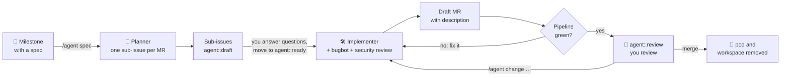

<p align="center">
  
</p>

<h1 align="center">ai-operator</h1>

<p align="center">
  <b>Coding agents that work through your GitLab board.</b><br>
  Write a spec in a milestone, move cards, review merge requests.<br>
  Claude Code and Cursor do the rest, in your own Kubernetes cluster.
</p>

<p align="center">
  <a href="https://gitlab.com/jo.wiemers/ai-operator/-/pipelines?ref=main"></a>
  <a href="https://github.com/jonathanwiemers/ai-operator/releases"></a>
  
  <a href="LICENSE"></a>
</p>

<p align="center">
  Open issues and merge requests on
  <a href="https://gitlab.com/jo.wiemers/ai-operator">GitLab</a>.
  GitHub mirrors <code>main</code> and builds the releases.
</p>

<p align="center">
  <a href="#how-it-works">How it works</a> ·
  <a href="#highlights">Highlights</a> ·
  <a href="#talk-to-it-in-gitlab">Commands</a> ·
  <a href="#quick-start">Quick start</a> ·
  <a href="#documentation">Docs</a>
</p>

---

## How it works

You stay in GitLab. ai-operator watches your milestones and issues, runs
headless coding agents (**Claude Code**, **Cursor CLI**) in a pod per issue,
and reports back on merge requests.



## Highlights

|  |  |
|--|--|
| 🧭 **Plans with you** | A planner breaks the milestone spec into one sub-issue per merge request, with a sub-spec, acceptance criteria, open questions and its decisions. You answer, then move the card. |
| 🛠️ **Implements and reviews** | The implementer works in steps you can follow and steer on a draft MR. Bugbot and security reviewers check every diff; blocking findings go back to the implementer. |
| 🟢 **Gets CI green** | The operator follows the pipeline, retries flaky jobs, and hands real failures back to the agent. An issue reaches review only with green CI. |
| 📝 **Describes its work** | Each MR gets a description of the whole change (why, what, how, verification) with a mermaid diagram where it helps. Your own text in it stays. |
| 💬 **Iterates by comment** | `/agent <what to change>` on the issue or MR. Plain discussion costs nothing. Merge conflicts with `main` are resolved by the agent too. |
| 🔔 **Pings you when needed** | Failed runs, questions, red CI, ready for review, autopilot pauses: the owners get mentioned and requested as reviewers. |
| 🚀 **Autopilot** | `/agent autopilot` in a milestone: agents take their defaults, work through the issues in dependency order and merge each MR once CI is green and the review is clean. |
| 📌 **Decisions you can revisit** | Every choice an agent makes is recorded with why and the alternatives. `/agent revisit D42-3 …` changes it, even after the merge. |
| ⚖️ **Right model for the job** | Profiles route each issue to a cheap or a strong model, Claude or Cursor. `/agent use claude opus high` overrides per issue, within the models you allow. |
| 🔒 **Isolated by design** | The model never sees the GitLab token or cluster credentials: a trusted runner and the agent container exchange commits only as git bundles ([security](docs/design.md#security)). |
| 🪙 **Easy on tokens** | Runs with your Claude or Cursor subscription. Sessions are resumed, pipelines are watched for free, pods stop right after each run, and usage limits pause runs instead of failing them. |
| 👀 **Web UI** | Optional read-only dashboard of boards, runs, CI and autopilot queues, with OIDC login and per-project roles ([web UI](docs/ui.md)). |

> **Status:** `v1alpha1`. Unit and end-to-end tests pass (fake GitLab, real
> git); real-world runs are tracked in the
> [sandbox test plan](docs/sandbox-test-plan.md).

## Talk to it in GitLab

```text
/agent also cover the error case          another run with your instructions
/agent revisit D42-3 keep the case as typed   change a recorded decision
/agent use claude opus high               pick model and effort for this issue
/agent use cursor auto                    … or a cheaper one, if your project allows it
/agent effort low                         just the effort
/agent pause | resume | skip #12          autopilot, on the tracking issue
```

In the milestone description: `/agent spec`, `/agent autopilot`,
`/agent owners @you`. The full list is in **[docs/commands.md](docs/commands.md)**.

## Quick start

**You need** a Kubernetes cluster with a default StorageClass, `helm` (or
Flux), a GitLab project with a **project access token** (role *Developer*,
scopes `api` and `write_repository`), and agent credentials:
`CLAUDE_CODE_OAUTH_TOKEN` (`claude setup-token`) or `ANTHROPIC_API_KEY`,
and/or `CURSOR_API_KEY`.

**1. Install the operator**

```sh
helm install ai-operator oci://ghcr.io/jonathanwiemers/charts/ai-operator \
  --namespace ai-operator-system --create-namespace \
  --set 'agent.namespaces={agents}' --set agent.createNamespaces=true
```

This installs the CRDs and the operator, and prepares the `agents` namespace
for agent pods. Pin `--version` from the
[releases](https://github.com/jonathanwiemers/ai-operator/releases) for
production. Using Flux? See
[Install with Flux](docs/configuration.md#install-with-flux).

**2. Add the credentials**

```sh
kubectl -n agents create secret generic gitlab --from-literal=token=glpat-…
kubectl -n agents create secret generic agent-credentials \
  --from-literal=CLAUDE_CODE_OAUTH_TOKEN="…" \
  --from-literal=CURSOR_API_KEY="…"          # only if you use cursor
```

**3. Prepare GitLab:** the workflow labels, and a protected default branch
(the agent only pushes `agent/*` branches)

```sh
GITLAB_PROJECT=my-group/shop GITLAB_TOKEN=glpat-… ./hack/sandbox/gitlab-setup.sh
```

A board with the columns `agent::draft`, `agent::ready`, `agent::working`,
`agent::needs-input`, `agent::review` and `agent::done` makes it easy to
follow.

**4. Connect the project**

```yaml
apiVersion: ai.wiemers.me/v1alpha1
kind: AgentProject
metadata:
  name: shop
  namespace: agents
spec:
  gitlab:
    project: my-group/shop
    tokenSecretRef: {name: gitlab, key: token}
  agents:
    credentialsSecretName: agent-credentials
  notify:
    users: [your-gitlab-username]     # who gets pinged
```

```sh
kubectl apply -f shop.yaml
kubectl -n agents get agentprojects       # LAST SYNC is set within a minute
```

Everything else has defaults: Opus for planning, a `fast` (Sonnet) and a
`strong` (Opus) profile, Sonnet for reviews and MR descriptions, two CI fix
rounds. [`config/samples/agentproject.yaml`](config/samples/agentproject.yaml)
shows a full example with Cursor and custom profiles. If your repository
needs more than Node to build and test, use your
[own agent image](docs/configuration.md#agent-image).

**5. Plan a milestone**

Put the spec in a milestone description, with the marker:

```markdown
/agent spec

## Goal
Customers can pay with PayPal in the new checkout.

## Requirements
- …
```

Within a minute sub-issues labelled `agent::draft` appear. Answer their
questions, move one to **`agent::ready`**, and watch:

```sh
kubectl -n agents get agenttasks -w                     # phase, result, CI, runs, cost
kubectl -n agents logs -f shop-42-add-paypal-button -c runner
```

The draft MR shows the run live. Once CI is green the issue moves to
`agent::review`, and it's your turn.

## Documentation

| | |
|-|-|
| [Usage](docs/usage.md) | the GitLab workflow: labels, milestone specs, decisions, CI, autopilot, owners, lifecycle |
| [Commands](docs/commands.md) | every `/agent` command and the labels behind them |
| [Configuration](docs/configuration.md) | installation (Helm, Flux), secrets, `AgentProject` reference, engines, profiles, models, agent image |
| [Design](docs/design.md) | architecture, CRDs, pod topology, token economy, security |
| [Web UI](docs/ui.md) | the optional read-only UI: OIDC login, roles, HTTPRoute, API |
| [Helm chart](charts/ai-operator/README.md) | chart values |
| [Releasing](docs/releasing.md) | calendar versions, release workflow, published images and chart |
| [Sandbox test plan](docs/sandbox-test-plan.md) | end-to-end test with a real GitLab project and the real agent CLIs |

## Development

Requires Go 1.26 (and Node 22 for the web UI).

```sh
make generate manifests   # deepcopy, CRDs, RBAC (controller-gen)
make test                 # unit tests + end-to-end runner test against a local git repo
make helm-lint            # lint and render the chart
make run                  # run the operator against your current kubeconfig
make ui                   # build the web UI, embedded into the ui binary
make run-ui               # run the web UI without login on http://127.0.0.1:9080
make test-db              # start a Postgres in docker for the research store tests
make test-db-stop         # stop it
```

The research store tests (`internal/research/store`) run against a real
Postgres: export the `AI_TEST_DATABASE_URL` that `make test-db` prints before
`make test`. Without it they are skipped; CI sets
`AI_TEST_REQUIRE_DATABASE=1`, so there they fail instead. Each test works in
a schema and with login roles of its own, dropped afterwards.

A merge to `main` does not release by itself: a release is a decision (the
operator's or a human's) and gets a calendar version (`2026.10.1`,
`2026.10.2`, …), see [releasing](docs/releasing.md).

## Security

Please report vulnerabilities privately, see [SECURITY.md](SECURITY.md).

## License

[Apache License 2.0](LICENSE)
