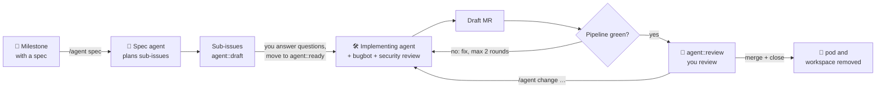

<p align="center">
  
</p>

<h1 align="center">ai-operator</h1>

<p align="center">
  <b>Coding agents that work through your GitLab board.</b><br>
  Write a spec in a milestone, move cards, review merge requests. The agents do the rest, in your Kubernetes cluster.
</p>

<p align="center">
  <a href="https://github.com/jonathanwiemers/ai-operator/actions/workflows/ci.yml"></a>
  <a href="https://github.com/jonathanwiemers/ai-operator/releases"></a>
  
  <a href="LICENSE"></a>
</p>

---

## What it does

ai-operator is a Kubernetes operator that connects a GitLab project to
headless coding agents (**Claude Code** and **Cursor CLI**). You stay in
GitLab; every agent run happens in a pod of its own.



- **Plan.** A spec agent breaks the milestone spec into **one sub-issue per
  merge request**. Each sub-issue has a sub-spec, acceptance criteria, open
  questions and a profile label (`agent-profile::fast` or `::strong`).
- **Implement.** Move an issue to `agent::ready`. An agent implements it,
  **bugbot and security reviewers** check the diff, and a **draft MR** is
  opened.
- **Wait for CI.** The operator follows the pipeline, retries flaky jobs and
  lets the agent fix real failures. The issue moves to `agent::review` only
  once CI is green.
- **Iterate.** Comment `/agent <what to change>` on the issue or the MR.
  Plain discussion costs nothing.
- **Merge conflicts.** When `main` moves on and the MR conflicts, the agent
  merges `main` into its branch and resolves the conflicts; the result is
  reviewed and checked by CI like any push.
- **Autopilot.** With `/agent autopilot` in the milestone, the agents take
  their defaults instead of asking, and the operator works through the issues
  one at a time and merges each MR once CI is green and the review is clean.
  Every decision is posted with an ID you can `/agent revisit` later, even
  after the merge: a follow-up issue changes it.
- **Clean up.** Close the issue, and the pod and workspace are removed. Pods
  only run while an agent works: right after each run the pod stops, and the
  workspace keeps the checkout, caches and agent session for the next run.

**Built for subscriptions and token efficiency.** The agent CLIs run with
your Claude Pro/Max or Cursor subscription, or with API keys. Strong models
are used only for planning and `strong` issues. Sessions are resumed instead
of re-sent, and pipelines are watched without spending tokens. Usage limits
pause runs instead of failing them.

**Isolated by design.** The model never sees the GitLab token or Kubernetes
credentials. Each pod splits into a trusted runner and an agent container
that exchange commits only as git bundles ([security](docs/design.md#security)).

> **Status:** `v1alpha1`. Unit and end-to-end tests pass (fake GitLab, real
> git). Real-world runs are tracked in the
> [sandbox test plan](docs/sandbox-test-plan.md).

## Getting started

### 1. Prerequisites

- A Kubernetes cluster with a default StorageClass, and `helm` (or Flux)
- A GitLab project and a **project access token** with role *Developer* and
  scopes `api` and `write_repository`
- Agent credentials, at least one of:
  - `CLAUDE_CODE_OAUTH_TOKEN` from `claude setup-token` (Claude subscription),
    or `ANTHROPIC_API_KEY`
  - `CURSOR_API_KEY` (Cursor subscription)

### 2. Install the operator

```sh
helm install ai-operator oci://ghcr.io/jonathanwiemers/charts/ai-operator \
  --version 2026.10.3 \
  --namespace ai-operator-system --create-namespace \
  --set 'agent.namespaces={agents}' --set agent.createNamespaces=true
```

This installs the CRDs and the operator, and prepares the `agents` namespace
for agent pods. Pick the newest version from the
[releases](https://github.com/jonathanwiemers/ai-operator/releases). Using
Flux? See [Install with Flux](docs/configuration.md#install-with-flux).

### 3. Add the credentials

```sh
kubectl -n agents create secret generic gitlab \
  --from-literal=token=glpat-…

kubectl -n agents create secret generic agent-credentials \
  --from-literal=CLAUDE_CODE_OAUTH_TOKEN="…" \
  --from-literal=CURSOR_API_KEY="…"          # only if you use cursor
```

### 4. Prepare GitLab

Create the workflow labels and protect your default branch (the agent only
pushes `agent/*` branches):

```sh
GITLAB_PROJECT=my-group/shop GITLAB_TOKEN=glpat-… ./hack/sandbox/gitlab-setup.sh
```

Optionally, add an issue board with the columns `agent::draft`,
`agent::ready`, `agent::working`, `agent::needs-input`, `agent::review` and
`agent::done`.

### 5. Connect the project

```yaml
# shop.yaml
apiVersion: ai.wiemers.me/v1alpha1
kind: AgentProject
metadata:
  name: shop
  namespace: agents
spec:
  gitlab:
    url: https://gitlab.com
    project: my-group/shop
    tokenSecretRef: {name: gitlab, key: token}
  agents:
    credentialsSecretName: agent-credentials
```

```sh
kubectl apply -f shop.yaml
kubectl -n agents get agentprojects       # LAST SYNC is set within a minute
```

Everything else has defaults: Opus for planning and unlabelled issues, the
`fast` (Sonnet) and `strong` (Opus) profiles, Sonnet reviews, 2 CI fix
rounds. See [`config/samples/agentproject.yaml`](config/samples/agentproject.yaml)
for a full example with Cursor and custom profiles. If your repository needs
more than Node to build and test, use your
[own agent image](docs/configuration.md#agent-image).

### 6. Plan your first milestone

Create a milestone and put the spec in its description, together with the
marker `/agent spec`:

```markdown
/agent spec

## Goal
Customers can pay with PayPal in the new checkout.

## Requirements
- …
```

Within a minute a pod like `shop-spec-m3-checkout-v2` starts, and sub-issues
labelled `agent::draft` appear in the milestone. Answer their questions in
the comments, then move an issue to **`agent::ready`**.

### 7. Watch it work

```sh
kubectl -n agents get agenttasks -w                     # phase, result, CI, runs, cost
kubectl -n agents logs -f shop-42-add-paypal-button -c runner
```

The draft MR shows up in GitLab. Once CI is green the issue moves to
`agent::review`, and it's your turn.

## Documentation

| | |
|-|-|
| [Usage](docs/usage.md) | the GitLab workflow: labels, milestone specs, commands, CI feedback, lifecycle |
| [Configuration](docs/configuration.md) | installation (Helm, Flux), secrets, `AgentProject` reference, engines, profiles, agent image |
| [Design](docs/design.md) | architecture, CRDs, pod topology, token economy, security, roadmap |
| [Helm chart](charts/ai-operator/README.md) | chart values |
| [Releasing](docs/releasing.md) | calendar versions, release workflow, published images and chart |
| [Sandbox test plan](docs/sandbox-test-plan.md) | end-to-end test on kind with a real GitLab project and the real agent CLIs |

## Development

Requires Go 1.26.

```sh
make generate manifests   # deepcopy, CRDs, RBAC (controller-gen)
make test                 # unit tests + end-to-end runner test against a local git repo
make helm-lint            # lint and render the chart
make run                  # run the operator against your current kubeconfig
```

Releases use calendar versions (`2026.10.1`, `2026.10.2`, …) and are cut
automatically from `main`, see [releasing](docs/releasing.md).

## Security

Please report vulnerabilities privately, see [SECURITY.md](SECURITY.md).

## License

[Apache License 2.0](LICENSE)
