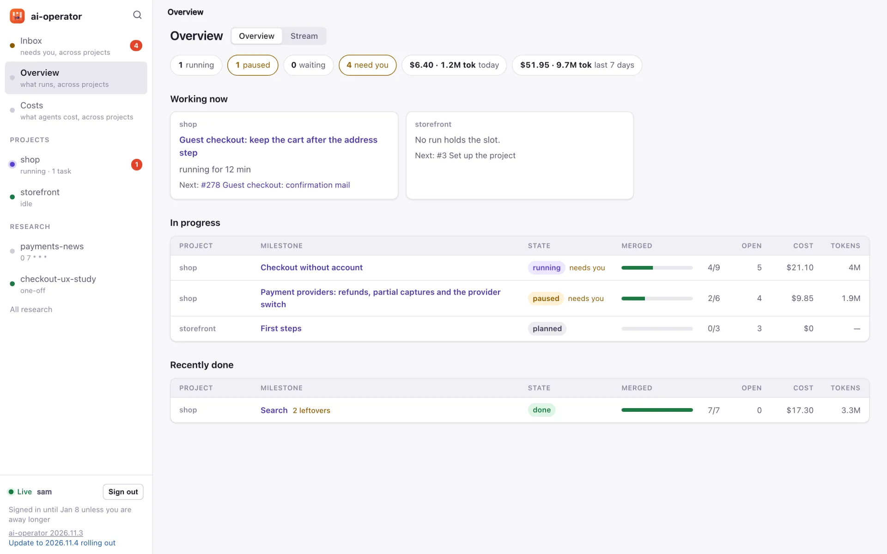

<p align="center">
  
</p>

<h1 align="center">ai-operator</h1>

<p align="center">
  <b>Coding agents that build a GitLab milestone on autopilot.</b><br>
  Write the spec, and steer from the Desk while a pilot keeps it moving.<br>
  Claude Code and Cursor do the work, in your own Kubernetes cluster.
</p>

<p align="center">
  <a href="https://github.com/jonathanwiemers/ai-operator/actions/workflows/ci.yml"></a>
  <a href="https://github.com/jonathanwiemers/ai-operator/releases"></a>
  
  <a href="LICENSE"></a>
</p>

<p align="center">
  Built in GitLab by its own agents, mirrored here.
  Issues and pull requests are welcome on GitHub, see
  <a href="CONTRIBUTING.md">CONTRIBUTING.md</a>.
</p>

<p align="center">
  <a href="#how-it-works">How it works</a> ·
  <a href="#highlights">Highlights</a> ·
  <a href="#steer-it">Steer it</a> ·
  <a href="#quick-start">Quick start</a> ·
  <a href="#documentation">Docs</a>
</p>

---

## How it works

You write the spec in a GitLab milestone and steer from the Desk.
ai-operator plans the milestone into issues, runs headless coding agents
(**Claude Code**, **Cursor CLI**) in a pod per issue, merges and releases.
Each milestone has a pilot. It fixes what goes wrong where it can, asks you
when it needs a decision, and answers when you ask where things stand.

<p align="center">
  
</p>

Put `/agent spec` and `/agent autopilot` in the milestone description, and
it runs end to end. The planner splits the spec into one issue per merge
request and takes a default for each open point, recorded as a decision.
Each issue starts once the issues it depends on are merged. An agent pushes
its work to a draft merge request and fixes red CI. Reviewers check every
change. The operator merges once CI is green and the review is clean, and
tags the releases the plan asks for. Without autopilot you answer the
planner's questions and hand each issue over yourself
([Answer and hand over](docs/guides/answer-and-hand-over.md)).

You steer from the [Desk](docs/guides/desk.md), the operator's web UI. Ask
the milestone's pilot where things stand, chat with the agent on a task,
answer prompts, and revisit decisions. The Desk also shows what runs now,
every milestone in work with its progress, cost and tokens, and what needs
you ([Steer from the Desk](docs/guides/steer-from-the-desk.md)).

<p align="center">
  <picture>
    <source media="(prefers-color-scheme: dark)" srcset="docs/assets/screenshots/dashboard-dark.webp">
    
  </picture>
</p>

## Highlights

|  |  |
|--|--|
| 🚀 **Autopilot** | `/agent autopilot` in a milestone: issues run in dependency order, several at once, and each merge request is merged once CI is green and the review is clean. The planner puts release points into the plan and the operator tags them as the queue gets there; an owner's `/agent release` on the tracking issue cuts one in between ([autopilot](docs/guides/autopilot.md), [releases](docs/guides/releases.md)). |
| 🧑‍✈️ **A pilot per milestone** | It assesses what goes wrong (a pause, red CI, a run that hangs) and fixes it on its own within limits: run the issue again, rebase, ask for another review. Anything else becomes a prompt to you. Ask it anything in the Desk or with `/pilot`. When the milestone is done, it writes the retrospective ([pilot](docs/guides/pilot.md)). |
| 🧭 **Plans with you** | A planner breaks the milestone spec into one sub-issue per merge request, with a sub-spec, acceptance criteria and its decisions. On autopilot it takes a default for each open point; otherwise you answer its questions in the Desk or on the issue. |
| 🛠️ **Implements and reviews** | The implementer works in steps on a draft MR. Bugbot and security reviewers check every diff, and blocking findings go back to the implementer. Each MR gets a description of the whole change (why, what, how, verification); your own text in it stays. |
| 🟢 **Gets CI green** | The operator follows the pipeline, retries flaky jobs, and hands real failures and merge conflicts with `main` back to the agent. Nothing merges without green CI. |
| 💬 **Chat with the agent** | In the Desk, chat with the agent on a task while it works or after it is done. `/agent <what to change>` on the issue or MR does the same from GitLab, and plain discussion costs nothing ([steering](docs/guides/steer-from-the-desk.md)). |
| 🔔 **Pings you when needed** | Prompts, questions, pauses and work ready for review land in the Desk's inbox, with browser notifications if you like. In GitLab the milestone's owners get mentioned and requested as reviewers ([owners and pings](docs/guides/owners-and-pings.md)). |
| 📌 **Decisions you can revisit** | Every choice an agent makes is recorded with why and the alternatives. Revisit it in the Desk or with `/agent revisit D42-3 …`, even after the merge. |
| 💰 **Spend and budgets** | What every agent call costs, per run, issue and milestone, on the Desk's Costs page. An `/agent budget 40` line in the milestone description gives it a budget: the owners get a prompt at 80 %, and autopilot pauses at 100 % ([budgets and spend](docs/guides/budgets-and-spend.md)). |
| 🩺 **Hung runs get restarted** | A watchdog notices runs that log nothing for a long time or whose pod cannot start. On autopilot the pilot restarts them, and an owner can with one click in the Desk ([when runs go wrong](docs/guides/when-runs-go-wrong.md)). |
| 🪙 **Easy on tokens** | Runs with your Claude or Cursor subscription. Profiles route each issue to a cheap or a strong model, and `/agent use claude opus high` overrides it within the models you allow. Sessions are resumed, pipelines are watched for free, pods stop right after each run, and usage limits pause runs instead of failing them. |
| 🔒 **Isolated by design** | The model never sees the GitLab token or cluster credentials: a trusted runner and the agent container exchange commits only as git bundles ([security](docs/concepts/security.md)). |

> **Status:** `v1alpha1`, in real use: the recent milestones of this
> repository, such as the run watchdog, parallel issues and this
> documentation, were planned and built on autopilot
> ([specs](docs/specs/README.md)). Unit and end-to-end tests (fake GitLab,
> real git) run on every change, and the
> [sandbox test plan](docs/contributing/sandbox-test-plan.md) covers a real
> GitLab project with the real agent CLIs.

## Steer it

**In the Desk.** At the bottom of a milestone's *Cockpit* you ask the pilot where things
stand; its prompts wait on the *Needs you* tab. On a task you chat with its agent, or restart
a run that hangs. **Revisit** next to a decision asks whether it should
stay, and pause cards offer the ways out of a pause. Your *Inbox* collects
everything that waits for you, across projects
([Steer from the Desk](docs/guides/steer-from-the-desk.md)).

**In GitLab**, with comments on an issue or its merge request:

```text
/agent also cover the error case              another run with your instructions
/agent revisit D42-3 keep the case as typed   change a recorded decision
/agent use claude opus high                   pick model and effort for this issue
/pilot why are we paused?                     ask the milestone's pilot
```

On the milestone's tracking issue:

```text
/agent pause | resume | skip #12              hold or steer autopilot
/agent release the new checkout is ready      owners: release once main is green
```

Restarting a run that hangs is a Desk action: `/agent restart` in a
comment is no command.

**In the milestone description**, with marker lines:

```text
/agent spec                                   plan the milestone
/agent autopilot                              and run it end to end
/agent owners @alice                          who gets mentioned in GitLab
/agent owner-subjects alice@example.com       who answers prompts in the Desk
/agent budget 40                              the milestone's budget in USD
```

Every command and marker line is in **[Commands](docs/reference/commands.md)**.

## Quick start

The full path, from an empty cluster to a milestone on autopilot with the
Desk, is in **[Getting started](docs/getting-started/README.md)**.

**You need** a Kubernetes cluster with a default StorageClass, `helm` (or
Flux), a GitLab project with a **project access token** (role *Developer*,
scopes `api` and `write_repository`), and agent credentials:
`CLAUDE_CODE_OAUTH_TOKEN` (`claude setup-token`) or `ANTHROPIC_API_KEY`,
and/or `CURSOR_API_KEY`. For the Desk: a Postgres database, an OIDC
provider, and a Gateway (Kubernetes Gateway API) for its host name.

**1. Install the operator**

```yaml
# values.yaml
agent:
  namespaces: [agents]
  createNamespaces: true
```

```sh
helm upgrade --install ai-operator oci://ghcr.io/jonathanwiemers/charts/ai-operator \
  --namespace ai-operator-system --create-namespace -f values.yaml
```

This installs the CRDs and the operator, and prepares the `agents` namespace
for agent pods. Pin `--version` from the
[releases](https://github.com/jonathanwiemers/ai-operator/releases) for
production. Using Flux? See
[Install with Flux](docs/getting-started/install.md#install-with-flux).

**2. Add the credentials**

```sh
kubectl -n agents create secret generic gitlab --from-literal=token=glpat-…
kubectl -n agents create secret generic agent-credentials \
  --from-literal=CLAUDE_CODE_OAUTH_TOKEN="…" \
  --from-literal=CURSOR_API_KEY="…"          # only if you use cursor
```

**3. Prepare GitLab:** the workflow labels, and a protected default branch
(the agent only pushes `agent/*` branches)

```sh
GITLAB_PROJECT=my-group/shop GITLAB_TOKEN=glpat-… ./hack/sandbox/gitlab-setup.sh
```

**4. Connect the project**

```yaml
apiVersion: ai.wiemers.me/v1alpha1
kind: AgentProject
metadata:
  name: shop
  namespace: agents
spec:
  gitlab:
    project: my-group/shop
    tokenSecretRef: {name: gitlab, key: token}
  agents:
    credentialsSecretName: agent-credentials
    chat: true                    # take answers and chat from the Desk
  notify:
    users: [alice]                # the owners: GitLab usernames, without @
```

```sh
kubectl apply -f shop.yaml
kubectl -n agents get agentprojects       # LAST SYNC is set within a minute
```

Everything else has defaults. Every role runs on Claude: Opus 5.5 for
planning and implementing, with a `fast` (Sonnet 5.5) and a `strong`
(Opus 5.5) profile, and Sonnet 5.5 for the reviewers (bugbot and security),
the MR descriptions and the pilot. CI failures get two fix rounds. The
defaults are in [Agents and models](docs/reference/agents-and-models.md) and
[AgentProject](docs/reference/agentproject.md). If your repository needs
more than Node to build and test, use your
[own agent image](docs/reference/agent-image.md).

**5. Turn on the Desk**

[Add the database](docs/getting-started/install.md#add-the-database) first:
it keeps your answers, the chats and the spend. Then create the Desk's
Secret and add the `ui` block to `values.yaml`:

```sh
kubectl -n ai-operator-system create secret generic ai-operator-ui \
  --from-literal=session-key="$(openssl rand -hex 32)"
```

```yaml
ui:
  enabled: true
  externalURL: https://ai.example.com
  oidc:
    issuerURL: https://login.example.com
    clientID: ai-operator
    existingSecret: ai-operator-ui
  authorization:
    rules:
      - roles: [ai-operator-admin]     # your provider's role
        transcript: true               # live transcripts of the runs
        chat: true                     # answer prompts, chat with agents
  chat:
    writerSecret:                      # the chat writer login of the database
      name: research-chat-writer.ai-operator-postgres.credentials.postgresql.acid.zalan.do
  httpRoute:
    enabled: true
    parentRefs: [{name: public, namespace: gateway-system, sectionName: https}]
```

Run the Helm command again and log in at `https://ai.example.com`. Your user
name is at the bottom of the rail. The OIDC client and your provider's role
claim are in [Turn on the Desk](docs/getting-started/turn-on-the-desk.md).

**6. Run a milestone on autopilot**

Put the spec in a milestone description, with the marker lines:

```markdown
/agent spec
/agent autopilot
/agent owners @alice
/agent owner-subjects alice@example.com

## Goal
Users can switch the shop between a light and a dark theme.

## Requirements
- …
```

`owners` are GitLab usernames, `owner-subjects` the Desk user names that may
answer this milestone's prompts. The milestone shows up on the Desk's
*Overview*. The planner splits it into issues, and the first one starts as
soon as it is planned. Its task page shows the merge request, the run as it
happens, CI and cost.

**7. Answer the first prompt**

When the pilot needs a decision, a prompt with two to four options lands in
your *Inbox* and on the milestone's *Needs you* tab. To try it right away, wait
until the first issue is done and click **Revisit** next to one of its
decisions: the prompt asks whether the decision stays. Pick an option, and
the card says who answered
([Your first milestone](docs/getting-started/first-milestone.md#4-answer-a-prompt)).

## Documentation

Start at **[docs/README.md](docs/README.md)**, the map of every page.

| | |
|-|-|
| [Getting started](docs/getting-started/README.md) | install (Helm, Flux), secrets and the database, turn on the Desk, your first milestone |
| [Guides](docs/guides/README.md) | one task per page: write a milestone, autopilot, the pilot, the Desk and steering from it, pauses, when runs go wrong, budgets and spend, releases, cross-repo changes, research |
| [Reference](docs/reference/README.md) | every command and marker line, the labels, every `AgentProject` field with its default, agents and models, the Desk API; chart values are in the [chart README](charts/ai-operator/README.md) |
| [Concepts](docs/concepts/README.md) | how it works, the roles, security, the glossary |
| [Contributing](docs/contributing/README.md) | design, web UI development, releasing, the sandbox test plan |
| [Specs](docs/specs/README.md) | the milestone specs behind each feature, with the decisions of their time |

## Development

Requires Go 1.26 (and Node 22 for the web UI).

```sh
make generate manifests   # deepcopy, CRDs, RBAC (controller-gen)
make test                 # unit tests + end-to-end runner test against a local git repo
make helm-lint            # lint and render the chart
make run                  # run the operator against your current kubeconfig
make ui                   # build the web UI, embedded into the ui binary
make run-ui               # run the web UI without login on http://127.0.0.1:9080
make test-db              # start a Postgres in docker for the research store tests
make test-db-stop         # stop it
```

The research store tests (`internal/research/store`) run against a real
Postgres: export the `AI_TEST_DATABASE_URL` that `make test-db` prints before
`make test`. Without it they are skipped; CI sets
`AI_TEST_REQUIRE_DATABASE=1`, so there they fail instead. Each test works in
a schema and with login roles of its own, dropped afterwards.

For the web UI (local setup, browser checks, bundle budget, UI kit), see
[Web UI development](docs/contributing/web-ui.md).

A merge to `main` does not release by itself: a release is a decision (the
operator's or a human's) and gets a calendar version (`2026.10.1`,
`2026.10.2`, …), see [releasing](docs/contributing/releasing.md).

## Contributing

See [CONTRIBUTING.md](CONTRIBUTING.md).

## Security

Please report vulnerabilities privately, see [SECURITY.md](SECURITY.md).

## License

[Apache License 2.0](LICENSE)
