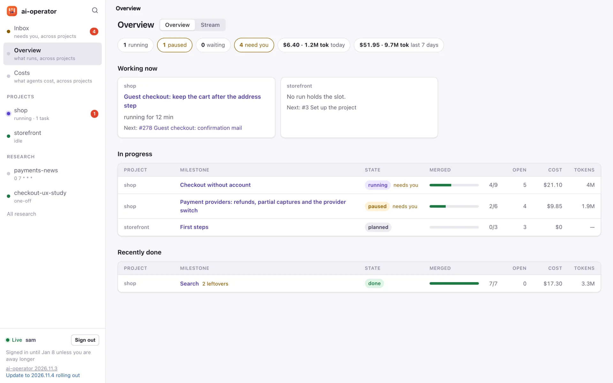

# Documentation

ai-operator turns GitLab milestones and issues into work for coding agents in
Kubernetes. The docs are in four sections for users, Getting started,
Guides, Reference and Concepts, plus a section for contributors and the
specs behind each feature. New here? Start with Getting started.

The docs are being reorganised into these sections. Until a page has moved,
it is listed under [Pages being moved](#pages-being-moved).

## Getting started

**[getting-started/](getting-started/README.md)**: install the operator,
turn on the Desk and get your first milestone planned.

## Guides

**[guides/](guides/README.md)**: one task per page, from writing a
milestone to running it on autopilot and steering it from the Desk.

## Reference

**[reference/](reference/README.md)**: every `/agent` command in
[commands](reference/commands.md), the [labels](reference/labels.md), the
`AgentProject` fields and the Desk API, for looking things up.

## Concepts

**[concepts/](concepts/README.md)**: [how it works](concepts/how-it-works.md),
the [roles](concepts/roles.md) of the agents,
[security](concepts/security.md) and a [glossary](concepts/glossary.md).

## Contributing

**[contributing/](contributing/README.md)**: the design, web UI
development, releasing and the sandbox test plan, for people who work on
ai-operator itself.

## Specs

**[specs/](specs/README.md)**: the specs behind each feature, with the
problem, the decisions and how it was split into merge requests. Read one
to learn why something works the way it does.

## Pages being moved

The old pages, until their sections have moved to the sections above. The
[docs revamp spec](specs/docs-revamp.spec.md#inventory) lists where each
section goes.

- **[Usage](usage.md)**: the GitLab workflow. Labels, milestone specs,
  questions and decisions, CI, autopilot and its pauses, the pilot, owners,
  budgets and the retrospective.
- **[Configuration](configuration.md)**: installation with Helm or Flux,
  secrets, the `AgentProject` reference, engines, profiles, models and the
  agent image. Chart values are in the
  [Helm chart README](../charts/ai-operator/README.md).
- **[Web UI](ui.md)**: the Desk. What it shows
  ([screenshots](ui.md#screenshots)), OIDC login, roles, steering and the
  API.
- **[Research](research.md)**: news flashes, scheduled and one-off
  researches next to the projects, with their own database.

## Assets

**[assets/](assets/README.md)**: the logo, the architecture diagram and the
Desk screenshots used in these pages.
