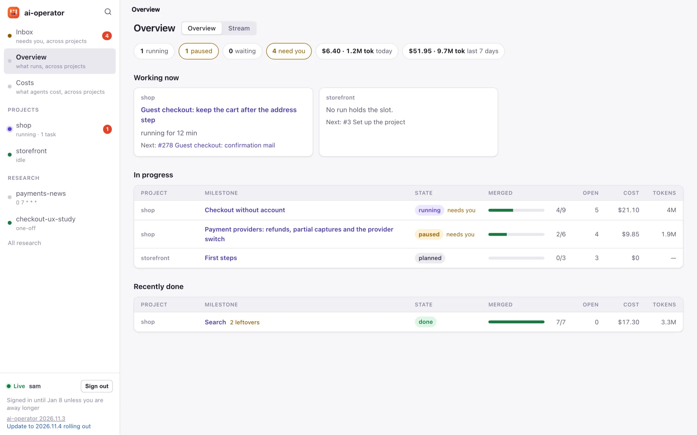

# Documentation

ai-operator turns GitLab milestones and issues into work for coding agents in
Kubernetes. These pages go from using it in GitLab, through installing and
configuring it, to how it is built. New here? Read them in this order.

## Use it

1. **[Usage](usage.md)**: the GitLab workflow. Labels, milestone specs,
   questions and decisions, CI, autopilot and its pauses, the pilot, owners,
   budgets and the retrospective.
2. **[Commands](commands.md)**: every `/agent` command and the labels behind
   them, for looking things up while you work.

## Run it

3. **[Configuration](configuration.md)**: installation with Helm or Flux,
   secrets, the `AgentProject` reference, engines, profiles, models and the
   agent image. Chart values are in the
   [Helm chart README](../charts/ai-operator/README.md).
4. **[Web UI](ui.md)**: the optional Desk. What it shows
   ([screenshots](ui.md#screenshots)), OIDC login, roles, steering, the API
   and how to develop and check it.
5. **[Research](research.md)**: news flashes, scheduled and one-off
   researches next to the projects, with their own database.

## Understand and maintain it

6. **[Design](design.md)**: architecture, CRDs, pod topology, token economy
   and security.
7. **[Releasing](releasing.md)**: calendar versions, who decides a release,
   the release pipelines, published images and chart.
8. **[Sandbox test plan](sandbox-test-plan.md)**: an end-to-end run with a
   real GitLab project and the real agent CLIs.

## Folders

- **[specs/](specs/README.md)**: the specs behind each feature, with the
  problem, the decisions and how it was split into merge requests. Read one
  to learn why something works the way it does.
- **[assets/](assets/README.md)**: the logo, the architecture diagram and the
  Desk screenshots used in these pages.
