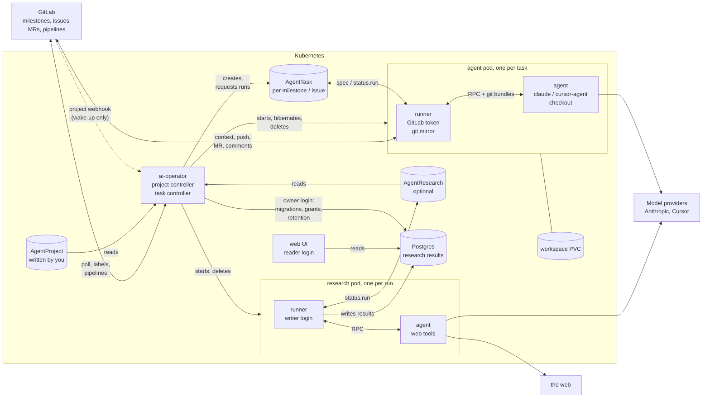
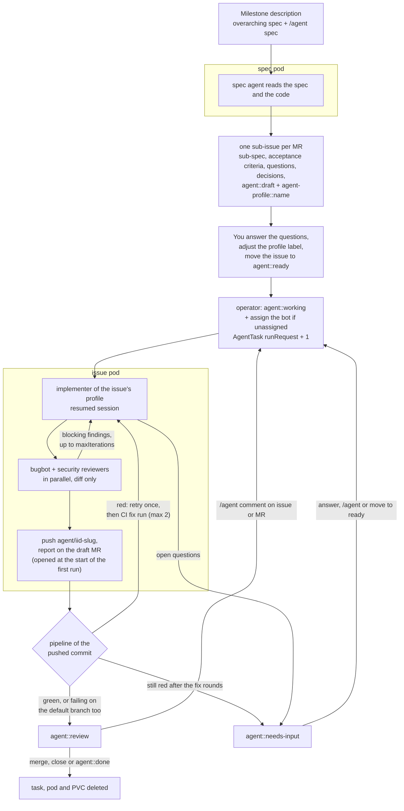
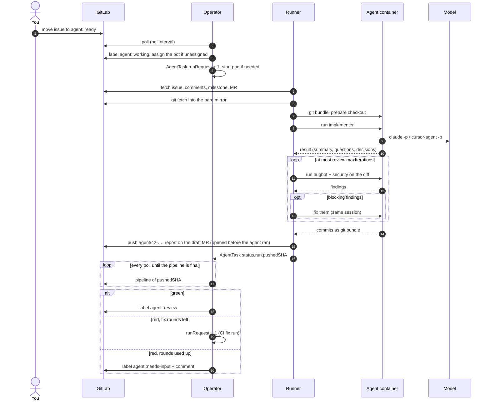
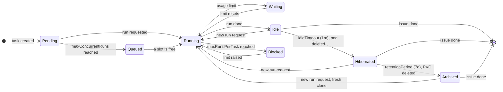
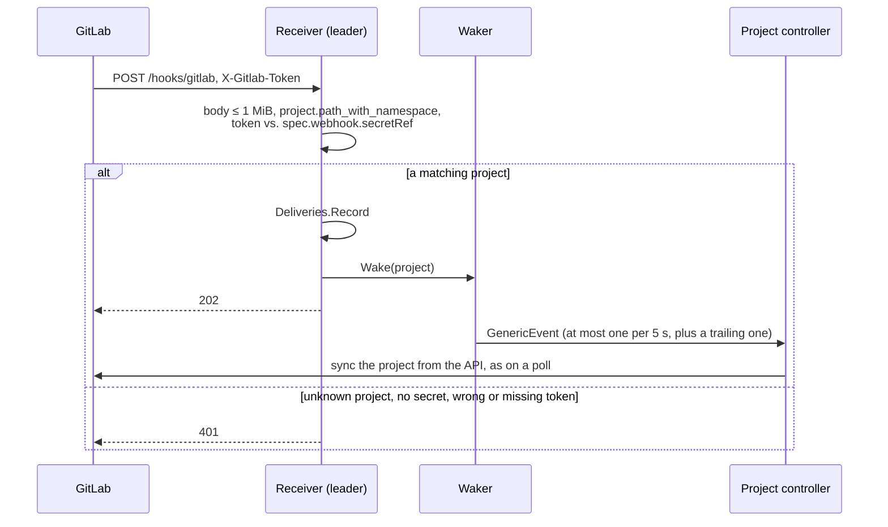
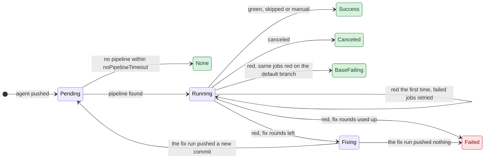
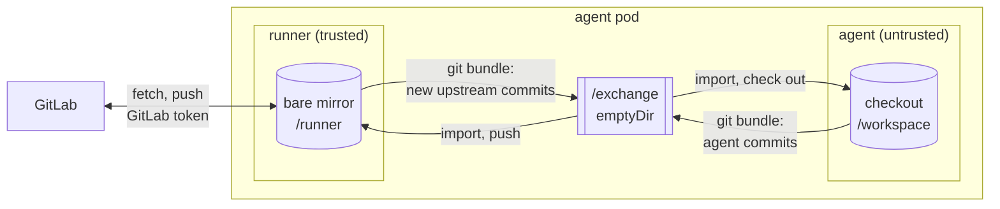

# ai-operator design

The operator turns GitLab milestones and issues into work for coding agents
running in Kubernetes pods. A milestone runs on autopilot; the pilot handles
what goes wrong, and you steer from the Desk. For the user-facing workflow
see the [guides](../guides/README.md), for all settings the
[AgentProject reference](../reference/agentproject.md) and
[Install](../getting-started/install.md) for installation.

**Status:** v1alpha1, first version. Unit and end-to-end tests (fake GitLab,
fake agent, real git) pass. It has not yet run against a real cluster, a real
GitLab instance or the real agent CLIs.

## Architecture



The operator runs in `ai-operator-system`; projects, tasks and agent pods
live in the namespaces listed in the chart's `agent.namespaces`. The research
part (lower half) exists only with a research database
(`research.database.host`); without one, the operator, the chart and the UI
run only the factory.

* The **project controller** polls GitLab, creates an `AgentTask` per planned
  milestone and per handed-over issue, turns `agent::ready` and `/agent`
  comments into run requests, follows pipelines, and deletes tasks of
  finished issues. A GitLab project webhook wakes it within seconds (see
  [GitLab webhooks](#gitlab-webhooks)); polling stays the fallback.
* The **task controller** owns the pod and the workspace PVC of each task:
  it starts, queues, hibernates and archives them (see
  [Lifecycle](#lifecycle-of-long-lived-issues)).
* The **runner** does one run per request: it collects the context from
  GitLab, drives the agent CLIs in the agent container, and publishes the
  result (branch, MR, comments, labels).
* The **agent container** runs the agent CLIs on the checkout. It has the
  model credentials, nothing else (see [Security](#security)).
* The optional **web UI** (`ai-operator-ui`, [The Desk](../guides/desk.md)) shows the tasks
  of the projects a user's OIDC roles grant. It only reads AgentProjects and
  AgentTasks from the Kubernetes API and never uses the operator's GitLab
  token; with a user's GitLab account connected it reads threads and posts
  comments (also the milestone chat to the pilot) with that user's token.
* The optional **research controller** ([Research internals](research.md)) runs
  each `AgentResearch` once or on its cron schedule: it chooses the agent
  from the usage left, starts one pod per run without git, and records the
  outcome. The runner of that pod asks the agent, validates the answer
  against the block schema and writes it to **Postgres**.
* The database has **three logins**, each with only what its holder needs:
  the operator's **owner** login (migrations, grants, hourly retention
  delete), the UI's **reader** login (read only), and a **writer** login per
  AgentProject (`spec.research.writerSecret`) that only the runner container
  of research pods gets (read, insert, update). The agent container gets
  none.

## Flow



A single run of an issue, step by step:



**The MR first.** The first run opens the draft MR before the agent starts,
so every run of the issue can be followed in one place. A new branch gets an
empty start commit, made with `git commit-tree` in the runner's trusted
mirror and pushed with `ci.skip`; its message is one line without `[skip
ci]`, which merge commit templates could copy to the default branch. The
agent's checkout is then prepared again on top of it, and the MR is recorded
in the task status at once, so a run deferred or failing later reuses it. A
branch whose head changes nothing against the default branch is never taken
over as a push for CI.

**Draft until reviewed.** The MR is a draft while the agent works. A run whose
review is clean (no blocker or major findings, no failed reviewer, no
questions, and changes against the default branch) marks it ready *before*
pushing, so the push gets its pipeline also in projects that skip drafts; a
run that leaves problems marks it draft again. CI then runs, CI fix rounds
follow, and a ready, green MR is what a human (or autopilot) merges.

**Live progress.** The run log has a change hook: every step start and end
re-renders a progress comment on the MR (hidden marker, open details block,
the running step marked). Edits are sent by a timer goroutine, at most every
3 seconds, so a slow GitLab never holds up the run and a long step still
shows; the body is rendered on the run's goroutine, the timer only sends it.
When the run ends the comment is deleted (the report follows as a new
comment, so watchers are notified), or keeps the final run log under a failed
or paused headline; this also happens while the pod stops, with a context
that outlives the shutdown. A live comment a killed run left behind is
removed by the next run. Progress comments are kept out of the agent's
prompt.

**The description describes the branch.** After the push, a read-only
describe agent (light model, no session) gets the issue, the run's summary,
the previous description and the diff, and answers why, what, how,
verification and an optional mermaid diagram. It only runs when the diff's
hash differs from the one last described (runner state), and its failure is a
notice in the report, never a failed run. The runner owns the text between
`<!-- ai-operator:description -->` markers; the rest of the description is
left alone; it is read again right before the write, so an edit made while
the describer ran is kept. Agent text sent to GitLab (the description's
prose, run reports, questions) is made inert: a zero-width space after `@`
and before a `/` that starts a line, because GitLab runs quick actions in
notes and descriptions written through the API. A diagram is kept only with a known mermaid type, no code
fence and at most 5000 bytes.

**Owners.** The project controller resolves the owners of every task on each
poll (a milestone's `/agent owners` line, else `spec.notify.users`, else
`--default-owners`) into `AgentTask.spec.owners`; the runner and the CI and
autopilot code only read the task. A milestone's `/agent owner-subjects …`
line (Desk identities, the UI's username claim) is stored as
`AgentTask.spec.ownerSubjects` with no project-level fallback; Desk
accept/reject of pilot proposals needs the author there. The owners and
owner-subjects lines, like the [standing rules](#pilot), are left out of
the milestone's description hash, so they do not re-plan. Mentions go into
new comments only, because GitLab notifies again for mentions added by an
edit.
With `workflow.commandsFrom: owners`, `commandGate`
(`internal/controller/commandgate.go`) filters every poll's `/agent`
comments (run requests, `reviewOnly`, routing, the tracking issue's
commands, revisits) to those whose author ID is an owner's, looking the
owners' IDs up lazily once per poll (`members`, the default, costs no
GitLab call). A denied command gets one reply in its thread (`replyPerNote` in
`command_replies.go`: the reply carries a `reply-to` marker, so a repeated
poll does not answer twice), at most `maxRepliesPerDay` (10) per author and
24 h, counted in the AgentProject's `status.commandReplies.authors`; beyond
the cap it is logged. The place's watermark moves past it either way. The
older `status.pilot.rejected` is no longer written.

**Model and effort per issue.** `/agent use` and `/agent effort` start no
run: on the poll that sees them the operator validates them against
`agents.models` and `agents.maxEffort`, swaps the issue's `agent-model::` /
`agent-effort::` labels and, once the task is saved, answers with a short
comment (`internal/command`, `spec.source.lastRoutingNoteID`; a recreated
task skips commands answered before, found by the answer's hidden marker). A comment
that is only such a command starts no run and is left out of the agent's
prompt. The runner reads the labels when it picks the implementer
(`AgentProjectSpec.IssueRole`), so a label set by hand works the same, and
an invalid one is ignored with a notice in the report. Sessions are kept per
engine, and the runner remembers the engine of the last implementer run: a
run on another engine (also switching back) starts that engine's session
fresh, another model or effort of the same engine resumes it.

The milestone description is the single source of the overarching spec. The
operator writes to it only for the pilot's standing rules and spec edits
after an owner's `yes` (see [Pilot](#pilot)). Sub-specs live in the sub-issues, and the
planner's summary is kept in the spec task's status (`kubectl get agenttask
<name> -o jsonpath='{.status.run.summary}'`).

## Custom resources

| Kind | Who writes it | Purpose |
|------|---------------|---------|
| `AgentProject` | you | GitLab connection, label workflow, agent image, engines/models per role, lifecycle and limits |
| `AgentTask` | operator | one per planned milestone (`Spec`), per handed-over issue (`Implement`) and per milestone with a pilot (`Coordinate`); owns the pod and the workspace PVC |
| `AgentResearch` | you, or the UI for one-offs | a research question run once or on a schedule against a project's engines; owns the pod of its current run. Its results live in Postgres, not in etcd. See [AgentResearch](../reference/agentresearch.md) |

An `AgentResearch` follows the same split: the operator writes the top-level
status, the runner only `status.run` (outcome, cost, usage readings), and the
operator copies those readings into the referenced project's status.

`AgentTask.spec.runRequest` is a counter: each increment asks for exactly one
more run. The runner acknowledges in `status.run.observedRunRequest`. Requests
that arrive during a run are coalesced into one follow-up run. The operator
writes the top-level status, the runner only `status.run`; both use merge
patches so they never overwrite each other.

A spec task starts at `runRequest` 1, except an autopilot milestone's while
another open autopilot milestone of the project ranks ahead
(`internal/milestoneorder`: run-next marks first, earliest mark first, then
lowest iid; a milestone is open while its spec task is missing or not
`Done`; paused and waiting ones count). That task waits at 0 with the
ahead iids in `spec.queuedBehind`; `syncSpecTask` keeps its owners, rules,
budget, repos and description hash current without a run request and, once
nothing is ahead (`specTurn`), sets `runRequest` 1 with the hash of that
moment and clears `queuedBehind`. A task at 1 or more is never put back to
waiting. An owner `/agent start` (or the Desk `start` command) sets
`status.autopilot.startRequestedBy` and `startRequestedAt` so the milestone
ranks first; `/agent start off` and Desk `unstart` clear the mark.

Names are declarative: `shop-spec-m3-checkout-v2` (milestone !3) and
`shop-42-add-paypal-button` (issue #42). Pod, task and PVC (`…-ws`) share the
name, so `kubectl get pods` reads like the board. Tasks are found by the
issue IID label, so renaming an issue does not create a second task.

## Pod topology

**One pod per issue, one pod per planned milestone.** All roles of an issue
(implement, bugbot, security) run as separate CLI invocations inside the same
pod on the same workspace.

Why not one pod per milestone running everything? Issues move independently:
a pod per issue gives parallelism, isolates failures, and maps "issue done"
directly onto "delete the pod and PVC". Why not separate pods per role? The
reviewers are short, read-only invocations that need exactly the work tree the
implementer just produced; separate pods would need RWX volumes and
coordination for no gain. The engine abstraction keeps the option open.

Each pod has two containers, see [Security](#security):

| Container | Runs | Has | Volumes |
|-----------|------|-----|---------|
| `runner` | `ai-runner` | GitLab token, service account token | PVC sub-path `runner` at `/runner` (git mirror, runner state), `/exchange` |
| `agent` | `ai-runner agent-server` | agent CLI credentials | PVC sub-path `agent` at `/workspace` (checkout, `$HOME` with CLI sessions, build outputs), `/exchange`, `/cache` |

* The per-task RWO PVC holds both sub-paths, so the checkout, the build
  caches, the agent sessions and the mirror survive hibernation.
* `/exchange` is an `emptyDir` shared by both containers: the agent server's
  unix socket and git bundles in transit.
* `/cache` is an optional RWX PVC shared by all agent pods (`GOMODCACHE`,
  `npm_config_cache`, `PIP_CACHE_DIR`, …).
* The kubelet restarts a container that dies (e.g. `OOMKilled`) in place.
  The operator, which watches the pods, records how the agent container last
  stopped in `status.agentTermination`. A runner call that the agent server
  never answered waits for the container to be ready again and for that
  record (`internal/runner/agentlost.go`), then fails the run with the
  reason, or resets the checkout and tries the call once more if the
  container crashed for another reason than memory. After an OOM kill the
  operator raises the task's memory limit by half (`status.agentMemoryLimit`,
  capped by `agents.maxMemory`), and the runner, which computes the same
  from the same record, gives the run back as pending (`oomRetries`, at most
  3) with a short delay, so the operator replaces the pod first. Pods carry a hash of the
  agent container's resources (`ai.wiemers.me/agent-resources`); a pod with
  other ones is replaced between runs, so raised limits apply to the next
  run.
* A pod that stops mid-run (evicted, node lost) leaves
  `status.run.activeRunRequest` ahead of `observedRunRequest`: every way a
  run ends sets them equal. The runner of the replacement pod sees that at
  the start of the run, counts it in `status.run.interruptions`, says so above
  the run log, and fails the run instead after 3 restarts (reset when a run
  finishes). The same interruption path is what a Desk or pilot **restart**
  uses: it deletes the agent pod on purpose (see
  [Stall detection](#stall-detection)).

**Research runs** (`AgentResearch`, see [Runs in detail](research.md#runs-in-detail)) get
one short-lived pod per run, `<research>-<run ID prefix>`, with the label
`ai.wiemers.me/research` and the same two containers, without git:

| Container | Runs | Has | Volumes |
|-----------|------|-----|---------|
| `runner` | `ai-runner research` | the project's database writer login (`spec.research.writerSecret`, as `secretKeyRef`), the database's host, port, name and `sslMode` as values, service account token | `emptyDir` at `/runner`, `/exchange` |
| `agent` | `ai-runner agent-server` | agent CLI credentials | `emptyDir` at `/workspace`, `/exchange` |

* No GitLab token in either container, no database variables in the agent
  container: the agent reads untrusted web pages, and its answer is data the
  runner validates.
* `restartPolicy: Never` and `activeDeadlineSeconds` of the depth's timeout
  plus 2 minutes. The operator deletes the pod once the run's outcome is in
  the status and the database.
* The agent container is a task's (image, credentials, resources) without
  the `/cache` volume.
* On claude the agent may use only WebSearch and WebFetch: the research
  agent reads the web, not a checkout.
* The agent NetworkPolicy applies to them as to task pods. An extra
  NetworkPolicy (`<agent role>-research-db`, from
  `research.database.networkPolicyPeer`) lets only pods with the research
  label reach the database pods on its port; task pods never match it.
  NetworkPolicies apply per pod, so the agent container of a research pod
  could reach the database too, but it has no login.

**Logging.** The runner records every run as numbered steps
(`internal/runner/steps.go`): a start and an end line per step in its log,
the step in progress in `status.run.currentStep`, and a run log table in the
GitLab comment of the run. The runner sends its run ID (`<task>#<request>`)
with every call to the agent server, which logs each call with it. Neither
side logs prompts, comments, diffs or commit messages. Both CLIs run with
`--output-format stream-json`: the agent server logs what the agent says and
each tool call with its main argument (command, file, pattern; a command's
first line) as it happens, and for claude also what it thinks
(`internal/runner/transcript.go`); cursor-agent keeps its thinking to itself
in print mode. Tool output, written file contents and the final answer are
not logged: the agent's last message before the result is held back and
logged as "agent answers" (cursor writes its JSON answer as that message).
Only the final result line is parsed. With `spec.agents.logPrompts` the
agent server also logs each call's role, system prompt and prompt (64 KiB
each at most), which the web UI's live transcript shows; off by default.

### Stall detection

A run that stops making progress is noticed without an LLM call per task.
The operator checks every Running task every
`lifecycle.stallCheckInterval` (default 5m). Tasks younger than
`lifecycle.stallAfter` (default 30m) are never looked at. A task is
**stalled** when its pod runs and the newest line of both the `runner` and
the `agent` container log (Kubernetes timestamps, `tailLines: 1`) is older
than `stallAfter`, or the pod is `Pending` or waiting in
`CrashLoopBackOff` / `ImagePullBackOff` / `ErrImagePull` for that long.
One threshold for all steps; remote git commands fail fast on their own
(5m push/fetch, 1m ls-remote, plus `http.lowSpeedLimit=1000` /
`http.lowSpeedTime=60`).

A stall sets condition `Stalled=True` with reason `Silent`, `PodPending` or
`CrashLoop` and a message ("no log line for 42m in step 18 push"); it
clears on the next log line or when the run ends. The task stays
`Running`. The gauge `ai_operator_task_stalled` mirrors the condition after
a successful status patch. The runner writes `status.run.currentStepSince`
with `currentStep` so the Desk and the pilot see how long the step has run.

The operator's ClusterRole includes `get` on `pods/log` for that check and
for the pilot's evidence. The UI role stays `get` on `pods` and
`pods/log` only; only the operator deletes pods. Restart is always the
interruption path: delete the agent pod, keep the workspace PVC, count
`status.run.interruptions` (cap `MaxInterruptions` 3 → `blockReason:
infra`). Owners send Desk chat `{"cmd":"restart"}` (Implement, Spec or
Coordinate). When the task has an issue (Implement, or Spec/Coordinate on
an autopilot milestone), a note on that issue records who, which step and
how long; a Spec task with autopilot off restarts without a GitLab note
(Desk chat answer only).

When an Implement task is stalled, the pilot gets event `run-stalled/<iid>/<stall-start>`
once per stall (Spec and Coordinate stalls do not wake it). The text carries
step, step age, stall reason, pod phase / restarts / last termination,
`pushedSHA` vs the remote branch head, and the last 40 lines of each
container log (capped 4 KB each), framed as untrusted data. The counted
tool `restartRun` (managed autonomy, or proposed) rechecks
`Stalled=True` on execute and refuses with "the run is moving again"
otherwise; the pilot system prompt has a short runbook (silent mechanical
step → restart; long silent agent step → read the last tool use first;
pending or crash loop → restart once, then escalate). When interventions
on the issue's head are used up and the task is stalled again, or
`MaxInterruptions` is reached, autopilot pauses with kind `stalled`; the
pause reason holds the evidence without the logs (those stay in the Desk).
Resume after Desk chat `restart` (the task's *Restart run* button; not a
pause-card button) or when the run ends. See the
[spec](../specs/run-watchdog.spec.md).

## Lifecycle of long-lived issues



* **Idle**: the run is done; the pod waits a minute for a follow-up request
  (e.g. a comment written while the agent worked) and then stops. After a
  Desk chat turn it waits `lifecycle.chatIdleTimeout` (default 15m) from
  `status.chat.lastTurnTime` instead; unanswered chat turns (not commands)
  keep the pod up like a pending run (see [Desk live chat](#desk-live-chat)).
  A warm task keeps its pod, or gets one, without a run until the later of
  `spec.warmUntil` (written by the operator, capped by
  `lifecycle.problemWarmMax`) and `spec.warmRequestedAt` plus
  `chatIdleTimeout` (written by the Desk); then the rules above apply.
  Warmth starts no run, does not count toward `maxRunsPerTask` and loses to
  `spec.suspend`. The project reconciler sets a milestone pilot's
  `spec.warmUntil` while the milestone has an open problem: the autopilot
  is paused or an active issue is held. The value is the earliest
  `pausedAt` or hold `since` plus `problemWarmMax`, so a problem left open
  stops keeping the pod after the cap. The reconciler clears the field when
  no problem is open and writes only when the value changes.
* **Hibernated**: pod deleted, PVC kept. This is the normal state between
  runs: no CPU or memory is held. Waking up costs a pod start; the checkout,
  build cache and agent session are still there. A warm pod would not keep
  the model's prompt cache either: it expires within minutes to an hour.
* **Archived**: PVC deleted. The branch, the MR and the GitLab thread hold
  everything that matters; the next run clones fresh and starts a new
  session with the full issue thread and the agent notes as context.
* **Blocked**: `maxRunsPerTask` reached – a guard against loops.
* `maxConcurrentRuns` caps token-consuming runs per project; extra runs queue.
  The queue has an order, `aiv1.QueueLess`: the main-red fix
  (`spec.queueLane: urgent`, set and cleared by the project controller),
  then review-only runs, then tasks without a milestone, then the lowest
  milestone iid, then the older task. Before a task without a pod takes a slot, the reconciler lists
  the project's tasks once; if a task in phase `Queued` that still wants a
  slot (not suspended, deferred, budget-stopped or blocked) ranks ahead of it,
  it queues too, even with a free slot. With capacity N the top N start
  together. The queue itself never leaves a slot idle, but `pick` starts no new
  issue of a milestone while `queuedAhead` lists other open autopilot
  milestones ahead of it (`internal/milestoneorder`: marked milestones before
  unmarked, earliest `startRequestedAt` first, then lowest iid), so only the
  first in that order starts new issues and the others only finish what was
  already active. A run in progress is never preempted, and pilots stay
  outside. A run that lost its pod and a chat turn without a pending run
  skip the rank check and only need a free slot. A queued task whose start
  fails with an error leaves the queue (`Pending`), so it holds nobody back.
  The `Queued` message names the place and the task ahead.
  Pilots (`Coordinate` tasks) neither count toward it nor wait for it: one
  per planned milestone, light model, no builds or pushes, capped by
  `pilot.maxBudgetUSD`.

Whoever sets the needs-input label first writes why in
`status.run.needsInputCause`: `ciRed` (`finishCI`, the details are in
`status.ci`), `runFailed` or `agentQuestion` (the runner).
`status.run.needsInputURL` links to the runner's failure note on the issue
or its report on the merge request. Status first, then the label, so the
operator never sees the label without its cause. A run or CI loop that ends
without needs-input clears both; tasks of an older release have neither.

The runner never sets the blocked labels. It reports why a run waits or
gave up in `status.run.blockReason` (`quota` while deferred by a usage limit
and after giving up on one; `infra` when the agent pod or container was
lost, also out of memory, or the run was interrupted too often), and the operator's poll turns each report into
`status.blocked` once (`status.runBlockedAt` remembers which, so a block
lifted by hand stays lifted) and applies the labels. A new run lifts any
block and shows `working`: in progress (`activeRunRequest` ahead of
`observedRunRequest`), or pending and not deferred, also when the label move
of its request failed. A deferred run waits, so it keeps the quota block,
also before the block is applied. An `infra` block of a failed run gets
one new run `lifecycle.infraRetryAfter` after the failure: the request is
recorded in `spec.source.infraRetry`, so a failed retry (its observed run
request) waits for a human, and the runner's comment says which case it
is. Autopilot's resume leaves such a block to that new run.

### Desk live chat

With `agents.chat: true` and the research database, Desk messages go into
Postgres (`chat_messages`) and the operator (`internal/controller/chat.go`)
hands each queued row to its `AgentTask` as `spec.source.chatMessages` (at
most 20; the rest wait in the table), marking the row `delivered` only after
the spec patch. The runner answers into `status.chat.replies`; the operator
inserts the reply (`ON CONFLICT reply_to DO NOTHING`) and drops the message
from the spec. A task with unanswered chat turns (`message` / `interrupt`)
gets its pod without a run request (same suspend, capacity and blocked
gates as a run). Kind `command` rows are structured JSON (`internal/chatcmd`);
the dispatcher puts Implement commands (`retry`, `review`, `use`, `effort`),
autopilot verbs (`pause`, `resume`, `skip`, `merge`, `start`, `unstart`,
`endmilestone`) on an autopilot Spec task, and proposal answers
(`accept`, `reject`) on a Coordinate task onto the task and wakes the
project reconciler, which applies them like `/agent` / `/pilot` comments
(`spec.source.lastChatCommandID`, answers in `chatAnswers`); the
chatreply reconciler copies those answers as system rows. Commands do not
start or keep a pod. On a project with
`workflow.inputs: [desk]` each run request of an Implement task also gets
`spec.source.chatContext` (`chat_context.go`): the last 20 answered user and
agent `message` rows, cut to 30 KiB starting from the oldest. A fresh
implementer session gets it in place of the issue thread, which the runner
does not read there. See
[desk-live-agent-chat.spec.md](../specs/desk-live-agent-chat.spec.md).

A chat turn on a pilot (`Coordinate` task) gets the milestone state the
pilot's GitLab messages get (`pilotState`, as untrusted JSON) and one rule:
answer from the state and the session, name the Desk command or proposal
to act, and never claim to have acted. The turn stays read-only. Since
pilots are outside the run capacity, the Desk's questions to a pilot do not
wait behind an implementer. See
[desk-ask-the-pilot.spec.md](../specs/desk-ask-the-pilot.spec.md).

Spec tasks have no issue to block, but get the same one retry: the runner
also reports `infra` for a planning run that failed on a transient GitLab or
network error (`gitlab.IsTransient`), and the poll's `syncSpecTask` requests
one new run `lifecycle.infraRetryAfter` after it, recorded in
`spec.source.infraRetry` like above, in the same update as a re-plan for a
changed spec. On autopilot the runner comments every planning failure on the
tracking issue, with the owners' mention (event `failed`): no autopilot
pause covers planning.

The issue can stay open for months; resources are reclaimed in stages and
nothing is lost.

## Token economy

* **Right-sized models.** Strong models only for planning and for issues
  labelled with a strong profile; reviews and simple issues run on a light
  model or cursor `auto` (see Engines, profiles and subscriptions).
* **Explicit triggers only.** Runs start when an issue is moved to ready, or a
  comment starts with `/agent`. Discussion between humans costs nothing.
  Comments by the bot user never trigger.
* **Polling is cheap.** Comments are only fetched when an issue's or MR's
  `updated_at` changed. The GitLab client retries what GitLab pushes back
  on: a 429 after `Retry-After` / `RateLimit-Reset` (up to a minute, for
  any method, since a rate-limited request did not run), and reads that hit
  a 5xx, a timeout or a broken connection twice with a short backoff. The
  client does not retry writes on those, as GitLab may have applied them;
  only plan apply does (`gitlab.RetryTransient`), having made its writes safe
  to repeat: a timed-out issue create is looked up by its plan key and a
  decisions note by its marker before trying again. A poll has a
  deadline (the poll interval, at least 2 minutes) that also ends the
  retries, and an edit of the live progress comment gives up after 10
  seconds. A poll that still fails with such an error is logged without a
  stack trace ("GitLab sync failed, trying again on the next poll") and
  simply repeated on the next poll, with the reason in the project's
  `Synced` condition; every poll logs its request count at debug ("GitLab
  poll done"), and a poll that needed retries at the default level. Job logs are streamed: `JobTrace` keeps only the
  last 4 MiB while reading (`readTail`), so a huge log costs no more memory
  than that.
* **Webhooks save polls.** While a project's webhook deliveries arrive,
  only every `webhook.fallbackInterval` is a full sync; the polls in between
  list the milestones only (see [GitLab webhooks](#gitlab-webhooks)).
* **Resumable plan apply.** `applyPlan` (`internal/runner/spec.go`) matches
  issues by plan key (`issueKey`), so a planning run that fails halfway
  keeps the issues it created and the next run finds them; its retries
  above make one timeout cost a retry, not the run.
* **Resumed sessions.** Follow-up runs resume the implementer's session and
  only send the new comments, instead of the whole issue, spec and thread.
* **Steps on drafts.** While the MR is a draft, the implementer returns
  `in_progress` after each step; the runner commits and pushes it with
  `ci.skip` and resumes the session with the comments written in the
  meantime (`runSteps` in `internal/runner/implement.go`). The run's last
  push gets CI as usual; if the last step already pushed the final head, the
  runner starts a pipeline for it (merge request pipeline, else a branch
  pipeline).
* **Checkpoints.** An implementer call cut off by a usage limit, an engine
  error or timeout, or a budget stop does not lose its edits: in
  `invokeOn`, before the call is recorded, the runner has the agent commit
  the work tree (`Workspace.Checkpoint`, with its guards) and pushes it with
  `ci.skip`, the MR set to draft first (`internal/runner/checkpoint.go`).
  The commit is recorded in `status.run.checkpoint` and kept apart from the
  run's pushes (`checkpointHead`): it gets no pipeline and is never
  `pushedSHA` or `reviewedSHA`. While an MR's head is a checkpoint
  (`RunStatus.CheckpointHead`, also for one an earlier run left), the
  runner does not mark it ready or request reviewers, the CI loop requests
  none, and autopilot's `drive` waits without pausing (it resets
  `MarkedReady`, since the draft is the runner's). A fix round's usage limit is excluded, it
  publishes the committed work itself. A restarted agent container is
  checkpointed before `Reset` (`container-restart`). For a lost pod or an
  OOM kill, the runner keeps `state.InFlight` (run, step, branch) on the
  PVC during each implementer call; the next attempt's `syncBranch` runs
  `checkpointLostAttempt` between `Mirror.Sync` and `Prepare`, with
  `Expect` = the mirror's `origin/<branch>`, so a branch someone pushed to
  since, or a workspace on another branch, saves nothing. The agent server
  writes the call's last todo list or text to `.git/ai-last-status`
  (throttled) for the commit body.
* **Folding checkpoints.** `Runner.commit` (each implementer commit, not
  the merge commit of a conflict run, and not runs in which the
  implementer does not run) calls `Workspace.CommitStep`. When the tip of
  the `agent/` branch (never the base branch) is a checkpoint that was
  pushed (the checkout's `origin/<branch>`, or the head this run pushed),
  it walks back from `HEAD` over the commits with the `Agent-Checkpoint`
  trailer (single parent, down to the merge base with `origin/<base>`),
  `reset --soft`s to the commit before them and commits with the agent's
  message, also when the step changed nothing itself. The next `publish`
  pushes it with `Mirror.PushWithLease`
  (`--force-with-lease=refs/heads/<branch>:<checkpoint>`). **This is the
  only force push the operator does**: it is limited to the agent branch
  by the push policy, and the mirror itself checks (with its own git, not
  the agent's answer) that every commit it removes from the branch is a
  checkpoint. A rejected lease (`ErrLeaseRejected`, someone pushed) or a
  refused fold makes the runner `Unfold`: the fold commit, and any commit
  on it, are re-created on top of the checkpoint (same trees and
  messages), which is published with a normal push and so hits the usual
  conflict path. The run report says the checkpoint was kept. A
  successful fold clears `checkpointHead` and `status.run.checkpoint`.
* **Agent notes.** The implementer also returns handoff notes, which the
  runner keeps in one bot comment on the issue (created on the first run,
  edited right after each later push, `internal/runner/handoff.go`). A
  fresh session (archived workspace, lost session) gets them with the
  thread and the newest comment they cover, so it does not re-derive
  earlier decisions. Only the oldest bot comment that starts with the
  notes header counts; anyone else's comment with the same markers, and
  the bot's own reports quoting them, stay plain comments. Markers in the
  agent's text are neutralised. The notes are as trustworthy as the bot
  account (and whoever may edit its comments) and are model output built
  from the thread, so they are data in the prompt like any comment.
* **Decisions.** Both agents return the decisions they made (question,
  choice, why, rejected alternatives) as structured output, so there is no
  extra model call to extract them (`internal/runner/decisions.go`). The
  runner posts the implementer's decisions in one comment per run with IDs
  `D<issue>-<n>`, and the planner's in one comment per issue as
  `D<issue>-P<n>`, so every decision is discussed where the conversation is;
  the description holds only the spec. The plan comment carries a hidden
  marker and is updated in place while the issue is a draft (planning IDs
  are renumbered then), and only when its decisions change. IDs are numbered after the highest one in the bot's
  decision comments, so GitLab is the source of truth and they survive an
  archived workspace; long lists are split over several comments, never
  cut. `/agent revisit <id> …` puts the decision and the instruction at the
  top of the next prompt; the new decision names the old one in
  `supersedes`, and only then is the old one marked. Revisits already
  covered by the agent notes are not applied again after a lost workspace.
  HTML outside code spans, markers and mentions in the agent's text are
  neutralised.
* **Context prepared by the runner.** The runner fetches the issue, milestone
  and comments and puts them into the prompt; the model never spends turns on
  GitLab API exploration and never gets GitLab credentials.
* **Stable system prompts** (constants, no timestamps) so the prompt prefix
  stays cacheable.
* **Read gate.** A claude role with subagents is told to delegate reads,
  but a prompt line alone is ignored, so the gate enforces it: claude calls
  `ai-runner read-gate` (`internal/readgate`) as a `PreToolUse` hook for
  `Read` and `Bash` in the agent container, where `ai-runner` is already
  the entrypoint. It denies a `Read` without `offset`/`limit`, and a whole
  `cat`/`head`/`tail`/`less`/`more` of a file over `minLines` lines, and
  the reason tells the agent to ask a subagent or read a section. Calls
  from subagents (hook input with `agent_id`) are always allowed: reading
  big files is the scout's job. The hook fails open: bad input, an
  unreadable file or a panic allow the call with one line on stderr, and
  it always exits 0, so a gate bug never fails a run. Lines are counted
  with a bounded read up to `minLines + 1`. The runner sets a 5 s timeout
  on the hook in the `--settings` it passes. The runner wiring and the
  `readGate` field come with later slices of the milestone (see
  [the spec](../specs/read-gate-and-writer.spec.md)); until then nothing calls
  the hook.
* **Step-size gate.** `ai-runner step-gate --max-lines N [--state-dir DIR]`
  (`internal/runner/stepgate.go`) is a claude `PostToolUse` hook for
  `Edit`, `Write` and `Bash`. It counts the uncommitted lines (added plus
  deleted, `Workspace.UncommittedLines`: `git diff --numstat HEAD` plus the
  untracked text files; binary files count nothing) of the repository
  holding the hook's `cwd`. Over `N` it answers with
  `hookSpecificOutput.additionalContext`: *Your uncommitted diff is L lines
  (step limit N). Finish this step: get it to build, then return
  in_progress with its commitMessage.* The first nudge comes at once, then
  at most one every 5 tool calls; calls under the limit count too. Each
  hook call is a new process, so the cadence lives in
  `<stateDir>/step-gate-<session_id>.json` (default the temp dir, outside
  the work tree), which also counts the session's nudges
  (`StepGateNudges`). Subagents' calls and other tools are ignored. Like
  the read gate it fails open: bad flags or input, a git failure, or a
  state file it cannot read or write give no output, one line on stderr
  and exit 0. `agents.implement.maxStepLines` (or a profile's, which
  wins) turns it on for stepwise implement calls: `buildPrompt` sets
  `Invocation.StepGateMaxLines` and the steps note's sentence, the fix
  rounds clear it, and `withStepGate` (after `withReadGate`, claude only)
  adds the hook (matcher `Edit|Write|Bash`) to the same `--settings`
  object as the read gate's.
* **Reviewers see the diff**, not the repository; they read more code only to
  confirm a finding. They are one-shot, without session persistence.
* **Bounded fix loop** (`review.maxIterations`), per-invocation
  `maxBudgetUSD` (claude), `maxRunsPerTask`.
* **Structured output** (JSON schema) instead of free text that would need a
  second model call to parse.
* **Slicing for cost.** The planner splits a change that spans several
  layers (migration, store, runner or controller, API types, web UI) into
  slices of at most two layers once it would exceed a few hundred lines,
  measurement and UI after the data they show, and gives a migration slice
  nothing else large (a bullet of `specSystemPrompt`). #179 put all five
  layers into one 600-line slice and cost $53.88, four times the next
  issue, mostly from that scope (a migration renumber and a pause came on
  top). `budget.perIssueAlertUSD`
  (and 80 % of an issue's budget) posts a heads-up with the issue's top
  kinds and models while such an issue is still running, without pausing.
* Spend is visible per task: `kubectl get agenttasks` shows the accumulated
  cost the CLIs report.

* **What the role is told** (`spec.agents.<role>.subagents`, `readGate`;
  user side in [Subagents](../reference/agents-and-models.md#subagents)).
  The subagents go to claude as `--agents` JSON, the gate's hooks as
  `--settings` JSON. A role with readers only gets: *You have subagents
  (scout). Delegate searches, lookups and log reading to them, and read
  only the files you edit yourself.* With writers it names the readers
  instead of "them", and adds: *Give boilerplate (tests, fixtures, configs,
  stubs that follow an existing file) to writer with a short spec and one
  reference file. It writes the files and answers with their paths only.
  Review its changes with git diff and fix what needs judgment.* (several
  writers joined with "or"). The read gate's sentence comes last: *Reads of
  files over 350 lines are blocked; ask a subagent or read a section with
  offset/limit.*, its own paragraph saying *ask a subagent such as Explore*
  without subagents. A denied call gets *File … is over 350 lines (…; read
  gate: 350). Ask a subagent (scout) for what you need from it, or read
  only the section you edit with offset/limit.* The step-size gate adds
  *Keep a step under N changed lines where you can.* to the steps note. On
  cursor (role engine or fallback) the runner drops subagents and hooks and
  logs *subagents are claude only; ignored for role implement on cursor*
  (and the same for the read gate and the step gate) once per run and role.
  The read gate's Bash rule looks at the first word after an optional
  `cd … &&`; pipes, redirects and `sed -n 'A,Bp'` go through.

## History

The web UI's streams need what happened, not only the current status. The
operator appends it to the research database as the owner (tables
`history_events` and `agent_calls`; research run pods have no rights on
them). Two sources of events:

* **Status diffs.** An informer handler compares every AgentTask's old and
  new status, whoever wrote it (the operator, or the runner from the agent
  pod), and turns transitions into events: run started or finished, push,
  final CI result or fix round, review, needs a human, merge, autopilot
  phase, proposals. Initial adds and resyncs produce nothing.
* **Comments.** The project reconciler's GitLab client is wrapped once:
  every issue or merge request note listing records the comments it
  returned, a bounded set of seen IDs keeping repeats away from the
  database.

The AgentProject reconciler also records one kind itself, through its
Recorder: `companion.merged`, when a companion entry becomes merged (see
[Merged lines](#merged-lines)). A `merged` event carries `data.lines` when
the item has `mergedLines`.

Every event has a deterministic key (`task/<uid>/run/<n>`, `note/<id>`, …),
so writing it twice is one row. A leader-only recorder writes in batches
from a bounded queue: a full queue or a database outage drops events and
never slows a reconcile. Transitions during operator downtime are lost; two
quick patches that the informer sees as one update give the later state.
Retention deletes expired rows hourly (`--history-retention`).

**Agent calls.** Every engine call (implement step, review, fix, CI and
conflict round, describe, spec, pilot turn, retro, chat turn) is one row of
`agent_calls`: what ran (kind, role, engine, model, effort, resumed session,
fallback), for what (namespace, project, milestone, issue and MR IIDs, task,
run, seq), and what it consumed (input, output, cache read and write tokens,
`cost_usd`, `cost_source`, turns, duration). A call with a per-model split
(claude's `modelUsage`) records the sum of its models as its tokens, so the
totals, by issue, by kind and by model share one basis: claude's `usage`
holds the main thread only, without subagents. claude's `modelUsage`,
`total_cost_usd` and `subagent_stats` are running totals of a session or
process, so a Desk chat turn (the one long-lived process,
`ClaudeSession.perTurn`) records only its own delta: the result's
`model_usage_since_last_result` when present, else the totals minus the
previous result's (a first turn is recorded as is). One-shot calls record the
result as is. Rows written before this
was introduced keep `usage` and are not rewritten. A call without a split
(cursor) records its own usage.
`cost_usd` is NULL when
`cost_source` is `unknown`, so "n/a" never reads as $0. Claude's cost is
`reported`; for calls that report tokens but no cost (cursor), the operator
estimates it from `--pricing-file` when it writes the row (`estimated`,
see [Pricing](#pricing)). Three jsonb columns
hold the detail: `models` (per model tokens and `costUSD`, subagent models
included), `context_series` (context size of each main-thread turn, at most
500 points) and `subagent_turns` (indexes into it after which a subagent
ran); `subagent_calls` counts the subagents and `read_gate_blocks` the tool
calls the read gate denied (error `tool_result`s of the stream whose text
contains the gate's marker `read gate: `, in every thread). `checkpoint` and
`checkpoint_sha` name the reason and commit when the call's end saved a
checkpoint (empty otherwise); `lines_added` and `lines_deleted` are the
uncommitted diff an implementer call left, counted by the agent container
when the engine returned (`git diff --numstat HEAD` plus untracked text
files), so they are the lines of the step commit after it; other calls
have 0. `step_gate_nudges` is how often the step-size gate nudged an
implementer call: the agent container reads the gate's per-session state
file before and after the call and records the difference, since a
session is resumed across calls. `token_basis` is how the
runner computed the call's tokens: 1 is the sum of the per-model figures,
each the call's or turn's own share (R6, R7, #255); 0 is not recorded (rows
from before the column or from an older agent image), and nothing is
backfilled. The cost-lever columns (#538) are NULL when empty: `arm` is the
issue's experiment arm (`status.experiment`, while the project's experiment
still has it) on every call of the issue's runs; `step_session` (`resume` or
`fresh`) is set on implement calls of stepwise runs; `tool_results` is
`{"<tool>": {"calls", "bytes"}}` of the claude stream's `tool_result`s by the
name of their `tool_use` (a subagent's results under the tool that started
it, unknown ids as `unknown`; estimated tokens are bytes / 4 on read); and
`base_context_tokens` is the first main-thread turn's context of a claude
call that started its session (`resume` empty). The planner records the
profile and effort labels it set in a `plan-labels` marker of the issue
description, so the arm assignment tells them from a human's. The runner only appends the
call to the task's `status.run.calls` (the newest 50, each with a task-wide
`seq`); the operator stays the only writer. The differ writes each call
whose seq the previous status did not have, keyed `call/<task UID>/<seq>`.
Unlike events, calls are also written on informer adds, and the recorder
writes the calls of every cached task when it starts (leader election
included), so calls appended while no operator recorded are not lost; the
key makes the repeats one row. Calls expire with the history retention.
A Desk chat turn is a `chat` call (role `implement`, `spec` or `pilot`,
run = the task's latest run) that the runner appends with the reply.
Research runs have no task: their pod reports the calls in
`status.run.calls` of the AgentResearch, and the operator writes them when
it finishes the run, keyed `research/<research UID>/<run ID>/<seq>`, under
the research's project, with task `research/<name>` (so it never collides
with an AgentTask of that name) and run the run's number:
`status.runCount` counts the started runs, and each run keeps its number in
`status.run.number` (run IDs are UUIDs). Calls written before numbers
existed keep the research name as task and run 0. A call without cost and
tokens is stored with an unknown cost, never $0. Research calls expire with
the history retention, not the research's own, so a research run's cost
outlives its result in `research_runs`.

`agent_calls_project_at_idx` (namespace, project, at) serves time ranges over
several projects: `Store.SpendSince` (the dashboard's today and 7-day chips)
and the Metrics page's queries. A store test checks with `EXPLAIN` that the
plan uses it.

**Spend.** Sums of cost and tokens come from Postgres, never from the
AgentTasks, so they survive task deletion (`store.Spend`,
`internal/research/store/spend.go`). A scope (project, milestone, issue,
task, run) gives its totals, its children one level down (a project's
milestones plus "no milestone", a milestone's issues plus one `milestone`
child for its own spec, pilot and retro calls, an issue's runs, a task's or
run's calls by seq with their rows) and breakdowns by kind, role and model.
Calls with an unknown cost count in `UnknownCalls` and never add $0; a total
is "n/a" (`CostKnown` false) only when all its calls are unknown. The model
split uses `models` when it is set, else the row's model; the row's model is
the main one (if `models` lacks it, say because the row has an alias, the
one with the most output tokens), the others are subagents and show up as
their own model in the breakdown. Runs from before `agent_calls`: a
`run.finished` event with a `costUSD` whose task and run count have no call
adds that cost as `LegacyCostUSD`, without tokens, and shows up as a run of
its issue.

**Checkpoints in measurement.** A checkpoint that ends an agent call is a
column of that call (`checkpoint`, `checkpoint_sha`). A checkpoint without a
call (a budget stop, or what the next pod saves after a lost pod or an OOM
kill) is appended by the runner to `status.run.runCheckpoints`. That is the
newest 20, which unlike `status.run.checkpoint` stay after a fold. The
differ writes each new entry as a `checkpoint` event keyed
`task/<task UID>/checkpoint/<run>/<sha>`, with its reason, commit, run, step
and diff stat. Like calls, these events are also written on informer adds
and at the recorder's start, so the key makes repeats one row. `spendWith`
reads these events in scope and retention (`cpevents`), leaving out one
whose commit a call carries, and adds them to `spend` as rows that are no
call: no cost, no tokens, not in `Calls`. `SpendTotals.Checkpoints` counts
the calls with a checkpoint plus these events at every scope and child.
`ByCheckpoint` groups both by reason, with the number in `Count`; its
totals stay the calls'.

### Merged lines

User side: [Lines of code](../guides/budgets-and-spend.md#lines-of-code);
the fields and events: [Status and history events](../reference/status-and-history.md).

*Written* lines are `agent_calls.lines_added`/`lines_deleted`, summed into
`SpendTotals.linesAdded`/`linesDeleted` at every scope (legacy runs add 0).
*Merged* lines are the final diff of an issue's merge requests, home and
companions, counted once from GitLab when each becomes merged:

- `internal/difflines` classifies a path and counts a `[]gitlab.Diff`. The
  category is decided on `new_path` (`old_path` for a deleted file), the
  first match wins, patterns in `.gitignore` syntax (a pattern without a
  `/` matches at any depth):
  - `generated`: `zz_generated*`, `web/src/generated/**`, `config/crd/**`,
    `config/rbac/**`, `charts/*/files/**`, `*.pb.go`, `go.sum`,
    `package-lock.json`, `pnpm-lock.yaml`, `yarn.lock`;
  - `tests`: `*_test.go`, `**/test/**`, `**/tests/**`, `**/testdata/**`,
    `*.test.*`, `*.spec.ts`;
  - `docs`: `docs/**`, `*.md`;
  - `production`: everything else.

  It counts the patch lines that start with `+` or `-`, not the `+++`/`---`
  headers; a binary patch counts 0. A diff without content (collapsed, too
  large, or empty and not a pure rename) sets `partial`. The list is the
  same for companion repositories and lives in code only.
- Home MRs: when autopilot records the merge (`autopilot.merged`), it makes
  one `ListMergeRequestDiffs` call while the item has no `mergedLines` and
  stores the count on `AutopilotItem.mergedLines`. The differ copies it to
  the `merged` event as `data.lines`; the event key is unchanged.
- Companions: when a `status.companions` entry becomes merged (a human
  merge seen on a poll, a resumed landing, autopilot's own merge),
  `companionMerged` counts once into `CompanionStatus.mergedLines` and
  records a `companion.merged` event through the AgentProject reconciler's
  recorder: the home namespace, project, milestone and issue, `mr_iid` the
  companion MR, `data.companion` its path, `data.lines`, keyed
  `companion/<path>/<mrIID>/merged`, at the entry's end time. A kind of its
  own, so `issueFigures`' merge time (from `merged`) does not move.
- A failed diffs call only logs: the merge or landing goes on, the field
  stays empty, and the event comes without `lines`. It is not retried.
  There is no new table and no migration: the lines expire with the
  history retention, and nothing is backfilled.

The store sums `merged` and `companion.merged` events per issue
(`merged_lines_query.go`): an issue is measured when its `merged` event has
`lines`; one without counts as unmeasured, not 0 (`issues` and `measured`
counts, "M of N measured" in the Desk). The sums are `partial` when a part
is, or a companion merged without lines. Per project, companion lines count
under the home project. The cost per 100 merged production lines is the
cost of all calls of the measured merged issues (calls before the range
included) divided by their production lines (added plus deleted,
companions included), times 100; unmeasured issues add neither cost nor
lines.

### Pricing

How a call's `cost_usd` and `cost_source` are set; the chart value
`pricing` is described in the
[chart README](../../charts/ai-operator/README.md#pricing).

- **claude** reports `total_cost_usd` (the notional API price on a
  subscription): `cost_source = reported`. A `pricing` entry for the model
  does not change it.
- **cursor** reports a USD cost only when an ACP `usage_update` carries one
  (`cost_source = reported`, the increase of the session's running total
  during the call; other currencies are ignored). The cursor-agent in the
  agent image sends none yet. Without one, when it reports tokens (ACP's
  prompt response) and `pricing` has a price for the model, the operator
  estimates the cost from them when it writes the row:
  `cost_source = estimated`.
- Otherwise (no tokens, or no price) the cost is NULL and
  `cost_source = unknown`: the call counts with its duration, and the Desk
  shows "n/a", never $0. A call with neither a cost nor tokens (cursor with
  model `auto`: ACP reports no usage) is counted as *not metered* besides
  that (`unmeteredCalls`); it does not change whether the cost is known.
  Calls recorded before the token basis was stored (`token_basis` 0) are
  counted as `oldBasisCalls` next to `calls`: their tokens are not
  comparable with newer calls'.

The operator looks a model up as `<engine>/<model>`, then the bare model,
then `<engine>/*`; missing prices are 0, and estimates are rounded to 4
decimals like reported costs. A non-empty value is rendered into the
ConfigMap `<release>-pricing`, mounted into the operator and passed as
`--pricing-file`; the pod restarts when the prices change. The file is
parsed strictly: unknown keys, negative prices or an unreadable file stop
the operator at start. Prices apply to calls written from then on; stored
rows keep their cost.

### What the spend counts

User side: [What counts as spend](../guides/budgets-and-spend.md#what-counts-as-spend).
Budgets, the Metrics tab ([Metrics tab in detail](web-ui.md#metrics-tab-in-detail)),
the Metrics page and the retrospective read the same numbers: one row per
agent call in `agent_calls`. Calls without a known cost add nothing to the
spend a budget compares.

- **A call counts only itself.** Its tokens are input, output, cache read
  and cache write of everything the call ran: the main thread, subagents
  and compaction (claude's `modelUsage`). A call that resumes a session
  (implementer steps, fix rounds, re-runs) counts only what it spent
  itself, not the session's earlier calls: claude's `--resume` restores
  the session's totals into `modelUsage` and `total_cost_usd`, so the
  operator takes `model_usage_since_last_result` instead. Desk chat turns
  count their own turn the same way.
- **Per-model tokens are the same tokens, split.** A call's models (its
  main model and the subagents' models) add up to the call's tokens, so
  *by model*, *by kind*, *by role* and the drill-down all add up to the
  total. Calls recorded by older releases could hold a
  resumed session's carried-over totals in their models: such a call
  counts whole on its main model, with its own tokens and cost, and is
  not split.
- **Cursor's `auto` is not metered.** Cursor calls with model `auto` (any role or
  profile set to it) let cursor pick the model, and its ACP session
  reports neither which model it picked
  (`currentModelId: "default[]"`) nor any usage. So these calls have no
  tokens and no cost: they appear as *cursor auto (unmetered)*, count as
  *N calls not metered* next to the total, add nothing to the token sums,
  and add nothing to a budget. No model or price is guessed for them.
- **Old token basis.** Calls recorded before a call stored how its tokens
  were computed (`token_basis` 0, older releases: before the sum of
  `modelUsage` and per-turn deltas) are on the old basis, and their tokens
  are not comparable with newer calls'. Every total, child and breakdown
  counts them (runs without calls and checkpoint events are no calls and
  never count). When a milestone holds such calls, the retrospective's
  total says so: "N of M calls on the old token basis" when it mixes both,
  "old token basis" when all are old. They are not recomputed.
- **Cursor's cost: reported, estimated or n/a.** Cursor sends usage over
  ACP only optionally, and the cursor-agent in the agent image sends none
  yet. When an ACP `usage_update` carries a cost in USD, that is the
  call's reported cost (ACP's cost is the session's running total, so a
  call counts the increase since the previous call of its session; other
  currencies and credits are ignored). Otherwise a call with tokens (from
  the ACP prompt response) is estimated from the
  [`pricing:` table](../../charts/ai-operator/README.md#pricing), and without tokens or a
  price its cost is n/a, never $0. The context size a `usage_update`
  reports becomes the call's context series, never its tokens. Calls
  recorded before a price was configured, or before this release, are not
  re-priced.

### Spend report script

`hack/spend-report.sql` answers "where did this issue's cost come from" and
"what do conflict rounds cost" from `agent_calls` alone, with psql on the
research database (it only reads). Variables: `project` (required),
`milestone` and `issue` (0 or unset: all). It prints four tables:

1. per issue: kinds, models, runs, review rounds (as in the Spend tab's
   *Review rounds*), calls, input, output, cache read and cache write
   tokens, cost and cost per 1M tokens;
2. conflict calls per issue and model, with the most calls one run made
   (above 1: the run resolved conflicts repeatedly) and the output and
   cache tokens, to see conflict rounds on Opus with large outputs;
3. the calls of one issue (`issue` ≠ 0): task, run, seq, kind, role, model,
   resumed, tokens, cost and duration;
4. every cursor call and every call on model `auto`, oldest first: time,
   kind, role, issue, task, run, seq, engine, model, `fallback_from`, cost
   source, tokens, cost, duration and the engine and `fallback_from` of the
   next call of its run. A cursor call that hit its usage limit is a row
   without cost or tokens; when the role has a fallback, the next call is
   the fallback's (`next_fallback_from` = `cursor`).

```sh
# Why did #179 cost $53.88: every call of the issue, in order.
psql "$DATABASE_URL" -v project=ai-operator -v issue=179 -f hack/spend-report.sql
# The milestone's issues, its conflict spend by model and its cursor/auto calls.
psql "$DATABASE_URL" -v project=ai-operator -v milestone=12 -f hack/spend-report.sql
```

Models are the calls' own models; the Spend tab's *By kind and model*
(and *Conflict calls per run* at milestone and issue scope) also splits out
the subagent models. Expired calls are left out, as in the tab.

### Research store migrations

The operator applies the embedded SQL migrations
(`internal/research/store/migrations/`) at every start, under an advisory
lock, and records each version in `schema_migrations`. A file's version is
its name's prefix in one of two forms:

* **Legacy:** four digits, `0001` to `9999`. Only `0001` to `0009` use it,
  and they keep their names and versions.
* **Timestamp:** the UTC time the migration was created,
  `YYYYMMDDHHMMSS` (`$(date -u +%Y%m%d%H%M%S)_name.sql`). Every new
  migration uses it.

With the next free number, two parallel merge requests both picked `0010`.
The clash only showed after one was rebased onto the other, and the
renumber then changed a reviewed diff (#179, which paused the autopilot). A
timestamp only collides when two branches create a migration in the same
second. Anything else (a 5-digit prefix, a 14-digit prefix that is no valid
time, a version used twice) fails `readMigrations`, and
`TestEmbeddedMigrations` fails without Postgres: the legacy versions must
be exactly 1 to 9 and every other one a valid timestamp.

Migrations run in version order, so every legacy one before every
timestamp. A migration that is not applied yet is applied even when a later
version already is, because two branches' migrations can land on `main` in
either order. A database with a version the binary does not know is
refused (a downgrade). `schema_migrations.version` was an `int`, too small
for a timestamp: `Migrate` widens it to `bigint` before reading it, once,
under the lock. A migration file could not do it, since recording that
migration's own version already needs the wider column.

### Desk snapshot

A closed milestone loses its tasks, and with them its title, issue list,
states, MRs and retrospective. The Desk keeps them in four tables of the
research database, written by the operator as the owner
(`internal/research/store/snapshot.go`, migration `0006`): `desk_milestones`
(project, iid, GitLab milestone ID, title, URL, `open` or `closed`, autopilot
phase, start and done times, tracking issue, owners and their Desk subjects,
the retrospective's note ID, text and posted time), `desk_milestone_issues`
(iid, title, state, MR, position) and `desk_follow_ups` (number, title, body,
state `open`, `issue`, `milestone` or `dismissed`, and the target's iid),
plus `desk_milestone_releases` (migration `20261110173852`: one row per
release decision, keyed by its ID in status, with who, why, after which
issue, the commits, state, reason, issues, MRs, version, links and times).
`SaveMilestone` writes a milestone with its issues, follow-ups and releases in one
transaction and writes only rows whose values changed (`ON CONFLICT … DO
UPDATE … WHERE … IS DISTINCT FROM …`), so a repeated snapshot changes no row
and keeps `updated_at`. Start and done times, once set, stay, and so does a
stored retrospective. Issues missing from a snapshot are deleted (a re-plan
dropped them); follow-ups and releases never are (status trims old ended
release decisions, the snapshot keeps them). Each row expires at its last change
plus the history retention; retention deletes a milestone with its issues,
follow-ups and releases once all of them expired, so an active milestone stays whole.
Research run pods have no rights on these tables.

The decisions of planned milestones are copied into two more tables
(`internal/research/store/decisions.go`, migration `20261117231921`), with
no foreign key to `desk_milestones`, as an issue's decisions can be read
before its milestone's snapshot exists. `desk_decisions` holds one row per
decision, keyed by project and decision ID: milestone, issue, kind
(`planner` or `implementer`), the number after `-` or `-P` for sorting,
title, question, choice, why, alternatives, `supersedes`, the comment's
`superseded` marker, run, URL, the issue's title and state, and the time it
was posted. `desk_decision_revisits` holds the requests to revisit one
(source `comment` or `followUp`, requester, instruction, URL, follow-up issue
and its state) with the issue they were read from. `SaveIssueDecisions`
replaces one issue's decisions and the requests read from it in one
transaction, so a re-plan that renumbered the planner's decisions leaves no
old ID. `Decisions` searches them (ID, title, question, choice, why and
alternatives, `ILIKE`), derives the decision that superseded each one and
whether a request was applied, and orders them by milestone (newest first),
the issue's plan position, planner before implementer, and number. The rows
carry the snapshot's expiry and `DeleteExpiredDecisions` deletes them on
their own.

`syncDecisions` (`internal/controller/decisions_sync.go`) fills them. It
runs in `autopilotPhase.run` right after `syncRevisits`, for every spec task
with a milestone, autopilot or not. It lists the milestone's issues, open
and closed, updated since `status.decisions.checkedAt` (`DecisionSyncStatus`)
minus `revisitClockSkew` (5 minutes). Without a watermark it lists all of
them: that is the backfill of existing milestones, once per milestone. For
each issue it reads the notes: decisions come only from bot notes that are
not system notes and start with the decisions header (as
`isDecisionComment`), parsed by `marker.ParseDecisions`, plus planner
decisions (`-P` IDs) from the description of a bot-authored issue. Revisit
requests come from human notes that are a `revisit` command with the
project's prefix (requester, instruction, link, time) and from a bot
follow-up's `ai-operator:revisit=<id>` marker (the requester and change its
description names, the follow-up and its state). When a follow-up is read,
the issue it revisits is read in the same sweep, if it is in the milestone,
so its *superseded* state follows. The tracking issue is read for revisit
requests only. Each issue's set goes to `history.Recorder.RecordIssueDecisions`
(`internal/history/decisions.go`): queued by project and issue, a newer set
replacing a queued one, flushed every second, dropped and counted past the
queue size, a no-op without the database. The watermark (the time before
the listing) is patched only after every listed issue was read; a GitLab
error returns before it, is reported as `decisions of milestone …` like
other phase errors and does not stop the poll, so the window is read again.
The UI server's endpoint decides each decision's revisit mode (`prompt`,
`comment`, `command` or `none`, see the API table) from the milestone's
tasks and the issue's state, so the web only renders it.

The recorder fills them from the spec tasks' status
(`internal/history/snapshot.go`): every informer add and update of a spec
task, and its start for every cached spec task (adds arrive before leader
election), queue the milestone's snapshot, built by the pure `Snapshot`:
title and owners from the spec, issues in plan order with their autopilot
item's state in lower case (else `planned`) and MR, then queue items the
plan lacks (flaky fixes); the autopilot phase in lower case and its tracking
issue; start time at the first write, done time once the phase is `Done`;
the release decisions of `status.autopilot.releases`, field by field (so a
closed milestone keeps them, also those status trimmed earlier); the
retrospective's note, text and posted time, and follow-ups `issue` with their
iid for the numbers in `created`, `milestone` with the taking milestone's iid
for those in `taken`, else `open`. A spec task whose `status.followUpOf`
holds accepted numbers also queues `TakeFollowUps` for its source milestone:
those rows become `milestone` with this milestone as target, but only from
`open`, so a repeat writes nothing and a row opened as an issue, dismissed
or taken by another milestone stays (the closed source has no task left to
snapshot). The queue holds the newest
snapshot per milestone and is written with the events every second, so a
busy autopilot is one write per second at most, and an unchanged status is
no write at all. Deleting a spec task queues `CloseMilestone`: state
`closed`, the done time kept or set, no row deleted. Implement tasks feed
no snapshot. A queue full of 2000 other milestones drops the snapshot and
logs a count. The recorder knows no project, so `web_url` stays empty and
the UI builds the link from the project.

`desk_milestones.requirements` (migration `20261114112556`) is the number of
requirement IDs (R lines, `rules.CountRequirements`) of the milestone's
description; the snapshot does not write it. The project reconciler does,
in its backfill step after the poll (`internal/controller/requirements.go`):
for each selected open milestone that already had a spec task (only then a
row exists), and once per project per operator start for the newest page of
closed milestones, so milestones finished earlier carry a count too. An
in-memory map keeps the last written count per milestone, so an unchanged
description is no write; a failed write is logged at V(1) and tried again on
the next poll. Without a research database nothing is recorded.

The UI lists them with `Milestones` (`internal/research/store/milestones.go`)
in one statement for any number of projects and milestones: the snapshot rows
of the projects the user may see, optionally only `open` or `closed`, joined
with their issue counts (merged and skipped count as done), their open
follow-ups and their spend, summed from `agent_calls` and legacy runs as the
spend views do. A milestone without calls reports an unknown cost and no
tokens, never $0. Open milestones come first, the longest running first, then
closed ones, newest done first; at most 200 rows.

One milestone comes from `Milestone`, in five statements however many issues
it has: the list's row with the retrospective and owners, its follow-ups, its
issues in order joined with their calls' spend (agent time is the calls'
`duration_ms`), their `run.started` and `merged` events (first run and latest
merge per issue) and the milestone's pause history (`Pauses`), summed in Go
per pause item. Wall time runs from the first run to the latest merge, or to
now; an issue that never ran has none, one without calls an unknown cost.
Pauses without an item count for no issue. `IssueFigures` gives one issue's
figures from the same statements for the issue page. Both return the store's
not-found error without a snapshot row.

The UI reads, never writes (`internal/ui/milestones.go`, `overview.go`,
`milestone.go`, `issue.go`, `retrospective.go`): the dashboard's rows are
the live rows of the visible projects' spec tasks merged with one
`Milestones` call. A live row keeps its state, title and progress from the
tasks and takes spend, times and follow-ups from the snapshot; a done
snapshot row without tasks is a `stored` row; an open one without tasks is
in no work and stays out. The milestone and issue views do the same with
`Milestone` and `IssueFigures`. What an owner changes goes to GitLab with
their own token: the follow-up milestone (`followup.go`, with the
`followup-of` line) and the dismiss reply (`dismiss.go`, `create none`).
The operator reads both on its next poll and the recorder writes the
outcome, so the UI's database role stays a reader.

The backfill fills the snapshot once from GitLab for closed milestones the
recorder never saw (`internal/research/store/backfill.go`, migration `0009`).
`desk_backfill` records each milestone it tried (`done` or `failed`, the
attempts, the last error, when), `desk_backfill_projects` when a project's
closed milestones were listed and whether all of them were backfilled then
(`ProjectListed`, `SetProjectListed`). `BackfillPending` keeps, of a list of
GitLab milestone IIDs, in order, those neither done, nor stored with issues
(by the recorder), nor failed three times. `SaveBackfilled` only inserts:
the milestone with `ON CONFLICT DO NOTHING`, its issues and follow-ups only
when the milestone row is new, so a row of the recorder is never changed,
and marks the milestone done in the same transaction. `BackfillFailed`
counts an attempt and keeps the error (at most 1000 bytes); a done milestone
stays done. So a run stopped at any point restarts where it stopped. A done
record is deleted with its milestone by `DeleteExpiredSnapshot`; failed
records have no milestone and stay, so a broken milestone stays skipped. The
backfill writes no spend: a milestone without `agent_calls` shows none.

The operator runs it (`internal/history/backfill.go`, `Backfill.Step`), with
the research database only: one step after each poll of an AgentProject
(light or full, not while GitLab gives out), with the project's GitLab
client. A step is either the listing or one milestone:

* **Listing**, when the project has none in memory (first poll, after a
  restart) or it is a day old, unless the store says the project was found
  complete less than a day ago: the closed milestones
  (`ListClosedMilestones`, at most 4 pages of 100), kept are those the poll
  would have planned while open (title pattern and marker, as
  `milestoneSelection`), oldest IID first. A failed listing is tried again
  an hour later. Milestones closed later are the recorder's anyway.
* **Milestone**, the oldest one `BackfillPending` returns: its issues
  (`ListIssues`, milestone title, state all, at most 3 pages; issues of
  another milestone with the same title are dropped), the tracking issue
  among them (the bot's, with the tracking marker; its creation is the
  start), and on it the bot's newest note with `marker.Retrospective`
  among the newest 100 (`ListIssueNotesNewest`, one request). Its text is
  stored as the runner stores it (`textutil.UntrustedMarkdown`, at most
  `MaxRetroText`). Merge requests come from the history (`MergedIssues`:
  the newest unexpired `merged` event per issue), never one GitLab call per
  issue. An issue merged on record is `merged` with its MR, else GitLab's
  closed is `closed` (counted done like `merged` and `skipped`) and opened
  is `pending`. Done is the milestone's `updated_at`, else its due date.
  There is no phase, no owners and no follow-ups: the rendered list is lossy
  and does not tell which were opened. `SaveBackfilled` writes it.

A failed milestone counts an attempt (`BackfillFailed`) unless the error is
transient (429, 5xx, a timeout) or the poll's deadline passed. So a step
makes at most 4 GitLab requests and none when nothing is pending. Steps
of all projects are at least 15 s apart, and a step skips while another
project's runs, so the backfill makes at most 16 requests a minute however
often webhooks wake the polls, well below GitLab's 100 per user.

## GitLab webhooks

GitLab project hooks (GitLab Free; group hooks need Premium) wake the
project controller instead of waiting for the next poll
(`internal/webhook`, `internal/controller/webhook.go`).



* **Receiver.** `--webhook-bind-address` (chart `webhook.enabled`,
  `webhook.port` 8082, Service `<release>-webhook`) adds a manager runnable
  that serves only `POST /hooks/gitlab` (405 for other methods), with read
  header 5 s and read/write 10 s timeouts. It needs leader election: only
  the leader runs the controller a wake acts on, so other replicas do not
  listen and GitLab's retry covers a delivery that reached one. The route
  from the internet is the cluster's job; the chart renders none.
* **Trust model.** The payload is never trusted as data: the receiver reads
  the whole body through a 1 MiB `MaxBytesReader` (413 over it), takes only
  `project.path_with_namespace` (400 without one) and matches it
  case-insensitively against `spec.gitlab.project` of every AgentProject.
  A match counts only when `sha256(X-Gitlab-Token)` equals `sha256` of the
  trimmed secret from `spec.webhook.secretRef` (in the project's namespace),
  compared with `subtle.ConstantTimeCompare`. Every match is woken and
  answered with 202; otherwise 401 (unknown project, no `secretRef`, an
  unreadable or empty secret, a wrong or missing token), so the answer does
  not tell which projects exist. Each delivery logs one line with the event,
  remote address and project (clipped to 256 bytes), never the body or the
  token. A wake only syncs the project from the API, which the operator does
  on every poll anyway: even a replayed delivery costs at most
  one sync per 5 s.
* **Debounce.** `webhook.Waker` sends at most one `GenericEvent` (namespace
  and name only) per project per 5 s, and one trailing event at the window's
  end, so the last change is never missed; the channel holds 100 events and
  a full buffer drops (syncs are queued already). The controller watches it
  through `source.Channel`; the existing requeue coalesces a burst.
* **Self-registration** (`syncWebhook`, right after the bot user in `sync`,
  never fails the sync). With `spec.webhook.enabled` and `url` it hashes the
  URL, the six events (issues, notes, merge requests, pipelines, pushes,
  milestones),
  SSL verification and `sha256(token)` into `status.webhook.configHash`.
  Only when that hash changes, or `checkedAt` is an hour old, it lists the
  project hooks, takes its own by `hookID` (else the one with the exact URL,
  adopted and given the token, which GitLab never returns), edits it when
  the hash changed, it was found by URL or its visible settings differ, and
  creates one otherwise. The `WebhookRegistered` condition is `Registered`,
  `Forbidden` (403/404: the bot needs Maintainer), `Invalid` (no URL or
  `secretRef`, a missing secret or key) or `Failed` (tried again next poll,
  status kept). Switched off, the recorded hook is deleted (404 counts as
  done) and the status and condition are cleared.
* **Adaptive polling.** The receiver records each valid delivery in
  `webhook.Deliveries` (in memory) before the wake. A project with a
  `secretRef` and a delivery younger than `webhook.silenceThreshold` is
  *receiving* (`WebhookDeliveries` `Receiving`, else `Silent`;
  `status.webhook.lastDeliveryTime`). Then `Reconcile` syncs fully on a
  delivery the last full sync did not cover (kept in memory, since the
  status has whole seconds only), every `webhook.fallbackInterval`, after a
  failed sync or a generation change; otherwise it lists only the milestones
  (`milestonesChanged`; milestone edits have no hook) and syncs fully when
  a planned one appeared, vanished or its spec task would change
  (`specTaskCurrent`, also a due spec retry or a waiting milestone's turn).
  The requeue stays
  `pollInterval`. Steps that only time advances (infra retries, auto-resume,
  the main health interval, the hourly hook check) run on full syncs, so at
  most `fallbackInterval` late while receiving. A project whose milestones
  all settle (`activeMilestones` 0, `settlingMilestones` above 0;
  `onlySettling`) stretches that fallback to at least `settleInterval`
  (`fullSyncDue`): set children and explicit projects alike. Deliveries and
  set wakes still sync at once, and `settleSkip` still decides per milestone
  inside the sync. After a restart nothing is receiving until the next
  delivery.
* **Set children poll through their set.** A child of an AgentProjectSet
  (controller reference, same set UID) with a `secretRef` counts as
  receiving while the set's `status.lastDiscoveryTime` is younger than twice
  its `pollInterval`, and skips the milestone listing: between full syncs
  its polls send no GitLab request (`WebhookDeliveries` `ViaProjectSet`).
  The set's discovery hashes each child's active milestones (iid, title,
  `updatedAt`, sorted by iid) into `status.projects[].milestones`; when the
  hash changes it records a delivery for the child and wakes it, after the
  status is stored, through the receiver's `webhook.Deliveries` and
  `Waker`, which `cmd/operator` always creates. An entry without a stored
  hash (first discovery, lost status) stores it and wakes nothing, so a
  restart does not sync every child at once. A stale discovery or a missing
  set lets the child poll like any AgentProject.
* **Explicit projects are covered too.** Without a set ownerRef,
  `setDiscoveryCurrent` lists the sets of the namespace and takes one whose
  current discovery has an `explicit` entry for the project's path with a
  hash. `milestoneChanges` stores hashes for `explicit` entries as well and
  wakes the AgentProject named in the entry. An entry whose active
  milestones fill discovery's page (20) is `milestonesTruncated`, keeps no
  hash and so covers nothing: that project lists its milestones itself.
  GitLab's milestone hook fires on create, close, reopen and delete, never
  on update, so the set's `updatedAt` hash is the only edit watcher.
* **Heartbeat** (`heartbeat.go`). A project that no set covers, with a
  registered hook, asks GitLab for a test delivery
  (`POST /projects/:id/hooks/:id/test/:trigger`) once its last delivery, its
  last heartbeat and the operator's start are all older than
  `silenceThreshold / 2` plus an fnv jitter of up to an eighth. It tries
  the stored `status.webhook.heartbeatTrigger` first, then `push_events`,
  `issues_events` and `milestone_events` on a 4xx (an empty repository
  cannot test pushes), keeps the first that works and stamps
  `heartbeatTime` even when all fail. `Deliveries.ExpectHeartbeat` marks
  it; the first delivery within a minute is `RecordHook`'s heartbeat: it
  counts for `Last` (receiving) but not for `LastEvent`, so it starts no
  full sync. Cost: one request per project per 15 minutes by default.
* **Set hooks on dormant projects** (`projectset_hooks.go`). After
  discovery, `syncSetHooks` registers one hook (issues and milestone
  events, the template's URL and trimmed secret) on each `dormant` entry
  without a child, in `status.projects[].hookID` and `hookCheckedAt`. A
  budget of 6 requests per reconcile (list + add = 2) and a recheck every
  hour plus a 15-minute jitter by path keep it off GitLab's rate limit;
  `hookCheckedAt` is stamped on failure too, which backs off a failing
  project. When the entry turns active, the child's `syncWebhook` adopts
  the set's hook by URL: an AgentProject whose `status.webhook.hookID`
  equals the entry's hands it over and the set forgets it. Otherwise the
  set deletes it once a watcher reports `WebhookRegistered=True`, or when
  no AgentProject watches and there is no child (excluded, archived,
  `nameTaken`). A vanished path stays an `excluded` entry while its delete
  fails. The finalizer `ai.wiemers.me/project-hooks` deletes the rest on
  set deletion within the same budget, requeues every 30 s, and gives up
  on a hook after 3 failures (counted in memory). Token rotation is not
  detected for these hooks: they get a new token only when created anew.
* **The receiver wakes sets.** When no AgentProject accepts a delivery, the
  receiver looks for sets whose status lists the path with a `hookID` and
  checks the token against the template's secret. A match calls
  `WakeSet`: the set's own `Waker` (30 s window) and a `woken` mark that
  makes the next reconcile discover at once instead of waiting for
  `pollInterval`. Unknown paths and wrong tokens still get `401`.
* **Metrics.** `ai_operator_gitlab_requests_total{kind, owner, op}` (`op` is
  the client method, a fixed set), `ai_operator_project_syncs_total
  {namespace, project, kind}` (`full`, `light`, `skipped`) and
  `ai_operator_webhook_deliveries_total{event, result}` (`accepted`,
  `heartbeat`, `set`, `refused`; unknown event headers count as `other`).

**Settings behind `spec.webhook`** (user side in
[`spec.webhook`](../reference/agentproject.md#specwebhook)). A delivery
counts only when its `X-Gitlab-Token` matches the secret (constant-time
compare, surrounding whitespace of the secret ignored), else `401`. With
`enabled`, the operator registers one hook for `url` with issues, notes,
merge requests, pipelines, pushes and milestones, SSL verification and the secret
token; it updates it when the URL or secret changes, checks it hourly
(restoring a hook deleted or changed by hand), deletes it when switched off
and leaves other hooks alone. `WebhookRegistered` has the reasons
`Registered`, `Forbidden`, `Invalid` and `Failed`; `WebhookDeliveries`
`Receiving`, `ViaProjectSet` and `Silent`, with `status.webhook.lastDeliveryTime`. Between
full syncs each `pollInterval` lists only the milestones (milestone edits
send no delivery), unless a set watches them, and syncs fully when a planned one changed, appeared or
vanished, or the spec changed. After an operator restart every poll is a
full sync until a delivery arrives. The receiver serves on the leader only.

## CI feedback

The agent runs the build and tests it knows about, but the project's
pipeline usually checks more (other jobs, services, the merge result). So a
push is not "done" until its pipeline is green:

* The runner records the pushed commit (`status.run.pushedSHA`) and leaves
  the issue in `agent::working`.
* The project controller polls the pipeline of that commit on its normal
  GitLab poll – no tokens – and records it in `status.ci`: the MR's head
  pipeline if the MR's head is that commit (it also covers merged-results
  pipelines), else the newest pipeline of the commit.
* Red pipelines are retried once (flaky jobs cost nothing). If the same jobs
  fail on the default branch, the agent is not involved: `status.mainHealth`
  answers when it was checked within one interval (`red` or `retrying`, its
  `failedJobs`; the note links its `issueIID`), else the latest finished
  pipeline of the default branch is listed. Otherwise the operator requests a CI fix run
  (`spec.source.ciFixPipelineID`).
* A CI fix run resumes the implementer's session with the failed jobs and a
  cleaned excerpt of their logs (ANSI codes, section markers and progress
  output removed, the last 150 lines / 8 KB of at most 3 jobs), marked as
  untrusted data. Reviewers are skipped for these runs.
* `status.run.ciRound` counts CI fix runs since the last push a human asked
  for; after `ci.maxFixRounds` the issue goes to needs-input with the
  failing jobs. A fix run that pushes nothing new also ends the loop.

`status.ci.state` of the pushed commit:



Green states move the issue to `agent::review`, `Failed` to
`agent::needs-input`.

The loop ending does not mean no pipeline follows: in projects that skip
pipelines for drafts, one is started after the MR is marked ready, and people
run and retry them. For an issue in `agent::review` the controller compares
the MR's head pipeline (from the MR it fetches on every poll anyway) with
`status.ci`. A new pipeline of the pushed commit, or a `Canceled` or
`BaseFailing` one that was retried, that runs or failed resets `status.ci` to
`Pending` (first, so a failed label move is retried) and moves the issue back
to `agent::working`; a green one sets `Success`, a canceled one is only
recorded. A loop that is not final while the issue is in review (a CI fix run
that pushed nothing ends in review) also goes back to working, where it
finishes.

### Main health

The project controller also watches the default branch
(`internal/controller/mainhealth.go`), on its poll but only every
`mainHealth.interval`: one `ListPipelines{ref, scope: finished, limit: 10}`,
of which the newest green or red one counts (skipped and canceled ones say
nothing), and the failed jobs only when that pipeline is new. `status.mainHealth` goes
`green` → `retrying` (failed jobs retried once, their IDs kept in
`retriedJobIDs`) → `flaky` (green after the retry: a `ci::flaky` issue per
job, with an occurrence comment that starts with
`<!-- ai-operator:flaky-occurrence=<pipeline> -->` and quotes the failing
tests and the log tail of the failed attempt, read by the recorded IDs,
after the untrusted-data marker, once per pipeline (a repeated check finds
its own comment); `status.mainHealth.flaky` keeps them for the pilot) or `red` (a `ci::main-red` issue with the
defused log tails, the owners pinged); green again closes the issue. While a
retry runs, GitLab lists an older pipeline as the newest finished one, so
pipelines older than the recorded one are ignored. The status is written only
when every GitLab call of a check succeeded, so a failed one is repeated on
the next check. The issues are found again by a marker at the start of the
description, in issues the bot wrote.

The logs of the first 3 failing jobs are attached, the last 40 lines each.
The failing tests come from the log: nextest's
`FAIL [2.715s] <binary> <test>`, cargo test's `test <name> ... FAILED` and
vitest's `FAIL <file> > <test>`, at most 10, made safe for code spans. Job
names in titles keep only letters, digits and ` :._/-`, at most 60
characters. A flaky issue's description stays the marker and its first
one-liner; the logs live only in the occurrence comments. Read the state
with `kubectl get agentproject <name> -o jsonpath='{.status.mainHealth}'`:
`state` (`green`, `retrying`, `red`, `flaky`), the pipeline, commit,
failing jobs and the open `ci::main-red` issue.

Canceled pipelines (`mainHealth.retryCanceled`, `checkCanceled`, on the
same pipeline list): the first check records the newest finished pipeline
as the baseline (`status.mainHealth.canceledSince`), so history is not
replayed. A canceled pipeline with a newer pipeline on the branch that is
not canceled or skipped (green, red, running, pending) is superseded, as
GitLab's auto-cancel of redundant pipelines does on quick merges: the branch
is fast-forward only, so the newer commit contains it, and its release
covers it. It is recorded as `superseded` and neither retried nor reported;
the running ones are not in the list, so one more `ListPipelines{ref,
limit: 10}` without a scope is made when the finished ones cover nothing.
A newer canceled pipeline that is not superseded and whose commit has no
`success` pipeline on the default branch (one more `ListPipelines` by
`sha`) is retried once. Canceled again (or a refused retry), it is reported
once (`status.mainHealth.canceled`, the newest 10): a comment on the open
main-red issue, else on the `ci::main-canceled` issue (marker
`main-canceled`, owners pinged when it is opened with the `mainRed` event).
That issue sets no `issueIID`, so it freezes nothing and is never handed to
the agent. Switching `retryCanceled` off clears the baseline.

With `autoFix`, a check that leaves a main-red issue adds `agent::ready`
to it once (`status.mainHealth.autoFixIssueIID`, reset when green); the poll
keeps that issue in scope despite `milestones.titlePattern`, and `syncCI`
skips `baseFailing` for it. The job logs in its description and comments
follow `marker.UntrustedData`; the runner's prompts put everything after
that marker between `<untrusted-data>` tags with the CI warning, and a
closing tag inside the logs is defused. The CI fix prompt gives its failed
jobs and logs the same way (backticks in logs defused). Only an issue whose
description carries the marker is handed over.

With `freezeAutopilot`, autopilot reads `status.mainHealth` on every poll
(`internal/controller/freeze.go`, after `autoResume`, before the queue
step). `red`, or `retrying` after red (the main-red issue is open, or the
active issue is blocked already), freezes: once an active issue passes the
gate's run, review and CI checks it is blocked (`main-red`) and autopilot
pauses with `resumeWhenReady`. Not red (green, flaky, disabled, or not
checked for 3 intervals) lifts the block and ends that pause. The blocked
issue's CI is not followed and its gate waits (also with a review label
put back by hand); the gate runs again on the next poll, after
`syncReviewCI` saw its head pipeline. `checkedAt` also advances on a failed
check, so a GitLab outage keeps a red status fresh: stale means the watcher
stopped, not that GitLab failed.

The main-red lane (also in `freeze.go`): one autopilot per project, the
lowest milestone IID that is not done, keeps the main-red issue as
`status.autopilot.mainRedFix` while main health is red and fresh (and while
autopilot is paused for it). With `autoFix` off the item starts only once
the issue carries an active workflow label (an owner's hand-over); the poll
keeps `status.mainHealth.issueIID` in scope despite `milestones.titlePattern`,
like the autoFix issue. `loadMainRedFix` reads that issue
before `autoResume`, since it is in no milestone; `item()` finds it, so
pauses, `autoResume` and `doneByHand` treat it like an active issue.
`mainRedLane` runs `drive` on it after `freezeOnMainRed`, while autopilot runs
or is paused for another issue (a pause over the fix is ended by `autoResume`
or `resume`, and `unblockActive` covers the fix); a merged item stays until
the episode ends, so it is merged once. The poll runs that issue's task on
autopilot while main health is fresh. Pause reasons
about it carry a prefix (`about`).

**API calls** (user side in
[`spec.mainHealth`](../reference/lifecycle-and-ci.md#specmainhealth)): one
`GET pipelines` per check, jobs and logs only for a new red pipeline. A
canceled pipeline costs one more `GET pipelines` to look for a successful
one of its commit, and one more when no finished newer pipeline supersedes
it. Canceled pipelines up to the newest one when the watcher first ran are
left alone.

## Checkpoints and Conventional Commits

Usage: [When a run is cut off](../guides/when-runs-go-wrong.md#when-a-run-is-cut-off). The
implementation notes are under Token economy ("Checkpoints", "Folding
checkpoints"). Files over `checkpoint.maxFileBytes` and new files named like
secrets (`checkpointSecrets`, `isSecretName` in `internal/runner/workspace.go`)
stay out of the commit.

* **Where.** The checkpoint is made in the agent container, in the
  workspace, where the files are (`Workspace.Checkpoint`). The runner pushes
  it from its mirror (`Mirror.push`, `ci.skip`), the same path as a step
  commit, so the push policy applies.
* **Why the PVC check.** After a lost pod or OOM kill the volume still holds
  the workspace, but the runner cannot know what state it is in. It saves
  only if the workspace is on the task's branch and `HEAD` is the mirror's
  last pushed commit or a descendant. A workspace on another branch, or one
  behind a branch someone pushed to, would put foreign or stale files on the
  work branch, so nothing is saved.
* **One force push.** The fold replaces the checkpoints with the agent's
  commit and pushes with `--force-with-lease=<branch>:<checkpoint sha>`. It
  runs on `agent/*` only, and only when every commit removed carries
  `Agent-Checkpoint`, which the mirror checks itself. The lease makes it fail
  if anyone pushed after the checkpoint; the runner then keeps the
  checkpoint and pushes normally. Nothing else is ever forced.
* **The signal.** `status.run.checkpoint` (SHA, branch, reason,
  step, diff stat) tells the operator, autopilot and the pilot that the
  branch head is work in progress: compare it with the head (`RunStatus.CheckpointHead`). Then no
  reviewers, no "ready", no merge. A regular push clears it.
* **Conventional Commits** (`workflow.conventionalCommits`, off by default).
  The implementer's `commitMessage` schema gets a `pattern` built from
  `workflow.commitTypes`. The runner still checks every message it commits
  and rewrites a failing one to `chore(agent): <first line>` (logged,
  counted); the start commit is `chore: start work on #N`. The describe role
  returns a `title` in the same format; the runner sets the MR title to it,
  keeping `Draft: `. Merges squash into the MR title, so human merges are
  conventional too, and autopilot sends the title plus `Refs #N` as
  `squash_commit_message`. Checkpoints keep their own fixed
  `chore(wip)` subject until the fold.

* **Formats.** A checkpoint commit is
  `chore(wip): checkpoint #<issue> step <n> (<reason>)` with the trailer
  `Agent-Checkpoint: <run>/<step> <reason>`; it lands in
  `status.run.checkpoint`, and one no agent call ended in (budget stop, lost
  pod, OOM kill) also in `status.run.runCheckpoints` (the newest 20). The
  Conventional Commits pattern on `commitMessage` and the describer's
  `title` is `^(<types>)(\([a-z0-9._/-]+\))?!?: .{1,72}(\n\n[\s\S]*)?$`. A
  conflict run's merge commit is `chore: merge <base> into <branch>`. A
  hand-renamed MR title, or a describer title that does not match, is left
  as it is.
* **Edge cases.** A usage limit in a fix round keeps its own path: the run
  publishes what is committed with the open findings. Step commits a lost
  pod made but had not pushed are pushed with the checkpoint.

## Merge conflicts

A long-lived MR falls behind the default branch; with autopilot every merge
moves it. Conflicts are resolved by the agent, with git doing the mechanics:

* **Trigger.** The project controller already fetches each active issue's MR
  on its poll. If the issue is in review, no run is pending and GitLab reports
  conflicts (`has_conflicts`, or `detailed_merge_status: conflict`), it sets
  `spec.source.mergeBaseFor` to the MR head and requests a run. Once per head:
  a head the agent already tried is left to humans, so a conflict the agent
  cannot resolve does not loop. Autopilot uses the same request when GitLab
  cannot rebase an MR.
* **Re-review.** `spec.source.reviewFor` (set by `/agent review` when the
  MR head is the agent's `pushedSHA`; with a companion it names both heads,
  `<home>+<companion>`) asks the next run to only review: the
  implementer is skipped if the remote branch (and companion branch) is still at that head, no
  human commented since the last run (other than `/agent review` and
  routing commands) and the run has no CI fix, merge or revisit to do. The review loop then runs as usual (blocking findings go to
  the implementer, whose fix is pushed). The run records the head as
  `status.run.reviewedFor` when it ends (also as a fallback normal run; a
  failed run, or one with another run requested meanwhile, leaves it), so a later run is never a re-review again for the
  same request; a repeated `/agent review` on that head clears
  `reviewedFor` (before the run request) to ask again.
* **Merge, not rebase.** The runner asks the agent container to merge
  `origin/<base>` into the work branch (`MergeBase`, one more agent RPC). A
  merge commit keeps the agent's commits and needs no force push, and it
  satisfies fast-forward and semi-linear merge methods as well, since the
  branch then contains the default branch. Git runs in the agent container
  like every git command on the checkout; the runner only imports the bundle.
* **Resolution.** Conflicted files keep their markers; the implementer gets
  the list and instructions not to run `git merge`, `rebase`, `commit` or
  `reset`. `FinishMerge` concludes the merge only if none of the files has a
  conflict marker left and the index has no unmerged paths. Otherwise, or if
  the agent asked a question, the branch is reset to its pre-merge commit, so
  a half-resolved merge is never committed or pushed. If the agent concluded
  the merge itself, its markers are checked the same way.
* **No agent for a clean merge.** Without conflicts (and without other
  input), the implementer is not run; the merge commit goes straight to
  review and push.
* **Same checks as any push.** Reviewers see the whole branch diff against
  the new default branch, CI runs on the merge commit, and autopilot's gate
  applies unchanged.

## Autopilot

A milestone with `/agent autopilot` runs end to end. The lifecycle is driven
by the operator, not by an agent: queue, merge gate, rebase and pause are
rules ("CI green, no blocking findings, head unchanged → merge"), so they are
predictable, testable and cost no tokens, and no model ever decides to merge
into the default branch. Agents are used where judgement is needed:
planning, implementing, reviewing.

```mermaid
stateDiagram-v2
    direction LR
    [*] --> Pending: planned
    Pending --> Active: dependencies merged,<br/>moved to agent::ready
    Active --> Active: implement, review, CI,<br/>rebase if needed
    Active --> Merged: gate passed, merged
    Active --> Skipped: closed without merge,<br/>/agent skip
    Pending --> Skipped: /agent skip
    Merged --> [*]
    Skipped --> [*]
```

* **State.** The spec runner records the plan in the spec task's
  `status.plan` (IIDs, dependencies and release decisions in plan order; a
  re-plan keeps the release decision of an issue that is no draft any more).
  The operator keeps the queue in `status.autopilot` (phase, items, tracking
  issue, last handled command) and does one step per poll
  (`internal/controller/autopilot.go`).
* **Several at a time.** The queue is the plan in topological order, ties in
  plan order. Each poll `step` drives every active item in queue order until
  one pauses, then `pick` starts pending items while fewer than the
  milestone's `maxParallel` are running. An item starts once its dependencies
  are merged, so its branch starts from a default branch that has them; the
  graph's layers are no barriers. A poll that merged or skipped an item starts
  nothing, so a freed slot is refilled from the default branch after the merge;
  with a limit of 1 the queue runs one issue at a time as before. While items
  are active, nothing pending that can start is normal: no `stuck` pause and
  no done. The merge freeze and the BaseFailing heal check every active item.
* **Landing lane.** Merges stay fast-forward, so each merge moves the default
  branch and every other open MR needs a rebase. An active item whose head
  passed the merge gate (run, review, CI, MR head, companion) is *ready to
  land* (`items[].readyAt`, set once). At most one item per milestone is
  *landing* (`status.autopilot.landing`, its IID): only it goes on to mark
  ready, rebase, CI on the rebased head and merge. The others wait, and the
  lane goes to the active item that became ready first (`readyAt`, then queue
  order). A new push or run clears `readyAt` of an item that is not landing;
  the landing item keeps the lane while CI runs on its rebased head. The lane
  is freed when the item merges or is skipped, when autopilot pauses over it,
  and when the agent merges the default branch into it (`mergeBase`): that
  head is reviewed and checked anew, and the item queues up again once it is
  ready. The landing item does not count against `maxParallel` above a limit
  of 1, so a pending item can start while it lands; at 1 it counts, one issue
  at a time. The main-red fix does not use the lane. Owner `rebase` and
  `mergeBase` commands and the BaseFailing heal still act on any active item.
* **Holds.** Above a limit of 1, a problem of one issue (an item pause kind:
  `ciRed`, `ciCanceled`, `findings`, `reviewErrors`, `notReviewed`,
  `runFailed`, `needsInput`, `mergeRequest`, `companion`, `stalled`) holds
  that item (`items[].hold`: kind, reason, since, `resumeWhenReady`, the
  pushed head) instead of pausing the milestone. The tracking issue gets
  `⏸️ #N is held: <reason>. The other issues go on.` with the ways out and
  the owners' mention, once per reason. A held item is not driven, leaves
  the landing lane (the next ready item lands) and frees its slot; an infra
  block of the gate stays on it until the hold ends.
  Milestone kinds (`owner`, `budget`, `mainRed`, `config`, `cycle`,
  `emptyPlan`, `release`, `stuck`) pause the milestone at any limit, and so
  does every problem of the main-red fix and every problem at a limit of 1.
  When every active item is held and nothing can start, the milestone pauses
  `stuck` (`nothing can move: every running issue is held (#1: ciRed, …)`);
  `unstick` lifts it once an issue can start or a hold ended (`#N goes on`).
  A hold ends by itself like a pause over the issue (`resumeHolds` and
  `autoResume` share `resumeItem`, every poll, also while the milestone is
  paused): merged or closed by hand, a later run that passes the gate
  (`resumeWhenReady`; a moved head only after a run took it over), the
  companion can go on, or the BaseFailing heal rebased it. The tracking
  issue says `▶️ #N goes on: <why> (<who and how>)`, the item's infra block
  is lifted and it is driven again; a later run failing for another reason
  holds it anew with that reason. A run asked for during a hold is recorded
  on the hold (`runBy`, `runHead`) for the resume's how. `/agent resume`
  without an issue lifts the milestone's pause and every hold, with one
  comment (`▶️ Autopilot continues: resumed; #1, #2 go on (…)`, or
  `▶️ #1, #2 go on: resumed (…)` with only holds); it does not check the
  causes: the next poll's gate holds an issue again if its problem is still
  there. Holds are not in the history's pause events yet.
* **Tracking issue above a limit of 1.** The intro says `up to N at a time`
  and that the issues merge one after another; under the status line,
  `Held:` lists each hold (``- #N <title>: <reason> (`/agent resume #N`)``). An
  active item's line shows its lane: `**landing**`, `ready to land`,
  `**held** (<kind>)` or `**in progress**`; a pending issue whose
  dependencies are merged while every slot is taken says `waits for a free
  slot`. At a limit of 1 the text is as before.
* **Project queue order.** Open autopilot milestones of a project share one
  ranking (`internal/milestoneorder`, used by `queuedAhead`, the planning
  hold and the Desk *Queue* section): milestones with a run-next mark
  (`startRequestedBy` and `startRequestedAt`, from `/agent start` or Desk
  `start`) before unmarked ones, earliest mark first, then by age (lowest
  iid). At most one milestone starts new issues; the others hold while their
  active issues finish (no preemption). Passed milestones' tracking issues
  say once "⏭️ %N goes first (by …)" (`passedBy`). `/agent start off` and
  Desk `unstart` clear the mark.
* **Issue links.** The spec run mirrors the plan's dependencies as GitLab
  issue links (`link dependencies` step): `is_blocked_by`, or `relates_to`
  when GitLab refuses blocking links (Free: 400/422, or 403 naming the
  subscription). The links it made are recorded per issue in
  `status.plan[].linked`; on a re-plan only drafts are touched, and only
  those recorded links are removed when the plan drops a dependency. Links
  humans made stay, and a recorded link a human removed is not made again.
  Links are matched by project and IID. The step is best effort: the plan is
  applied already and the description lists the dependencies. When picking
  the next issue, autopilot also waits for open issues the candidate is
  linked `is_blocked_by` to (also in other projects), except stale links of
  dependencies the plan dropped, which lets humans order work with links
  (Premium). `relates_to` has no direction and is ignored.
* **No questions.** Spec and implement tasks of the milestone carry
  `spec.autopilot`; the runner then adds a short paragraph to the *user*
  prompt (the system prompts stay the same and cached): never ask, take the
  default, record it as a decision. CI fix runs are reviewed too, since no
  human reviews before the merge. Only issues in the queue carry it; others
  in the milestone follow the normal flow.
* **Re-plans.** The runner records the plan after applying it, matching
  items like `applyPlan` does (existing IID first, then key).
* **Taking over a push.** If someone pushed to the agent's branch, a run that
  changes nothing records that head as `pushedSHA`, so CI and the gate follow
  it: "comment `/agent …` so the agent takes it over" is a way out of the
  "someone pushed" pause. While the spec
  task has a pending run, no new issue is started.
* **Merge gate.** Issue in review (the CI loop finished), last run
  succeeded, `blockingFindings == 0`, `reviewErrors == 0` (if all failed
  reviewers failed transiently and `spec.source.reviewFor` is not the pushed
  head yet, the gate waits `review.retryAfter` after that run, sets
  `reviewFor` and requests a run; a second transient failure on that head
  pauses and blocks the issue with reason `infra`, which the end of the
  pause lifts),
  `reviewedSHA == pushedSHA`, MR open with head `pushedSHA`, GitLab's
  `detailed_merge_status` mergeable. Clean runs mark the MR ready
  themselves; a draft the gate still meets is marked ready by its title
  (and, if its head had no pipeline, gets a merge request pipeline first),
  and `PUT …/merge` passes the checked `sha`.
* **Rebase.** On `need_rebase` the operator hashes the MR's change (files,
  added and removed lines, no positions) and asks GitLab to rebase. The
  rebased head is handed to the CI loop like a push (`pushedSHA`, reset CI,
  back to working) only if its change hashes the same; then the review still
  holds. If the hash differs, `interdiff.go` judges the rebase by the MR's
  versions: the reviewed one (head `rebasedFrom`) and the rebased one (the
  MR's head). Other commits than the reviewed ones (number, titles and
  author emails, in order; a GitLab rebase keeps them), or a missing
  version, are someone's push. Otherwise the interdiff compares the
  `+`/`-` lines per path pair, without positions, like the hash. It is
  *mechanical* with at most `autoReReviewMaxLines` = 40 changed lines, or
  if every file whose lines changed also changed on the default branch
  between the two bases (`repository/compare`). A file that kept its lines
  under a new path counts as one moved line. A mechanical rebase takes the
  head over like the hold path (`pushedSHA`, reset CI), but `reviewedSHA`
  stays at the old head. It asks for a review-only run (`reviewFor`) and
  does not pause, at most `maxAutoReReviews` = 2 times per item
  (`autoReReviews`; the pilot hears of each one as a `rereview` event).
  Then the gate judges the new review like any. Anything else pauses as
  before (`pauseHead`, the reviewers are asked for the new head). Both paths
  post the interdiff as a defused 🔁 MR note, cut at 200 lines. A change too
  large for GitLab to return in full pauses, here or before any rebase. GitLab may refresh the MR a little after the rebase, so an
  unchanged head only counts as a failed rebase after five minutes.
  Conflicts and failed rebases pause: resolving them is not automated yet.
* **No silent waits.** An issue in review whose pushed commit the CI loop
  never finished (it only follows issues in working) is handed back to
  working; the CI loop always ends in review or needs-input.
  An active issue that lost its workflow label, an MR marked draft again or
  retargeted, and a configuration without reviewers pause.
* **Finished by hand.** A closed issue counts as merged if its MR was merged,
  if its last state event is a close by a merged MR of the project
  (`resource_state_events`; GitLab's `closed_by` only answers for open
  issues, and an MR that merely mentions the issue does not count), or if it
  carries the done label, so
  issues merged before autopilot started, after a `skip`, or by hand do not
  block their dependants.
* **Pauses that end by themselves.** A milestone pause over one issue (at a
  limit of 1, or the main-red fix) records it (`pausedFor`); one over its
  run, review or CI also `resumeWhenReady`. While paused, each poll checks
  that issue: merged or closed by hand, or (with `resumeWhenReady`) passing
  the merge gate's run, review and CI checks again, ends the pause. Holds
  keep the same fields on the item (`items[].hold`) and end the same way
  (see *Holds*). `/agent pause` and every other pause wait for `resume`.
* **Failure safety.** The autopilot status is saved after every poll, also
  when a step failed, since GitLab side effects (a created tracking issue, a
  requested rebase) already happened. Comments are posted before the state
  that suppresses them is set, so a failed comment is retried. One failing
  milestone or issue does not stop the others or the cleanup.
* **Pause.** Anything that needs a human pauses the queue (or, for an item
  kind above a limit of 1, holds the issue, see *Holds*) with a comment on
  the tracking issue, once per reason. The reason can quote job names, so
  it goes through `notify.Defuse` wherever it reaches GitLab (the pause
  comment and the tracking description; the owners' mention is appended
  after); `status.autopilot.pausedReason` keeps the raw text, and
  `pauseKind` the cause (`PauseKinds`: `owner`, `cycle`, `stuck`,
  `needsInput`, `runFailed`, `findings`, `reviewErrors`, `notReviewed`,
  `ciRed`, `ciCanceled`, `mergeRequest`, `mainRed`, `config`, `budget`,
  `companion`, `emptyPlan`, `release`, `stalled`) for the Desk's pause
  card; a hold keeps both in `items[].hold`. A planning run that succeeded
  with no issues pauses with `emptyPlan`; a pending re-plan or a plan with
  issues lifts it. A milestone with a `/agent budget <usd>` line pauses with
  `budget` once its `agent_calls` spend reaches it (read once per poll,
  `status.autopilot.budget`); raising or removing the line resumes it. An
  open issue with a budget (`spec.budgetUSD` of its task, from an `/agent
  budget <usd>` comment, else `spec.budget.perIssueUSD`) pauses it the same
  way with `pausedFor` the issue, from the same query (the milestone's
  issues as children; `items[].budget`); without the database neither is
  enforced. The same query gives each pending or active issue its spend
  heads-up (`budgetAlerts`): at `spec.budget.perIssueAlertUSD` and at 80 %
  of its budget (only while under it), the highest threshold passed, once
  per issue and threshold (`items[].budgetAlertedAt`, `budgetAlertedUSD`;
  another threshold re-arms it). It is a tracking-issue comment with the
  issue's top kinds and models (`SpendChild.Kinds` and `Models`) and a
  pilot event `budget-alert/<iid>/<usd>`, and pauses nothing. While paused for a budget, the operator sets `spec.budgetStop`
  on the affected Implement tasks; the runner re-reads its task before every
  agent call and ends the run `Deferred` instead of starting one (the
  request stays pending, without a pod, until the flag is cleared; chat
  turns still run). The milestone's budget is put to the owners as
  `budget` prompts on the spec task (keys `budget/80/<limitUSD>` once per
  budget value, `warnedAt`; `budget/100/<limitUSD>` with the pause): two
  raises (1.25 and 1.5 times the spend, whole dollars, at least budget + 1)
  with keep going or pause now at 80 %, end the milestone here or stay
  paused at 100 %. Their actions are the owner-only tools `raiseBudget`
  (`amount`; rewrites the budget line) and `endMilestone` (a queue command:
  pending issues skipped, the active one too during a budget pause, then
  done); `checkAction` refuses both in options the model made. `done`
  needs a non-empty queue: with no items (nothing planned, or a re-plan
  that dropped every pending issue) it keeps the phase and closes and
  comments nothing, and `endMilestone` only answers that there is nothing
  to end (close the milestone in GitLab or remove the marker). A done
  milestone with its budget used keeps `spec.budgetStop` on its issues.
  Before pausing because of the active
  issue, the operator checks whether its MR was merged meanwhile. `/agent resume`, `pause`,
  `skip #N` and `merge #N` on the tracking issue are handled by the operator.
* **Merge without a full review.** `merge #N <sha>` (GitLab owners, or the
  Desk's owner subjects; the sha is the head they looked at) records
  `status.autopilot.mergeOverride {issueIID, sha, by, at}` for the active
  issue's current head and comments on the tracking issue. For that head the
  gate skips its review checks (findings, reviewer failures, an unreviewed
  head); CI, the MR state and approvals still apply. A pause over the
  issue's review ends. A new push, or a run that finishes on the head after
  it (a re-review), voids the override; a rebase that keeps the change
  carries it like the review. Applying it again changes nothing.
* **Ways out.** The ways out of each kind are one table, `PauseExits` in
  `api/v1alpha1/pause.go` (`ItemPauseKinds` are the kinds that hold an
  issue). The pause comment renders it, the pilot gets it in its state
  (`pauseExits`) and the Desk in the milestone view (`exits`), so all three
  name the same ways out. `TestPauseKindsDocumented` keeps
  [When autopilot pauses](../guides/pauses.md#when-it-pauses) in step: one
  `` #### `kind` `` per kind, naming the `/agent` command of every exit. The
  `needsInput` reason is built from `status.run.needsInputCause`; it holds
  no relative times or counters, so a pause comments once while its cause
  stays the same, and a label from before the cause was recorded lists all
  three causes.
* **Pause records.** Each pause and its end are history events
  (`autopilot.paused`, `autopilot.resumed`, with kind, reason and issue;
  holds are not recorded yet). The end has `resolvedBy` and `pausedSec`:
  `operator` for an end by itself (the cause went away, a budget raise, a
  stuck pause that can move, a merge by hand), `laterRun` when a later run
  made the issue pass the gate, `selfHealed` for the rebase onto a green
  default branch, `owner` for a command or an answered prompt (also
  `merge`, `endMilestone` or removing the marker), `pilot` for a `rebase`
  or `mergeBase` the pilot ran on its own. A new reason of the same kind is
  the same pause; another kind ends the old one (as `operator`) and starts
  a new one. `status.autopilot.resumedBy` keeps the last resolver until the
  next pause, and `resumedVia` how it ended:

  | `via` | How the pause ended |
  |---|---|
  | `reReview` | a review-only run autopilot asked for (after a rebase, a reviewer outage) passed on the head it was asked for |
  | `takeover` | a run an owner's `/agent …` comment on the issue, or a pilot action, started |
  | `push` | a later run passed on a head nobody asked a run for |
  | `mergedByHand` | the merge request was merged by hand |
  | `closedByHand` | the issue was closed by hand |
  | `command` | `resume` or another owner or pilot command (`merge`, `rebase`, `mergeBase`, `endMilestone`, removing the marker) |
  | `causeGone` | another end by itself (a green default branch, a budget raise, a companion that can go on, a pause replaced by another kind) |
  | `selfHealed` | the rebase onto a green default branch |

  Events from before `via` was recorded have none. To tell `reReview`,
  `takeover` and `push` apart, the operator records who asked for a run of
  the paused issue while it is paused (`status.autopilot.pauseRunBy`:
  `autopilot`, `@alice` or the pilot) and that run's head (`pauseRunHead`);
  both are cleared when the pause ends. A run started from the Desk chat is
  not recorded, so a pause it ends counts as `push`. The tracking issue's
  "▶️ Autopilot continues: … (ended by …)" line says the same in words.
* **Tracking issue.** Created on the first poll, before the first plan (so a
  planning failure has a place to be reported); until a plan exists only the
  tracking issue and its commands are handled, nothing is picked and the
  milestone is never done. Edited in place (only when
  its rendered text changes), closed when done or switched off, created again
  if deleted. It carries a
  hidden marker (`internal/marker`) so the spec agent does not see it as an
  existing issue.
* **Closing the milestone.** A `Done` autopilot without a pending re-plan
  closes its milestone (`closeMilestone`, `gitlab.API.CloseMilestone`) once
  the retrospective is
  on the spec task (or the milestone has no pilot to write one), its
  follow-ups are settled (none, each opened or taken over by another
  milestone's `followup-of` line, dismissed by an owner's `create none`,
  failed, or posted at least
  `followUpWindow` = 7 days ago), no issue besides the tracking issue is
  open and every companion of the milestone has landed. Open issues are
  named once on the tracking issue (`status.autopilot.closeWaitsFor`, again
  only when the list changes), open companions likewise
  (`status.autopilot.closeWaitsForCompanions`, `<project>!<iid>`). It
  closes first and comments after: the next poll lists active milestones
  only, so the spec task is deleted and the comment cannot repeat. See
  [autopilot-close-milestone.spec.md](../specs/autopilot-close-milestone.spec.md).
* **Settling.** A `Done` autopilot whose retrospective is posted and whose
  follow-ups are not settled yet, without a pending re-plan, is settling
  (`autopilotSettling`, `internal/controller/settling.go`). Its sync reads
  only the tracking issue's notes and runs the pilot, the follow-ups and the
  release records not ended (`settle`); a pending command takes the full
  sync. It syncs at most every `settleInterval` = 15 minutes: the time of
  its last sync is `status.autopilot.settleSyncedAt`, so a restart does not
  sync every settling milestone at once. Other polls skip its revisits and
  its autopilot sync (`settleSkip`); its decisions are not synced while it
  settles, their watermark catches up once it leaves settling. A Desk
  command on the milestone wakes it on the next poll, and so does a webhook
  note event on its tracking issue that arrived after `settleSyncedAt`: the
  receiver keeps the last note time per issue IID, for the 100 newest
  issues per AgentProject, in memory (`Deliveries.RecordNote`). A re-plan, a command
  that leaves `Done`, or the end of `followUpWindow` ends settling, so the
  next poll is a full sync; the last one closes the milestone on time.
* **Off.** Removing the marker sets `phase: Off` and closes the tracking
  issue; if the milestone is no longer planned at all, this happens before
  the spec task is deleted.

### Revisiting after the merge

A decision of a closed issue has no runner left to change it, so the operator
turns the revisit into a follow-up issue (`internal/controller/revisit.go`).
It watches every planned milestone, autopilot or not:

* **Polling.** Each poll lists the milestone's closed issues updated since the
  last check (`updated_after`, minus five minutes of clock skew) and, on
  autopilot, the notes of the tracking issue. A new comment updates its
  issue, so the list stays short. Only comments after the issue's
  `closed_at` count: earlier revisits were its runner's. `status.revisits`
  keeps when watching started (older comments are history), the last check,
  and the newest handled note ID per issue, saved after each comment, so
  each comment is handled once even if a later one fails. A follow-up GitLab
  refuses to create (4xx) gets a reply instead of blocking the milestone.
* **Lookup.** The decision is read like the runner reads it: from the bot's
  decision comments only (planner decisions of older issues also from the
  description). Every handled comment gets a reply.
* **Follow-up.** The issue carries the old decision without its marker and
  the instruction, both cleaned like agent text (no HTML, markers or
  mentions), and `<!-- ai-operator:revisit=<id> -->` last. It has no plan
  key: the planner sees it as context, and `applyPlan` never rewrites it. One
  follow-up per decision: an open follow-up of the bot with that marker gets
  a pointer instead (and is queued if queuing failed before).
* **Superseding across issues.** When the follow-up's run posts a decision
  that supersedes the marked ID, the runner marks the old decision on the
  original issue, in the bot's decision comment (or, for older issues, the
  description). Only
  issues the bot created count as follow-ups. The mark is set when the
  decision is posted, not when the follow-up merges.
* **Autopilot.** The follow-up is a draft and is appended to the queue with
  `revisitOf`; rebuilding the queue from the plan keeps it. When it merges,
  the decision index of the original issue is collected again, so the
  tracking issue shows the old decision as superseded.

**Fields behind the AgentProject reference** (user side in
[AgentProject](../reference/agentproject.md)). The parallel limit in effect
is the spec task's `status.autopilot.maxParallel`, the issue that is landing
`status.autopilot.landing`. Above `maxConcurrentRuns` the tracking issue
says "⚠️ Up to N issues may run at the same time, but the project allows M
agent runs at a time (`maxConcurrentRuns`): further runs queue." Budgets are
checked once per poll; a running run stops making calls through
`spec.budgetStop`, and the per-issue heads-up is recorded once per issue and
value in `status.autopilot.items[].budgetAlertedAt` (another value re-arms
it). The pilot's spend is its task's `status.run.costUSD`; on claude a
single answer or assessment may spend at most what is left (or
`agents.pilot.maxBudgetUSD`, if lower).

### Budgets in detail

What the user guide ([Budgets and spend](../guides/budgets-and-spend.md))
and the Autopilot section above leave out, from the old usage page:

* **Status.** The spec task's `status.autopilot.budget` holds `limitUSD`
  and `spentUSD`; the pause reason reads "the budget of $5.00 is used
  ($5.12 spent) …". The milestone's spend is every `agent_calls` row with
  its milestone, the spec, pilot and retro calls included. Calls without a
  known cost add nothing to it.
* **The line.** `/agent budget <usd>` takes a decimal (a leading `$` is
  accepted); a value that is not above 0 is ignored and logged. It is no
  part of the spec hash, like the owners and the rules. A failed spend read
  is logged on every poll and enforces nothing.
* **The run stop.** With `spec.budgetStop` the run ends `Deferred` ("the
  budget is used") after the call in progress: the steps it pushed stay on
  the branch, the workspace and session are kept, and the run request stays
  pending without a pod until the flag is cleared.
* **Prompts.** The `budget` prompts are mirrored on the tracking issue;
  each open one is one Desk Inbox item and one browser notification. A
  prompt closes (superseded) once its budget is another or the spend is
  under its threshold again; the 80 % prompt also closes when the 100 % one
  follows. Falling under 80 % and crossing it again with the same budget
  posts nothing new. `raiseBudget` reads the description again first: a
  budget raised above the amount or removed by hand meanwhile is kept, and
  the outcome says so. Issue budgets get no prompt.
* **Issue budgets.** `/agent budget <usd>` on an issue or its MR is stored
  in the Implement task's `spec.budgetUSD`, starts no run and is answered on
  the issue; `/agent budget default` clears it. The milestone's budget is
  checked first, then the issues in queue order; a pending issue that spent
  its budget earlier pauses before it starts. Merged and skipped issues have
  no budget. The issue pause reads "#12 used its budget of $20.00 ($20.31
  spent). Raise it with `/agent budget <usd>` on the issue".
* **Heads-ups.** The comment lists the issue's top three kinds and models.
  Thresholds passed in separate polls get a heads-up each; in one poll only
  the highest, and an issue that jumps past its budget gets only the pause.
  The 80 % heads-up of an issue's budget is the Inbox item `budgetWarning`,
  derived from `budgetAlertedUSD` (one per crossing); it opens the issue's
  Implement task and leaves the Inbox when the issue merges or is skipped,
  the budget is raised or the budget pause takes over. The
  `perIssueAlertUSD` heads-up is no Inbox item.

### Releases

How the operator decides and carries out releases; the user side is
[Releases](../guides/releases.md), the values are under
[`spec.workflow.release`](../reference/agentproject.md#specworkflowrelease).
Code: `internal/controller/release.go` (the releaser), `release_sweep.go`
(outside milestones), `pilot_release.go`, `owner_release.go`,
`companion_release.go` and `release_notes.go`.

A release is a decision with a reason, recorded in
`status.autopilot.releases` (at most 50: the oldest ended records are
dropped first, records that have not ended always stay). The
operator carries the decisions out on every poll, also while the milestone is
paused; the queue does not wait for them. Each release that runs is
commented on the tracking issue and carries release notes, see
[what is posted](#what-a-release-posts).

Each decision is recorded in the history: `release.decided` when it is
made (who, why, after which issue), `release.started` when its pipeline
starts (pipeline, the head it runs on, issues and merge requests) and
`release.ended` when it ends (state, version, reason, release link). A
retried or resumed pipeline starts again, and a decision that ends again (a
failed final release ended without a release) ends again. The milestone's
snapshot in the research database keeps the decisions, so a closed
milestone still has them, and the Desk's milestone view (`releases`, and the
`version` of each issue) reads them from there once its tasks are gone; the
Pilot tab shows the three events. Decisions outside milestones (AgentProject
`status.releases`) get no history events.

**The planner decides first.** The planning run decides per issue whether to
release after it (`release` and `releaseWhy` in `status.plan`), and writes
the decision into the issue's description as a `**Release:**` line (see
[what an issue holds](../guides/write-a-milestone.md)). On every poll the
operator syncs the plan into the records:

- An issue the plan releases after gets one record `by: planner`,
  `afterIssue`, `why` and `state: Planned`, unless a planner record after it
  already exists, in any state. Polling again or planning again never adds a
  second one.
- A re-plan that no longer releases after the issue, or that dropped the
  issue, makes a record that is still `Planned` `Dropped` ("the re-plan
  dropped it"). A record past `Planned` is never changed by a re-plan: once
  its issue is merged, only the pilot or an owner can drop it.
- When the issue merges, its `Planned` records become `Waiting` with the
  merge commit as `sha`, and the steps below carry them out. An issue merged
  without a known merge commit (closed as done by hand) leaves its record
  `Planned`.
- A record after a skipped issue stays `Planned`: if the issue is merged
  after all, its release follows; otherwise the milestone's final release
  covers it.

**The pilot decides next.** An answer or an assessment of the
[pilot](../guides/pilot.md) may carry a release decision: after issue N,
add a release (`release: true`) or drop a planned one (`false`), with a
reason. The runner records it in the pilot task's
`status.pilot.releaseDecisions`; on every poll, with the commands of the
tracking issue, the operator handles those newer than
`status.autopilot.lastPilotRelease`, each once, in order. It validates each:

- N is an issue of this milestone's queue;
- the reason is not empty (it is folded to one line of 200 characters);
- it never touches the final release.

A valid decision is carried out:

- **Add** creates a record `by: pilot`, `afterIssue: N` and the reason as
  `why`: `Planned` while N is not merged, `Waiting` with N's merge commit as
  `sha` once it is. Nothing is added while a record after N has not ended or
  has released it ("already decided"); after a `Dropped`, `Failed` or
  `NotNeeded` one a new record is added.
- **Drop** makes the `Planned` and `Waiting` records after N that are not
  the final release `Dropped` ("dropped by the pilot: <reason>"), whoever
  decided them. A `Running` release is never stopped.

A refused decision changes nothing, and one comment on the tracking issue
says what was refused and why ("🛑 Refused the pilot's release after #42:
#42 is not an issue of this milestone"); a decision with nothing to do
(already decided, nothing to drop, the release already runs) is answered the
same way with "ℹ️". Either way it is handled: the watermark moves past it,
and the pilot sees the records in its next state.

**Owners decide too**, with two commands on the tracking issue (owners only,
also with `commandsFrom: members`, see [commands](../reference/commands.md#on-the-tracking-issue)):
`/agent release [reason]` adds a record `by: owner`, `actor: @you`, `Waiting`
for the newest commit of the default branch (the SHA of its newest pipeline);
`/agent no-release #N [reason]` drops the `Planned` and `Waiting` records
after N that are not the final release ("dropped by @you: <reason>"). The
reason is optional and folded to one line of 200 characters.

**A waiting companion decides by itself.** A [companion](#cross-repo) of the
milestone in `waitingRelease` whose home merge is not docs-only adds a
record `by: companion`, `afterIssue` its home issue, `Waiting` for the home
merge commit, with the why "<project>!<mr> waits for #N to be live". No
record is added while another one covers the home merge: a companion record
after that issue in any state (a `Failed` or `Dropped` one is not tried
again; the final release covers it), any record after that issue that has
not ended or has released, or a record that has not ended or has released
whose commit (`releasedSHA` once it runs) contains the home merge. Once a
tag contains the home merge, the companion lands on by itself. A companion
outside a milestone on autopilot adds its record to the project's list, see
[outside milestones](#outside-milestones).

**No contract with the project's CI:** the operator creates the release
itself through the API (`POST /projects/:id/releases`): a tag with the next
calendar version (`YEAR.MONTH.N`: one more than the highest `N` of the
current UTC month among the project's newest 100 tags, from 1) on the
default branch and a GitLab release with the notes. Whatever the project's CI
runs for a tag (images, charts, packages, a deploy) is what the release
builds; a project without tag pipelines is released by the tag alone. A human
releases the same way, in the GitLab UI (*Deploy → Releases → New release*)
or with `glab release create <version> --ref main --notes "<why>"`; the
operator sees such a tag like its own. ai-operator itself builds in the
pipeline of its release tags (see [Releasing](releasing.md)).

A decision is `Planned` until its commit is merged, then `Waiting`. Each
poll checks the `Running` decisions first, then the others by ID (the order
they were made), in this order:

1. **Mode Off:** with `spec.workflow.release.mode: Off` the decision is
   `NotApplicable` ("release.mode is Off").
2. **Already released:** before anything is created, the operator asks
   whether a calendar-version tag contains the commit. If one does, the
   decision is `AlreadyReleased` with that version: a project that still
   tags on push, or a release a human created, is reported. If the tag is
   the version of a release the operator ran for this milestone, the
   decision is `Released` instead ("contained in 2026.11.3"); while that
   release still runs, the decision waits for it. The tag of a `Failed`
   release does not count.
3. **One at a time:** while one release of the milestone is `Running`, the
   others wait ("after the running release").
4. **Minimum interval:** a release starts at most once per
   `spec.workflow.release.minInterval` (default 15 m) after the last start,
   failed attempts included; the reason says until when. The milestone's
   final release is exempt.
5. **Green head:** the release tags the head of the default branch. Its
   newest pipeline must be `success`, and its commit must contain the
   decision's commit (the same commit, or a descendant). Until then the
   decision waits, with the reason. A default branch without any pipeline (a
   project without CI there) releases the decision's commit itself.
6. **Created:** the operator creates the tag and the GitLab release at that
   head. The decision is `Running`, with the version, the release's link,
   the head (`releasedSHA`), and the milestone's merged issues and merge
   requests that no earlier release lists. If the version's tag exists
   already (someone tagged meanwhile), the decision waits and the next poll
   counts on from that tag.

A `Running` decision follows the pipeline of its tag. Once it succeeded (or
was skipped), the decision is `Released`. Without a tag pipeline 10 minutes
after the release was created, the tag is the release: `Released`, with the
reason "no pipeline for the tag …". A tag pipeline that failed or was
canceled is a failed attempt.

**Retry once:** after a failed attempt the operator retries the tag pipeline
(never a new tag); the reason keeps the failure. After the second failed
attempt the decision is `Failed` with the reason, and the queue goes on.

A GitLab error ends the poll; the next poll tries again.

#### The final release

The milestone's last release is the operator's, with no model involved. Once
every issue of the queue is through, autopilot is not done before a release
contains the milestone's last merge. The order is: final release, then the
[companions](#cross-repo), then done, then the
[retrospective](../guides/pilot.md#the-retrospective).

- A milestone that merged nothing (or only issues closed as done by hand,
  without a merge commit) has no final release.
- Otherwise there is one record `by: final`, `final: true`, `why: "the
  milestone's last merge"`, `afterIssue` and `sha` of the issue merged last
  (`mergedAt` of its queue item). It is created once; planning again does not
  add a second one. If another issue merges after it was created (a re-plan
  added one, a revisit follow-up), it moves to that newer merge, as a fresh
  decision, unless its pipeline is running.
- **Not needed:** when the record is created and no tag contains the commit
  yet, the operator compares the newest calendar-version tag (the highest
  version) with the commit. An empty change gives `NotNeeded` ("no change
  since 2026.11.3"), a change of only `docs/**` and `*.md` files
  (the docs-only rule of [Cross-repo](#cross-repo)) gives `NotNeeded`
  ("nothing release-relevant since 2026.11.3"): no pipeline. A project without calendar-version tags is
  left to the steps above, which then record `NotApplicable` or release.
- While the record has not ended, the milestone keeps running, and the
  tracking issue says "every issue is through; done once a release contains
  the last merge". The final release does not wait for the minimum interval.
- Once it is `Released`, `AlreadyReleased`, `NotNeeded`, `NotApplicable` or
  `Dropped`, the records still `Planned` (their issue was never merged) are
  `Dropped` ("its issue was not merged"), and autopilot goes on to the
  companions and done.
- A final release that failed twice pauses the milestone with
  [`pauseKind: release`](../guides/pauses.md#release), with the reason. Its ways out:
  - By itself, once a tag contains the commit (released by hand): the record
    is `AlreadyReleased` with that version and autopilot is done.
  - `/agent resume`: the final release starts over: its tag pipeline is
    retried as a first attempt (one retry again); without a tag yet it is
    `Waiting` with attempts back to 0 and the same checks.
  - `/agent endMilestone` (owners only): the failed record is `Dropped`
    ("ended without a release by @you") and autopilot is done. A final
    release that is `Waiting` or `Running` is left as it is.

The green-head check looks at the default branch's own pipelines only;
pipelines recorded for a release are skipped, so they never hold a later
release back.

#### Outside milestones

Merges outside milestones (Renovate, a human's merge request) are released
by the operator too. Their decisions are kept in the AgentProject's
`status.releases` (newest 20, ended ones are dropped first) and carried out
with the same steps as above, after the companions and main's health on every
full poll. Two deciders add records there, and only while **no autopilot of
the project is `Running` or `Paused`**: the milestone's releases, its final
one last, cover everything merged meanwhile. While one runs, a record that is
already `Running` is followed to its end and every other one waits.

- **A waiting companion:** a [companion](#cross-repo) in `waitingRelease` whose
  home merge is not docs-only adds a record `by: companion` at once,
  `afterIssue` its home issue, `Waiting` for the home merge commit ("<project>!<mr>
  waits for #N to be live"). Not while another record of the list has not
  ended (the next poll adds it, if that release did not contain it), and only
  once per home merge: a `Failed` one is not tried again, the sweep covers it.
- **The sweep:** when the project tags its default branch
  (the tag rule of [Cross-repo](#cross-repo)) and no record of the list has
  not ended, the
  operator compares the newest calendar-version tag with the default branch.
  If the change is release-relevant (not empty, not only `docs/**` and
  `*.md`), its oldest commit landed more than
  `spec.workflow.release.maxUnreleasedAge` ago (default 24 h), and
  [main's health](#main-health) is green (or flaky) on the head, it adds a
  record `by: sweep`, `Waiting` for the head: "3 commits since 2026.11.4 are
  unreleased, the oldest since 2026-11-09 06:00 UTC (more than 24h)". A
  commit lands when it reaches the default branch: the first parents from the
  head count (merge commits, squashed or rebased commits), not the older
  commits of a merged branch. A docs-only commit among code commits counts
  too, so such a release may come earlier, never later. There is one sweep
  decision per head: one that `Failed` is not tried again until another
  merge moves the head. With
  `mainHealth.disabled` the green-head step alone decides.

So a Renovate merge outside a milestone is released within a day. These
records are not commented anywhere (there is no tracking issue) and get no
history events; their release notes say why, without a list of issues.

#### What a release posts

**On the tracking issue**, one comment when a release starts to run and one
when that run ends. The retry after a failed attempt is the same run; a
final release started over with `/agent resume` is a new one.

- Started: "🚀 Release started (planner): <why>. Contains #1, #2. Release
  2026.11.3: <link>". An owner's release names the owner.
- Released: "📦 Released 2026.11.3: <link to the GitLab release>".
- Failed after the retry: "❌ The release failed twice: <reason>. The queue
  goes on." The final release says "the milestone is not done without it"
  instead, and the [release pause](../guides/pauses.md#release) follows.
- The final release's end is commented also when nothing ran, since it
  decides when the milestone is done: "📦 Released 2026.11.3" when an
  earlier release of the milestone contains it (`Released`, reason
  "contained in 2026.11.3"), "📦 Already released in 2026.11.3 (…)" for
  another tag (`AlreadyReleased`), "📦 No release needed: nothing release-relevant since 2026.11.2",
  "📦 No release: release.mode is Off". A final
  release released by hand while paused is said by the resume comment
  only. A dropped decision and one that waits are not commented; a
  decision that a release of another one contains says so in its record.

The record's `announced` is the state last commented on: a comment that
fails is posted on the next poll, and none is posted twice.

**The release notes** (the description of the GitLab release the operator
creates; the project's tag pipeline may add to it) are markdown:

```markdown
## Why

The planner released after #2. Reason given by the planner: users see the new API.

## Contains

- #1 API for checkout (!11)
- #2 Checkout page (!12)

Milestone: [Checkout v2](https://gitlab.example/group/app/-/milestones/3)
```

The final release says "The operator released after #2: the end of
milestone Checkout v2.", an owner's "@alice released: <why>". The list
holds the issues and merge requests the release contains (`issues` and
`mergeRequests` of the record).

The planner's and the pilot's reasons and the issue titles are agent text
and stay untrusted: each is folded to one line and cut to 200 characters,
mentions and quick actions are defused (a zero-width space after `@` and
before `/`), the characters of links, images, HTML and code
(`` \ [ ] ( ) < > ! ` ``) are escaped with a backslash, and URLs are broken
(a zero-width space after `://` and in `www.`), so `@all`,
`[x](http://evil)` or `` render as plain text. The reason is labelled
as the planner's or the pilot's. The notes are at most 4000 bytes, valid
UTF-8: the list is cut at whole lines and ends with "… and N more issues".

## Pilot

A milestone's pilot is a `Coordinate` task with its own pod, workspace and
resumed session (`agents.pilot`, light model). It answers, and acts
through proposals an owner accepts or, when it manages, on its own within
counted interventions; more tools are later steps of
[the spec](../specs/milestone-coordinator.spec.md).

* **Lifecycle.** The project controller keeps one `Coordinate` task per
  planned milestone with a tracking issue (`spec.issue`): the autopilot's
  (`spec.autopilot` set, followed when it is recreated), or one `/pilot
  coordinate` opened (closed with a pointer once autopilot takes over). It is deleted with the autopilot (`phase: Off` or
  `Done`; it comes back when the queue runs again), the milestone's plan, or
  its own tracking issue when that is closed or deleted (one `GetIssue` per
  poll and such pilot). A done autopilot's pilot runs the retrospective
  first (C4): the controller asks for it once (`spec.source.retrospective`,
  with `spec.source.retroSpend`: the milestone's spend from `agent_calls`
  with its top 3 issues, kinds and models, subagent models as their own;
  unset without the history database or when the query fails),
  keeps the pilot until that run is over, copies its
  `status.pilot.retrospective` (note, text, follow-ups, pinned owner IDs, or why
  it failed) to the spec task and deletes the pilot once the follow-ups are
  settled (`followUpsSettled` on the spec task's copy: none, all opened or
  taken, dismissed (`dismissedAt`), or the 7 days are over). Until then the pilot stays for drafts of
  a follow-up milestone only (below): nothing wakes it for events or
  comments, so it starts no run by itself, and its Desk commands other than
  `draft` are answered that the autopilot is done. The run
  (`internal/runner/pilot_retro.go`) makes one read-only call with the
  `agents.implement` role's engine and model, capped by the rest of
  `pilot.maxBudgetUSD`, over the operator's facts (queue, merge requests,
  decisions, revisits, the autopilot's comments, cost, time), and posts the
  defused comment with the marker `<!-- ai-operator:retrospective -->`, with
  a "Cost drivers" part from `retroSpend` (without it, the cost is the sum
  over the live tasks, "(from live tasks)"). The comment stays on GitLab;
  `status.pilot.retrospective.text` keeps it for the Desk as untrusted
  markdown without HTML (comments, the marker and tags removed, code spans
  and fenced blocks kept), truncated with an ellipsis at 16 KiB
  (`MaxRetroText`). A run cut off after posting takes the text from the
  comment it finds. The operator copies it with the rest, and the recorder
  writes it to `desk_milestones.retro_text`.
  Without budget it posts the facts only; a failure is recorded, not
  retried. Autopilot (`followUps` in `pilot_followups.go`) reads the
  tracking issue's comments after `status.pilot.retrospective.lastNoteID`
  for an owner's `create 1 2` (`command.RetroCreate`) from a pinned owner
  ID, lists the threads only when there is one, and takes it only as a
  reply to the retrospective's note. It opens each named follow-up once
  (inert title and body, `<!-- ai-operator:follow-up=<milestone IID>-<n> -->`,
  the generated label, no milestone), records it in `created` right after,
  and replies in the thread (`ReplyIssueDiscussion`); one in `taken` is
  answered with the milestone that took it and not opened. An owner's
  `create none` (`command.RetroNone`, same checks) sets `dismissedBy` and
  `dismissedAt` once and is answered once: the follow-ups are settled, the
  ones still open read `dismissed` in the Desk and the snapshot, and a
  `followup-of` line no longer takes them. A later `create 2` still opens
  one.
  A milestone gets one; those done before this existed get none.
  It is not bound by
  `maxRunsPerTask`, only by its budget.
  The facts are at most about 60 000 bytes of JSON: the cost (from the
  history's agent calls when connected, else the live tasks' sum; with the
  tokens, the cost drivers, `unmeteredCalls`, `calls`, `oldBasisCalls` and
  `tokenBasis` `current`, `old` or `mixed`), start, end and duration, the
  autopilot's comments with their times (every pause, resume, skip and end
  comment plus the newest others, 60 in all unless more are pauses,
  resumes, skips and ends), each queue issue (title, state, merge request,
  revisit and decision IDs, at most 20 apart from superseded ones, its cost
  and last run summary) and the companions. A long milestone is shortened,
  not cut, in this order: run summaries (to 200 characters, then left out),
  the spec (to 4000, then left out), every comment (to 300), comments other
  than pauses, resumes, skips and ends (oldest first), issue titles (to 80),
  the companions' reasons and links. `trimmed` names what was shortened; the
  cost, the times, those comments and the queue entries are always there.
* **What the pilot sees and says.** Besides its own milestone, its state
  lists up to 20 issues of other open milestones that reference this
  milestone's issues ("replaces #X", "%N #X" in their descriptions, and
  GitLab's "mentioned in" notes on pending and skipped issues), from the 10
  most recently updated other milestones; a GitLab error leaves the list
  out. Draft issues are not read. An assessment classifies the event as
  `infra`, `flaky`, `regression`, `env`, `decision` or `unknown`. An owner's
  free-text answer to an action prompt becomes one more option ("From your
  answer: …", replacing one from an earlier answer, the recommendation
  kept); five such answers can wait for the pilot at a time. Proposals
  "P<n>" from before prompts stay answerable with `yes`/`no`,
  `/pilot yes P3` or Accept until they expire.
* **Follow-up draft** (`internal/controller/pilot_draft.go`,
  `internal/runner/pilot_draft.go`, R14). An owner subject's Desk command
  `{"cmd":"draft","followUps":[1,3]}` on the kept pilot of a done
  milestone sets `spec.source.followUpDraft` (`request`, `numbers`, `by`)
  and bumps the run request once. It is refused, without a run, while there
  is no retrospective with follow-ups, they are settled, a draft is still
  being written, or a number is unknown, opened or taken. The run makes one
  read-only call on the `agents.pilot` role's engine, model and effort, in
  a session of its own, with its own system prompt (`draftSystemPrompt`,
  neither the role's tools nor its instructions, so the pilot's other
  prompts and their cache are unchanged) and a schema with `title` and
  `description`, capped by the rest of `pilot.maxBudgetUSD`, recorded as
  the call kind `followUpDraft`. Its input is the milestone's title, the
  retrospective's text and the chosen follow-ups' titles and bodies, from
  the pilot's own status, fenced as untrusted data; it reads nothing from
  GitLab and posts nothing. The result is `status.pilot.followUpDraft`
  (`request`, `numbers`, `title` on one line of at most 200 bytes,
  `description` as markdown without HTML and without the operator's lines,
  at most 16 KiB, `at`, or `error`), the newest only. It stays untrusted
  until an owner confirms it in the Desk.
* **Taken by a follow-up milestone** (`internal/controller/followup_of.go`).
  Each poll, before the autopilots, `syncFollowUpOf` checks the spec tasks
  whose `spec.followUpOf` (the line `/agent followup-of <iid> <numbers>`,
  `rules.FollowUpOf`) is set, lowest milestone IID first, and records the
  outcome in `status.followUpOf` (`milestoneIID`, the accepted `numbers`,
  `problem`, `noticed`). The source is the spec task of an open milestone
  of the project, else the snapshot through `FollowUpSource.FollowUpsOf`
  (`store.FollowUpsOf` on `desk_follow_ups`; without the research database
  such a milestone is unknown, a failed read is tried again next poll). A
  number is accepted when the retrospective has it and it was not opened
  (`created`, state `issue`), dismissed, or taken by another milestone
  (the source's `taken`, a `milestone` row with another target, or another
  spec task's `status.followUpOf`, which covers a closed source before the
  recorder wrote it): the first to take a follow-up keeps it, and in one
  poll the lower IID comes first. Accepted numbers stay accepted, also
  once the source closed and its task is gone. For an open source the
  operator adds them to its `status.pilot.retrospective.taken`
  (`patchPilot`), which `followUpsSettled` counts like `created`, so the
  source can close without the 7 days; for a closed one the recorder's
  `TakeFollowUps` marks the rows. Anything else the line names is the
  problem, posted once (`noticed`, again only for another problem) on this
  milestone's tracking issue, else the source's, else not yet. The UI
  writes nothing: it shows `taken` and the rows as *taken by %N*. Taking
  is not undone when the line changes. A malformed line (the parse error of
  `rules.FollowUpOf`) is noticed the same way and keeps what was taken.
* **Routing** (`internal/controller/pilot.go`). Comments are read where the
  operator reads them anyway: the tracking issue's notes (autopilot lists
  them for its commands; a `/pilot coordinate` issue is listed by the
  pilot), and an issue's and its MR's notes when they changed. A comment
  counts when it starts with `workflow.pilotPrefix` or `@<bot>`
  (`status.botUsername`, read on every poll; `internal/command/pilot.go`);
  quotes, code and the bot's own notes never do. Watermarks:
  `status.pilot.lastNoteID` of the spec task for the tracking issue,
  `spec.source.lastPilotNoteID` of an implement task for its issue and MR;
  both start at the newest comment, so comments from before are history.
  Owners are compared by user ID (`FindUser` per poll with messages).
  Others get one reply per user and day (`status.pilot.rejected`) and never
  reach the model; replies of the operator itself start with 🧭.
* **Messages.** The operator puts the owners' messages into
  `spec.source.pilotMessages`, each with the run request that answers it, and
  bumps `spec.runRequest` in the same update. A run answers the messages of
  its requests (after `status.run.observedRunRequest`), one turn each, and
  posts each answer where the message was written; the operator drops
  answered messages. A failed turn gets a short failure reply and the others
  are still answered (all of them, when the state cannot be read); a usage limit defers the run. The runner remembers the
  last 100 answered note IDs in its state, so a run started again (pod lost,
  deferred) or a message handed over twice is not answered twice.
* **Events** (`internal/controller/pilot_events.go`). On every poll the
  operator derives the milestone's events from state it already has: an
  autopilot pause (`status.autopilot`), each held issue (an active item
  with `items[].hold`, while the milestone runs or is paused; none for the
  issue a pause is over), an issue with `agent::needs-input`,
  an issue blocked by `infra` or `quota` (`status.blocked` of its task), an
  automatic re-review of a rebased head (`autoReReviewHead`, while it waits
  for its review),
  and on the main-red lane only (the autopilot milestone that drives the
  main-red issue, so the owners get one prompt) a red default branch with
  its issue or a flaky one (`status.mainHealth`). Each has a key: `stuck/<issue>/<head>`
  (a pause or hold over the issue and its needs-input label are one event,
  so `maxInterventionsPerIssue` counts holds like pauses),
  `infra|quota/<issue>/<head>`, `rereview/<issue>/<head>`, `pause-<reason hash>/0/` for a pause over no
  issue, `main-red/<issue>`, `flaky/<pipeline>/<flaky issue>` (its text
  names the failing tests and ends with the failed attempt's log tail, cut
  from the front to fit, both after its first paragraph, which is the
  assessment's headline; `flaky/<pipeline>` without a report). A key the pilot did not
  have goes into `spec.source.pilotEvents` with a run request, like a
  message (its text cut to 4000 bytes). `status.pilot.events` of the
  `Coordinate` task remembers the keys handed over, those that hold first,
  then up to 100 that ended: a key wakes the pilot once, also when its event
  ends and comes back (a label or a pause flapped), so nobody can run up
  pods that way; a new head or a new reason is a new key. A key still in
  the spec is not handed over again, in case the status patch failed after
  the update, and an assessed event leaves the spec only once the status
  has its key. A pilot created in a poll hears of the events from the next
  one.
* **Context.** Each turn gets the owner's message, then the milestone's state
  as one JSON block marked as untrusted data: the description without owners
  lines, plan and autopilot status from the spec task, every issue of the
  milestone with labels, last run result and summary, CI and block of its
  task, `status.mainHealth`, the last 20 comments of the tracking issue, and
  `engines`: the usage limits in force (engine and reset, not the engine's
  message) and, per role and profile, engine, model and fallback. The system
  prompt has the pilot read `engines` before it calls a retry or re-review
  hopeless over a limited engine. JSON keeps text from GitLab or CI from closing the block. The pilot has the
  reviewers' read-only tools; its answer is made inert like all agent text
  (no mentions, quick actions or markers).
* **Assessments** (`internal/runner/pilot_assess.go`). A run also assesses
  the events in `spec.source.pilotEvents` of its requests, one turn each
  after the messages, each in a fresh session, so comments and logs it
  reads do not stay in the context of the owners' conversation. The prompt
  holds the event's key and, in one `<untrusted-data>` block the data
  cannot close, its text, the last 10 comments of its issue (the run
  reports among them) and the logs of the failed jobs of its pipeline (as
  in a CI fix run), together at most 30 kB, and the milestone's state (or
  why it could not be read: the event's own data is still assessed). The
  answer (`assessSchema`: classification, evidence, what it would do, a
  question and 2–4 options of `{label, detail, recommended, actions}`, the
  actions as in `actionSchema`) becomes a prompt (`proposePrompt`):
  `assessOptions` drops options without a label or whose actions
  `rejectActions` all refuses, keeps one recommended (the first that says
  so, else the first), appends "Do nothing" when every option has actions,
  and keeps at most 4 (the recommended one and the first without actions
  among them). It is recorded in `status.pilot.proposed` as a
  `PilotProposal` with `kind: assessment`, `question`, `options`, `context`
  (what happened and the inert classification, evidence and what it would
  do; a classification off the list is shown as `unknown`), `source:
  event/<key>@<request>`, `trigger`, `why`, and `state` of the recommended
  option's actions (empty when the state could not be read). An event of
  the default branch's health (`aiv1.MainHealthEvent`: `main-red/`,
  `flaky/`) is recorded with `kind: mainHealth`, a fixed question and the
  operator's options instead of the model's (`mainHealthOptions`): fix it
  (`fixFlaky` on the flaky issue, or `instruct ci-fix` on the main-red
  issue with the evidence as note), retry (`retryPipeline`, main red only),
  ignore, and pause when the `Coordinate` task is an autopilot's; the
  classification picks the recommended one, `fixFlaky` only once the bot's
  occurrence comments on the flaky issue name two pipelines. The runner
  posts no comment for it: the mirrored prompt is the assessment's comment.
  Without budget, a successful turn, owners or a recorded prompt, it posts
  the assessment on the tracking issue with one `cc` of the owners and
  says so. It executes nothing. The runner remembers the last 100 handled
  `key@request`, so a run started again does not assess twice; a comment
  that could not be posted fails the run.
* **Release decisions** (`recordReleaseDecision`). An answer or an
  assessment may carry one optional `release {issue, release, why}`
  (`releaseSchema`): after issue N of the milestone, `true` adds a release
  once N is merged, `false` drops a planned one. It is no proposal and needs
  no owner: the runner appends it to `status.pilot.releaseDecisions` under
  an optimistic lock, with the next `seq`, the reason cut to its first line
  of 200 characters, `source` (`note/<id>` or `event/<key>@<request>`,
  recorded once) and `at`, and keeps the newest 20. The operator
  (`autopilot.pilotReleases`, after the pilot's queue commands) validates
  and applies those past `status.autopilot.lastPilotRelease` by `seq`: an
  issue of the queue (`a.item`), a reason, never a `final` record. Add
  appends a `pilot` record (`Planned`, or `Waiting` for a merged issue's
  merge commit) unless one after the issue has not ended or released it;
  drop makes the `Planned` and `Waiting` non-final records after it
  `Dropped`. A refused or no-op decision gets one comment on the tracking
  issue; the watermark advances either way. The state the pilot reads has `releases`, the milestone's
  records of `status.autopilot.releases` as `by`, `why`, `afterIssue`,
  `state`, `version` and `final` (and not again under `autopilot`).
  Retrospective, draft and refine runs have no such field.
* **Refines** (`internal/runner/pilot_refine.go`). An owner's free text on
  an action prompt reaches the pilot as a `spec.source.promptRefines` entry
  (at most 5: the prompt's id, question, context and options, the text, who
  wrote it, the Desk message and a run request). The run turns each one of
  its requests, before the messages, into one option or one follow-up
  question, in a fresh read-only session with the pilot's system prompt
  and nothing else: the prompt and the owner's text are each one
  `<untrusted-data>` block they cannot close; the milestone's state is not
  read for it. The answer (`refineSchema`: `option {label, detail,
  actions}` or `followUp`) goes to `status.pilot.refined` under an
  optimistic lock, at most 5, the newest kept, once per prompt, message and
  request: an option labelled "From your answer: …" with `fromAnswer`, its
  actions as `pilotActions` cuts them (at most 5, no `owner` or `text`,
  those `rejectActions` refuses dropped); or the follow-up cut to 500
  bytes; or `error` without budget ("the pilot's budget is used up"), when
  the turn failed, or when the answer has both, neither, or an option with
  no action left (which also fails the run). It executes nothing: the
  operator validates the option's actions and the owner confirms it. The
  runner remembers the last 100 handled `prompt/message@request` and skips
  one the status already has, so a run started again refines it once.
* **Assessment prompts** (`optionsPrompt` in
  `internal/controller/pilot_actions.go`). `postProposals` puts a proposed
  entry with `options` as a prompt of its kind (`assessment`; `mainHealth`
  is kept, anything else becomes `assessment`) with `source {kind,
  issueIID: trigger, key: source}`, once per source. Its options go through
  `validOptions` (actions of the model); when no option with actions the
  operator runs is left, or the shape is invalid, the options are "Look
  into it myself" (recommended) and "Do nothing", and the context gets the
  reason. Unlike a proposal it is not dropped when the state moved on: each
  action is checked again when it runs. Its comment mentions the owners. A
  managing pilot (`manage`) runs the recommended option itself, audited
  like its proposals, only when all of that option's actions run on their
  own and its `state` still holds; otherwise the prompt goes to the owners
  whole and counts nothing.
* **Proposals** (`internal/controller/pilot_actions.go`). An answer may
  carry a proposal (`proposalSchema`: a summary and up to 5
  actions of `retry`, `reReview`, `instruct` with a kind, `openIssue`, `fixFlaky`, `retryPipeline`, `skip`, `pause`, `resume`, `revisit`). The
  runner executes nothing: it appends the proposal to
  `status.pilot.proposed` of the `Coordinate` task, with `state`, the hash
  of what it was made on (`aiv1.PilotState`: the spec task's description
  hash, autopilot phase, pause and queue, and the pushed head of each issue
  an action names), computed from the tasks it read for the turn. The
  operator puts the proposals on its next poll (`postProposals`): each
  becomes a `proposal` prompt on the spec task (`addPrompt`, which pins
  the owners' user IDs): `source {kind: proposal, issueIID: trigger, key:
  source}`, the summary as question, `why` and the line of each action
  (with why it would refuse one, and an `editSpec` diff) as context,
  option A "Do it" (recommended) with the actions it would run, option B
  "Do nothing", and `pilotState` over A's actions. The prompt mirror
  posts it on the tracking issue, also one about an issue; the mention
  follows `quiet` (a run that pinged the owners itself, or the operator's
  own `/pilot tell` and `/pilot forget`, mention nobody). A proposal with
  no action it would run, or whose `state` no longer matches, is not put;
  one whose source has a prompt already is not put again, so the prompt
  is written first and `status.pilot.proposed` cleared after, and a
  conflict on that patch only repeats the next poll.
  `status.pilot.lastProposal` no longer counts.
  Owner and verbatim text of an action are cleared on proposals
  from a run: only `/pilot tell #N: …`, which the operator handles without
  a model call, sets them. Both writers use optimistic locking on the
  status (the runner retries on a conflict, the operator tries again next
  poll), so no proposal is lost or put twice.
* **Rejected writes.** A status patch of the pilot (runner: proposals,
  refinements, the retrospective) or the operator (pilot status,
  proposals, queued commands, prompts, the autopilot queue) that the API
  server rejects as Invalid or BadRequest (a schema violation such as
  `actions: null`) is recorded in `status.writeFailures` of the task
  whose patch failed: source (e.g. `runner/recordProposal`,
  `operator/autopilot.save`), the error cut to 1000 bytes, a key of both,
  the time and a count, newest last, at most 5. It is written with a
  patch of only that field, so the rejected data is not sent again. A new
  key posts one line on the tracking issue ("⚠️ The API server rejected a
  status write of the pilot|operator (…)"); the same error from the same
  source again only bumps the count. Conflicts, not-found and transport
  errors are not reported; a failure that cannot be recorded is only
  logged and posts nothing. Each new key or count bump is also a
  `pilot.writeFailed` history event (`writefail/<key>/<count>`: source,
  error, count), and an entry seen in the last 24 hours is an Inbox item of
  kind `pilotError` (source, API error), read from the live status.
  The write itself still fails as before
  (`internal/writefail`).
* **Accepting.** Proposal prompts are answered like any prompt (see
  [Answering prompts](#answering-prompts)). Proposals posted as "Proposal
  P<n>" before prompts stay in `status.pilot.proposals` until their 24 h
  pass, and are answered as follows (removed one release later).
  `/pilot yes|no P<n>` comes through the routing above
  (owners only; a bare `yes` gets the list of open proposals and the open
  prompts with their Desk links). A `yes` or
  `no` that is a whole comment of an owner on the tracking issue is matched
  to its thread by listing the issue's discussions, only when there is such
  a comment; the thread must start with the bot's proposal marker. The
  operator recomputes `state` from the current tasks; a changed state or
  24 h since posting expire it. A `yes` or `no` from a user whose ID was
  not pinned when the proposal was posted (a username that changed hands)
  does nothing, without a reply; proposals posted before IDs were pinned
  keep the check by name. An accepted proposal moves to
  `status.pilot.accepted`; `runAccepted` runs those at the end of the poll
  (in `syncPilots`), when no other step of the poll writes the tasks any
  more, and each task write is done on a fresh copy, tried again on a
  conflict. They leave the status in one locked patch before any action
  runs (with the keys of the issue titles they open added to
  `status.pilot.openedIssues`, and taken out again when the issue could not
  be created), so each runs once at most; a failed action is reported in
  the outcome on the tracking issue, not retried. A run records a proposal
  once per message or event (`source`), so a run started again does not
  propose twice, and at most 10 wait for the operator. Each action
  is checked again: a known tool, an issue of the milestone with an
  implement task, a pushed head for `reReview`, a kind for `instruct`, a
  title not opened before. `retry` is a run request (`requestRun`),
  `reReview` sets `spec.source.reviewFor` like `/agent review`, `instruct`
  sets `spec.source.pilotInstruction` (kind and note, or owner and text,
  with the run request it is for) and comments on the issue (a 🧭 comment
  the implementer's thread leaves out), `openIssue` creates an
  `ai-generated` issue without agent labels or milestone, marked
  `<!-- ai-operator:pilot-issue=<title key> -->`. `fixFlaky`
  (`internal/controller/flakyfix.go`) is checked in GitLab too, when it is
  posted and again when it runs (`checkFlaky`): the bot's open `ci::flaky`
  issue whose title and description are the watcher's (marker and
  one-liner, the same job in all three), not yet ending in the operator's
  task, not in work, in no other milestone, with two bot occurrence
  comments of that job from distinct pipelines (one with `byOwner`: an
  option that is not recommended when posted, an answer with `acceptedBy`
  when run), and not in `status.mainHealth.flakyFixes`. `handOverFlaky` first appends the queue
  item with `flakyFix` (kept by `mergeQueue` on a re-plan, no revisit side
  effects; a skipped flaky fix is pending again) in a locked patch when the
  milestone's autopilot queue runs, then sets the description to the
  one-liner plus `fixFlakyTask`, the milestone
  (`UpdateIssueOptions.MilestoneID`) and, without a queue or on an
  owner's answer, `agent::ready` in one update: that update is the hand-over (when it fails, the queue
  item goes again), and the task it leaves in the description refuses
  another one even when the latch is lost. Then it
  records the latch (issue, milestone, time; the newest 100, kept while the
  watcher is off) in the project status, where the title filter exempts it
  like `autoFixIssueIID`, and comments where it went.
  The latch is written with the project status at the end of the poll; the
  pilots of one poll run in turn, so the second sees the first's. With
  `mainHealth.autoFixFlaky`, `syncMainHealth` does the same for the
  reports of a retry that turned green, into the lane (the oldest
  autopilot milestone that is not done) or none; a failed hand-over leaves
  the status as it was but for the latches of those that went through, so
  the check repeats (the occurrence comments are not posted twice). `skip`, `pause`,
  `resume` (only on a running or paused autopilot queue) and `revisit`
  (a decision ID) are appended to `status.pilot.commands` of the spec task
  with a sequence number, in a locked patch on a fresh copy: autopilot
  applies the queue commands in `commands()` through the same code as the
  tracking issue's comments, `syncRevisits` the revisits through
  `revisitAfterMerge` (the change asked for made inert), and each
  remembers the last sequence it handled (`status.autopilot.lastPilotCommand`,
  `status.revisits.lastPilotCommand`), saved with its own status, so a
  command applies once. Commands every path applied are dropped (the last keeps the sequence); with 20 waiting, a new one is refused. The implementer's prompt
  gets a kind as a fixed sentence with the note inside `<untrusted-data>`,
  or the owner's words as "Instruction from @owner via the pilot"; an
  instruction counts as human input, so a conflict or re-review run still
  runs the implementer.
* **Autonomy** (`internal/controller/pilot_autonomy.go`).
  `aiv1.PilotSpec.AutonomyOf` is `pilot.autonomy`, unset `managed` when the
  `Coordinate` task has `spec.autopilot`, and `propose` when
  `status.pilot.autonomyOverride` (an owner's `/pilot stop`, handled in the
  routing without a model call, with who and when) says so; `/pilot go`
  records `managed`, which never raises a `propose` project. Nothing from
  the milestone or the model reaches it. When it manages, `postProposals`
  first takes the valid actions of the counted tools (`retry`, `reReview`,
  `instruct` without owner text, `openIssue`, `fixFlaky`, `retryPipeline`, `rebase`, `mergeBase`,
  `restartRun` while its task is `Stalled=True`) out of the runs' proposals
  whose state still holds (a stale one is posted whole and expires like any
  proposal), while their issue has interventions left: `status.pilot.interventions`
  counts by issue IID (an `openIssue` by the proposal's `trigger`, the
  issue of its event or message, `0` for the milestone; a `fixFlaky` or `retryPipeline` by
  `0`) and head, reset
  when the head moves, at most `pilot.maxInterventionsPerIssue`. They go to
  `status.pilot.accepted` with no `acceptedBy`, in the same locked patch as
  the counts, and `runAccepted` runs them at the end of the poll (refused,
  and their interventions given back, when the pilot was stopped meanwhile
  or they are no longer valid, e.g. a `restartRun` whose task is no longer
  stalled: "the run is moving again", or interrupted `MaxInterruptions` times) and posts an audit comment instead of an
  outcome: summary, `why` (classification and evidence, or the message,
  recorded by the runner), the actions and the interventions left, inert
  and without mentions. The rest is posted as a proposal, with its state
  recomputed for the actions left. A proposal marked `quiet` (written by
  runs before assessment prompts) gets the owners mentioned in the
  proposal the operator posts (also when an owner said `/pilot stop` in
  between), or, when nothing of it would run, in a short comment. Interventions count attempts: an action that fails while it
  runs keeps its count, and the milestone's (`0`) has no head, so it is a
  cap for the milestone's life. A failed status patch
  restores the object, so nothing of it is used later in the poll. Every action the pilot starts, except an
  owner's own words, sets `spec.source.pilotRun` to its run request; the
  runner keeps `status.run.ciRound` on a push of that request instead of
  starting over (`ciRound` in `internal/runner/implement.go`).
* **Standing rules** (`internal/rules`, `internal/controller/pilot_rules.go`,
  `internal/runner/pilot_rules.go`). Lines `/agent rule R<n>: <kind> <text>`
  of the milestone description. `rules.Spec` leaves them out, with the
  owners lines, of the description hash (no re-plan), of milestone
  selection, of the planner's and the implementer's milestone text and of
  the pilot's `spec`. The project controller copies the raw lines into
  `spec.rules` of the spec task (and from there of the `Coordinate` task);
  `ensurePilot` writes it on a fresh copy, since a `/pilot stop` or a message
  may have changed that task earlier in the poll;
  `PilotState` hashes them, so a rule change expires open proposals. A
  `switch` is applied to a copy of the project spec per milestone:
  `ci.*` for the CI loop of its issues (`rules.For` before `syncCI`),
  `review.*` by the runner of an issue in the milestone. The allow-list is
  in code, counts are capped at 5, and `maxRunsPerTask` and the budgets
  still apply; everything else (the merge gate, the freeze, budgets and
  limits, owners, `pilot.*`, `mainHealth.*`) is refused with a reason.
  Two switches of one setting, or a reused ID, are not applied. `pilot`
  rules are appended to the pilot's system prompt, under a note that
  they cannot add tools, spare a `yes` or change its autonomy; `prompt`
  rules go at the end of the implementer's prompt and every reviewer's
  prompt as "Rules from the milestone owners" (cut to 1000 bytes each).
  `setRule` (kind, text) and `forgetRule` (ID) are proposal tools, always
  behind a `yes`. The runner drops a `setRule` with a refused switch and
  says why in the reply; the operator checks it again when posting and
  running. A `forgetRule` carries the rule's text from `spec.rules` (not
  the model's), shown in the proposal; when it runs, the operator reads
  the milestone again and removes the line only if its kind and text are
  unchanged and its ID is used once. A `setRule` gets the next free ID, its
  text one inert line (at most 500 bytes); one with the same setting or
  text as an existing rule is refused ("forget it first"). A proposal
  runs its `forgetRule`s first, so one that replaces a rule works in any
  order the pilot gave. Both write the description with `PUT
  /milestones/:id`, read right before: GitLab has no conditional update
  for milestones, so a hand edit within that round trip would be lost. `/pilot rules` (no model call)
  and the tracking issues (autopilot's and `/pilot coordinate`'s) list
  the rules with the reason for any that is not applied. A hand-written
  rule has the description's authority, which is already the spec; it
  cannot widen anything the operator checks.
  `editSpec` (the full new spec text, at most 64 KiB) is a proposal tool
  that always needs a `yes`, also in `managed`. Lines starting with the
  command prefix (markers, owners, rules) are dropped from the pilot's
  text and kept from the description, appended after the new text. The
  proposal shows a unified diff of the spec without those lines in a
  defused `diff` block. The edit is refused if the diff is over 20 KiB
  (edit by hand), changes nothing, would add or remove a spec or
  autopilot marker, or if the description changed since the spec task's
  last sync. When it runs, the operator reads the milestone again, checks
  it the same way and writes the description; the next poll re-plans
  through the description hash, keeping started and merged work. The
  pilot proposes it when an owner asks for a spec change and says which
  planned issues are re-planned; the runner drops, and says so in the
  reply, a spec edit of an assessment (no owner asked), one over 64 KiB
  and a second one in the same proposal.
* **Budget.** The task's `status.run.costUSD` is the pilot's spend; at
  `pilot.maxBudgetUSD` it answers without a model call that the budget is
  used up. On claude each turn is capped at the rest of the budget (or the
  role's own `maxBudgetUSD`, if lower); cursor reports no cost.

**Settings behind `spec.pilot`** (user side in
[`spec.pilot`](../reference/agentproject.md#specpilot)). `autonomy` is
changed neither by the milestone description nor by a rule. Against
`maxInterventionsPerIssue` an `openIssue` counts for the issue whose event
or message triggered it, on the tracking issue for the milestone; a
`fixFlaky` or `retryPipeline` counts for the milestone, for its whole life.
An action counts when it is started, also if it then fails. `stuckAfter`
compares the queue's items, their heads and CI states, main health and the
pause reason; the stuck assessment offers options from the pause's ways out
and the pilot's tools (e.g. `markDone`, `startAnyway`, `unskip`, `rebase`),
never runs on its own, and an owner's `/agent pause` is never assessed. A
milestone line `/agent budget <usd>` caps the whole milestone: at 100 %
autopilot pauses.

### Prompts in GitLab

A prompt's kind is `assessment`, `mainHealth`, `proposal`, `needsInput`,
`revisit` or `budget`. It is `Q<n>`, counted up per milestone (an agent's
question on an issue outside a milestone: per task). The CRD status keeps
the newest 20 prompts; every prompt and answer is also a history event
(`prompt.posted`, `prompt.answered`, `prompt.closed`), so the Desk shows
answered ones after status dropped them. Only proposal prompts expire, 24 h
after posting; the others have no time-to-live. A proposal "P<n>" from
before prompts stays answerable (`yes` / `no`, `/pilot yes P3`, Accept in
the Desk) until it expires.

A closed prompt records why (`closedReason`) and who closed it
(`closedBy`, a `PauseResolver`), written with the state change and never
deciding it. An answer records `answered` by `owner`. The lifetime check
(`promptResolved` in `prompt_lifetime.go`, run by `syncPrompts`) records
`expired`, `stateChanged`, `mainHealthy`, `agentRanAgain`,
`budgetResolved`, `pauseOver` or `issueDone`, by `operator`; a `pauseOver`
of a `pause-` or stalled event takes the milestone's
`status.autopilot.resumedBy` once it is no longer paused (a hold records
no resolver, so a `stuck/` event stays `operator`). `addPrompt` records
`replaced`, `operator` and `replacedBy` (the newer `Q<n>`) on the prompt a
newer one with the same kind and key supersedes. Prompts `boundPrompts`
drops leave the status without them; prompts closed before the fields
existed keep them empty.

The pilot's own actions are logged in `status.pilot.acted` of the Coordinate
task: the newest 30 (`MaxPilotActed`), each one proposal that `runAccepted`
ran without a prompt (`pilotActed` in `pilot_actions.go`). An entry has `at`,
`by` (empty for the pilot on its own, else the owner who accepted), `summary`
(≤ 300 bytes), `why` (≤ 1000), `lines` (the per-action result lines, at most
8 of ≤ 300 bytes), `issues` (the intervention keys it counted against, 0 for
the milestone) and `ran` (false when none of its actions ran). All text is
untrusted and cut to those bounds. The entries are written through
`patchProposals`. A proposal that came from a prompt is not logged: its
outcome is in the prompt's answer. The audit comment stays as it was.

Every prompt (`Q<n>`, in `status.prompts` of the spec task or of an
Implement task) is mirrored as one bot comment on its source: its merge
request, else its issue, else the milestone's tracking issue
(`internal/controller/prompt_mirror.go`). One step at the end of the poll,
after the pilots' accepted actions ran, compares each prompt's `state` with
`mirroredState` and, for an open prompt, the digest of its options with
`mirroredOptions`, so every producer and answer path is mirrored the same
way.

* **Posted** (open): the question, the context and option labels made
  inert (no mentions, quick actions or `<!--`), the options as a list with
  the recommended one marked, "Answer in the Desk" with the link (with the
  operator's `--desk-url`), "Owners can also reply here with the option's
  letter." for a milestone prompt with options on an issue or merge request
  while the project takes `gitlab` input, a mention of the owners unless
  the prompt is `quiet`, and `<!-- ai-operator:prompt=Q<n> posted=<unix> -->`. It has
  no command syntax. The comment is recorded (`postedNoteID`,
  `postedNoteURL`) after it is posted; before posting, the bot's comments
  are searched for the marker, so a crash in between does not post twice.
* **Options changed** (open): every mirror records `mirroredOptions`, the
  first 12 hex characters of the SHA-256 of what the comment shows of the
  options (id, label, detail, recommended, fromAnswer, in order; not their
  actions) of the prompt it rendered. When an open prompt's options no
  longer match, e.g. the pilot added or replaced the option "From your
  answer: …", the next poll edits the comment with the same body as the
  post, the letter hint included, without the mention. An unchanged prompt
  is not edited; GitLab is not read for it. Prompts mirrored before the
  field existed get one such edit while open; closed ones are left alone.
* **Answered:** the comment's first line becomes "✅ Answered by `@owner`
  in the Desk (or in GitLab): <option>", the other options struck through,
  and one reply in its thread, on an issue or a merge request (a comment
  of its own if the thread is not found), has the chosen option, the
  owner's words quoted as untrusted (inert, 2000 bytes) and `answer.outcome`, marked `prompt-answer=Q<n>` so it is not
  posted twice. When the option has actions, it waits for the outcome, two
  poll intervals at most.
* **Superseded / expired:** the first line says why, from the prompt's
  `closedReason` and `closedBy`, without a reply: "⌛ Expired: nobody
  answered in time", "⏹️ Replaced by Q14", "⏹️ Handled by the pilot:
  <cause>" (`closedBy: pilot`), "⏹️ Handled by an owner: <cause>" (an
  owner ended the pause) or "⏹️ Resolved on its own: <cause>". The causes
  come from one function, `closedCause` (`prompt_mirror.go`): "main is
  green again", "the issue was merged or closed", "the agent ran again
  without the answer", "the budget is no longer short", "the pause
  ended", "the milestone moved on". A prompt closed before the reason was
  recorded keeps the old line, "⏹️ Superseded: …" or "⌛ Expired". A
  prompt that closed before it was posted is not posted.
* Edits carry no mention (GitLab would notify again). Bodies are cut below
  GitLab's 1 MB limit and then end with the Desk link. GitLab errors are
  logged and tried again on the next poll.

### Answering prompts

An owner answers a milestone prompt from the Desk with the chat command
`{"cmd":"answer","prompt":"Q3","option":"A"}` (or `"text"` instead of
`"option"`) on the milestone's Coordinate task, the pilot's chat
(`internal/controller/prompt_answer.go`). Only the milestone's
`ownerSubjects` answer; the command always names its prompt.

* The answer (`state: answered`, `answer` with option, owner, time and
  `via: desk`) is written on the spec task first, on the server's copy, so
  a second answer is refused with the first one named and a crash never
  runs an option twice.
* An option with actions then becomes an accepted `PilotProposal` with
  `prompt` set; `runAccepted` checks and runs it at the end of the poll
  like any accepted proposal, and writes its action lines into
  `answer.outcome` instead of posting "Proposal P<n> accepted": the
  mirror's reply shows them. An option without actions ("do nothing")
  only records the answer.
* A prompt that is superseded or expired (a proposal past 24 h, or the
  milestone's state changed) is refused. Free text is refused on a prompt
  without `allowFreeText`.
* **The agent's questions** (`prompt_questions.go`). After a run that ended
  `NeedsInput`, `syncQuestions` makes a `needsInput` prompt of every
  `status.run.questions` entry on the Implement task, `source {kind:
  needsInput, issueIID, mrIID, task, key: run/<runCount>/<i>, runRequest}`,
  once per key and not while a newer run is requested; the mirror posts it
  on the issue. `answer` on the Implement task (owners: its
  `ownerSubjects`) does not go through `answerPrompt`: `answerQuestion`
  appends a `PromptAnswerDelivery` (option or text, `request` = the next run
  request) to `spec.source.promptAnswers`, in the same update as the chat
  reply and, once no prompt of that run request is open without one, the
  run request (which moves the issue to working). `showAnswers` then marks
  the prompts answered from the deliveries (`via: desk`), and the lifetime
  check does not supersede a prompt with a delivery: a crash in between
  shows the answer a poll later, never loses it. A pending delivery counts
  as an answer, so a second one is refused naming it.
* **Revisits from the Desk** (`prompt_revisit.go`). `revisit {decision,
  text}` on the Coordinate task, owners only, queues the `revisit` pilot
  command with the owner as "<name> via the Desk" (syncRevisits then keeps
  that name instead of adding "via the pilot") on the tracking issue (the
  decision's issue once there is none), so `revisitAfterMerge` does what a
  comment does. Without text it reads the decision as `revisitAfterMerge`
  does (`revisitDecision`, with the same refusals), parses its section
  (`parseDecision`: the heading's title and the `**Question:**`,
  `**Chosen:**`, `**Why:**` and `**Alternatives:**` fields as
  `renderDecision` writes them, alternatives split at `; `) and adds a
  `revisit` prompt with `source {kind: revisit, issueIID, key: <id>}`: "Keep
  …" recommended without actions, up to three "Switch to …" options with a
  `revisit` action (note "Choose instead: …"), "Decide later" when there
  are none, and free text. An open revisit prompt of the decision is named
  instead of a second one. Free text on a revisit prompt skips the pilot:
  `answerPrompt` adds the option "From your answer: revisit <id> asking
  for: …" (`fromAnswer`, the text as the action's note) through the same
  `addFromAnswer` as a refinement, and the owner confirms it.
* **Free text** on an action prompt (`queueRefine`) is never an answer: it
  goes to the pilot as a `spec.source.promptRefines` entry with a run
  request (see *Refines* above), the prompt stays open, and a sixth while
  five wait is refused ("the pilot is still working on your earlier
  answers"). The owner's chat message gets no answer yet (the chat keeps
  one reply per message). `consumeRefined`, in `syncPilots` before
  `runAccepted`, takes each `status.pilot.refined` entry: an option is
  checked like an option the model made (`checkOption`, the rules of
  `validOptions`) and, on the prompt if it is still open, takes the place
  of an earlier one from an answer or follows the producer's options with
  the next letter, labelled "From your answer: …", `fromAnswer`, never
  recommended. The message is answered with "Q3 has option E from your
  answer; confirm it there.", the refused actions, the follow-up question
  or the pilot's error, made inert; a refine whose run ended without a
  refinement is answered so. The refines leave the spec with the answers,
  then their refinements the status. Confirming the option is an answer
  like any other. The prompt's GitLab comment shows the option from the
  next poll on (*Options changed* in *Prompts in GitLab*), and
  `proposalState` leaves it out, so it does not supersede a proposal.
* **In GitLab** (`prompt_thread.go`), while `workflow.inputs` has
  `gitlab`: a reply that starts with an option's letter (alone, or before
  a line break or punctuation; the rest is ignored, free text stays in the
  Desk) in the thread of a prompt's comment answers it through the same
  path with `via: gitlab`. The thread must start with the bot's comment
  whose marker names the prompt and its `posted` time. Only the owners
  whose user IDs `addPrompt` pinned in `ownerIDs` answer; anyone else and
  every refusal get one reply in the thread, an answer only the mirror's.
  Comments are read where the poll already reads them (the tracking
  issue's watermark, an issue's `lastPilotNoteID`, which also covers the
  merge request of its task); the threads only when a new letter reply
  exists and a prompt of the milestone was posted on that issue or merge
  request. Only a thread whose root is the bot's comment of that prompt
  (`postedNoteID`) counts: on a merge request, review threads, diff notes
  and top-level comments are never answered nor replied to.
  Prompts on Implement tasks are not answered this way.

## Engines, profiles and subscriptions

Each role runs on an engine, an agent CLI:

| engine | CLI | auth (from `credentialsSecretName`) | notes |
|--------|-----|-------------------------------------|-------|
| `claude` | `claude -p` | `CLAUDE_CODE_OAUTH_TOKEN` (Pro/Max subscription, created with `claude setup-token`) or `ANTHROPIC_API_KEY` | JSON schema, effort, budget, tool allow-lists, cost reporting |
| `cursor` | `cursor-agent -p` | `CURSOR_API_KEY` (Cursor subscription) | instructions and schema are folded into the prompt; no tool allow-list (read-only roles get no `--force` and the work tree is reset after them); no cost reporting |

How the runner drives each CLI (users see the capabilities in
[Engines](../reference/agents-and-models.md#engines)):

| | `claude` | `cursor` |
|-|----------|----------|
| CLI | `claude -p` | `cursor-agent -p` |
| structured output | `--json-schema` | schema in the prompt, JSON parsed from the answer |
| role instructions | `--append-system-prompt` | folded into the first prompt of a session |
| tool restrictions | `--allowedTools` / `--disallowedTools` | none via flags; read-only roles run without `--force` and the work tree is reset after them |
| session resume | `--resume` | `--resume` |
| subagents, hooks | `--agents`, `--settings` | none |

Every claude invocation also denies `ScheduleWakeup`, `CronCreate`,
`CronDelete` and `RemoteTrigger`, after the role's own denials: a pending
wakeup or cron job keeps the CLI alive after the agent has answered, and the
run must end with the answer. If a one-shot run still prints several result
lines, the runner keeps the last successful one with structured output (an
error after it fails the run) and adds up the usage of every line.

**Model routing.** Strong models are expensive, so they are only used where
they pay off:

* `spec` (once per milestone): strong model, `claude-opus-5-5` by default.
* `review`: light model, `claude-sonnet-5-5` by default, or cursor `auto`.
* Implementation is chosen **per issue through a profile label**
  (`agent-profile::<name>`). Profiles are named role configurations in the
  `AgentProject`, e.g. `fast` = cursor `auto` or Sonnet, `strong` = Opus. The
  spec agent picks a profile for each sub-issue from the profile
  descriptions. A human can change the label at any time. Issues without a
  (known) profile label use `agents.implement` (strong by default).

A label naming a *profile* rather than an engine/model keeps the board readable
and lets you change what "fast" means in one place.

Agent CLIs are the right building block if you want to use subscriptions:
subscriptions authenticate the vendors' CLIs, while SDK/API integrations need
API keys. The CLIs also bring the agent harness (file tools, shell, context
management, sessions) that we would otherwise rebuild. Adding another CLI
(Codex, Gemini, opencode, …) means implementing the `Engine` interface in
`internal/runner/engine.go` – about 80 lines.

Things to keep in mind with subscriptions:

* Subscriptions have usage windows. Several agents in parallel exhaust them
  quickly, so keep `maxConcurrentRuns` low.
* When a CLI reports a usage or rate limit, the run is **deferred**, not
  failed. The runner recognises the error text and the reset time (Claude's
  `|<unix>` suffix, or the date cursor names, "…reset when your monthly
  cycle ends on 10/13/2026", taken as 00:00 UTC of that day), marks the
  task `Waiting` with `status.run.deferredUntil`, and retries then; without
  a reset time it backs off exponentially (5m → 1h). The limit goes into
  the task's `status.run.usageLimits` with `deferred: true`, the one place
  that names the engine (a task a release before R12 deferred has only
  `deferredUntil`: it is retried then, without its engine shown). The
  operator collects active limits
  per engine into the project status, and runners don't call a limited
  engine at all but wait for the same reset. Merging limits, which ones
  are active and the project's view live in `api/v1alpha1`
  (`usagelimits.go`).
* A role or profile can name a **fallback** (`fallback: {engine, model,
  effort}`, another engine and an allowed model). When its engine reports
  a limit, or the project already knows of one, and the fallback's engine
  is not limited, `invoke` runs the same request on the fallback right away
  instead of deferring the run: same prompt and invocation with the
  fallback's model and effort, resuming only a session of the fallback's
  own engine (otherwise fresh, with the full prompt). The limit is recorded
  on the task (`status.run.usageLimits`, until its reset or, without one,
  `usageLimitBackoff`) and goes into the project's `usageLimits` like a
  deferral's, so later calls and other tasks skip the limited engine. The
  run log heading every run report says which role ran where ("↪️ `cursor`
  reached its usage limit (until 2026-11-13 00:00 UTC), so bugbot ran on
  `claude/claude-sonnet-5-5` instead."), and the step results name the
  engine that ran. Sessions are stored under the engine that ran, so the
  next run on the original engine starts fresh with the full thread. Without
  a usable fallback, the run defers as above. When the fallback's engine
  is limited too (known, or found by calling it), no agent of the role has
  usage left: the run is deferred until the **earlier** of both resets and
  resumes on that agent, the task keeps both limits for the project, and
  the first deferral's comment names both limits and when and on which
  agent the run resumes.
* Claude's newer limit messages ("You've hit your session limit · resets
  3pm") carry no reset epoch: the reset time then comes from the call's
  usage reading (the latest reset of the full windows, else the fullest
  window's). With `agents.fallbackAtPercent`, a role with a fallback switches
  before the hard limit: when the project's freshest reading of its engine
  has a window, not reset since, at or above the threshold. That only
  routes (a "soft" limit, never recorded or deferred). A cursor role with a
  fallback gets the same soft limit while Cursor's dashboard API says the
  account is in the slow pool (`runner.CursorUsage`, cached 10 min, fails
  open; the runner container gets `CURSOR_API_KEY` from the credentials
  secret for it).
* Claude Code reports its usage windows with every call (a
  `rate_limit_event` in the stream: status, and per window the
  utilization and reset time). The runner keeps the newest reading per
  engine on the task (`status.run.engineUsage`); the operator keeps the
  freshest per engine in the project status (`status.engineUsage`), where
  a reading outlives its task until a newer one arrives. With a research
  database, research runs report their reading and any usage limit in
  their `AgentResearch` (`status.run.engineUsage`, `status.run.usageLimits`),
  and the operator merges them into the referenced project's status like a
  task's, so factory and research share one view of the budget. cursor-agent
  reports no usage. A
  limit during a review fix round publishes the work done so far. Deferred
  runs don't count towards `maxRunsPerTask`.
* **Every engine call is recorded** in `status.run.calls`: kind (spec,
  implement, review, fix, ci, conflict, describe, pilot, retro, chat), role,
  engine, model (the configured one, else the reported main model), effort,
  whether it resumed a session, the engine a fallback stood in for, tokens,
  cost with its source (`reported` for claude, `unknown` for cursor), turns,
  duration, run, the per-model split, the subagent count and the context
  series. A fallback records both the limited call and its own. The runner
  writes each call right after it ends (a failed write is retried with the
  next status update); `seq` numbers them across runs
  (`status.run.lastCallSeq`). The list keeps the newest 50 calls, and only
  the newest 10 keep their context series. `status.run.costUSD` stays the
  task's total.
* **Research shares the budget but never takes the end of it.** A research
  run's agent is chosen by the operator before the pod starts, from the
  candidates of the run's depth (chart `research.candidates`, overridable
  per project), with the same freshest-reading logic as
  `agents.fallbackAtPercent` (`AgentProjectStatus.FullestWindow`): the first
  candidate whose engine is not limited and whose windows are all below
  `research.maxUsagePercent` (default 70) runs. With none, a one-off waits
  and a scheduled run is skipped until the earliest reset, so the factory
  keeps the rest of every window. See
  [Choosing agents in detail](research.md#choosing-agents-in-detail).
* The plans are meant for your own use. Check the terms of your plan before
  running agents for a team on a personal subscription; use API keys for that.
* With a subscription the reported cost is the notional API price. It is
  still useful to compare tasks and roles.

**Run report lines of a fallback** (user side in
[Fallback engine](../reference/agents-and-models.md#fallback-engine)): the
report says which role ran where, and a companion run whose implementer was
moved off cursor says `↪️ The implementer runs on claude/<model> … instead
of cursor/<model>: the companion repository … needs claude.` A broken
fallback sets the condition `FallbacksValid=False` with reason
`InvalidFallback`. Companion runs need claude because only claude works on
the second checkout (`--add-dir`).

## Cross-repo

An issue can change one **companion repository** besides its home project
(the AgentProject's `spec.gitlab.project`) in the same run and the same
agent session: typically a feature here plus the infra config that turns it
on. The spec with the options and trade-offs is
[specs/cross-repo-changes.spec.md](../specs/cross-repo-changes.spec.md); how
it is used: [Cross-repo changes](../guides/cross-repo-changes.md).

**The companion checkout in the home task (option A).** The issue's pod
gets a second mirror and checkout, the one implementer session edits both
trees, and the reviewers see both diffs. The companion project has no
AgentProject and no runs of its own: an infra repository whose `main` Flux
applies to production should not get one. Big two-sided work keeps using
two AgentProjects with issues linked `is_blocked_by`; there is no
coordinator across AgentProjects. **One companion per issue.**

**Three gates, all required.** Nothing about a companion is decided by a
model.

1. The cluster: `--cross-repo-allowed-projects` (Helm
   `crossRepo.allowedProjects`), empty by default, which turns the feature
   off.
2. The AgentProject: `spec.crossRepo.targets[]` with `project`, `paths`
   (the allow-list), `autoMerge` (the ceiling for autopilot, default
   `false`) and `tokenSecretRef`. `ValidateCrossRepo`
   (`api/v1alpha1/crossrepo.go`) drops a target outside the allow-list, the
   home project, one on the never-list (`--cross-repo-never-projects`), a
   repeated one, and one whose `paths` is empty or matches
   `.gitlab-ci.yml`, `.gitlab/` or the whole tree (`internal/pathspec`);
   condition `CrossRepoReady` names them (see
   [AgentProject reference](../reference/agentproject.md#speccrossrepo)). Every use of the
   targets goes through `crossRepoTargets`, so a dropped target counts
   nowhere.
3. The issue: a milestone line `/agent repo <path|url> [merge]`
   (`rules.Repos`, `internal/rules/repo.go`; part of the description hash,
   so a change re-plans; an ignored line is named once on the tracking
   issue, `status.autopilot.repoNotices`). The planner sees the lines'
   targets with their paths and a short tree of the files under them, and
   sets `repo` on the plan items that need one; `applyPlan` writes the
   scoped label `agent-repo::<project>`. Outside such a milestone an owner's
   `/agent repo <project>` or `/agent repo none` (a routing command like
   `/agent use`, `internal/command/routing.go`, through `commandGate`) sets
   or clears the label. A label counts under a milestone line for its
   project, or when an owner or the bot added it (the issue's label events,
   `syncCompanion` in `internal/controller/repos.go`); otherwise the issue
   is told once and the label is ignored.

From a label that counts the operator writes `AgentTask.spec.companion`
(`project`, `paths`, `branch` `agent/<home-slug>-<iid>-<slug>`,
`autoMerge`); the runner only reads it. `autoMerge` is set only when the
milestone line has `merge`, the milestone is on autopilot and the target
has `autoMerge: true`, so a companion an owner gave an issue by command is
never merged by autopilot.

**Two trees, one trust model.** The runner keeps a second bare mirror
(`/runner/mirrors/<slug>.git`) and the agent a second checkout
(`/workspace/repos/<slug>`), moved by git bundle like the home tree; the
agent server accepts only `/workspace/repo` and `/workspace/repos/<valid
slug>` (details under [Security](#security)). The implementer's user
prompt gets a "Companion repository" section, the system prompts are
unchanged (prompt cache). claude gets `--add-dir`; a cursor implementer is
routed to the role's claude fallback, else `agents.implement`, with a
notice (see [Agents and models](../reference/agents-and-models.md#fallback-engine)).

**The path check.** Before any push of either tree the runner checks the
companion range in its own mirror: every path within `paths`, no CI
configuration, no symlink or submodule, at most 1 MiB of new blobs. A
violation fails the run and pushes neither tree (details under
[Security](#security)).

**The companion merge request and the links.**

* The companion branch is pushed from the companion mirror after the home
  push, and only at the head the check passed (`pushCompanion`,
  `internal/runner/companionmr.go`). Its merge request is opened as a draft
  and kept one; the operator alone marks it ready. The links between the two
  merge requests are lines at the head of the runner's description block
  ending in `<!-- ai-operator:link -->`; agent prose escapes `<!--`, so it
  cannot forge or remove one. The companion's description never gets a
  closing pattern: `#<iid>` there is another project's issue.
* The reviewers get one input for both trees (`internal/runner/companionreview.go`),
  with tree headers; the companion is committed before the review loop and
  after each fix round, and both checkouts are reset after each review. The
  inline-diff cap applies to the sum of both diffs (both trees fall back to
  their stat together). The security reviewer's companion note is in its user
  prompt; system prompts are unchanged. `status.run.companion.reviewedSHA`
  is set with `status.run.reviewedSHA` when the last review covered the
  companion. A re-review key (`spec.source.reviewFor`,
  `RunStatus.ReviewKey`) is `<home>+<companion>` with a pushed companion
  head; the runner compares it with both remote heads.

**CI and the home gate.**

* The operator follows the companion's pipeline with its guarded client
  (`internal/controller/ci.go`, `status.ci.companion`) and checks the
  companion's merge request in the home merge gate
  (`internal/controller/companion_gate.go`): green, reviewed, open and
  mergeable, `draft_status` counting as mergeable; one GitLab rebase per
  companion head (`spec.source.companionRebase`, with the diff hash the
  review is carried over by), else pause kind `companion`. A rebase in the
  companion project is a merge request write the guard allows only for a
  valid target. The fix rounds are shared; `spec.source.ciFixProject` tells
  the runner which project's jobs to read.

**Landing by rule.** There is no ordering knob: a companion lands after
its home change is merged and live, decided by operator rules alone
(`internal/controller/companions.go`). The state lives on the AgentProject
(`status.companions[]`: home issue, milestone, home merge request and merge
commit, companion project, merge request and head, `state`, `reason`,
`release`, `readyAt`, `notifiedAt`, `endedAt`, …), because the home task is
deleted once its issue closes. `syncCompanions` runs once per poll, before
the autopilots and before finished tasks are deleted. A task whose home
merge cannot be checked is kept for the next poll.

* An entry is created for a task with a companion merge request whose home
  merge request is merged, once per companion project and merge request.
  The states are `waitingRelease`, `rebasing`, `waitingCI`, `ready`,
  `merging`, `merged`, `closed` and `blocked` (`LandingState`).
* `homeLive` decides when the home change is live (live detection):
  * a home merge that touches only `docs/**` and `*.md` is live at merge
    (`docsOnly`);
  * the home project is `--self-project`: the running operator's
    `main.version` (the build version) is at least the smallest calendar
    tag that contains the merge commit
    (`commits/:sha/refs?type=tag`); a `dev` build is never live;
  * else, a project that tags its default branch (one of its 20 newest tags
    points to a commit from the last 30 days; fast-forward merges tag
    single-parent commits): once a tag contains
    the merge commit, ignoring the tags of operator releases that are
    `Running` or `Failed` (`buildingReleases`: the tag exists before its
    pipeline built it);
  * else: merged is enough.
* Then the operator rebases the companion if GitLab asks for it, once per
  entry (a conflict blocks it, which pauses with `companion`). A new head
  counts only if its change hashes like the head recorded at the home
  merge. It then needs a green pipeline on that head and a mergeable
  `detailed_merge_status`, and the entry is `ready`.

**Who merges.**

* Who merges a ready entry (`internal/controller/companions_merge.go`):
  `mergeSwitches` re-reads the milestone (`GetMilestone` by the entry's
  `milestoneID`) and needs the entry's `autoMerge`, the milestone's
  `/agent repo <project> merge` line, its autopilot marker
  (`milestoneSelection`) and a valid target with `autoMerge`, the same
  check the guard's policy is built from, so the guard never refuses in
  normal operation. With all of them the entry is `merging`: mark ready,
  one merge request pipeline if the head has none (only a 400/422 answer
  counts as "none possible", and even then it waits
  `ci.noPipelineTimeout`; 401/403 go to the owners, anything else is
  retried), merge with the checked
  `sha`, then the default branch's pipeline of `mergeSHA` decides `merged`
  or `blocked`. GitLab refusing the merge sends it back to the ready checks
  once (`mergeRefusals`), then blocks it until a resume. Without them
  (`askOwners`) the merge request is marked ready, gets one comment with
  the owners (the spec task's, else the entry's, else `notify.users` or
  the default owners) and one reminder after 7 days; `autoMerge` is
  cleared so the Desk's Inbox item (`ready`, no `autoMerge`, `notifiedAt`)
  stays stable. A merge or close by hand ends the entry in any state. No
  history events: they come from AgentTask status diffs, and the entries
  live on the AgentProject.
* A `blocked` entry pauses its autopilot milestone with kind `companion`
  (about no issue, `pausedFor` 0). The autopilot lifts that pause when no
  entry of the milestone is blocked any more, and `resume` resets the
  blocked entries for one more rebase and merge (an entry autopilot merged
  onto a red default branch is recorded as merged). The autopilot stays the only writer
  of `status.autopilot`. Outside autopilot, a blocked companion gets one
  comment per block.

**The queue.**

* The queue (`internal/controller/companions_queue.go`): the next issue
  does not wait for a companion to land, except that `startable` holds an
  issue whose companion is on project P (its task's `spec.companion`, else
  its `agent-repo::P` label under a milestone line for P) while another
  companion on P from the same milestone is open: an entry of the
  milestone that has not ended, or another queued issue's
  `status.run.companion` merge request that is not recorded yet and open
  in GitLab. The hold is named on the pending issue's line of the tracking
  issue (`<project>!<iid>`). One that lands by rule (an entry, or the
  companion of the active or a merged issue) is a wait, not a pause: with
  nothing else startable the autopilot keeps running, and `unstick` lifts
  a stuck pause for it. The open companion of a skipped issue never lands
  without its home merge, so an issue it holds counts towards a `stuck`
  pause.
* `done` keeps the phase `Running` while the milestone has entries that
  have not ended (or a merged issue's companion is not recorded yet), and
  names them once per change of the set on the tracking issue
  (`status.autopilot.closeWaitsForCompanions`). The phase becomes `Done`
  once they are merged or closed. `closeMilestone` checks the entries
  again (one recorded after done, its issue finished by hand) and does not
  close the milestone while there are any.

**Target rules behind `spec.crossRepo`** (user side in
[`spec.crossRepo`](../reference/agentproject.md#speccrossrepo)). `project`
is compared case-insensitively, without leading or trailing `/`. In
`paths` a leading or inner `/` anchors a pattern to the root, and one
without matches a name at any depth; refused are `!`, absolute paths, `.`
and `..`, character classes, backslashes, a leading `#` and surrounding
whitespace. A pattern covers the whole tree when it matches a top-level
file or a file in any top-level directory (`*`, `**`). `CrossRepoReady` is
`True` (`TargetsValid`) or `False` (`InvalidTargets`, message
`dropped: <project>: <why>; …`), and absent without `spec.crossRepo`. A
dropped target counts for no milestone line, label, token or guard
permission. The companion token goes into the runner only, as
`GITLAB_COMPANION_TOKEN`. The cluster lists are the operator flags
`--cross-repo-allowed-projects` and `--cross-repo-never-projects` (comma
separated), set from the chart's `crossRepo.*`. Their entries are full paths or
globs of `internal/projectglob` (`*` within a segment, `**` across segments,
anchored, case-insensitive), matched by `ValidateCrossRepo`; the operator
refuses to start on an invalid glob, and an invalid entry that still reaches
`ValidateCrossRepo` is compared as an exact path.

**The build version.** The operator knows its release from the build: the
Dockerfile's `ARG VERSION` (default `dev`) is linked in as `main.version`
(`-ldflags "-X main.version=…"`), and the release jobs set it to the
calendar version (`YEAR.MONTH.N`, see [Releasing](releasing.md)). The
operator logs it at start (`ai-operator starting`, `version`,
`selfProject`). A `dev` build never counts as a release, so the companions
of `--self-project` wait until a released operator runs.

### Companions in detail

What the user guide ([Cross-repo changes](../guides/cross-repo-changes.md))
leaves out, from the old usage page:

* **Lines and labels.** A malformed `/agent repo` line, or one whose project
  is no valid target, is named once on the tracking issue
  (`status.autopilot.repoNotices`) when there is one; otherwise only the
  operator log and the spec task's `spec.repos[].problem` say so. The
  planner reads at most 200 files under the allowed `paths` of all the
  milestone's companions together (through the GitLab API). The plan's
  `agent-repo::<project>` label is recorded in the issue description; a
  `repo` that is none of the milestone's companions gives no label, and the
  issue's plan comment says so. On a re-plan a label the plan set follows
  the plan (replaced, or removed when the item drops `repo`); a label an
  owner set stays. Without such lines the planner's prompt is unchanged.
* **The checkout.** The companion branch is checked out on its remote head
  if it exists, else on the companion's default branch. The companion's
  changes are committed after the implementer and each fix round, and with
  each step in a run that pushes steps. The branch is pushed (a normal
  push, so the companion's CI runs) only when it differs from the
  companion's default branch; a failed push fails the run with a report,
  and the next run pushes both again.
* **The merge request.** Title `<home title> (companion of <home
  project>#<iid>)`, label `agent::companion`, the describer's text for the
  companion diff and the line `Lands after: <home project>!<home MR> is
  merged and live.` Later runs find it again and rewrite its description
  when the companion diff changed. The home merge request gets
  `Companion: <project>!<iid>` inside the runner's part of its description.
  `status.run.companion` holds `project`, `mrIID`, `mrURL`, `branch`,
  `pushedSHA` and `reviewedSHA`. A later run that ends without a companion
  change (reverted, or the issue lost its label) closes the merge request,
  deletes its branch, removes the `Companion:` line and clears
  `status.run.companion`; a merge request merged by hand meanwhile is left
  as it is, and without a token for the companion the report asks to close
  it by hand.
* **Prompts.** The reviewers' input has `## Tree: home (<project>)` and
  then `## Tree: companion (<project>, allowed paths: …; lands after the
  home change is released)`, each with its changed files and diff. The
  security reviewer is told that Flux applies the companion to production
  on merge, and asked to flag secrets, plaintext credentials, RBAC widening
  and changes that break when applied before the home release. The
  implementer's "Companion repository" section names the checkout, branch
  and allowed paths, that out-of-path, CI-configuration, symlink and
  submodule changes fail the run, that the companion lands only after the
  home change is merged and released, and that the runner commits both
  trees. The system prompts are the same with and without a companion.
* **Review heads.** A run without a review (a CI fix) that pushes a new
  companion head leaves the companion unreviewed; autopilot pauses with
  `notReviewed` before the merge.
* **CI.** The companion's pipeline is that of the companion merge request's
  head if it is `pushedSHA`, else the newest pipeline of the commit, with
  the home rules: failed jobs retried once, a canceled pipeline goes to
  review with a comment, none within `ci.noPipelineTimeout` counts as no
  CI. The default-branch check is the home project's only. The state is in
  `status.ci.companion` (`sha`, `state`, `pipelineID`, `failedJobs`,
  `since`). A red companion gets a CI fix run with
  `spec.source.ciFixProject` naming it; both trees share
  `status.run.ciRound` against `ci.maxFixRounds`, home is fixed first, and
  a companion still red after the rounds moves the issue to
  `agent::needs-input` with a comment naming it. `ciRed` and `notReviewed`
  pauses name the companion. `/agent merge #N <sha>` skips the review
  checks of both trees; CI and the companion's open and mergeable checks
  still apply.
* **Landing fields.** A `status.companions` entry records `homeMergeSHA`,
  the pushed `headSHA` with the hash of its change, `rebasedSHA` (one
  rebase per entry), `pipelineStartedAt`, `mergeStartedAt`, `mergeSHA`,
  `mergeRefusals`, `notifiedAt`, `remindedAt`, `readyAt`, `endedAt` and
  `release`. The owners' comment names the home merge request, the release
  that made the home change live and why autopilot does not merge; such an
  entry (`ready`, no `autoMerge`, `notifiedAt`) raises the Desk's
  `companionReady` Inbox item. Ended entries are removed from the status 7
  days later. A companion of an autopilot milestone waiting in
  `waitingRelease` adds a release decision for its home merge (see
  [Releases](#releases)).
* **Done.** Only companions that land by rule hold the milestone's done: a
  companion whose home issue was skipped does not. The retrospective lists
  the milestone's companions with merge request, state, release and who
  merged them.

## Project sets

An `AgentProjectSet` makes the operator work in a whole GitLab group. The
milestone spec is [specs/group-projects.spec.md](../specs/group-projects.spec.md);
how it is used: [Project sets](../guides/project-sets.md).

**Planner and reconciler.** `AgentProjectSetReconciler` discovers the group
every `pollInterval` with one GraphQL query per 100 projects
(`internal/gitlab`, projects with their active milestones, plus the group's
ready issues). A pure planner (`projectset_plan.go`) turns the discovery, the
decoded template, all AgentProjects and the AgentTask counts into one entry
per matched project: `active`, `dormant`, `excluded`, `explicit` or
`nameTaken`. The reconciler then creates or updates the children, writes the
status and sets `Ready` and `Discovered`. The glob matcher
(`internal/projectglob`) is shared with the cross-repo flags.

**Removal sequence.** Deleting an AgentProject leaves its GitLab hook
behind, so a dormant child goes in three steps over later polls: the set sets
`webhook.enabled=false` and the `ai.wiemers.me/removing` annotation, the
child's next full sync deletes the hook and clears `WebhookRegistered`, and
only then the set deletes the child, after a live check that it has no
AgentTask. A hook that cannot be deleted keeps the child without a timeout.
A child with a task is kept. A child whose project left the set's scope is
removed without waiting for `dormantAfter`. A child whose milestones all
settle (`onlySettling` on its status counts) is idle: its tasks and selected
milestones no longer refresh `lastActiveTime`, a ready issue still does. It
may turn dormant while it settles, its tasks keep it, and it goes once the
milestone closed and its tasks are gone.

**Polling through the set.** A set child skips the light poll. While the
set's `lastDiscoveryTime` is younger than twice its `pollInterval`, the child
counts as receiving deliveries (`WebhookDeliveries`, reason `ViaProjectSet`)
and full-syncs on a delivery, a wake and every `webhook.fallbackInterval`. A
stale discovery returns it to its own polling.

**Delivery-store reuse.** The set keeps a hash of each project's milestones
(iid, title, `updatedAt`) in its status. When it changes, the set records a
delivery for the child in the store the webhook receiver uses and wakes it
through the same waker, so the child takes the path a real delivery takes.

**Requests.** Both the REST and the GraphQL client count their requests;
`ai_operator_gitlab_requests_total{kind, owner, op}` exports them. The set is
`Ready=False` (`TooComplex`) when the query's score passes 200.

## Security

The threat model: the model can do anything a shell in the agent container
can do – including following instructions planted in issues, comments or
code. It must not be able to get the GitLab token or Kubernetes access, or
make something that has them run its code.

**Two containers.** The `runner` container holds the GitLab token and is the
only container the service account token is mounted into
(`automountServiceAccountToken: false` plus an explicit projected volume).
The `agent` container only gets the agent CLI credentials from
`credentialsSecretName`. Containers of a pod do not share a process
namespace, so the model cannot read the runner's environment through
`/proc`. Service links are disabled.

**No git in the agent's checkout from the runner.** The model can edit
`.git/config`, hooks and `.gitattributes`, and git turns several of those
(`core.fsmonitor`, filters, hooks, external diff) into command execution. So
the runner never runs git in the checkout:



* The runner keeps a bare mirror on its own PVC sub-path. Only the runner
  touches it, so its config is trusted. Remote commands get the token as an
  `http.extraHeader` through `GIT_CONFIG_*` environment variables of that
  single git process. Git runs with a minimal environment, no system or
  global config and hooks disabled.
* Remote commands cannot block a run forever: they abort a transfer slower
  than 1000 bytes/s for 60 s (`http.lowSpeedLimit`, `http.lowSpeedTime`)
  and time out after 5 minutes (`push`, `fetch`) or 1 minute (`ls-remote`).
  The step fails with `git push timed out after 5m`, and the run ends
  through the usual error paths.
* Before a run, the runner bundles the commits the checkout lacks; the agent
  server imports the bundle and checks out the branch. After a run, the agent
  server bundles the new commits and the runner imports them into the mirror
  and pushes. Fetching from a bundle transfers refs and objects and cannot
  execute anything.
* The runner talks to the agent server over a unix socket on `/exchange`
  (RPC: run an agent CLI, prepare / commit / diff / reset / bundle). Bundle
  paths outside `/exchange` are rejected. Everything the agent returns
  (results, diffs) is treated as untrusted data.
* A task with `spec.companion` has a second tree with the same trust model:
  the runner's mirror `/runner/mirrors/<slug>.git` and the agent's checkout
  `/workspace/repos/<slug>`, where the slug is `naming.ProjectSlug` of the
  companion's path (e.g. `example-infra`). Its bundles are
  `/exchange/to-agent-<slug>.bundle` and `from-agent-<slug>.bundle`. The
  RPC calls on a tree carry a `repo`: empty for `/workspace/repo`, else a
  slug that the agent server checks with `naming.ValidProjectSlug` and maps
  to `/workspace/repos/<slug>` itself. Any other value (a path, `..`, an
  invalid slug) is refused, and merging the base is refused for a
  companion. The runner never sends a directory.
* The companion's token (the target's `tokenSecretRef`, default
  `spec.gitlab.tokenSecretRef`) is `GITLAB_COMPANION_TOKEN` in the runner
  container only. The operator sets it only while the companion's project
  is a valid target; a pod whose companion changed is replaced between
  runs (annotation `ai.wiemers.me/companion`). A run whose pod has no token
  for its companion leaves the companion out and says so in its report.
* The implementer call names the companion by its slug
  (`Invocation.Companion`); the agent server resolves it like a tree's
  `repo` and passes the checkout to claude as `--add-dir` (`AddDirs`,
  never sent over the socket). Any other engine is refused a companion.
* The companion change is checked in the runner's mirror, by trusted git
  only (`Mirror.CheckCompanion`, `internal/runner/companioncheck.go`), before
  every push of the home branch (`publish`: steps, final, CI-fix,
  merge-base and checkpoint pushes, from the companion's sync on; the
  checkpoint of a lost attempt comes before it and carries the home tree
  only). The range is
  `merge-base(origin/<default>, head)..head`; a merge commit in it is
  refused. Each commit and the net diff are listed with
  `git diff-tree -r -z --raw --no-renames`, so a rename shows both paths.
  Every path must match the target's `paths` (`internal/pathspec`), no
  path may be or lie in `.gitlab-ci.yml`, `.gitlab/` or `.gitmodules`, and
  no new mode may be `120000` (symlink) or `160000` (submodule). The new
  blobs of all commits (`git cat-file --batch-check`) may add up to 1 MiB
  (`companionMaxBytes`). A refusal is a `*CompanionViolation` (path,
  reason, commit) and fails the run before either tree is pushed; a check
  that cannot run refuses too. Only the head this run imported is checked,
  so a `refs/heads/<branch>` an earlier run left in the mirror does not
  count.
* A task that lost `spec.companion` while `status.run.companion` still
  records its merge request keeps the companion token and the guard's target
  (merges refused) until a run has closed it, if the project is still a
  valid target.

**What the agent can read across repositories.** With a companion, the
agent container holds a full checkout of the companion's default branch and
branch, and the reviewers read its diff. That is accepted only for
repositories without plaintext secrets: an infra repository with
SealedSecrets (encrypted, decryptable only in the cluster) and the public
sealing certificate qualifies. A target's `paths` limit what the agent may
**change**, not what it can read: the whole checkout is in the container.
A project on the cluster's never-list (`--cross-repo-never-projects`, Helm
`crossRepo.neverProjects`, e.g. a repository whose files hold plaintext
secrets) is never a valid target, even when the allow-list names it, so no
pod ever gets a checkout or a token for it. The agent container still
gets no GitLab token for either project, and companion trees move by git
bundle only. Agent prose in a merge request description cannot forge or
remove the links between home and companion merge requests (see
[Cross-repo](#cross-repo)).

**Merge/push guard.** The bot `operator-ai` stays **Maintainer on the
projects' GitLab group**, and all AgentProjects share its token: it could merge
into `example/infra`'s `main` or read a secrets repository of the group.
Changing the bot's memberships, a second seat or project access tokens are
not options on the Free plan, so the gates live in the operator and the
runner, which restrict themselves (`internal/gitlab/guard.go`):

* Their GitLab clients are wrapped by `gitlab.Guard` with a policy built
  only from `spec.gitlab.project` and the targets `ValidateCrossRepo`
  accepts. The runner narrows it to the task's `spec.companion` (without
  one, to the companion `status.run.companion` records, merges refused).
  A project on the never-list is never a target.
  * A merge is allowed in the home project, or in a target with `autoMerge`.
    In the runner, the task's resolved `autoMerge` must allow it too.
  * Creating, updating or rebasing a merge request, starting or retrying a
    pipeline, and creating a release (its tag), are allowed in the home
    project and its targets.
  * Deleting a branch is allowed only for `agent/` branches there, and never
    for the project's default branch.
  * Reads and issue and note writes are not guarded: links and comments in
    other projects are wanted.
* Every push of a mirror goes through its `PushPolicy`. It allows only an
  unforced push of a commit to an `agent/` branch, never the default branch.
  No tags, no deletes, and only to the remote URL of the policy's project. A
  mirror without a policy pushes nothing. The one exception to "unforced"
  is the fold of checkpoints (`PushWithLease`): under the same policy, with
  `--force-with-lease` on the checkpoint, and only when every commit it
  removes carries `Agent-Checkpoint`.

A refusal is a `*gitlab.GuardError`, which is not retried, and is logged at
info with `project`, `op` and `reason`. Every refusal has a unit test
(`internal/gitlab/guard_test.go` for the wrapper,
`TestMirrorRefusesPushes` in `internal/runner/git_test.go` for the mirror): a merge in a project that is no target,
a merge in a target without `autoMerge`, a push to a default branch or to a
branch outside `agent/`.

**Read-only roles are no sandbox.** Reviewers, the planner and the describer
run read-only: claude with a tool allow-list, cursor-agent without `--force`
(and with `--trust`, so it runs in the fresh checkout at all). For cursor the
repository's own `.cursor/cli.json` can still allow commands. That adds
nothing an attacker who controls the repository lacks: the implementer runs
in the same container with full shell access and runs the repository's
build and tests anyway. "Read-only" keeps the checkout as it is (it is reset
after every read-only run); the boundary is the agent container itself.

**Other measures.**

* Pods run as non-root with all capabilities dropped and seccomp
  `RuntimeDefault`; the runner's root filesystem is read-only.
* The agent service account can only read (get, list, watch: the runner wakes on Desk chat messages) tasks, get projects
  and patch `agenttasks/status`; the pilot lists the tasks of its milestone.
  With a research database it also gets AgentResearches and patches
  `agentresearches/status` (the runner of a research pod).
* Optional NetworkPolicy (Helm `agent.networkPolicy`): no ingress, no egress
  to cloud metadata endpoints or private networks except allow-listed CIDRs
  (Kubernetes API, self-hosted GitLab, mirrors). NetworkPolicies apply per
  pod, so the agent container can still reach the internet (GitLab, model
  APIs, package registries); it just has no credentials to use there.
* **Toolchain installs** reach the network from the agent container: the
  implementer installs the toolchains pinned at the root of the default
  branch (`.mise.toml`, `.tool-versions`, `rust-toolchain.toml`, which the
  runner lists from its mirror) with `mise` and `rustup` from official
  sources. Both installers are in the image, pinned and checksum-verified, so
  nothing is piped from the network into a shell; rustup checks components
  against the channel manifest's hashes, mise against what its backend
  publishes. Only default-branch pins, which humans merged, persist in
  `$HOME/.toolchains`; when the agent's branch changes a pin file
  (`Mirror.ChangedPins`, compared with the default branch at run start), the
  runner sends a per-run name with every agent call and the agent container
  points `MISE_DATA_DIR`, `RUSTUP_HOME` and `CARGO_HOME` at
  `/tmp/ai-toolchains/<name>` (removed by the next run). The runner sends
  only the name (`[a-z0-9-]`, validated by the agent), never environment
  variables. Nothing installs implicitly (rustup and mise
  auto-install are off), and no writable directory is on `PATH` ahead of the
  image's tools (mise tools run through `mise exec`), so an install cannot
  shadow `git` or an agent CLI. The default-branch rule is an instruction,
  not a sandbox: the model
  can download and run anything the container can reach, as it can run the
  repository's code. What bounds it is that `$HOME` is on the per-task PVC
  (no other task or issue sees its toolchains) and the container holds no
  GitLab or Kubernetes credentials. Restricting egress (package registries
  only, or a mirror) is a cluster concern: NetworkPolicy or an egress proxy,
  see the item above.
* Use a project access token (role Developer, scopes `api`,
  `write_repository`) and protect the default branch – the agent only pushes
  `agent/*` branches and opens draft MRs. Where that is not possible (a bot
  account with wider rights, as on GitLab Free), the
  [merge/push guard](#security) is what keeps the operator to its projects.

**Web UI.** The optional UI runs as its own Deployment with a service
account that can only read AgentProjects and AgentTasks (and AgentResearches;
with `ui.research.allowCreate` also create and delete them in one
namespace), so a flaw in it exposes task status, not credentials. Its
database login is the read-only reader. Users log in with OIDC (code flow with
PKCE); their roles grant access per project, nothing is visible without a
rule. Sessions are encrypted cookies: the user name and roles in one, the
provider's refresh token in another ([session model](#desk-session-model)). Without
OIDC it only listens on localhost (`kubectl port-forward`). Details in
[Web UI development](web-ui.md#security).

**Research runs read untrusted web content.** A web page can carry a prompt
injection, so a research run's pod holds less than a task's:

* No GitLab token anywhere in the pod: `ai-runner research` does not read
  one, and the pod gets none.
* The project's database writer login is only in the runner container. It
  may only read, insert and update runs, results and items (no delete, no
  schema changes); the operator, as the owner, migrates and deletes. The
  agent container gets no database variables, and only research pods may
  reach the database (NetworkPolicy).
* The agent's answer is data: the runner parses it as JSON and validates it
  against the block schema (types, sizes, `http(s)` URLs only, no raw HTML or
  images in markdown) before anything is stored. Unknown blocks are dropped
  with a warning, an answer that stays invalid is stored as one fenced
  markdown block. The UI renders blocks, never HTML from the agent.
* The system prompt tells the agent that web pages are data and that
  instructions found there are to be ignored. On claude it may only use
  WebSearch and WebFetch, no shell or file tools.
* What the runner writes to Kubernetes is its own research's `status.run`
  (outcome, message, cost, usage readings and limits), never the project.
  The operator copies the readings and limits into the project status.
* The browser gets web content only as validated blocks: the UI validates
  every stored result again before sending it (a result changed behind the
  validator's back is withheld), renders markdown with its own subset
  renderer into DOM nodes (no `v-html`, no `innerHTML`), loads no images and
  links only to `http(s)` URLs with `rel="noopener noreferrer nofollow"`. The
  Content Security Policy is unchanged.
* What is left: the agent can put false or misleading content into a
  result, or follow an injected instruction within its tools (e.g. fetch a
  URL). The answer is shown as the agent's output, and a run only spends
  usage within the guard and its deadline.

**Webhook receiver.** The only endpoint the operator serves besides metrics
and probes. A delivery is a wake-up call, never data: it counts only with
the project's secret token (constant-time compare), its body is capped at
1 MiB and never logged, and all it can cause is a sync from the API (see
[GitLab webhooks](#gitlab-webhooks)).

**Who may command.** By default anyone who can comment on an issue gives
`/agent` commands, as in GitLab itself; `workflow.commandsFrom: owners`
limits them to the milestone's owners by user ID. The pilot's proposals pin
the owners' user IDs when they are posted, so a `yes` from an account that
took over an owner's username, or became an owner later, does nothing.

**Remaining risks.** The model can still push arbitrary content to its own
`agent/*` branch (by design; humans review the MR) and write anything
into the summaries posted on GitLab. CI pipelines of agent branches run
untrusted code: don't expose protected CI variables to unprotected branches.

## Desk session model

The Desk is stateless: no session table, it works without the research
store, and replicas share logins through the session key. Two sealed
AES-GCM cookies (the cookie name is the additional data, so one cannot stand
in for the other):

- **session**: the principal (user name, roles) and a short expiry,
  `auth.renewAfter` (15m); `auth.sessionTTL` without a refresh token.
- **refresh** (`__Host-ai-operator-refresh`): the provider's refresh token,
  the subject, the nonce, the last renewal, the idle deadline
  (`auth.idleTimeout`, slid on each renewal) and, when `auth.maxLifetime` is
  set, the absolute deadline computed at login (start + `maxLifetime`), which
  caps the idle deadline. A later change of `maxLifetime` applies to new
  logins only.

`authed` renews in place: an expired session with a live refresh cookie goes
through the renewer (refresh grant, ID token verified against the original
subject and nonce, userinfo merged, claims mapped again), both cookies are
written, then the request is served. Zitadel rotates refresh tokens, so
renewals are single-flight per hash of the refresh token in the process and
a success is kept in memory for 2 minutes for requests still carrying the
old token; failures are not cached. Failures are *passing* (network, 5xx,
10s timeout: the session is kept for another `renewAfter`, up to the idle
deadline) or *refusing* (`invalid_grant` outside the window,
`unauthorized_client`, subject or nonce mismatch, claim mapping failure:
both cookies are cleared, 401). With several replicas a parallel renewal on
another pod can lose, since the cache is per process; the chart runs one.
Logout revokes the refresh token (RFC 7009). The requirements are in
[desk-session-refresh](../specs/desk-session-refresh.spec.md).

## Desk API

The endpoints for users, with the grant each needs, are in
[Desk API](../reference/desk-api.md). This section keeps the full answer
shapes, query parameters and error codes per endpoint for work on the Desk.
The view types are generated from Go into the web app (see
[Web UI development](web-ui.md)).

| Endpoint | Returns |
|----------|---------|
| `GET /api/v1/me` | user name, roles, auth mode |
| `GET /api/v1/about` | for any logged-in user, no project role needed: `version` (the UI binary's release, `dev` for a local build), `releasesURL` (the self project's GitLab releases page, `""` without `--self-project` or its AgentProject) and `release` (`null` without one): the self project's newest release decision with a version (from `status.releases` and its milestones' `status.autopilot.releases`; `Dropped` and versionless ones skipped; by calendar version, a tie to the later decision) as `version`, `state` and `url` (the GitLab release, `""` until released) |
| `GET /api/v1/features` | the sections you may see, e.g. `{"features":[{"name":"factory"},{"name":"history"},{"name":"chat"},{"name":"plans"},{"name":"research","write":true,"namespace":"agents"}]}` (`history` with the factory and a research database; `chat` with `ui.chat.writerSecret` and a `chat` grant; `plans` with `ui.chat.writerSecret` and the factory); `write` and `namespace` only with the research write grant and `ui.research.allowCreate`, see [Research rules](../guides/desk.md#research-rules) |
| `GET /api/v1/projects` | the projects you may see, with task counts per stage and each project's cost: `costUSD`, `costKnown`, `tokens` and `costFrom` as on a single project, summed for all listed projects in one query (`calls`, deleted tasks included; `tasks` without a connected research database or when it fails), without the `spend` breakdown; a project without calls is a known $0 |
| `GET /api/v1/milestones` | `{"milestones": […], "history"}`: the milestones of the projects you may see, from their spec tasks and, with the research database (`history: true`), the snapshot of done ones whose tasks are gone. Each row: `namespace`, `project`, `iid`, `title`, `webURL`, `state` (`running`, `paused`, `waiting` for its turn to be planned, `done` (autopilot done or the milestone closed), `planned` without autopilot), `phase` (the autopilot's, lower case), `progress` (`merged` (or skipped, or closed) of `total`, `open`), `followUpsOpen` (leftovers still open), the cost as in a project (`costUSD`, `costKnown`, `tokens`, `costFrom`; without `spend`), `startedAt`, `doneAt`, `needsYou` (the milestone has an Inbox item) and `stored` (its tasks are gone, the row is the snapshot's). State and progress come from the tasks, spend, start and done times and follow-ups from the snapshot. `?state=` `open` (default: needs you first, then running, then waiting, paused and planned, the oldest start first within each), `done` (the newest done first) or `all` (open, then done); `?limit=` 1–200 (default 50, more is capped); 400 for other values; `?project=<namespace>/<name>` narrows the rows to one project (404 when you may not see it). Without the database, or when it fails, done milestones whose tasks are gone are missing and costs are the tasks' |
| `GET /api/v1/search?q=` | `{"results": […]}`: the tasks with an issue (Implement, and Coordinate when it has one; not spec tasks) of the projects you may see whose issue matches `q` (trimmed, at least 2 characters, else 400): `#<n>` the issue number, `!<n>` the merge request number, anything else a case-insensitive part of the issue title. Each result: `namespace`, `project`, `task`, `type`, `title`, `issueIID`, `mergeRequestIID` (absent without one) and `createdAt`. At most 20, the newest task first. From the cached tasks: no database, no GitLab call |
| `GET /api/v1/overview` | The dashboard's summary strip and *Working now* for the projects you may see, from the live tasks: `running`, `paused` and `waiting` (milestones by the states of `/api/v1/milestones`), `needsYou` (the Inbox's count), `spendToday` (since 00:00 UTC) and `spend7d` (today and the 6 days before) as costs (`costUSD`, `costKnown`, `tokens`, `costFrom`), and `history`. Without the research database, or when it fails, the spend fields are absent (unknown, not $0) and `history` is false. `working`: one entry per running implement task (`namespace`, `project`, `issueIID`, `title`, `milestoneIID`, `task`, `since`, when its run started), and one without an issue for a project with an active autopilot, queued work or finishing milestones and nothing running; each carries the project's `next` (`issueIID`, `title`, `milestoneIID`: the first queued implement task in queue order, oldest milestone first, else the next pending issue of the oldest running autopilot), `finishing` (count of done autopilot milestones still open on GitLab, omitted when 0; the Overview card shows *N finishing*), `usageLimits` and `engineUsage`. Sorted by project, the longest running first. No GitLab calls |
| `GET /api/v1/projects/{namespace}/{name}` | a project with its tasks by milestone (`trackingIssueIID` where a milestone has a tracking issue); `queue` (open autopilot milestones in run order from `internal/milestoneorder`: `iid`, `title`, `task`, `state` `running`|`holding`|`waiting`|`paused`|`budget`, `holdingFor`, `pausedReason`, `markedBy`, `done`, `total`, cost) and `queueCommands` (Desk chat on and the `chat` grant: the Queue section may offer Run next / Clear mark / Pause / Resume); `finishing` (done autopilot milestones still open on GitLab, oldest first: `iid`, `title`, `task`, `replanning`, `retroWriting`, `followUps`, `openIssues` (`iid`, `title`, `webURL`), `companions`); the project and each milestone carry their cost: `costUSD` (`""` with `costKnown: false` when no call reports a cost), `tokens` (input, output and cache), `costFrom` (`calls`: summed from the recorded agent calls and older runs, with `spend` the totals as in `GET /api/v1/spend`; `tasks`: summed over the current tasks, without a connected research database). The milestone and task endpoints carry the same fields. A task whose issue has a companion merge request (cross-repo changes) carries `companion`: `homeIssueIID`, `project`, `mrIID`, `mrURL`, `state` (the landing state of `status.companions`, absent before the home merge), `chip` (`draft` before the home merge, `waiting for release` while waiting for the release, a rebase or CI, `ready`, `merging`, `merged`; `blocked` and `closed` keep the chip of the step they stopped at), `reason` (why it waits, is blocked or was closed), `release`, `readyAt`, `autoMerge` |
| `GET /api/v1/projects/{namespace}/{name}/milestones/{iid}` | a planned milestone: its spec task, the autopilot (`phase`, `pausedReason` as raw text; while paused `pauseKind`, `pausedFor`, that issue's pushed `head` and `reviewErrors`, and its `exits` (the ways out of `PauseExits`, each automatic one with a live `status`: `met` (lifts on the next poll), `inProgress` (a run pending, a rebase in flight), `waiting` or `unknown`, and a plain-text `detail` such as "main is red at abc1234"; a remedy has `allowed` when the page may offer it as a button: `merge` with `permissions.merge`, `resume`, `skip`, `retry` and `review` with `permissions.chat`, never labels, GitLab actions, prompt answers or commands the Desk cannot send); `mergeOverride`; queue `items` with title, state, MR number and URL, and task; `queuedBehind`, the autopilot milestones that rank ahead (run-next marks, then age), ascending, while it waits for its turn to be planned), the `tracking` issue, the `pilot` (task, autonomy, open proposals made before prompts, cost), the milestone's `prompts` (the open ones and the newest 10 closed, newest first; each with its `kind`, `question`, untrusted `context`, `options` with the recommended one first and their `actions` as plain text, `state`, `answer`, `canAnswer` (open, and you are an owner subject of the milestone with the chat grant; the operator checks again) and the `target` task whose chat takes the `answer` command: the Coordinate task), its implement tasks, its `companions` (the companion merge requests of its issues as in a task's `companion`, also those whose task is gone, by home issue), its cost and `permissions` (`gitlab`, `steer`, `merge`, `draft`: what the page may offer; `merge` means you may send merge anyway: an owner subject of the milestone with the chat grant, which the operator checks again; `draft` that you may ask for a draft of a follow-up milestone: as `merge`, while the pilot exists and a follow-up is open; `followUp` that you may create the follow-up milestone: `steer`, an owner subject of the milestone, and a follow-up is open; `dismiss` that you may dismiss the remaining follow-ups: `steer`, an owner subject of the milestone, autopilot on it, and its posted retrospective has open follow-ups none dismissed yet), its `state` (as in `GET /api/v1/milestones`) and its `issues` (plan order, then the autopilot's items the plan lacks: `iid`, `title`, `state` (`planned`, `pending`, `active`, `merged`, `skipped`, or `closed` for an issue the backfill found closed without a merge on record), MR number and URL, the live implement `task`, and with the research database `figures`: `wallSec` from the first run to the merge (or now), `agentSec` (the calls' durations), `pausedSec` (the milestone's pauses over the issue), `costUSD`, `costKnown` (false without calls, never $0) and `tokens`; no `figures` without the database or while the snapshot lacks the issue; its `version`: that of the first `Released` or `AlreadyReleased` release decision listing the issue, absent until one does), its `releases` (the release decisions of `status.autopilot.releases` by `id`, `[]` without any: `by`, `actor`, untrusted `why` and `reason` as plain text, `afterIssue`, `sha`, `releasedSHA`, `state`, `issues`, `mergeRequests`, `version`, `pipelineURL`, `releaseURL`, `decidedAt`, `startedAt`, `endedAt`) and its `retrospective` once the pilot wrote one (live from task status, else the snapshot's; absent without one): `text` (untrusted markdown without HTML), `postedAt`, `noteURL` (the comment on the tracking issue), `failed` (why there is none), `followUps` (`number`, `title`, `body`, `state` `open`, `issue`, `milestone` or `dismissed`, `targetIID` and the `targetURL` of the issue or milestone it became) and with the research database `costDrivers`, the top 5 of the milestone's issues and roles by cost, those of unknown cost (`costUSD` "") after by tokens (`label`, `kind` `issue` or `role`, `costUSD`, `costKnown`, `tokens`; roles span issues, so the two overlap), and while the pilot exists its `draft` of a follow-up milestone (the one asked for with `pending: true` and its `numbers` while it is written, else the last one written: `numbers`, `title`, `description`, untrusted markdown without HTML until an owner confirms it, `at`, or `error`). A milestone whose tasks are gone (a closed one, after the operator deleted them) answers from the snapshot with `stored: true`: title, `state` (`done` once closed or done, else `planned`), issues with figures and versions, the `releases`, the `tracking` issue, cost from the agent calls, `pauses` and the stored `retrospective` (no `failed`); `spec` is empty and there is no `autopilot`, `pilot`, prompt, task or companion; `permissions` keep `gitlab`, `steer` and `followUp` (from the snapshot's owner subjects), while `chat`, `transcript`, `merge`, `draft` and `dismiss` are false. 404 without a spec task and without the research database or a snapshot; 500 when the database fails |
| `GET /api/v1/projects/{namespace}/{name}/milestones/{iid}/issues/{issue}` | an issue of the milestone, its row of the milestone's `issues` (`iid`, `title`, `state`, MR number and URL, the live implement `task`, `figures` with the research database) with `namespace`, `project`, `milestoneIID`, `milestoneTitle` and the issue's GitLab `webURL`. With a live `task` the page shows what `GET …/tasks/{task}` holds; its stream is `GET /api/v1/stream?project=…&milestone=<iid>&issue=<issue>`. A milestone whose tasks are gone answers from the snapshot with `stored: true` and no `task`. No GitLab calls. 404 for an issue not in the milestone, a milestone without a spec task and without the research database or a snapshot, or a project you may not see; 500 when the database fails for a stored issue (a live one then has no `figures`) |
| `GET /api/v1/projects/{namespace}/{name}/milestones/{iid}/thread` | the comments of the milestone's tracking issue (`parts`), read with your GitLab token once the issue is confirmed as the operator's tracking issue of this milestone (409 otherwise); 409 when not connected, 404 without a tracking issue, 502 when GitLab fails to list the comments |
| `POST /api/v1/projects/{namespace}/{name}/milestones/{iid}/notes` | posts `{"body": "…"}` to the milestone's pilot on its confirmed tracking issue in your GitLab name, with the pilot prefix in front unless the body starts with it; needs the `steer` grant (403, 404 without the project), 409 for an issue that is not the milestone's tracking issue, 429 over the rate limit |
| `POST /api/v1/projects/{namespace}/{name}/milestones/{iid}/followup` | creates the follow-up milestone of `{"followUps": [1, 3], "title": "…", "description": "…"}` in GitLab with your token: the title (trimmed, 1–255 characters, one line) and the description (trimmed, 1 byte to 64 KiB, without its `owners`, `owner-subjects` and `followup-of` lines), a blank line, then the project's spec and autopilot markers and the source milestone's `owners`, `owner-subjects` and `followup-of <iid> <numbers>` lines; from the live tasks, else the snapshot (closed milestones, research database). 201 `{"iid", "webURL"}`; 400 for an invalid body or follow-ups the retrospective lacks (`unknown`), 403 without the `steer` grant or unless you are one of the milestone's owner subjects, 404 without the project or the milestone, 409 `{"taken": […]}` for follow-ups already opened, taken or dismissed, when GitLab is not connected or rejected the token (`login`) or refused the milestone (a title in use), 429 over the comment rate limit. Writes nothing to the database: the operator settles the follow-ups when it reads the line; audit line without the text |
| `POST /api/v1/projects/{namespace}/{name}/milestones/{iid}/followups/dismiss` | dismisses the remaining follow-ups of an open milestone's retrospective (no body): confirms the tracking issue as for the chat, finds the retrospective's thread (one `discussions` call) and replies `create none` there with your token; the operator settles them on its next poll, so the milestone can close. 202 with the reply (`id`, `author`, `body`, `createdAt`); 403 without the `steer` grant, unless you are one of the milestone's owner subjects, or when your GitLab account is not among the owners the operator pinned when it was posted (it would ignore the reply) or GitLab refuses the reply; 404 without the project; 409 when the milestone has no live tasks (closed), autopilot is off, there is no posted retrospective, nothing is open or it was dismissed already, the tracking issue cannot be confirmed, the retrospective's comment is gone, or GitLab is not connected or rejected the token (`login`); 429 over the comment rate limit; 502 when GitLab fails. Writes nothing to the database; audit line `milestone.dismiss` |
| `GET /api/v1/plans` | the plan lists of the Desk (`/plans` and a project's *Plans* tab): `{plans, projects}`. `plans` are the `AgentPlan`s of the projects you may see (one `List`, kept when `projectRef` names a visible project in the plan's namespace), as in `GET …/plans` below, last active first; `projects` are those projects as `{namespace, name, steer}` (`steer` as `permissions.steer`), sorted by namespace and name, with or without plans. `?project=namespace/name` narrows both to that project. `milestone` is filled from the dashboard's milestone rows, read only when a listed plan created a milestone. 404 without the chat writer login, and for a `project` you may not see |
| `GET /api/v1/projects/{namespace}/{name}/plans` | the project's milestone plans (`AgentPlan`), newest first: `name`, `title` (`status.title`: the agent's, then the created milestone's; else `spec.title`), `phase`, `createdBy`, `createdAt`, `lastActivityAt` (last turn, else creation), `spendUSD`, `tokens`, `budgetUSD` (the plan's raised cap, else `plan.maxBudgetUSD`), `budgetLimitUSD` (`plan.maxBudgetUSDLimit`), `namespace` and `project` (the plan's project), `createdMilestoneIID` and `createdMilestoneURL` once created, `milestone` `{state, progress, stored}` when the Desk has a row for that milestone (its state and progress as on the dashboard; left out otherwise, so the Desk links GitLab and says *Not planned*), and `permissions.steer`: the `steer` grant and you among the owner subjects of the project's live spec tasks (the grant alone when none has any). 404 without the chat writer login or the project |
| `GET /api/v1/projects/{namespace}/{name}/plans/{plan}` | one plan as in the list, with `draft`, `draftRevision`, `draftBy` (`agent` or `owner`) and `draftSHA`; 404 as for the list or for a plan of another project |
| `POST /api/v1/projects/{namespace}/{name}/plans` | starts a plan of `{"title": "…"}` (optional; trimmed, at most 255 characters, one line; an empty body is no title) in the project's namespace: named `plan-<yyyymmdd>-<6 random>`, owned by the AgentProject, `spec.createdBy` you; the operator starts its pod on the first message. 201 with the plan as in `GET …/plans/{plan}`; 400 for an invalid body or title (`field: "title"`), 403 without `permissions.steer`, 404 without the chat writer login or the project, 429 over 10 plans per hour per user. Audit line `plan.create` |
| `DELETE /api/v1/projects/{namespace}/{name}/plans/{plan}` | deletes a plan; its pod and PVC follow. Any user with `permissions.steer`, not only its creator. 204; 403 without `permissions.steer`, 404 as for `GET …/plans/{plan}`. Audit line `plan.delete` |
| `PUT /api/v1/projects/{namespace}/{name}/plans/{plan}/draft` | saves an owner's edit `{"baseRevision": n, "draft": "…"}` (`baseRevision` is the `draftRevision` the edit started from) as revision n+1 with `draftBy: "owner"`; the runner sends it to the agent with the next message. 200 with the plan as in `GET …/plans/{plan}`; 409 with the current plan when its `draftRevision` is no longer n (the agent or another tab saved a draft since: show the newer draft), and 409 with an error once the plan has created its milestone; 400 for an invalid body or a draft over 64 KiB (`field: "draft"`), 403 without `permissions.steer`, 404 as for `GET …/plans/{plan}` or without the chat writer login. Audit line `plan.draft` (the revision, without the text) |
| `POST /api/v1/projects/{namespace}/{name}/plans/{plan}/budget` | raises the plan's cap to `{"maxBudgetUSD": "12.50"}` (a decimal string, `$` allowed): it must be above the current `budgetUSD` and at most `budgetLimitUSD` (`plan.maxBudgetUSDLimit`), never lower. 200 with the plan as in `GET …/plans/{plan}`; 400 otherwise (`field: "maxBudgetUSD"`), 403 and 404 as for `PUT …/draft`. Audit line `plan.budget` (from, to) |
| `POST /api/v1/projects/{namespace}/{name}/plans/{plan}/milestone` | creates the plan's milestone `{"title": "…", "description": "…", "spec": true, "autopilot": true}` in GitLab with your token: the title and the description as for `POST …/milestones/{iid}/followup` (without its `owners`, `owner-subjects` and `followup-of` lines), a blank line, then the project's spec marker when `spec`, its autopilot marker when `autopilot`, the `owners` line (the owners of the project's live Spec tasks, else `spec.notify.users`) and the `owner-subjects` line (their owner subjects and you). The plan first claims the create (phase `Created`, so the operator stops its pod), then records `createdMilestoneIID`, `createdMilestoneURL`, the milestone's title as `status.title` and the description as the final draft (next revision, `draftBy: "owner"`); when GitLab refuses, the plan gets its phase back. 201 `{"iid", "webURL"}`; 400 for an invalid body, 403 and 404 as for `PUT …/draft`, 409 when the plan has created its milestone ("a milestone was already created from this plan"; nothing reaches GitLab) or changed while the request claimed it, and GitLab's refusals as for `POST …/followup`. Audit line `plan.milestone` (created IID) |
| `GET /api/v1/projects/{namespace}/{name}/plans/{plan}/chat` | the plan's messages as in `GET …/tasks/{task}/chat` (newest first, `?before=` / `?after=` / `?limit=`, `body` omitted and `redacted` without `conversation`), for anyone who may see the project; 404 as for `GET …/plans/{plan}` |
| `POST /api/v1/projects/{namespace}/{name}/plans/{plan}/chat` | posts `{"body": "…", "kind"?: "message"\|"interrupt", "clientKey": "…"}` to the plan as in `POST …/tasks/{task}/chat`; the operator wakes the plan's pod. 201 on create, 200 with the same `id` when the `clientKey` existed; 400 for an invalid body or `kind: "command"` ("commands are not supported on a plan"), 403 without `permissions.steer`, 404 as for `GET …/plans/{plan}`, 409 once the plan has created its milestone, 413 over 16 KiB, 429 over 10 messages a minute, 503 until the chat database is connected. Audit line `plan.chat` (without the text) |
| `GET /api/v1/projects/{namespace}/{name}/estimate` | the estimated cost of `?plan=<name>` (its saved draft, per requirement: the distinct `R<n>` lines) or `?milestone=<iid>` (per planned issue once its spec task has a plan, else per requirement of its description), exactly one of them: `unit` (`requirement` or `issue`), `count`, `lowUSD`, `typicalUSD`, `highUSD` (decimal strings), `lowTokens`, `typicalTokens`, `highTokens`, `milestones`. From the spend per unit of the project's last 10 finished milestones with a known cost (their unexpired `agent_calls`): first quartile, median and third quartile, times `count`. `notEnoughHistory: true` with a `reason` and no figures with fewer than 3 such milestones or an unknown or zero count. 400 without exactly one valid parameter, 404 without research, the project or the plan (plans also need Desk chat), 503 while the history database is not connected |
| `GET /api/v1/projects/{namespace}/{name}/decisions` | the stored decisions (`desk_decisions`, at most 200, as the store orders them) of `?milestone=<iid>` (empty or 0 for all), matching `?q=` (trimmed, first 200 characters) in `?state=` (`all`, `active`, `superseded`; the store defaults to `all`): `{"available", "decisions"}`. Each decision has its fields, `milestoneIID`, `issue` (`iid`, `title`, `state`, `task`: the issue's implement task unless archived), `supersedes`, `superseded`, `supersededBy`, `revisits` (`source`, `requestedBy`, `instruction`, `url`, `followUpIID`, `followUpState`, `at`, `applied`) and `revisit` (`mode`, `text`, `task`, `command`). The mode, first match: `none` when superseded or an open follow-up revisits it and is not applied; `prompt` (task: the pilot) for a closed issue of a milestone with a Coordinate task; `comment` (task: the implement task) for an open issue with a live implement task when you have `steer`; else `command` (`<prefix> revisit <id> `). `mode` is `""` and `task` empty (except `none`) unless you have the chat grant and are one of the spec task's owner subjects. For anyone who may see the project (404 otherwise); 400 for a `milestone` that is not an IID; 200 with `available: false` and no decisions without the history database |
| `POST /api/v1/projects/{namespace}/{name}/milestones/{iid}/issues/{issue}/close` | closes an issue that holds a done autopilot milestone open (one of its `CloseWaitsFor`, the open issues of the *Finishing* section) with your GitLab token (no body): first the note "Closed from the Desk by @&lt;your GitLab name&gt; to finish %&lt;iid&gt;." (your login name with the shared `gitlab.tokenUser` token), then the close; the operator closes the milestone on its next poll. 200 `{"iid", "webURL"}`; 403 without the `steer` grant, unless you are one of the milestone's owner subjects, or when GitLab refuses (403/404); 404 without the project or the milestone's spec task; 409 when the milestone is not a done autopilot milestone, the issue does not hold it, or GitLab is not connected or rejected the token (`login`); 429 over the comment rate limit; 502 when GitLab fails (a failed close can leave the note behind). Audit line `issue.close` |
| `GET /api/v1/projects/{namespace}/{name}/tasks/{task}` | one task and its project (`permissions.chat` when Desk chat is configured and granted; `permissions.logs` for an owner subject of the task with the `steer` grant and a log source, see `…/logs`; `permissions.restart` for an owner subject with `chat`: the Restart button sends the `restart` chat command), the task's `cost` and `prompts`: an Implement task's needsInput prompts as in the milestone view, answered on the task itself (empty for other tasks) |
| `GET /api/v1/projects/{namespace}/{name}/tasks/{task}/transcript` | server-sent events: `entry` per transcript line of the task's pod (what it logged so far, then live), `end` with the reason (`no pod`, `pod stopped`, `pod not available`, `session expired`, which the Desk answers by reopening the stream at once; it replays the log from the start); needs the `transcript` grant (403 without), counts as an event stream |
| `GET /api/v1/projects/{namespace}/{name}/tasks/{task}/logs` | the raw log of the task's pod (the one named after the task) as `text/plain; charset=utf-8`, `Cache-Control: no-store`: `?container=runner` or `agent` (400 otherwise), the last `?tail=` lines (default 500, clamped to 1–500; 400 when no number), with `?follow=1` also what comes after, flushed per chunk, until the container stops, the client leaves or the session expires (counts as an event stream). Only for an owner subject of the task with the `steer` grant (`permissions.logs`; 403 otherwise); 404 for an unknown task or no pod, 501 without a log source |
| `GET /api/v1/projects/{namespace}/{name}/tasks/{task}/chat` | `{"messages": […]}` of the task's Desk chat, newest first: `id`, `at`, `author`, `authorName`, `role`, `kind`, `body` (omitted and `redacted` without `conversation`), `replyTo`, `state`, `reason`; `?before=` / `?after=` message ids, `?limit=` 1–100 (default 50); 404 without a research database |
| `POST /api/v1/projects/{namespace}/{name}/tasks/{task}/chat` | posts `{"body": "…", "kind"?: "message"\|"interrupt"\|"command", "clientKey": "…"}` (kind defaults to `message`; `clientKey`, 1–128 characters, is required: the composer's retry key); for `kind: "command"` the body must be JSON with a known `cmd` (`retry`, `review`, `use` with `engine`+`model` or `default: true`, `effort` with an effort or `"default"`, `budget` with `usd` (a budget above 0 or `"default"`, Implement tasks), `pause`/`resume`, `skip` with `issue`, `merge` with `issue` and the head's `sha` (owner subjects only, checked by the operator), `start`/`unstart` (set or clear the milestone's run-next mark, like `/agent start` and `/agent start off`) and `endmilestone` (like `/agent endMilestone`), without arguments, owner subjects only, checked by the operator, `parallel` with `parallel` (1 to 10, like `/agent parallel N`; owner subjects only, checked by the operator), `restart` without arguments on Implement, Spec or Coordinate (owner subjects only: deletes the agent pod; see [commands](../reference/commands.md#restart-a-stuck-run)), `accept`/`reject` with `proposal`, `answer` with `prompt` (`Q<n>`) and either `option` (`A`–`E`) or non-blank `text` (at most 4000 bytes; the milestone's prompts on its Coordinate task, the agent's questions on its Implement task), `revisit` with `decision` (`D<issue>-<n>` or `D<issue>-P<n>`) and optional `text` (at most 4000 bytes), `draft` with `followUps` (1 to 9, at least one; the Coordinate task); unknown fields rejected); 400 with the parse error otherwise; 201 `{"id"}` on create, 200 `{"id"}` when `clientKey` already existed for this user (retry-safe); needs the `chat` grant and `ui.chat.writerSecret` (404 without the feature, 403 without the grant, 413 over 16 KiB, 429 over the rate limit); audit line without the text |
| `GET /api/v1/gitlab` | whether GitLab is configured and your account connected (`enabled`, `connected`, `username`) |
| `GET /api/v1/projects/{namespace}/{name}/tasks/{task}/thread` | the comments of the task's issue, MR and tracking issue (`parts`), read with your GitLab token; 409 when not connected |
| `POST /api/v1/projects/{namespace}/{name}/tasks/{task}/notes` | posts `{"target": "issue"\|"mr"\|"tracking", "body": "…"}` in your GitLab name; needs the `steer` grant |
| `GET /api/v1/stream` | `{"events": […], "older", "newest", "history"}`: events of the projects you may see, newest first: `id`, `at`, `namespace`, `project`, `milestoneIID`, `issueIID`, `mergeRequestIID`, `task`, `kind` (`note`, `run.started`, `run.finished`, `push`, `ci`, `review`, `needs`, `merged`, `closed`, `autopilot`, `autopilot.paused`, `autopilot.resumed`, `proposal`, `pilot.writeFailed`, `prompt.posted`, `prompt.answered`, `prompt.closed`, `retrospective`, `checkpoint`, `chat.user`, `chat.agent`; which tab shows which is under [Which events show where](web-ui.md#which-events-show-where)), `actor`, `summary`, `data` (per kind, e.g. a comment's `body`, `url`, `bot`; a run's `result`, `costUSD`, `durationSec`; chat's `body`, `role`, `kind`, `state`), `redacted` (a comment's or chat message's body withheld without `conversation`). Chat rows come only when `?kinds=` names `chat.user` or `chat.agent` (their ids are not unique against history events), merged with history by time; with `&milestone=` only the chat of that milestone's tasks, with `&issue=` of that issue's. `?project=namespace/name` (404 if you may not see it), `&milestone=<iid>`, `&issue=<iid>` with a milestone (the issue's events: recorded with it, in that milestone or without one; 400 without a project and milestone), `?kinds=` comma separated, `?q=` full text (1–200 characters; comments only where you have `conversation`; chat is left out of text search), `?before=` the `older` cursor or `t:<RFC 3339 time>`, `?after=` the `newest` cursor (what is newer, for live updates), `?limit=` 1–100 (default 50); 400 for other values. `history` is false without a research database (no events), 503 until the UI is connected to it |
| `GET /api/v1/projects/{namespace}/{name}/history` | `{"days": [{"day", "runs", "merged", "costUSD", "events"}], "totals": …, "previous": …}`: activity per day of the last `?days=` (1–90, default 30) in `?tz=` (an IANA time zone, default UTC), every day oldest first, with the totals and those of the days before; 404 without a research database |
| `GET /api/v1/spend` | what a scope cost, summed from the recorded agent calls: `?namespace=&project=` (required) narrowed by `&milestone=`, `&issue=`, `&task=` and `&run=` (needs `task`); `{"totals", "children", "byKind", "byRole", "byModel", "byReviewRound", "bySession", "byCheckpoint", "bySubagents", "cacheReadShare", "stepLines"}`. `totals` (also per child and breakdown): `costUSD` (2 decimals; `""` with `costKnown: false` when no call reports or estimates a cost, never `"0.00"`), `unknownCalls` (calls without a cost, not in `costUSD`), `unmeteredCalls` (the part of them that reports no tokens either: not metered), `oldBasisCalls` (the calls recorded before the token basis was stored, whose tokens do not compare with newer milestones), `inputTokens`, `outputTokens`, `cacheReadTokens`, `cacheWriteTokens`, `calls`, `subagentCalls`, `durationMS`, `legacyCostUSD` (the part of `costUSD` from runs recorded before agent calls, without tokens), `checkpoints` (the calls that saved a checkpoint plus the checkpoints saved without a call: budget stop, lost pod, OOM kill; not in `calls`). `children` are the next level, oldest or lowest first: a project's milestones (`key` the IID, `""` for none), a milestone's issues (and the milestone's own calls with `level: "milestone"`), an issue's runs (`key` `task/run`), a task's or run's calls (`key` the seq), each with `level`, `key`, `label`, `at` (its first call), `companion` (issue rows of an issue with a companion repository: its project; the companion's calls count to the home issue), `totals` and `models` (`model`, `main` (false for subagent models), `tokens`, `costUSD`, `costKnown`, `unmetered` (none of its calls reports a cost or tokens)); calls also carry `kind`, `role`, `engine`, `model`, `effort`, `resumed`, `fallbackFrom`, `costSource` (`reported`, `estimated`, `unknown`), `turns`, `contextSeries` (context tokens per main-thread turn) and `subagentTurns` (indexes into it after which a subagent ran) and `readGateBlocks` (reads the read gate denied), `checkpoint` and `checkpointSHA` (the reason and commit when the call's end saved a checkpoint, left out otherwise) and `linesAdded`, `linesDeleted` (the uncommitted lines an implementer call left, 0 for other calls) and `stepGateNudges` (how often the step-size gate nudged the call, 0 without). The breakdowns sum the calls by kind, role and model (subagent models as their own); `byReviewRound` the review calls by round (`key` `"1"`, `"2"`, …: within a run, the reviews before the first, second, … fix call by seq, summed across runs); `bySession` the implement calls by session (`key` `fresh` or `resumed`); `byCheckpoint` the checkpoints by reason (`key`, e.g. `usage-limit` or `pod-lost`) with their number in `count`, those saved without a call included, the most frequent first (`totals` sum only the calls that saved one); `bySubagents` the calls per `role` with `withSubagents` (a subagent ran) true or false, with `totals` and `subagentTokens` (the tokens of the subagent models) and `readGateBlocks` (the read gate's denials); `cacheReadShare` is cache reads over all input tokens; `stepLines` the size of the scope's step commits: `count` (implement calls with lines added plus deleted above 0), `median`, `p90` (interpolated, rounded) and `max` of their lines, and `nudges` (the step-size gate's nudges of all calls), all 0 without step data. 400 without namespace or project, for a number that is not positive or a run without task; 404 without a research database or when you may not see the project; 503 until the UI is connected to the database |
| `GET /api/v1/costs` | what the projects you may see cost over a range, summed from the recorded agent calls as `/api/v1/spend` does (legacy runs included, checkpoint events left out), for the Costs page. Range: `?range=` `7d`, `30d` (default), `90d`, `month` (this month), `lastMonth` or `12m` (from the first of the month 11 months back), or `?from=&to=` (`YYYY-MM-DD`, inclusive, both); dates are local in `?tz=` (an IANA name, default `UTC`), all ranges end today at the latest and start no earlier than today minus the history retention (a named range is cut there; a custom `from` before it is refused). `?group=` `project` (default), `kind`, `model` (a call counts to each of its models, subagents as their own) or `engine`; filters `?project=<namespace>/<name>` (404 when you may not see it), `?kind=` (a call kind) and `?engine=` (`claude`, `cursor`). Calls of kind `research` count only when you may read research. Answer: `range` (`custom` for from and to), `from`, `to`, `bucket` (`day` up to 90 days, `week` (from Monday) up to 180, `month` above), `tz`, `group`, `earliest` (the oldest allowed `from`), `buckets` (every bucket start in the range, to fill gaps), `series` (`bucket`, `key` (a project's `namespace/name`, a kind, model or engine; `""` for legacy runs), `other`, `totals` as in `/api/v1/spend`; only buckets and keys with calls; beyond the 20 keys with the largest known cost the others are one point per bucket with `other: true` and key `""`), `totals` and `previous` (the period of equal length before `from`), `cacheReadShare`, `previousCacheReadShare`, `stepLines`, `byProject`, `byKind`, `byModel`, `byEngine` (`key`, `totals`, the largest known cost first), `month` (`today`, the day of the month, `current` and `previous`: day points of this month up to today and of all of last month, with the filters but independent of the range) and `researchSince` (the first research call still stored; absent without one or when research is not counted). Live state, read from the cached projects and tasks rather than the history database, independent of the range and of `kind` and `engine` but narrowed by `project`: `planUsage` (per engine, sorted by engine, the newest `status.engineUsage` reading among the projects: `namespace`, `project`, `usage` as in `engineUsage` of `/api/v1/overview`) and `budgets` (each budget of a milestone whose autopilot is not done, the milestone's own with `issueIID` 0 and its issues': `namespace`, `project`, `milestoneIID`, `issueIID`, `title` (the milestone's, or the issue's from its implement task, `""` before it exists), `limit`, `spent` (`""` while the operator cannot read it, never `0.00`), `share` (spent / limit, 0 when spent is unknown); the largest share first, unknown spend last). 400 for an unknown or malformed value, `from` after `to`, `to` after today or `from` before `earliest`; 404 without the research feature; 503 until the UI is connected to the database |
| `GET /api/v1/costs/top` | the Costs page's top lists over the projects you may see: `{"milestones", "issues", "runs"}`, ten rows each, ranked by known cost (rows with only unknown calls last). Same parameters, validation, scope (research calls only when you may read research) and errors as `/api/v1/costs` (`?group=` is checked but not used; 400 for bad parameters, 404 without the research feature or for a project you may not see, 503 without the history database). A row: `namespace`, `project`, `milestoneIID`, `issueIID`, `task`, `run`, `kind` (a run's first call; each absent when none), `label`, `at` (the latest call) and `totals` as in `/api/v1/spend`; a run counts chat and research runs too |
| `GET /api/v1/costs/metrics` | the Costs page's cost per merged line and Context panel (`MetricsView`), same parameters, scope and errors as `/api/v1/costs/top` (`?group=`, `?kind=` and `?engine=` are checked but not used: an issue counts whole). One row per issue with calls in the range: its arm (`agent_calls.arm`), the model, effort and step session of its implement calls with the largest summed cost, the cost and tokens of all its calls in the range, and, when the history (`merged` event) or the Desk snapshot says it is merged, the lines of its implement calls (`lines_added + lines_deleted`). `arms` (by project and arm, issues without an arm left out; `experiment` is the project's current experiment when it has the arm), `byModel`, `byEffort`, `byStepSession`: `issues` and `mergedLines` of the merged issues, `costUSD` (known) and `tokens` of all, `costPer100Lines` = `costUSD` × 100 / `mergedLines` (0 without lines), `low` below 5 merged issues. `context` per project: `baseContext`, the median `base_context_tokens` per role with the call count, and `topTools`, the five tools with the most `tool_results` bytes (ties by name) with `tokens` = bytes / 4 |
| `GET /api/v1/inbox` | `{"items": […]}`: what needs you now across your projects, newest first: `kind` (`task` with `reason` `needs-input`, `failed` or `blocked`; `proposal` with `proposalID`; `prompt` for each open prompt, with `promptID`, the question cut as `title` and the prompt kind as `reason`; a task with an open needsInput prompt has no `task` item; `pause` for a paused autopilot, with the milestone's `title`, `reason` (the pause reason), `pauseKind` and the paused issue as `issueIID`, listed after the dated items; `companionReady` for a companion merge request that is ready and waits for the owners to merge it (autopilot does not, and the owners were told), with the companion `project!iid` as `title`, the release that made the home change live in `reason`, the merge request as `url`, the home issue as `issueIID` and `at` when the owners were told; it leaves once merged or closed; `budgetWarning` for a pending or active issue of an autopilot milestone whose 80 % heads-up of its own budget holds (`status.autopilot.items[].budgetAlertedUSD` is 80 % of its budget, its spend known and under the budget), with the issue as `issueIID`, its Implement task as `task` and its title as `title` (both empty before the task exists), `reason` "80 % of the issue's budget of $X spent" and `at` the heads-up's time; it leaves once the issue merges or is skipped, its budget changes or the budget pause takes over), `namespace`, `project`, `task`, `issueIID`, `milestoneIID`, `title`, `at`, `url` |
| `GET /api/v1/events` | server-sent events: `change` with the kind (`project`, `task`, `research`), namespace and name of what changed; research events only for researches you may read. The stream ends at the session's expiry; the Desk reconnects at once (the reconnect renews the session) and shows *Offline* only when no stream is open for 5 seconds |
| `GET /api/v1/researches` | the researches you may read: `namespace`, `name`, `view`, `depth`, `schedule`, `timeZone`, `phase`, `lastRun`, `nextRun`, `lastEngine`, `lastModel`, the current or last `run` (`id`, `startedAt`, `finishedAt`, `engine`, `model`, `effort`, `reason`, `outcome`, `message`, `costUSD`), `skippedReason`, `waiting` (`engine`, `until`), `oneOff`, `createdBy`, `canDelete` (your own one-off you may delete) |
| `GET /api/v1/researches/{namespace}/{name}` | `{"research": …, "run": …, "result": …}`: the research as in the list plus its `prompt`, `topics` and `agent` (absent for auto), its latest result and that result's run (as in `runs`), both `null` without one |
| `GET /api/v1/researches/{namespace}/{name}/runs` | `{"runs": […]}`, newest first: `id`, `startedAt`, `finishedAt`, `status` (`running`, `succeeded`, `degraded`, `failed`, `limited`), `engine`, `model`, `effort`, `costUSD`, `choiceReason`, `error`, `warnings`, `expiresAt`; `?limit=` 1–100 (default 20), `?before=` an RFC 3339 time (the `startedAt` of the last run of the previous page); 400 for other values |
| `GET /api/v1/researches/{namespace}/{name}/runs/{id}` | `{"research": …, "run": …, "result": …}`: the research as above, one run of it and its result (`null` without one); 404 for a run of another research |
| `GET /api/v1/research/search?q=` | `{"hits": […]}`: at most 50 results of the researches you may read that match `q` (1–200 characters, web search syntax: words, `"a phrase"`, `or`, `-word`), best match first, then newest: `runID`, `namespace`, `research`, `title`, `summary`, `createdAt`; results of deleted researches are not searched |
| `GET /api/v1/research/form` | what the one-off form offers: `namespace`, `projects` (`name`, `available`, `reason` when not, `models` with `engine`, `model` and `label` like `claude/sonnet`), `depths`, `views`, `efforts` |
| `POST /api/v1/researches` | starts a one-off research from `{"project", "prompt", "depth"?, "view"?, "topics"?, "agent"?: {"engine", "model", "effort"?}}` (depth `quick` and view `report` by default, no agent: automatic); 201 with `{"namespace", "name"}`, 400 with an `error` for an invalid request (unknown fields included) and the `field` it is about (`prompt`, `topics`, `depth`, `view`, `project`, `agent`) where there is one, 413 over 32 KiB, 429 with `Retry-After` over the rate limit |
| `DELETE /api/v1/researches/{namespace}/{name}` | deletes your own one-off in `ui.research.namespace`: 204, 403 for someone else's, a scheduled one or another namespace |

The one-off endpoints answer 404 without `ui.research.allowCreate` or any
research rule (and a delete for a research you may not read), and 403 with
`research: read` only or a write rule that does not match the new research
in `ui.research.namespace`; see
[One-off researches](web-ui.md#one-off-researches).

The research endpoints exist only with a research database. They answer 404
without a matching research rule, for a research you may not read and for
one that does not exist (no matter whether it has stored runs), and 503 until
the UI is connected to the database. A result has `runID`, `title`,
`summary`, `blocks` (the [block schema](research.md#block-schema-v1), items with
`"new": true` when this run is the first of the research to report
their URL, see [new items](research.md#runs-results-and-new-items)), `createdAt`, `expiresAt` and `warnings`. The UI runs
every stored result through the block validator again before it sends it: one
that fails (changed in the database, or by an older validator) is replaced by
the title "Result withheld", no blocks and a warning, and logged; a search hit
with an invalid title or summary is left out.

Change events carry no content; the app fetches what it shows again. The
stream sends a heartbeat every 25 seconds and ends when the session expires.
A user may have 20 streams open at a time (one per browser tab); more answer
429.
If your Gateway cuts long requests, the app reconnects and catches up; set
`ui.httpRoute.timeouts: {request: 0s}` to keep the stream open.

## Desk styles

The Desk's global styles are `web/src/style.css`. It imports Tailwind's
theme and utilities and Nuxt UI's styles ([web-ui.md](web-ui.md#ui-kit)); views on
the kit use utilities, the others add scoped CSS on top.

**Tokens.** CSS custom properties hold the palette and the shared sizes:
`--bg`, `--surface`, `--surface-2`, `--surface-3`, `--border`,
`--border-strong`, `--text`, `--text-2`, `--text-3`, `--accent`,
`--accent-2`, `--primary`, `--brand-ink`, `--link`, `--focus`, `--me-*`,
`--pilot-*`, `--tone-<tone>-bg`/`-fg` (neutral, muted, info, progress,
success, warning, danger), `--chart-1` … `--chart-6`, `--chart-other`,
`--radius`, `--radius-sm`, `--shadow`, `--shadow-hover`, `--font` and
`--mono`. The light values are on `:root`, the dark ones on `.dark`, with
the same names; a token missing from `.dark` is the same in both schemes.
Colours outside `style.css` are flagged by the conventions check
([web-ui.md](web-ui.md#conventions-check)).

**Colour tokens.** `--text`, `--text-2` and `--text-3` reach 4.5:1 (WCAG
AA) on `--bg`, `--surface` and `--surface-2`, light and dark. `--primary`
(`#c4361f`, both modes) is the colour of the main buttons, with white text
at 5.39:1; `--accent` stays the logo's and the brand's. Errors and counts
(the rail's and the phone tabs' counts, `Badge` with `danger`) take the
danger tone, never `--primary`. A row's name in a table or list carries
`.row-link`: the text colour, the link colour only on hover or keyboard
focus. `web/test/contrast.test.mjs` measures all of this from `style.css`.

**Light and dark.** The owner picks Light, Dark or Auto in the rail's footer
(`components/ThemeSwitch.vue`, `UTabs`; on phones in the rail sheet). The
choice is kept per browser in `localStorage` under `desk.theme` (`light`,
`dark`, `auto`); missing, unknown or unreadable is Auto, and every read and
write is in try/catch. `themeController` in `web/src/colorScheme.ts`, created
first in `main.ts` and provided to the app (`themeInjectionKey`), sets only
the `dark` class on `<html>`. It registers one `change` listener on
`prefers-color-scheme: dark`, which acts only in Auto, so an open Desk
follows the OS scheme in Auto and ignores it in Light and Dark. Nuxt UI's
`colorMode` stays off. The CSP allows no inline script, so this runs with
the app's module. Until then
`:root` has `color-scheme: light dark` and `html` the system's `Canvas`
background, and `body` paints `--bg`: a page loading in dark mode does not
flash light. `.dark` sets `color-scheme: dark` for form controls.

**Layers.** Unlayered CSS beats every cascade layer, whatever the
specificity. The bare element rules (`*`, `html`, `body`, `a`, `:focus-visible`,
`h1`–`h3`, `code`) are therefore in `@layer base`, so component classes and
utilities (Nuxt UI, Tailwind's `components` and `utilities` layers) win over
them. Global classes (`.card`, `.row`, `.empty`, `.md …`)
stay unlayered until they are removed: in a layer, scoped rules they beat
today would win. New element rules go into `@layer base`, never unlayered.

**Kit classes.** Scoped CSS does not redefine a kit or global class
(`.btn`, `.empty`, `.card`, `.muted`, …) or give a component its own
`.head`, `.title`, `.err`, `.reason` or `.hint`: a button is `UButton`, an
empty state the global `.empty`, an error or reason line utilities
(`text-[13px] text-(--tone-danger-fg)`), and a scoped rule only adds what the
global class lacks (`EventCard`'s `.card` padding). There is no global
`.btn` any more. The shell (`App.vue`, `RailNav.vue`, `SignIn.vue`) is in the
initial bundle, so its controls are plain elements with utilities: a Nuxt UI
component there costs the bundle budget ([web-ui.md](web-ui.md#bundle-budget)).
Text cut to fit is `Truncated` (opens on tap); a `title` only repeats what
can also be read elsewhere, since touch cannot show it.

Tailwind's preflight (its element reset) is not imported: it would restyle
the lists, paragraphs, headings and buttons of every view not yet on the
kit. Elements Nuxt UI renders carry `data-slot`; the base layer gives them
what preflight would (no margin, padding or border, links and form controls
inheriting colour and font, block icons), after the element rules. `html`
keeps the browser's 16 px, so `rem` (Tailwind's spacing, Nuxt UI's sizes)
is 16 px; `body` sets the Desk's 14 px text. Scoped CSS uses `px`, not `rem`.

**Widths.** The Desk knows three widths and no other breakpoints:

| Width | Viewport | Tailwind | Scoped CSS |
|-------|----------|----------|------------|
| phone | under 760 px | no prefix (utilities are phone-first) | `@media (max-width: 759.98px)` |
| tablet | 760 px to under 1180 px | `tablet:` | `@media (max-width: 1179.98px)` for "below desktop" |
| desktop | 1180 px and up | `desktop:` | `@media (min-width: 1180px)` |

The `@theme` of `style.css` sets `--breakpoint-*: initial`, which removes
Tailwind's `sm` to `2xl`, and defines `--breakpoint-tablet: 760px` and
`--breakpoint-desktop: 1180px`. A `max-width` ends a hundredth of a pixel
below a `min-width` breakpoint, so at exactly 760 or 1180 px a scoped rule and
a `tablet:` or `desktop:` utility never both apply. The conventions check
([web-ui.md](web-ui.md#conventions-check)) fails on any other `@media` width. What
each component does at a width is its own choice: the board shows four
columns on a desktop, two below it and one on a phone; the stream's context
panel is hidden below desktop.

**Phones.** A phone is under 760 px (`@media (max-width: 759.98px)`). The
viewport meta of `web/index.html` is `width=device-width, initial-scale=1,
viewport-fit=cover, interactive-widget=resizes-content`: the page draws
under notches and rounded corners, and Chrome on Android shrinks the layout
viewport when the keyboard opens (iOS ignores the key; the composer handles
it there, with `--keyboard-inset`, see [web-ui.md](web-ui.md#composer)).

- *Viewport height.* Full-height rules use `dvh`, after a `vh` line for
  browsers without it (`height: 100vh; height: 100dvh`), so they follow the
  browser's bars and the keyboard. No plain `100vh` on its own. Every
  browser of Vite's default build target (baseline widely available)
  supports `dvh`, so the minifier drops the `vh` line from the build; it
  comes back by itself if the target ever goes lower.
- *Safe areas.* `viewport-fit=cover` needs `env(safe-area-inset-*)`
  padding at the edges, all of it in `App.vue`: the rail (and the rail
  sheet on phones) takes the top, bottom and left insets, the content pane (`main`) the top, right and
  bottom ones. On a phone the mobile bar takes the top and side insets,
  the fixed bottom bar the bottom and side ones, and the pane the sides
  and the bottom, plus the bottom bar's height (`--bottombar`, 56 px with
  its border; 0 while a text field has the focus and the bar is hidden).
  Views add none. On screens without insets `env()` is 0, so desktop is
  unchanged.
- *Shell rows.* On a phone `.app` is one column with rows `auto 1fr`: the
  mobile bar keeps its natural height and the pane takes the rest. With
  two `auto` rows and `min-height: 100dvh`, a short page (Not found, an
  empty list) would stretch the bar. The bottom bar is `position: fixed`,
  outside the rows.
- *Inputs at 16 px.* iOS zooms into a control under 16 px when it gets the
  focus. The base layer sets `input`, `select` and `textarea` to
  `font-size: 16px !important` on phones. An `!important` in a layer beats
  every normal declaration, unlayered or not, so the composers' and views'
  scoped sizes and Nuxt UI's text utilities give way without a phone rule
  of their own. Do not set an input's size with `!important` elsewhere.
- *Hit areas.* Every control a thumb taps is at least 44 px high on a
  phone. The same base-layer rule gives `button`,
  `[role=button]`, `select` and every `input` but checkboxes and radios
  `min-height: 44px !important`, and buttons `min-width: 44px !important`.
  Checkboxes and radios keep their size, the native ones and the buttons
  `UCheckbox` and `URadioGroup` render (`role=checkbox|radio`); their
  label or item is the hit area.
  `min-height` wins over a smaller `height` whatever the cascade, so the
  scoped 26 to 34 px heights (the rail's *Sign out*,
  the stream search, the composers' buttons, the pause card's select) need
  no phone rule of their own; a view must not set `min-height` on a control
  with `!important`. Links styled as controls set it themselves (`min-h-11`): `UButton`s with `to` or `href`, *Sign in with SSO*, the rail
  links (`RailNav.vue`, the `UNavigationMenu` `link` class), the mobile bar's brand and the bottom bar's items (`App.vue`) and the tab
  strip (`RouteTabs`, `min-h-11`). Desktop and tablet keep their sizes. The
  e2e check `<route> hit areas of at least 44 px@375` counts the visible
  `button`, `[role=button]` and `input` elements under 44 px on the
  overview, the Inbox and the task page; an exception goes into its
  `hitAllowlist` with a reason.

**Nuxt UI tokens.** Nuxt UI reads its theme from `--ui-*` variables, which
its colour plugin would inject as an inline `<style>` that the CSP refuses.
`style.css` sets them instead, unlayered on `:root` (they beat the defaults
in Nuxt UI's `theme` layer). Each names a palette token, so it follows
`.dark` without a second block:

| Nuxt UI | Token |
|---------|-------|
| `--ui-primary` | `--primary` |
| `--ui-secondary` | `--focus` |
| `--ui-success`, `--ui-info`, `--ui-warning`, `--ui-error` | `--tone-success-fg`, `--tone-info-fg`, `--tone-warning-fg`, `--tone-danger-fg` |
| `--ui-neutral` | `--tone-muted-fg` |
| `--ui-color-<colour>-50` … `-950` | the colour above at 500, mixed with white (50–400) or black (600–950) in oklab |
| `--ui-bg`, `-muted`, `-elevated`, `-accented`, `-inverted` | `--surface`, `--surface-2`, `--surface-2`, `--surface-3`, `--text` |
| `--ui-text-dimmed`, `-muted`, `-toned`, `--ui-text`, `-highlighted`, `-inverted` | `--text-3`, `--text-2`, `--text-2`, `--text`, `--text`, `--surface` |
| `--ui-border`, `-muted`, `-accented`, `-inverted` | `--border`, `--border`, `--border-strong`, `--text` |
| `--ui-radius` | 4 px, so `rounded-md` (buttons, inputs) is `--radius-sm` |

The page background stays `--bg` (the base layer's `body` rule comes after
Nuxt UI's). In utilities, the tokens are `bg-default`, `text-muted`,
`border-default`, `text-primary` and so on; a palette token without a Nuxt
UI name is used as `bg-(--pilot-bg)`.

**Badge tones.** `components/Badge.vue` keeps its props (`tone`, `dot`,
`pulse`, `title`) and wraps Nuxt UI's `UBadge`; `StageBadge.vue` and every
consumer are unchanged. `src/badgeTone.ts` maps each tone to a kit colour
with the `soft` variant (`danger` is `error`, `progress` is `secondary`,
`neutral` and `muted` are `neutral`) plus utilities that keep the tone's
own `--tone-*-bg` and `--tone-*-fg` tokens, so the look is as before. The
`pulse` dot uses `animate-pulse`, off under reduced motion.

## Code map

| Path | What |
|------|------|
| `api/v1alpha1` | CRD types, defaults, profile routing (`ImplementRole`) |
| `internal/controller/agentproject_controller.go` | GitLab poll → AgentTasks: the sync runs the phases of `project_sync.go` in order, run requests, label acknowledgement |
| `internal/controller/project_sync.go` | the poll's state (`projectPoll`: tasks, milestones → spec tasks, lane, labelled issues) and its phases, in order: `issuePhases` (per issue: implement, questions, run block, blocked, CI), `mainHealthPhase`, `autopilotPhase` (revisits, follow-ups, companions, then each autopilot milestone), `pilotPhase` (open prompts, pilots, prompt mirroring, command replies) and `cleanupPhase` (switch off unplanned autopilots, delete tasks not kept, task count, usage, usage limits). Each phase collects its errors in the poll, returned together at the end; a failed task delete returns at once |
| `internal/controller/agenttask_controller.go` | pod / PVC lifecycle, queueing, limits |
| `internal/controller/chat.go` | Desk live chat: LISTEN/poll dispatch of `chat_messages` into `spec.source.chatMessages`, replies and command answers back into the table |
| `internal/chatcmd` | Desk chat command JSON (`retry` / `review` / `use` / `effort` / `budget` / `pause` / `resume` / `skip` / `merge` / `start` / `unstart` / `endmilestone` / …) |
| `internal/milestoneorder` | shared ranking of a project's open autopilot milestones (run-next marks, then age) for `queuedAhead`, planning hold and the Desk *Queue* |
| `internal/controller/resources.go` | pod and PVC templates |
| `internal/runner/runner.go` | run loop, status reporting, session state, mirror ⇄ workspace sync |
| `internal/runner/steps.go` | run steps: step logging, current step, GitLab run log |
| `internal/runner/handoff.go` | agent notes: the bot's handoff comment on the issue |
| `internal/runner/decisions.go` | decisions: IDs, decision comments, revisits, superseding |
| `internal/controller/autopilot.go` | autopilot: queue, merge gate, rebase, pause / resume / skip, tracking issue |
| `internal/controller/interdiff.go` | autopilot: the interdiff of a rebase that changed the reviewed change, re-review instead of a pause |
| `internal/controller/override.go` | autopilot: an owner's `merge` without a full review |
| `internal/controller/revisit.go` | revisits of merged issues: follow-up issues, replies |
| `internal/marker` | hidden markers in GitLab text shared by operator and runner (tracking issue, decisions) |
| `internal/runner/agent.go` | `Agent` interface, agent server and client (unix socket RPC) |
| `internal/runner/workspace.go` | agent-side checkout (local git only), including the merge of the default branch for conflicts |
| `internal/runner/spec.go` | planning pipeline, applying the plan to GitLab, linking dependencies |
| `internal/runner/implement.go` | implement → review → fix → push → MR pipeline; CI fix runs |
| `internal/runner/ci.go` | CI fix prompt, log excerpts |
| `internal/controller/ci.go` | CI feedback loop: pipeline tracking, retry, fix requests, final labels |
| `internal/controller/mainhealth.go` | main health: default branch pipelines, retry, flaky and main-red issues |
| `internal/controller/commandgate.go` | `workflow.commandsFrom`: whose `/agent` comments count, the reply to the others |
| `internal/controller/webhook.go` | self-registration of the project hook, the `WebhookRegistered` and `WebhookDeliveries` conditions |
| `internal/webhook` | webhook receiver (`POST /hooks/gitlab`, token check), server, waker (debounce), deliveries |
| `internal/history` | the factory's history: AgentTask status diffs and mirrored GitLab comments, written to the research database in batches |
| `internal/controller/pilot_spec.go`, `pilot_followups.go`, `followup_of.go`, `pilot_draft.go`, `internal/runner/pilot_retro.go`, `pilot_draft.go` | the pilot's spec edits (`editSpec`), the retrospective's `create 1 2`, the `followup-of` line's settling, the retrospective run, the follow-up draft |
| `internal/runner/engine.go` | `Engine` interface, `ClaudeCLI`, `CursorCLI` |
| `internal/runner/prompts.go` | role prompts and JSON schemas |
| `internal/readgate` | the read gate (`ai-runner read-gate`): claude `PreToolUse` hook for `Read` and `Bash`, no Kubernetes imports |
| `internal/runner/stepgate.go` | the step-size gate (`ai-runner step-gate`): claude `PostToolUse` hook for `Edit`, `Write` and `Bash`, per-session state file |
| `internal/runner/pilot.go` | the pilot: milestone state, answers, budget |
| `internal/runner/git.go` | runner-side bare mirror (the only git that talks to GitLab) |
| `internal/runner/research.go`, `research_run.go` | research runs (`ai-runner research`): prompt, agent call, validation and repair; store writes and the report in `status.run` |
| `internal/controller/agentresearch_controller.go`, `research_resources.go` | research controller: schedule, agent choice, one pod per run, conditions, run end; the research pod template |
| `internal/research` | operator side of research: the database runnable (`database.go`: migrate and grant with backoff, hourly retention), the agent choice (`choose.go`), cron with time zone (`schedule.go`) |
| `internal/research/blocks` | block schema v1: Go types, `Validate` (sizes, URL schemes, markdown without HTML or images), `PromptSchema`, `Degraded` |
| `internal/research/store` | Postgres store (pgx): embedded migrations, grants, runs, results and items, retention delete, the UI's queries and search |
| `internal/research/storetest` | test helper: a schema and roles per test on the Postgres of `make test-db` (no SQL mocks) |
| `internal/ui/research.go`, `oneoff.go`, `features.go` | the UI's research API: features, read endpoints and search, one-off create and delete |
| `internal/history/snapshot.go`, `backfill.go`, `internal/research/store/snapshot.go`, `milestones.go`, `backfill.go` | the Desk snapshot: the recorder's upserts, the backfill from GitLab, the store's writes and queries |
| `internal/ui/milestones.go`, `overview.go`, `milestone.go`, `issue.go`, `retrospective.go`, `followup.go`, `dismiss.go`, `queue.go`, `finishing.go`, `close_issue.go` | the Desk's milestone API: the dashboard's rows and strip, the project *Queue* and *Finishing* views, closing a holding issue, the milestone and issue views, the retrospective, the follow-up milestone and dismiss |
| `hack/research-migrate`, `hack/research-seed.sql` | `make research-seed`: a local database with seeded results for the UI's research pages |
| `internal/gitlab` | minimal REST client with retries; `gitlabfake` for tests |
| `internal/gitlab/guard.go` | the merge/push guard around the GitLab client |
| `api/v1alpha1/crossrepo.go`, `internal/pathspec` | cross-repo: `spec.crossRepo` targets, `ValidateCrossRepo` (allow-list and never-list), the `status.companions` types; the gitignore-style matcher of `paths` |
| `internal/rules/repo.go`, `internal/command/routing.go`, `internal/controller/repos.go` | the `/agent repo` milestone line, the owner command, the `agent-repo::` label rule and `AgentTask.spec.companion` |
| `internal/runner/companion*.go` | the companion mirror and checkout, the path check, the companion push and merge request, the combined reviewer diff |
| `internal/controller/companion_gate.go`, `companions.go`, `companions_merge.go`, `companions_queue.go` | the companion in the home merge gate, landing by rule, who merges, the queue rule |
| `internal/e2e` | end-to-end tests over the exported operator, runner and UI APIs: fake Kubernetes, `gitlabfake.Projects` with local bare git remotes, a scripted engine and a fake clock, stepped poll by poll (a companion milestone with and without `merge`, a path violation) |
| `internal/ui` | web UI server: OIDC login, CEL claim mapping, access rules, session cookies, JSON API, change events |
| `cmd/ui`, `web/` | web UI binary; the Vue app (`web/src`), embedded from `web/dist/app`. `web/src/client.ts` is the only API caller, `web/src/ui` holds the kit's own components, `components/Markdown.vue` is the one markdown wrapper, `web/e2e` the Playwright checks and `web/test` the unit and conventions checks (see [web-ui.md](web-ui.md#ui-kit)) |
| `charts/ai-operator` | Helm chart (CRDs and operator RBAC are copied in by `make manifests`) |
| `.gitlab-ci.yml`, `mise.toml`, `mise.lock` | the GitLab pipeline (MRs and `main`); the Go, Node and Helm pins the agent installs and CI will run on |
| `.github/workflows` | CI on the GitHub mirror and calendar-versioned releases (`YEAR.MONTH.N`), see [releasing.md](releasing.md) |

## Roadmap

Done: credential split into runner and agent containers, bundle-based git
exchange, optional NetworkPolicy (see Security); usage limit backoff (see
Engines, profiles and subscriptions); CI feedback loop (see CI feedback);
GitLab webhooks with polling as the fallback (see GitLab webhooks); the
web UI's live transcripts, steering and milestone chat ([Steer from the Desk](../guides/steer-from-the-desk.md));
research with scheduled news flashes and one-off reports in Postgres
([Research internals](research.md)).

Next:

1. **Web UI:** a few actions and an MCP endpoint on the same host and
   access rules (see [web-ui.md](web-ui.md#roadmap)).

Later:

* Profiles for reviews (e.g. security review on a strong model only for
  `strong` issues).
* Group milestones and group-level `AgentProject`s.
* Metrics: runs, cost, durations per project, role and profile.
