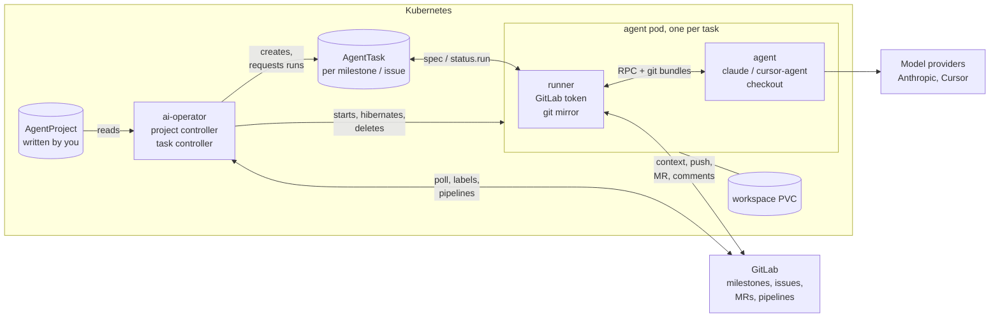
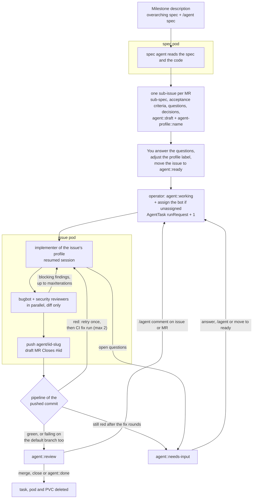
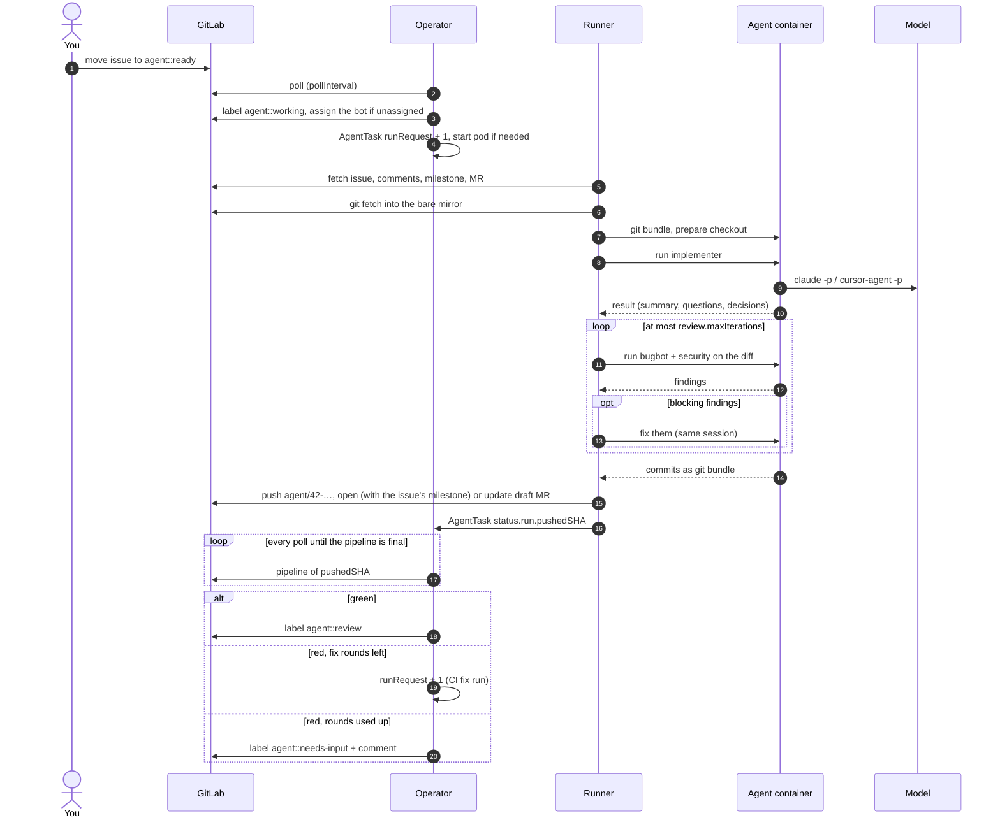
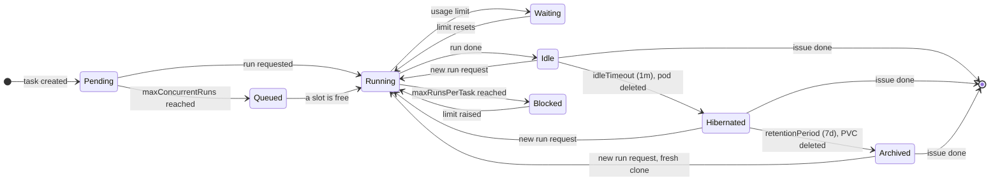
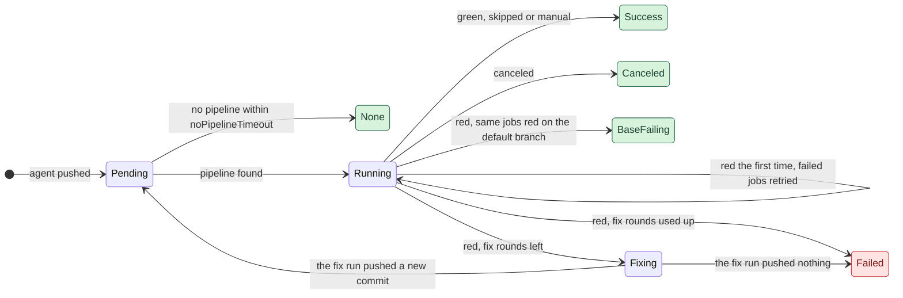
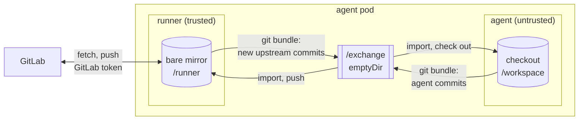

# ai-operator design

The operator turns GitLab milestones and issues into work for coding agents
running in Kubernetes pods. Humans stay in GitLab: they write specs, answer
questions, move cards on the board and review merge requests. For the
user-facing workflow see [usage.md](usage.md), for all settings
[configuration.md](configuration.md).

**Status:** v1alpha1, first version. Unit and end-to-end tests (fake GitLab,
fake agent, real git) pass. It has not yet run against a real cluster, a real
GitLab instance or the real agent CLIs.

## Architecture



The operator runs in `ai-operator-system`; projects, tasks and agent pods
live in the namespaces listed in the chart's `agent.namespaces`.

* The **project controller** polls GitLab, creates an `AgentTask` per planned
  milestone and per handed-over issue, turns `agent::ready` and `/agent`
  comments into run requests, follows pipelines, and deletes tasks of
  finished issues.
* The **task controller** owns the pod and the workspace PVC of each task:
  it starts, queues, hibernates and archives them (see
  [Lifecycle](#lifecycle-of-long-lived-issues)).
* The **runner** does one run per request: it collects the context from
  GitLab, drives the agent CLIs in the agent container, and publishes the
  result (branch, MR, comments, labels).
* The **agent container** runs the agent CLIs on the checkout. It has the
  model credentials, nothing else (see [Security](#security)).

## Flow



A single run of an issue, step by step:



The milestone description is the single source of the overarching spec. The
operator never writes to it. Sub-specs live in the sub-issues, and the
planner's summary is kept in the spec task's status (`kubectl get agenttask
<name> -o jsonpath='{.status.run.summary}'`).

## Custom resources

| Kind | Who writes it | Purpose |
|------|---------------|---------|
| `AgentProject` | you | GitLab connection, label workflow, agent image, engines/models per role, lifecycle and limits |
| `AgentTask` | operator | one per planned milestone (`Spec`) and per handed-over issue (`Implement`); owns the pod and the workspace PVC |

`AgentTask.spec.runRequest` is a counter: each increment asks for exactly one
more run. The runner acknowledges in `status.run.observedRunRequest`. Requests
that arrive during a run are coalesced into one follow-up run. The operator
writes the top-level status, the runner only `status.run`; both use merge
patches so they never overwrite each other.

Names are declarative: `shop-spec-m3-checkout-v2` (milestone !3) and
`shop-42-add-paypal-button` (issue #42). Pod, task and PVC (`…-ws`) share the
name, so `kubectl get pods` reads like the board. Tasks are found by the
issue IID label, so renaming an issue does not create a second task.

## Pod topology

**One pod per issue, one pod per planned milestone.** All roles of an issue
(implement, bugbot, security) run as separate CLI invocations inside the same
pod on the same workspace.

Why not one pod per milestone running everything? Issues move independently:
a pod per issue gives parallelism, isolates failures, and maps "issue done"
directly onto "delete the pod and PVC". Why not separate pods per role? The
reviewers are short, read-only invocations that need exactly the work tree the
implementer just produced; separate pods would need RWX volumes and
coordination for no gain. The engine abstraction keeps the option open.

Each pod has two containers, see [Security](#security):

| Container | Runs | Has | Volumes |
|-----------|------|-----|---------|
| `runner` | `ai-runner` | GitLab token, service account token | PVC sub-path `runner` at `/runner` (git mirror, runner state), `/exchange` |
| `agent` | `ai-runner agent-server` | agent CLI credentials | PVC sub-path `agent` at `/workspace` (checkout, `$HOME` with CLI sessions, build outputs), `/exchange`, `/cache` |

* The per-task RWO PVC holds both sub-paths, so the checkout, the build
  caches, the agent sessions and the mirror survive hibernation.
* `/exchange` is an `emptyDir` shared by both containers: the agent server's
  unix socket and git bundles in transit.
* `/cache` is an optional RWX PVC shared by all agent pods (`GOMODCACHE`,
  `npm_config_cache`, `PIP_CACHE_DIR`, …).

**Logging.** The runner records every run as numbered steps
(`internal/runner/steps.go`): a start and an end line per step in its log,
the step in progress in `status.run.currentStep`, and a run log table in the
GitLab comment of the run. The runner sends its run ID (`<task>#<request>`)
with every call to the agent server, which logs each call with it. Neither
side logs prompts, comments, diffs or commit messages.

## Lifecycle of long-lived issues



* **Idle**: the run is done; the pod waits a minute for a follow-up request
  (e.g. a comment written while the agent worked) and then stops.
* **Hibernated**: pod deleted, PVC kept. This is the normal state between
  runs: no CPU or memory is held. Waking up costs a pod start; the checkout,
  build cache and agent session are still there. A warm pod would not keep
  the model's prompt cache either: it expires within minutes to an hour.
* **Archived**: PVC deleted. The branch, the MR and the GitLab thread hold
  everything that matters; the next run clones fresh and starts a new
  session with the full issue thread and the agent notes as context.
* **Blocked**: `maxRunsPerTask` reached – a guard against loops.
* `maxConcurrentRuns` caps token-consuming runs per project; extra runs queue.

The issue can stay open for months; resources are reclaimed in stages and
nothing is lost.

## Token economy

* **Right-sized models.** Strong models only for planning and for issues
  labelled with a strong profile; reviews and simple issues run on a light
  model or cursor `auto` (see Engines, profiles and subscriptions).
* **Explicit triggers only.** Runs start when an issue is moved to ready, or a
  comment starts with `/agent`. Discussion between humans costs nothing.
  Comments by the bot user never trigger.
* **Polling is cheap.** Comments are only fetched when an issue's or MR's
  `updated_at` changed.
* **Resumed sessions.** Follow-up runs resume the implementer's session and
  only send the new comments, instead of the whole issue, spec and thread.
* **Agent notes.** The implementer also returns handoff notes, which the
  runner keeps in one bot comment on the issue (created on the first run,
  edited right after each later push, `internal/runner/handoff.go`). A
  fresh session (archived workspace, lost session) gets them with the
  thread and the newest comment they cover, so it does not re-derive
  earlier decisions. Only the oldest bot comment that starts with the
  notes header counts; anyone else's comment with the same markers, and
  the bot's own reports quoting them, stay plain comments. Markers in the
  agent's text are neutralised. The notes are as trustworthy as the bot
  account (and whoever may edit its comments) and are model output built
  from the thread, so they are data in the prompt like any comment.
* **Decisions.** Both agents return the decisions they made (question,
  choice, why, rejected alternatives) as structured output, so there is no
  extra model call to extract them (`internal/runner/decisions.go`). The
  runner posts the implementer's decisions in one comment per run with IDs
  `D<issue>-<n>`, and the planner's go into the issue description as
  `D<issue>-P<n>`. IDs are numbered after the highest one in the bot's
  decision comments, so GitLab is the source of truth and they survive an
  archived workspace; long lists are split over several comments, never
  cut. `/agent revisit <id> …` puts the decision and the instruction at the
  top of the next prompt; the new decision names the old one in
  `supersedes`, and only then is the old one marked. Revisits already
  covered by the agent notes are not applied again after a lost workspace.
  HTML outside code spans, markers and mentions in the agent's text are
  neutralised.
* **Context prepared by the runner.** The runner fetches the issue, milestone
  and comments and puts them into the prompt; the model never spends turns on
  GitLab API exploration and never gets GitLab credentials.
* **Stable system prompts** (constants, no timestamps) so the prompt prefix
  stays cacheable.
* **Reviewers see the diff**, not the repository; they read more code only to
  confirm a finding. They are one-shot, without session persistence.
* **Bounded fix loop** (`review.maxIterations`), per-invocation
  `maxBudgetUSD` (claude), `maxRunsPerTask`.
* **Structured output** (JSON schema) instead of free text that would need a
  second model call to parse.
* Spend is visible per task: `kubectl get agenttasks` shows the accumulated
  cost the CLIs report.

## CI feedback

The agent runs the build and tests it knows about, but the project's
pipeline usually checks more (other jobs, services, the merge result). So a
push is not "done" until its pipeline is green:

* The runner records the pushed commit (`status.run.pushedSHA`) and leaves
  the issue in `agent::working`.
* The project controller polls the pipeline of that commit on its normal
  GitLab poll – no tokens – and records it in `status.ci`.
* Red pipelines are retried once (flaky jobs cost nothing). If the same jobs
  fail in the latest finished pipeline of the default branch, the agent is
  not involved. Otherwise the operator requests a CI fix run
  (`spec.source.ciFixPipelineID`).
* A CI fix run resumes the implementer's session with the failed jobs and a
  cleaned excerpt of their logs (ANSI codes, section markers and progress
  output removed, the last 150 lines / 8 KB of at most 3 jobs), marked as
  untrusted data. Reviewers are skipped for these runs.
* `status.run.ciRound` counts CI fix runs since the last push a human asked
  for; after `ci.maxFixRounds` the issue goes to needs-input with the
  failing jobs. A fix run that pushes nothing new also ends the loop.

`status.ci.state` of the pushed commit:



Green states move the issue to `agent::review`, `Failed` to
`agent::needs-input`.

## Autopilot

A milestone with `/agent autopilot` runs end to end. The lifecycle is driven
by the operator, not by an agent: queue, merge gate, rebase and pause are
rules ("CI green, no blocking findings, head unchanged → merge"), so they are
predictable, testable and cost no tokens, and no model ever decides to merge
into the default branch. Agents are used where judgement is needed:
planning, implementing, reviewing.

```mermaid
stateDiagram-v2
    direction LR
    [*] --> Pending: planned
    Pending --> Active: dependencies merged,<br/>moved to agent::ready
    Active --> Active: implement, review, CI,<br/>rebase once if needed
    Active --> Merged: gate passed, merged
    Active --> Skipped: closed without merge,<br/>/agent skip
    Pending --> Skipped: /agent skip
    Merged --> [*]
    Skipped --> [*]
```

* **State.** The spec runner records the plan in the spec task's
  `status.plan` (IIDs and dependencies in plan order). The operator keeps the
  queue in `status.autopilot` (phase, items, tracking issue, last handled
  command) and does one step per poll (`internal/controller/autopilot.go`).
* **One at a time.** The queue is the plan in topological order, ties in plan
  order. The next issue starts only after the previous MR is merged, so every
  branch starts from the current default branch and every merge was tested
  against what is really there.
* **No questions.** Spec and implement tasks of the milestone carry
  `spec.autopilot`; the runner then adds a short paragraph to the *user*
  prompt (the system prompts stay the same and cached): never ask, take the
  default, record it as a decision. CI fix runs are reviewed too, since no
  human reviews before the merge.
* **Merge gate.** Issue in review (the CI loop finished), last run
  succeeded, `blockingFindings == 0`, `reviewErrors == 0`,
  `reviewedSHA == pushedSHA`, MR open with head `pushedSHA`, GitLab's
  `detailed_merge_status` mergeable. The draft is marked ready by its title,
  and `PUT …/merge` passes the checked `sha`.
* **Rebase.** On `need_rebase` the operator asks GitLab to rebase once. The
  rebased head is handed to the CI loop like a push (`pushedSHA`, reset CI,
  back to working); the review still holds because the agent's change did not
  change. Conflicts pause: resolving them is not automated yet.
* **Pause.** Anything that needs a human pauses the queue with a comment on
  the tracking issue, once per reason. `/agent resume`, `pause` and
  `skip #N` on the tracking issue are handled by the operator.
* **Tracking issue.** Created with the first plan, edited in place (only when
  its rendered text changes), closed when done or switched off. It carries a
  hidden marker (`internal/marker`) so the spec agent does not see it as an
  existing issue.
* **Off.** Removing the marker sets `phase: Off` and closes the tracking
  issue; if the milestone is no longer planned at all, this happens before
  the spec task is deleted.

### Revisiting after the merge

A decision of a closed issue has no runner left to change it, so the operator
turns the revisit into a follow-up issue (`internal/controller/revisit.go`).
It watches every planned milestone, autopilot or not:

* **Polling.** Each poll lists the milestone's closed issues updated since the
  last check (`updated_after`, minus five minutes of clock skew) and, on
  autopilot, the notes of the tracking issue. A new comment updates its
  issue, so the list stays short. `status.revisits` keeps when watching
  started (older comments are history), the last check, and the highest
  handled note ID, so each comment is handled once.
* **Lookup.** The decision is read like the runner reads it: planner
  decisions from the issue description, implementer decisions from the bot's
  decision comments only. Every handled comment gets a reply.
* **Follow-up.** The issue carries the old decision without its marker, the
  instruction, a key marker `revisit-<id>` (so the planner treats it as an
  existing issue) and `<!-- ai-operator:revisit=<id> -->`. One follow-up per
  decision: an open issue with that marker gets a pointer instead.
* **Superseding across issues.** When the follow-up's run posts a decision
  that supersedes the marked ID, the runner marks the old decision on the
  original issue, in its description or the bot's decision comment.
* **Autopilot.** The follow-up is a draft and is appended to the queue with
  `revisitOf`; rebuilding the queue from the plan keeps it. When it merges,
  the decision index of the original issue is collected again, so the
  tracking issue shows the old decision as superseded.

## Engines, profiles and subscriptions

Each role runs on an engine, an agent CLI:

| engine | CLI | auth (from `credentialsSecretName`) | notes |
|--------|-----|-------------------------------------|-------|
| `claude` | `claude -p` | `CLAUDE_CODE_OAUTH_TOKEN` (Pro/Max subscription, created with `claude setup-token`) or `ANTHROPIC_API_KEY` | JSON schema, effort, budget, tool allow-lists, cost reporting |
| `cursor` | `cursor-agent -p` | `CURSOR_API_KEY` (Cursor subscription) | instructions and schema are folded into the prompt; no tool allow-list (read-only roles get no `--force` and the work tree is reset after them); no cost reporting |

**Model routing.** Strong models are expensive, so they are only used where
they pay off:

* `spec` (once per milestone): strong model, `claude-opus-5-5` by default.
* `review`: light model, `claude-sonnet-5-5` by default, or cursor `auto`.
* Implementation is chosen **per issue through a profile label**
  (`agent-profile::<name>`). Profiles are named role configurations in the
  `AgentProject`, e.g. `fast` = cursor `auto` or Sonnet, `strong` = Opus. The
  spec agent picks a profile for each sub-issue from the profile
  descriptions. A human can change the label at any time. Issues without a
  (known) profile label use `agents.implement` (strong by default).

A label naming a *profile* rather than an engine/model keeps the board readable
and lets you change what "fast" means in one place.

Agent CLIs are the right building block if you want to use subscriptions:
subscriptions authenticate the vendors' CLIs, while SDK/API integrations need
API keys. The CLIs also bring the agent harness (file tools, shell, context
management, sessions) that we would otherwise rebuild. Adding another CLI
(Codex, Gemini, opencode, …) means implementing the `Engine` interface in
`internal/runner/engine.go` – about 80 lines.

Things to keep in mind with subscriptions:

* Subscriptions have usage windows. Several agents in parallel exhaust them
  quickly, so keep `maxConcurrentRuns` low.
* When a CLI reports a usage or rate limit, the run is **deferred**, not
  failed. The runner recognises the error text (and Claude's reset time),
  marks the task `Waiting` with `status.run.deferredUntil`, and retries
  then; without a reset time it backs off exponentially (5m → 1h). The
  operator collects active limits per engine into the project status, and
  runners don't call a limited engine at all but wait for the same reset. A
  limit during a review fix round publishes the work done so far. Deferred
  runs don't count towards `maxRunsPerTask`.
* The plans are meant for your own use. Check the terms of your plan before
  running agents for a team on a personal subscription; use API keys for that.
* With a subscription the reported cost is the notional API price. It is
  still useful to compare tasks and roles.

## Security

The threat model: the model can do anything a shell in the agent container
can do – including following instructions planted in issues, comments or
code. It must not be able to get the GitLab token or Kubernetes access, or
make something that has them run its code.

**Two containers.** The `runner` container holds the GitLab token and is the
only container the service account token is mounted into
(`automountServiceAccountToken: false` plus an explicit projected volume).
The `agent` container only gets the agent CLI credentials from
`credentialsSecretName`. Containers of a pod do not share a process
namespace, so the model cannot read the runner's environment through
`/proc`. Service links are disabled.

**No git in the agent's checkout from the runner.** The model can edit
`.git/config`, hooks and `.gitattributes`, and git turns several of those
(`core.fsmonitor`, filters, hooks, external diff) into command execution. So
the runner never runs git in the checkout:



* The runner keeps a bare mirror on its own PVC sub-path. Only the runner
  touches it, so its config is trusted. Remote commands get the token as an
  `http.extraHeader` through `GIT_CONFIG_*` environment variables of that
  single git process. Git runs with a minimal environment, no system or
  global config and hooks disabled.
* Before a run, the runner bundles the commits the checkout lacks; the agent
  server imports the bundle and checks out the branch. After a run, the agent
  server bundles the new commits and the runner imports them into the mirror
  and pushes. Fetching from a bundle transfers refs and objects and cannot
  execute anything.
* The runner talks to the agent server over a unix socket on `/exchange`
  (RPC: run an agent CLI, prepare / commit / diff / reset / bundle). Bundle
  paths outside `/exchange` are rejected. Everything the agent returns
  (results, diffs) is treated as untrusted data.

**Other measures.**

* Pods run as non-root with all capabilities dropped and seccomp
  `RuntimeDefault`; the runner's root filesystem is read-only.
* The agent service account can only read tasks/projects and patch
  `agenttasks/status`.
* Optional NetworkPolicy (Helm `agent.networkPolicy`): no ingress, no egress
  to cloud metadata endpoints or private networks except allow-listed CIDRs
  (Kubernetes API, self-hosted GitLab, mirrors). NetworkPolicies apply per
  pod, so the agent container can still reach the internet (GitLab, model
  APIs, package registries); it just has no credentials to use there.
* Use a project access token (role Developer, scopes `api`,
  `write_repository`) and protect the default branch – the agent only pushes
  `agent/*` branches and opens draft MRs.

**Remaining risks.** The model can still push arbitrary content to its own
`agent/*` branch (by design; humans review the draft MR) and write anything
into the summaries posted on GitLab. CI pipelines of agent branches run
untrusted code: don't expose protected CI variables to unprotected branches.

## Code map

| Path | What |
|------|------|
| `api/v1alpha1` | CRD types, defaults, profile routing (`ImplementRole`) |
| `internal/controller/agentproject_controller.go` | GitLab poll → AgentTasks, run requests, label acknowledgement, cleanup |
| `internal/controller/agenttask_controller.go` | pod / PVC lifecycle, queueing, limits |
| `internal/controller/resources.go` | pod and PVC templates |
| `internal/runner/runner.go` | run loop, status reporting, session state, mirror ⇄ workspace sync |
| `internal/runner/steps.go` | run steps: step logging, current step, GitLab run log |
| `internal/runner/handoff.go` | agent notes: the bot's handoff comment on the issue |
| `internal/runner/decisions.go` | decisions: IDs, decision comments, revisits, superseding |
| `internal/controller/autopilot.go` | autopilot: queue, merge gate, rebase, pause / resume / skip, tracking issue |
| `internal/controller/revisit.go` | revisits of merged issues: follow-up issues, replies |
| `internal/marker` | hidden markers in GitLab text shared by operator and runner (tracking issue, decisions) |
| `internal/runner/agent.go` | `Agent` interface, agent server and client (unix socket RPC) |
| `internal/runner/workspace.go` | agent-side checkout (local git only) |
| `internal/runner/spec.go` | planning pipeline, applying the plan to GitLab |
| `internal/runner/implement.go` | implement → review → fix → push → MR pipeline; CI fix runs |
| `internal/runner/ci.go` | CI fix prompt, log excerpts |
| `internal/controller/ci.go` | CI feedback loop: pipeline tracking, retry, fix requests, final labels |
| `internal/runner/engine.go` | `Engine` interface, `ClaudeCLI`, `CursorCLI` |
| `internal/runner/prompts.go` | role prompts and JSON schemas |
| `internal/runner/git.go` | runner-side bare mirror (the only git that talks to GitLab) |
| `internal/gitlab` | minimal REST client; `gitlabfake` for tests |
| `charts/ai-operator` | Helm chart (CRDs and operator RBAC are copied in by `make manifests`) |
| `.github/workflows` | CI and calendar-versioned releases (`YEAR.MONTH.N`) |

## Roadmap

Done: credential split into runner and agent containers, bundle-based git
exchange, optional NetworkPolicy (see Security); usage limit backoff (see
Engines, profiles and subscriptions); CI feedback loop (see CI feedback).

Next:

1. **GitLab webhooks** instead of polling, for instant reactions.

Later:

* Profiles for reviews (e.g. security review on a strong model only for
  `strong` issues).
* GitLab issue links (`blocks`) for dependencies on Premium instances.
* Group milestones and group-level `AgentProject`s.
* Rebase/conflict handling when `main` moves under a long-lived MR.
* Metrics: runs, cost, durations per project, role and profile.
