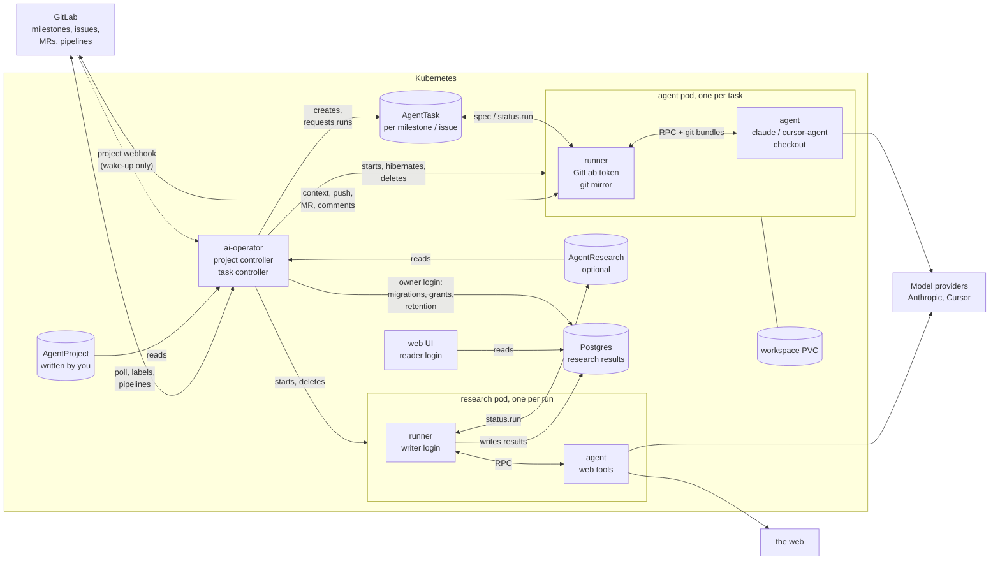
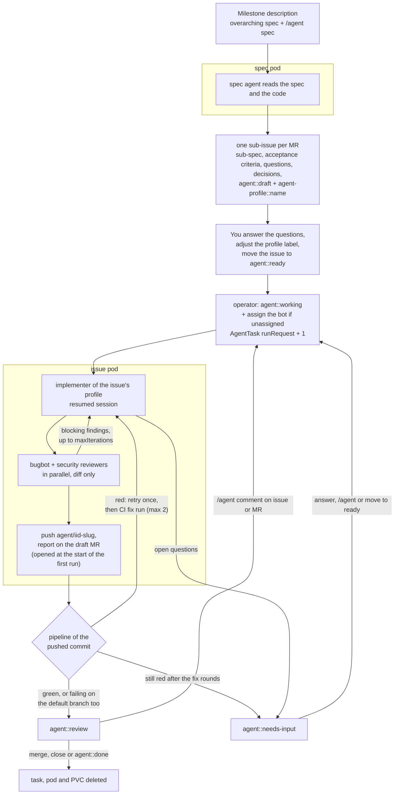
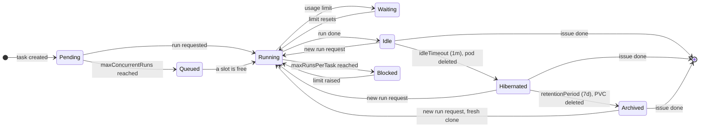
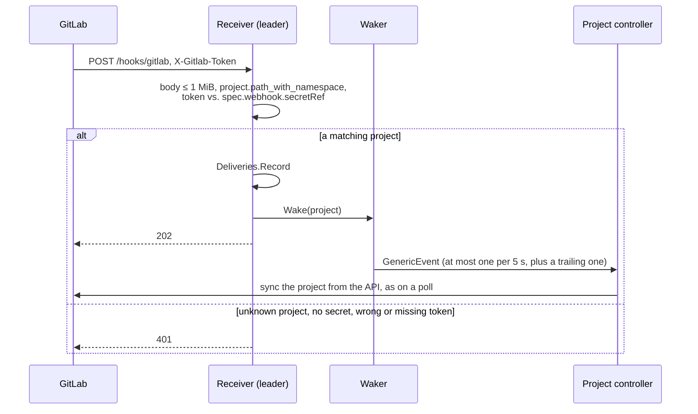
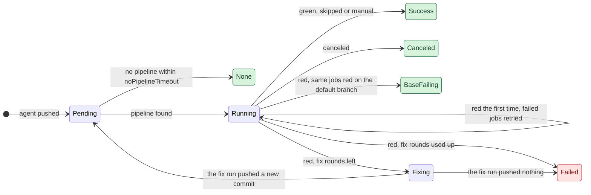
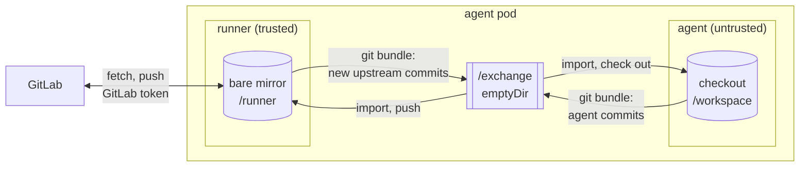

# ai-operator design

The operator turns GitLab milestones and issues into work for coding agents
running in Kubernetes pods. Humans stay in GitLab: they write specs, answer
questions, move cards on the board and review merge requests. For the
user-facing workflow see [usage.md](usage.md), for all settings
[configuration.md](configuration.md).

**Status:** v1alpha1, first version. Unit and end-to-end tests (fake GitLab,
fake agent, real git) pass. It has not yet run against a real cluster, a real
GitLab instance or the real agent CLIs.

## Architecture



The operator runs in `ai-operator-system`; projects, tasks and agent pods
live in the namespaces listed in the chart's `agent.namespaces`. The research
part (lower half) exists only with a research database
(`research.database.host`); without one, the operator, the chart and the UI
run only the factory.

* The **project controller** polls GitLab, creates an `AgentTask` per planned
  milestone and per handed-over issue, turns `agent::ready` and `/agent`
  comments into run requests, follows pipelines, and deletes tasks of
  finished issues. A GitLab project webhook wakes it within seconds (see
  [GitLab webhooks](#gitlab-webhooks)); polling stays the fallback.
* The **task controller** owns the pod and the workspace PVC of each task:
  it starts, queues, hibernates and archives them (see
  [Lifecycle](#lifecycle-of-long-lived-issues)).
* The **runner** does one run per request: it collects the context from
  GitLab, drives the agent CLIs in the agent container, and publishes the
  result (branch, MR, comments, labels).
* The **agent container** runs the agent CLIs on the checkout. It has the
  model credentials, nothing else (see [Security](#security)).
* The optional **web UI** (`ai-operator-ui`, [ui.md](ui.md)) shows the tasks
  of the projects a user's OIDC roles grant. It only reads AgentProjects and
  AgentTasks from the Kubernetes API and never uses the operator's GitLab
  token; with a user's GitLab account connected it reads threads and posts
  comments (also the milestone chat to the pilot) with that user's token.
* The optional **research controller** ([research.md](research.md)) runs
  each `AgentResearch` once or on its cron schedule: it chooses the agent
  from the usage left, starts one pod per run without git, and records the
  outcome. The runner of that pod asks the agent, validates the answer
  against the block schema and writes it to **Postgres**.
* The database has **three logins**, each with only what its holder needs:
  the operator's **owner** login (migrations, grants, hourly retention
  delete), the UI's **reader** login (read only), and a **writer** login per
  AgentProject (`spec.research.writerSecret`) that only the runner container
  of research pods gets (read, insert, update). The agent container gets
  none.

## Flow



A single run of an issue, step by step:


**The MR first.** The first run opens the draft MR before the agent starts,
so every run of the issue can be followed in one place. A new branch gets an
empty start commit, made with `git commit-tree` in the runner's trusted
mirror and pushed with `ci.skip`; its message is one line without `[skip
ci]`, which merge commit templates could copy to the default branch. The
agent's checkout is then prepared again on top of it, and the MR is recorded
in the task status at once, so a run deferred or failing later reuses it. A
branch whose head changes nothing against the default branch is never taken
over as a push for CI.

**Draft until reviewed.** The MR is a draft while the agent works. A run whose
review is clean (no blocker or major findings, no failed reviewer, no
questions, and changes against the default branch) marks it ready *before*
pushing, so the push gets its pipeline also in projects that skip drafts; a
run that leaves problems marks it draft again. CI then runs, CI fix rounds
follow, and a ready, green MR is what a human (or autopilot) merges.

**Live progress.** The run log has a change hook: every step start and end
re-renders a progress comment on the MR (hidden marker, open details block,
the running step marked). Edits are sent by a timer goroutine, at most every
3 seconds, so a slow GitLab never holds up the run and a long step still
shows; the body is rendered on the run's goroutine, the timer only sends it.
When the run ends the comment is deleted (the report follows as a new
comment, so watchers are notified), or keeps the final run log under a failed
or paused headline; this also happens while the pod stops, with a context
that outlives the shutdown. A live comment a killed run left behind is
removed by the next run. Progress comments are kept out of the agent's
prompt.

**The description describes the branch.** After the push, a read-only
describe agent (light model, no session) gets the issue, the run's summary,
the previous description and the diff, and answers why, what, how,
verification and an optional mermaid diagram. It only runs when the diff's
hash differs from the one last described (runner state), and its failure is a
notice in the report, never a failed run. The runner owns the text between
`<!-- ai-operator:description -->` markers; the rest of the description is
left alone; it is read again right before the write, so an edit made while
the describer ran is kept. Agent text sent to GitLab (the description's
prose, run reports, questions) is made inert: a zero-width space after `@`
and before a `/` that starts a line, because GitLab runs quick actions in
notes and descriptions written through the API. A diagram is kept only with a known mermaid type, no code
fence and at most 5000 bytes.

**Owners.** The project controller resolves the owners of every task on each
poll (a milestone's `/agent owners` line, else `spec.notify.users`, else
`--default-owners`) into `AgentTask.spec.owners`; the runner and the CI and
autopilot code only read the task. A milestone's `/agent owner-subjects …`
line (Desk identities, the UI's username claim) is stored as
`AgentTask.spec.ownerSubjects` with no project-level fallback; Desk
accept/reject of pilot proposals needs the author there. The owners and
owner-subjects lines, like the [standing rules](#pilot), are left out of
the milestone's description hash, so they do not re-plan. Mentions go into
new comments only, because GitLab notifies again for mentions added by an
edit.
With `workflow.commandsFrom: owners`, `commandGate`
(`internal/controller/commandgate.go`) filters every poll's `/agent`
comments (run requests, `reviewOnly`, routing, the tracking issue's
commands, revisits) to those whose author ID is an owner's, looking the
owners' IDs up lazily once per poll (`members`, the default, costs no
GitLab call). A denied command gets one reply in its thread (`replyPerNote` in
`command_replies.go`: the reply carries a `reply-to` marker, so a repeated
poll does not answer twice), at most `maxRepliesPerDay` (10) per author and
24 h, counted in the AgentProject's `status.commandReplies.authors`; beyond
the cap it is logged. The place's watermark moves past it either way. The
older `status.pilot.rejected` is no longer written.

**Model and effort per issue.** `/agent use` and `/agent effort` start no
run: on the poll that sees them the operator validates them against
`agents.models` and `agents.maxEffort`, swaps the issue's `agent-model::` /
`agent-effort::` labels and, once the task is saved, answers with a short
comment (`internal/command`, `spec.source.lastRoutingNoteID`; a recreated
task skips commands answered before, found by the answer's hidden marker). A comment
that is only such a command starts no run and is left out of the agent's
prompt. The runner reads the labels when it picks the implementer
(`AgentProjectSpec.IssueRole`), so a label set by hand works the same, and
an invalid one is ignored with a notice in the report. Sessions are kept per
engine, and the runner remembers the engine of the last implementer run: a
run on another engine (also switching back) starts that engine's session
fresh, another model or effort of the same engine resumes it.

The milestone description is the single source of the overarching spec. The
operator writes to it only for the pilot's standing rules and spec edits
after an owner's `yes` (see [Pilot](#pilot)). Sub-specs live in the sub-issues, and the
planner's summary is kept in the spec task's status (`kubectl get agenttask
<name> -o jsonpath='{.status.run.summary}'`).

## Custom resources

| Kind | Who writes it | Purpose |
|------|---------------|---------|
| `AgentProject` | you | GitLab connection, label workflow, agent image, engines/models per role, lifecycle and limits |
| `AgentTask` | operator | one per planned milestone (`Spec`), per handed-over issue (`Implement`) and per milestone with a pilot (`Coordinate`); owns the pod and the workspace PVC |
| `AgentResearch` | you, or the UI for one-offs | a research question run once or on a schedule against a project's engines; owns the pod of its current run. Its results live in Postgres, not in etcd. See [research.md](research.md#agentresearch) |

An `AgentResearch` follows the same split: the operator writes the top-level
status, the runner only `status.run` (outcome, cost, usage readings), and the
operator copies those readings into the referenced project's status.

`AgentTask.spec.runRequest` is a counter: each increment asks for exactly one
more run. The runner acknowledges in `status.run.observedRunRequest`. Requests
that arrive during a run are coalesced into one follow-up run. The operator
writes the top-level status, the runner only `status.run`; both use merge
patches so they never overwrite each other.

Names are declarative: `shop-spec-m3-checkout-v2` (milestone !3) and
`shop-42-add-paypal-button` (issue #42). Pod, task and PVC (`…-ws`) share the
name, so `kubectl get pods` reads like the board. Tasks are found by the
issue IID label, so renaming an issue does not create a second task.

## Pod topology

**One pod per issue, one pod per planned milestone.** All roles of an issue
(implement, bugbot, security) run as separate CLI invocations inside the same
pod on the same workspace.

Why not one pod per milestone running everything? Issues move independently:
a pod per issue gives parallelism, isolates failures, and maps "issue done"
directly onto "delete the pod and PVC". Why not separate pods per role? The
reviewers are short, read-only invocations that need exactly the work tree the
implementer just produced; separate pods would need RWX volumes and
coordination for no gain. The engine abstraction keeps the option open.

Each pod has two containers, see [Security](#security):

| Container | Runs | Has | Volumes |
|-----------|------|-----|---------|
| `runner` | `ai-runner` | GitLab token, service account token | PVC sub-path `runner` at `/runner` (git mirror, runner state), `/exchange` |
| `agent` | `ai-runner agent-server` | agent CLI credentials | PVC sub-path `agent` at `/workspace` (checkout, `$HOME` with CLI sessions, build outputs), `/exchange`, `/cache` |

* The per-task RWO PVC holds both sub-paths, so the checkout, the build
  caches, the agent sessions and the mirror survive hibernation.
* `/exchange` is an `emptyDir` shared by both containers: the agent server's
  unix socket and git bundles in transit.
* `/cache` is an optional RWX PVC shared by all agent pods (`GOMODCACHE`,
  `npm_config_cache`, `PIP_CACHE_DIR`, …).
* The kubelet restarts a container that dies (e.g. `OOMKilled`) in place.
  The operator, which watches the pods, records how the agent container last
  stopped in `status.agentTermination`. A runner call that the agent server
  never answered waits for the container to be ready again and for that
  record (`internal/runner/agentlost.go`), then fails the run with the
  reason, or resets the checkout and tries the call once more if the
  container crashed for another reason than memory. After an OOM kill the
  operator raises the task's memory limit by half (`status.agentMemoryLimit`,
  capped by `agents.maxMemory`), and the runner, which computes the same
  from the same record, gives the run back as pending (`oomRetries`, at most
  3) with a short delay, so the operator replaces the pod first. Pods carry a hash of the
  agent container's resources (`ai.wiemers.me/agent-resources`); a pod with
  other ones is replaced between runs, so raised limits apply to the next
  run.
* A pod that stops mid-run (evicted, node lost) leaves
  `status.run.activeRunRequest` ahead of `observedRunRequest`: every way a
  run ends sets them equal. The runner of the replacement pod sees that at
  the start of the run, counts it in `status.run.interruptions`, says so above
  the run log, and fails the run instead after 3 restarts (reset when a run
  finishes).

**Research runs** (`AgentResearch`, see [research.md](research.md#runs)) get
one short-lived pod per run, `<research>-<run ID prefix>`, with the label
`ai.wiemers.me/research` and the same two containers, without git:

| Container | Runs | Has | Volumes |
|-----------|------|-----|---------|
| `runner` | `ai-runner research` | the project's database writer login (`spec.research.writerSecret`, as `secretKeyRef`), the database's host, port, name and `sslMode` as values, service account token | `emptyDir` at `/runner`, `/exchange` |
| `agent` | `ai-runner agent-server` | agent CLI credentials | `emptyDir` at `/workspace`, `/exchange` |

* No GitLab token in either container, no database variables in the agent
  container: the agent reads untrusted web pages, and its answer is data the
  runner validates.
* `restartPolicy: Never` and `activeDeadlineSeconds` of the depth's timeout
  plus 2 minutes. The operator deletes the pod once the run's outcome is in
  the status and the database.
* The agent container is a task's (image, credentials, resources) without
  the `/cache` volume.
* On claude the agent may use only WebSearch and WebFetch: the research
  agent reads the web, not a checkout.
* The agent NetworkPolicy applies to them as to task pods. An extra
  NetworkPolicy (`<agent role>-research-db`, from
  `research.database.networkPolicyPeer`) lets only pods with the research
  label reach the database pods on its port; task pods never match it.
  NetworkPolicies apply per pod, so the agent container of a research pod
  could reach the database too, but it has no login.

**Logging.** The runner records every run as numbered steps
(`internal/runner/steps.go`): a start and an end line per step in its log,
the step in progress in `status.run.currentStep`, and a run log table in the
GitLab comment of the run. The runner sends its run ID (`<task>#<request>`)
with every call to the agent server, which logs each call with it. Neither
side logs prompts, comments, diffs or commit messages. Both CLIs run with
`--output-format stream-json`: the agent server logs what the agent says and
each tool call with its main argument (command, file, pattern; a command's
first line) as it happens, and for claude also what it thinks
(`internal/runner/transcript.go`); cursor-agent keeps its thinking to itself
in print mode. Tool output, written file contents and the final answer are
not logged: the agent's last message before the result is held back and
logged as "agent answers" (cursor writes its JSON answer as that message).
Only the final result line is parsed. With `spec.agents.logPrompts` the
agent server also logs each call's role, system prompt and prompt (64 KiB
each at most), which the web UI's live transcript shows; off by default.

## Lifecycle of long-lived issues



* **Idle**: the run is done; the pod waits a minute for a follow-up request
  (e.g. a comment written while the agent worked) and then stops. After a
  Desk chat turn it waits `lifecycle.chatIdleTimeout` (default 15m) from
  `status.chat.lastTurnTime` instead; unanswered chat turns (not commands)
  keep the pod up like a pending run (see [Desk live chat](#desk-live-chat)).
* **Hibernated**: pod deleted, PVC kept. This is the normal state between
  runs: no CPU or memory is held. Waking up costs a pod start; the checkout,
  build cache and agent session are still there. A warm pod would not keep
  the model's prompt cache either: it expires within minutes to an hour.
* **Archived**: PVC deleted. The branch, the MR and the GitLab thread hold
  everything that matters; the next run clones fresh and starts a new
  session with the full issue thread and the agent notes as context.
* **Blocked**: `maxRunsPerTask` reached – a guard against loops.
* `maxConcurrentRuns` caps token-consuming runs per project; extra runs queue.
  The queue has an order, `aiv1.QueueLess`: the main-red fix
  (`spec.queueLane: urgent`, set and cleared by the project controller),
  then tasks without a milestone, then the lowest milestone iid, then the
  older task. Before a task without a pod takes a slot, the reconciler lists
  the project's tasks once; if a task in phase `Queued` that still wants a
  slot (not suspended, deferred, budget-stopped or blocked) ranks ahead of it,
  it queues too, even with a free slot. With capacity N the top N start
  together. A slot is never left idle (a younger milestone runs while the older
  one has nothing queued), a run in progress is never preempted, and pilots
  stay outside. A run that lost its pod and a chat turn without a pending run
  skip the rank check and only need a free slot. A queued task whose start
  fails with an error leaves the queue (`Pending`), so it holds nobody back.
  The `Queued` message names the place and the task ahead.
  Pilots (`Coordinate` tasks) neither count toward it nor wait for it: one
  per planned milestone, light model, no builds or pushes, capped by
  `pilot.maxBudgetUSD`.

The runner never sets the blocked labels. It reports why a run waits or
gave up in `status.run.blockReason` (`quota` while deferred by a usage limit
and after giving up on one; `infra` when the agent pod or container was
lost, also out of memory, or the run was interrupted too often), and the operator's poll turns each report into
`status.blocked` once (`status.runBlockedAt` remembers which, so a block
lifted by hand stays lifted) and applies the labels. A new run lifts any
block and shows `working`: in progress (`activeRunRequest` ahead of
`observedRunRequest`), or pending and not deferred, also when the label move
of its request failed. A deferred run waits, so it keeps the quota block,
also before the block is applied. An `infra` block of a failed run gets
one new run `lifecycle.infraRetryAfter` after the failure: the request is
recorded in `spec.source.infraRetry`, so a failed retry (its observed run
request) waits for a human, and the runner's comment says which case it
is. Autopilot's resume leaves such a block to that new run.

### Desk live chat

With `agents.chat: true` and the research database, Desk messages go into
Postgres (`chat_messages`) and the operator (`internal/controller/chat.go`)
hands each queued row to its `AgentTask` as `spec.source.chatMessages` (at
most 20; the rest wait in the table), marking the row `delivered` only after
the spec patch. The runner answers into `status.chat.replies`; the operator
inserts the reply (`ON CONFLICT reply_to DO NOTHING`) and drops the message
from the spec. A task with unanswered chat turns (`message` / `interrupt`)
gets its pod without a run request (same suspend, capacity and blocked
gates as a run). Kind `command` rows are structured JSON (`internal/chatcmd`);
the dispatcher puts Implement commands (`retry`, `review`, `use`, `effort`),
autopilot verbs (`pause`, `resume`, `skip`) on an autopilot Spec task, and
proposal answers (`accept`, `reject`) on a Coordinate task onto the task
and wakes the project reconciler, which applies them like `/agent` /
`/pilot` comments (`spec.source.lastChatCommandID`, answers in
`chatAnswers`); the chatreply reconciler copies those answers as system
rows. Commands do not start or keep a pod. On a project with
`workflow.inputs: [desk]` each run request of an Implement task also gets
`spec.source.chatContext` (`chat_context.go`): the last 20 answered user and
agent `message` rows, cut to 30 KiB starting from the oldest. A fresh
implementer session gets it in place of the issue thread, which the runner
does not read there. See
[desk-live-agent-chat.spec.md](specs/desk-live-agent-chat.spec.md).

A chat turn on a pilot (`Coordinate` task) gets the milestone state the
pilot's GitLab messages get (`pilotState`, as untrusted JSON) and one rule:
answer from the state and the session, name the Desk command or proposal
to act, and never claim to have acted. The turn stays read-only. Since
pilots are outside the run capacity, the Desk's questions to a pilot do not
wait behind an implementer. See
[desk-ask-the-pilot.spec.md](specs/desk-ask-the-pilot.spec.md).

Spec tasks have no issue to block, but get the same one retry: the runner
also reports `infra` for a planning run that failed on a transient GitLab or
network error (`gitlab.IsTransient`), and the poll's `syncSpecTask` requests
one new run `lifecycle.infraRetryAfter` after it, recorded in
`spec.source.infraRetry` like above, in the same update as a re-plan for a
changed spec. On autopilot the runner comments every planning failure on the
tracking issue, with the owners' mention (event `failed`): no autopilot
pause covers planning.

The issue can stay open for months; resources are reclaimed in stages and
nothing is lost.

## Token economy

* **Right-sized models.** Strong models only for planning and for issues
  labelled with a strong profile; reviews and simple issues run on a light
  model or cursor `auto` (see Engines, profiles and subscriptions).
* **Explicit triggers only.** Runs start when an issue is moved to ready, or a
  comment starts with `/agent`. Discussion between humans costs nothing.
  Comments by the bot user never trigger.
* **Polling is cheap.** Comments are only fetched when an issue's or MR's
  `updated_at` changed. The GitLab client retries what GitLab pushes back
  on: a 429 after `Retry-After` / `RateLimit-Reset` (up to a minute, for
  any method, since a rate-limited request did not run), and reads that hit
  a 5xx, a timeout or a broken connection twice with a short backoff. The
  client does not retry writes on those, as GitLab may have applied them;
  only plan apply does (`gitlab.RetryTransient`), having made its writes safe
  to repeat: a timed-out issue create is looked up by its plan key and a
  decisions note by its marker before trying again. A poll has a
  deadline (the poll interval, at least 2 minutes) that also ends the
  retries, and an edit of the live progress comment gives up after 10
  seconds. A poll that still fails with such an error is logged without a
  stack trace and simply repeated on the next poll; every poll logs its
  request count at debug. Job logs are streamed: `JobTrace` keeps only the
  last 4 MiB while reading (`readTail`), so a huge log costs no more memory
  than that.
* **Webhooks save polls.** While a project's webhook deliveries arrive,
  only every `webhook.fallbackInterval` is a full sync; the polls in between
  list the milestones only (see [GitLab webhooks](#gitlab-webhooks)).
* **Resumable plan apply.** `applyPlan` (`internal/runner/spec.go`) matches
  issues by plan key (`issueKey`), so a planning run that fails halfway
  keeps the issues it created and the next run finds them; its retries
  above make one timeout cost a retry, not the run.
* **Resumed sessions.** Follow-up runs resume the implementer's session and
  only send the new comments, instead of the whole issue, spec and thread.
* **Steps on drafts.** While the MR is a draft, the implementer returns
  `in_progress` after each step; the runner commits and pushes it with
  `ci.skip` and resumes the session with the comments written in the
  meantime (`runSteps` in `internal/runner/implement.go`). The run's last
  push gets CI as usual; if the last step already pushed the final head, the
  runner starts a pipeline for it (merge request pipeline, else a branch
  pipeline).
* **Checkpoints.** An implementer call cut off by a usage limit, an engine
  error or timeout, or a budget stop does not lose its edits: in
  `invokeOn`, before the call is recorded, the runner has the agent commit
  the work tree (`Workspace.Checkpoint`, with its guards) and pushes it with
  `ci.skip`, the MR set to draft first (`internal/runner/checkpoint.go`).
  The commit is recorded in `status.run.checkpoint` and kept apart from the
  run's pushes (`checkpointHead`): it gets no pipeline and is never
  `pushedSHA` or `reviewedSHA`. While an MR's head is a checkpoint
  (`RunStatus.CheckpointHead`, also for one an earlier run left), the
  runner does not mark it ready or request reviewers, the CI loop requests
  none, and autopilot's `drive` waits without pausing (it resets
  `MarkedReady`, since the draft is the runner's). A fix round's usage limit is excluded, it
  publishes the committed work itself. A restarted agent container is
  checkpointed before `Reset` (`container-restart`). For a lost pod or an
  OOM kill, the runner keeps `state.InFlight` (run, step, branch) on the
  PVC during each implementer call; the next attempt's `syncBranch` runs
  `checkpointLostAttempt` between `Mirror.Sync` and `Prepare`, with
  `Expect` = the mirror's `origin/<branch>`, so a branch someone pushed to
  since, or a workspace on another branch, saves nothing. The agent server
  writes the call's last todo list or text to `.git/ai-last-status`
  (throttled) for the commit body.
* **Folding checkpoints.** `Runner.commit` (each implementer commit, not
  the merge commit of a conflict run, and not runs in which the
  implementer does not run) calls `Workspace.CommitStep`. When the tip of
  the `agent/` branch (never the base branch) is a checkpoint that was
  pushed (the checkout's `origin/<branch>`, or the head this run pushed),
  it walks back from `HEAD` over the commits with the `Agent-Checkpoint`
  trailer (single parent, down to the merge base with `origin/<base>`),
  `reset --soft`s to the commit before them and commits with the agent's
  message, also when the step changed nothing itself. The next `publish`
  pushes it with `Mirror.PushWithLease`
  (`--force-with-lease=refs/heads/<branch>:<checkpoint>`). **This is the
  only force push the operator does**: it is limited to the agent branch
  by the push policy, and the mirror itself checks (with its own git, not
  the agent's answer) that every commit it removes from the branch is a
  checkpoint. A rejected lease (`ErrLeaseRejected`, someone pushed) or a
  refused fold makes the runner `Unfold`: the fold commit, and any commit
  on it, are re-created on top of the checkpoint (same trees and
  messages), which is published with a normal push and so hits the usual
  conflict path. The run report says the checkpoint was kept. A
  successful fold clears `checkpointHead` and `status.run.checkpoint`.
* **Agent notes.** The implementer also returns handoff notes, which the
  runner keeps in one bot comment on the issue (created on the first run,
  edited right after each later push, `internal/runner/handoff.go`). A
  fresh session (archived workspace, lost session) gets them with the
  thread and the newest comment they cover, so it does not re-derive
  earlier decisions. Only the oldest bot comment that starts with the
  notes header counts; anyone else's comment with the same markers, and
  the bot's own reports quoting them, stay plain comments. Markers in the
  agent's text are neutralised. The notes are as trustworthy as the bot
  account (and whoever may edit its comments) and are model output built
  from the thread, so they are data in the prompt like any comment.
* **Decisions.** Both agents return the decisions they made (question,
  choice, why, rejected alternatives) as structured output, so there is no
  extra model call to extract them (`internal/runner/decisions.go`). The
  runner posts the implementer's decisions in one comment per run with IDs
  `D<issue>-<n>`, and the planner's in one comment per issue as
  `D<issue>-P<n>`, so every decision is discussed where the conversation is;
  the description holds only the spec. The plan comment carries a hidden
  marker and is updated in place while the issue is a draft (planning IDs
  are renumbered then), and only when its decisions change. IDs are numbered after the highest one in the bot's
  decision comments, so GitLab is the source of truth and they survive an
  archived workspace; long lists are split over several comments, never
  cut. `/agent revisit <id> …` puts the decision and the instruction at the
  top of the next prompt; the new decision names the old one in
  `supersedes`, and only then is the old one marked. Revisits already
  covered by the agent notes are not applied again after a lost workspace.
  HTML outside code spans, markers and mentions in the agent's text are
  neutralised.
* **Context prepared by the runner.** The runner fetches the issue, milestone
  and comments and puts them into the prompt; the model never spends turns on
  GitLab API exploration and never gets GitLab credentials.
* **Stable system prompts** (constants, no timestamps) so the prompt prefix
  stays cacheable.
* **Read gate.** A claude role with subagents is told to delegate reads,
  but a prompt line alone is ignored, so the gate enforces it: claude calls
  `ai-runner read-gate` (`internal/readgate`) as a `PreToolUse` hook for
  `Read` and `Bash` in the agent container, where `ai-runner` is already
  the entrypoint. It denies a `Read` without `offset`/`limit`, and a whole
  `cat`/`head`/`tail`/`less`/`more` of a file over `minLines` lines, and
  the reason tells the agent to ask a subagent or read a section. Calls
  from subagents (hook input with `agent_id`) are always allowed: reading
  big files is the scout's job. The hook fails open: bad input, an
  unreadable file or a panic allow the call with one line on stderr, and
  it always exits 0, so a gate bug never fails a run. Lines are counted
  with a bounded read up to `minLines + 1`. The runner sets a 5 s timeout
  on the hook in the `--settings` it passes. The runner wiring and the
  `readGate` field come with later slices of the milestone (see
  [the spec](specs/read-gate-and-writer.spec.md)); until then nothing calls
  the hook.
* **Reviewers see the diff**, not the repository; they read more code only to
  confirm a finding. They are one-shot, without session persistence.
* **Bounded fix loop** (`review.maxIterations`), per-invocation
  `maxBudgetUSD` (claude), `maxRunsPerTask`.
* **Structured output** (JSON schema) instead of free text that would need a
  second model call to parse.
* Spend is visible per task: `kubectl get agenttasks` shows the accumulated
  cost the CLIs report.

## History

The web UI's streams need what happened, not only the current status. The
operator appends it to the research database as the owner (tables
`history_events` and `agent_calls`; research run pods have no rights on
them). Two sources of events:

* **Status diffs.** An informer handler compares every AgentTask's old and
  new status, whoever wrote it (the operator, or the runner from the agent
  pod), and turns transitions into events: run started or finished, push,
  final CI result or fix round, review, needs a human, merge, autopilot
  phase, proposals. Initial adds and resyncs produce nothing.
* **Comments.** The project reconciler's GitLab client is wrapped once:
  every issue or merge request note listing records the comments it
  returned, a bounded set of seen IDs keeping repeats away from the
  database.

Every event has a deterministic key (`task/<uid>/run/<n>`, `note/<id>`, …),
so writing it twice is one row. A leader-only recorder writes in batches
from a bounded queue: a full queue or a database outage drops events and
never slows a reconcile. Transitions during operator downtime are lost; two
quick patches that the informer sees as one update give the later state.
Retention deletes expired rows hourly (`--history-retention`).

**Agent calls.** Every engine call (implement step, review, fix, CI and
conflict round, describe, spec, pilot turn, retro, chat turn) is one row of
`agent_calls`: what ran (kind, role, engine, model, effort, resumed session,
fallback), for what (namespace, project, milestone, issue and MR IIDs, task,
run, seq), and what it consumed (input, output, cache read and write tokens,
`cost_usd`, `cost_source`, turns, duration). `cost_usd` is NULL when
`cost_source` is `unknown`, so "n/a" never reads as $0. Claude's cost is
`reported`; for calls that report tokens but no cost (cursor), the operator
estimates it from `--pricing-file` when it writes the row (`estimated`,
see [configuration.md](configuration.md#pricing)). Three jsonb columns
hold the detail: `models` (per model tokens and `costUSD`, subagent models
included), `context_series` (context size of each main-thread turn, at most
500 points) and `subagent_turns` (indexes into it after which a subagent
ran); `subagent_calls` counts the subagents and `read_gate_blocks` the tool
calls the read gate denied (error `tool_result`s of the stream whose text
contains the gate's marker `read gate: `, in every thread). The runner only appends the
call to the task's `status.run.calls` (the newest 50, each with a task-wide
`seq`); the operator stays the only writer. The differ writes each call
whose seq the previous status did not have, keyed `call/<task UID>/<seq>`.
Unlike events, calls are also written on informer adds, and the recorder
writes the calls of every cached task when it starts (leader election
included), so calls appended while no operator recorded are not lost; the
key makes the repeats one row. Calls expire with the history retention.
A Desk chat turn is a `chat` call (role `implement`, `spec` or `pilot`,
run = the task's latest run) that the runner appends with the reply.
Research runs have no task: their pod reports the calls in
`status.run.calls` of the AgentResearch, and the operator writes them when
it finishes the run, keyed `research/<research UID>/<run ID>/<seq>`, with
the research name as task and run 0.

**Spend.** Sums of cost and tokens come from Postgres, never from the
AgentTasks, so they survive task deletion (`store.Spend`,
`internal/research/store/spend.go`). A scope (project, milestone, issue,
task, run) gives its totals, its children one level down (a project's
milestones plus "no milestone", a milestone's issues plus one `milestone`
child for its own spec, pilot and retro calls, an issue's runs, a task's or
run's calls by seq with their rows) and breakdowns by kind, role and model.
Calls with an unknown cost count in `UnknownCalls` and never add $0; a total
is "n/a" (`CostKnown` false) only when all its calls are unknown. The model
split uses `models` when it is set, else the row's model; the row's model is
the main one (if `models` lacks it, say because the row has an alias, the
one with the most output tokens), the others are subagents and show up as
their own model in the breakdown. Runs from before `agent_calls`: a
`run.finished` event with a `costUSD` whose task and run count have no call
adds that cost as `LegacyCostUSD`, without tokens, and shows up as a run of
its issue.

## GitLab webhooks

GitLab project hooks (GitLab Free; group hooks need Premium) wake the
project controller instead of waiting for the next poll
(`internal/webhook`, `internal/controller/webhook.go`).



* **Receiver.** `--webhook-bind-address` (chart `webhook.enabled`,
  `webhook.port` 8082, Service `<release>-webhook`) adds a manager runnable
  that serves only `POST /hooks/gitlab` (405 for other methods), with read
  header 5 s and read/write 10 s timeouts. It needs leader election: only
  the leader runs the controller a wake acts on, so other replicas do not
  listen and GitLab's retry covers a delivery that reached one. The route
  from the internet is the cluster's job; the chart renders none.
* **Trust model.** The payload is never trusted as data: the receiver reads
  the whole body through a 1 MiB `MaxBytesReader` (413 over it), takes only
  `project.path_with_namespace` (400 without one) and matches it
  case-insensitively against `spec.gitlab.project` of every AgentProject.
  A match counts only when `sha256(X-Gitlab-Token)` equals `sha256` of the
  trimmed secret from `spec.webhook.secretRef` (in the project's namespace),
  compared with `subtle.ConstantTimeCompare`. Every match is woken and
  answered with 202; otherwise 401 (unknown project, no `secretRef`, an
  unreadable or empty secret, a wrong or missing token), so the answer does
  not tell which projects exist. Each delivery logs one line with the event,
  remote address and project (clipped to 256 bytes), never the body or the
  token. A wake only syncs the project from the API, which the operator does
  on every poll anyway: even a replayed delivery costs at most
  one sync per 5 s.
* **Debounce.** `webhook.Waker` sends at most one `GenericEvent` (namespace
  and name only) per project per 5 s, and one trailing event at the window's
  end, so the last change is never missed; the channel holds 100 events and
  a full buffer drops (syncs are queued already). The controller watches it
  through `source.Channel`; the existing requeue coalesces a burst.
* **Self-registration** (`syncWebhook`, right after the bot user in `sync`,
  never fails the sync). With `spec.webhook.enabled` and `url` it hashes the
  URL, the five events (issues, notes, merge requests, pipelines, pushes),
  SSL verification and `sha256(token)` into `status.webhook.configHash`.
  Only when that hash changes, or `checkedAt` is an hour old, it lists the
  project hooks, takes its own by `hookID` (else the one with the exact URL,
  adopted and given the token, which GitLab never returns), edits it when
  the hash changed, it was found by URL or its visible settings differ, and
  creates one otherwise. The `WebhookRegistered` condition is `Registered`,
  `Forbidden` (403/404: the bot needs Maintainer), `Invalid` (no URL or
  `secretRef`, a missing secret or key) or `Failed` (tried again next poll,
  status kept). Switched off, the recorded hook is deleted (404 counts as
  done) and the status and condition are cleared.
* **Adaptive polling.** The receiver records each valid delivery in
  `webhook.Deliveries` (in memory) before the wake. A project with a
  `secretRef` and a delivery younger than `webhook.silenceThreshold` is
  *receiving* (`WebhookDeliveries` `Receiving`, else `Silent`;
  `status.webhook.lastDeliveryTime`). Then `Reconcile` syncs fully on a
  delivery the last full sync did not cover (kept in memory, since the
  status has whole seconds only), every `webhook.fallbackInterval`, after a
  failed sync or a generation change; otherwise it lists only the milestones
  (`milestonesChanged`; milestone events have no hook) and syncs fully when
  a planned one appeared, vanished or its spec task would change
  (`specTaskCurrent`, also a due spec retry). The requeue stays
  `pollInterval`. Steps that only time advances (infra retries, auto-resume,
  the main health interval, the hourly hook check) run on full syncs, so at
  most `fallbackInterval` late while receiving. After a restart nothing is
  receiving until the next delivery.

## CI feedback

The agent runs the build and tests it knows about, but the project's
pipeline usually checks more (other jobs, services, the merge result). So a
push is not "done" until its pipeline is green:

* The runner records the pushed commit (`status.run.pushedSHA`) and leaves
  the issue in `agent::working`.
* The project controller polls the pipeline of that commit on its normal
  GitLab poll – no tokens – and records it in `status.ci`: the MR's head
  pipeline if the MR's head is that commit (it also covers merged-results
  pipelines), else the newest pipeline of the commit.
* Red pipelines are retried once (flaky jobs cost nothing). If the same jobs
  fail on the default branch, the agent is not involved: `status.mainHealth`
  answers when it was checked within one interval (`red` or `retrying`, its
  `failedJobs`; the note links its `issueIID`), else the latest finished
  pipeline of the default branch is listed. Otherwise the operator requests a CI fix run
  (`spec.source.ciFixPipelineID`).
* A CI fix run resumes the implementer's session with the failed jobs and a
  cleaned excerpt of their logs (ANSI codes, section markers and progress
  output removed, the last 150 lines / 8 KB of at most 3 jobs), marked as
  untrusted data. Reviewers are skipped for these runs.
* `status.run.ciRound` counts CI fix runs since the last push a human asked
  for; after `ci.maxFixRounds` the issue goes to needs-input with the
  failing jobs. A fix run that pushes nothing new also ends the loop.

`status.ci.state` of the pushed commit:



Green states move the issue to `agent::review`, `Failed` to
`agent::needs-input`.

The loop ending does not mean no pipeline follows: in projects that skip
pipelines for drafts, one is started after the MR is marked ready, and people
run and retry them. For an issue in `agent::review` the controller compares
the MR's head pipeline (from the MR it fetches on every poll anyway) with
`status.ci`. A new pipeline of the pushed commit, or a `Canceled` or
`BaseFailing` one that was retried, that runs or failed resets `status.ci` to
`Pending` (first, so a failed label move is retried) and moves the issue back
to `agent::working`; a green one sets `Success`, a canceled one is only
recorded. A loop that is not final while the issue is in review (a CI fix run
that pushed nothing ends in review) also goes back to working, where it
finishes.

### Main health

The project controller also watches the default branch
(`internal/controller/mainhealth.go`), on its poll but only every
`mainHealth.interval`: one `ListPipelines{ref, scope: finished, limit: 10}`,
of which the newest green or red one counts (skipped and canceled ones say
nothing), and the failed jobs only when that pipeline is new. `status.mainHealth` goes
`green` → `retrying` (failed jobs retried once, their IDs kept in
`retriedJobIDs`) → `flaky` (green after the retry: a `ci::flaky` issue per
job, with an occurrence comment that starts with
`<!-- ai-operator:flaky-occurrence=<pipeline> -->` and quotes the failing
tests and the log tail of the failed attempt, read by the recorded IDs,
after the untrusted-data marker, once per pipeline (a repeated check finds
its own comment); `status.mainHealth.flaky` keeps them for the pilot) or `red` (a `ci::main-red` issue with the
defused log tails, the owners pinged); green again closes the issue. While a
retry runs, GitLab lists an older pipeline as the newest finished one, so
pipelines older than the recorded one are ignored. The status is written only
when every GitLab call of a check succeeded, so a failed one is repeated on
the next check. The issues are found again by a marker at the start of the
description, in issues the bot wrote.

Canceled pipelines (`mainHealth.retryCanceled`, `checkCanceled`, on the
same pipeline list): the first check records the newest finished pipeline
as the baseline (`status.mainHealth.canceledSince`), so history is not
replayed. A canceled pipeline with a newer pipeline on the branch that is
not canceled or skipped (green, red, running, pending) is superseded, as
GitLab's auto-cancel of redundant pipelines does on quick merges: the branch
is fast-forward only, so the newer commit contains it, and its release
covers it. It is recorded as `superseded` and neither retried nor reported;
the running ones are not in the list, so one more `ListPipelines{ref,
limit: 10}` without a scope is made when the finished ones cover nothing.
A newer canceled pipeline that is not superseded and whose commit has no
`success` pipeline on the default branch (one more `ListPipelines` by
`sha`) is retried once. Canceled again (or a refused retry), it is reported
once (`status.mainHealth.canceled`, the newest 10): a comment on the open
main-red issue, else on the `ci::main-canceled` issue (marker
`main-canceled`, owners pinged when it is opened with the `mainRed` event).
That issue sets no `issueIID`, so it freezes nothing and is never handed to
the agent. Switching `retryCanceled` off clears the baseline.

With `autoFix`, a check that leaves a main-red issue adds `agent::ready`
to it once (`status.mainHealth.autoFixIssueIID`, reset when green); the poll
keeps that issue in scope despite `milestones.titlePattern`, and `syncCI`
skips `baseFailing` for it. The job logs in its description and comments
follow `marker.UntrustedData`; the runner's prompts put everything after
that marker between `<untrusted-data>` tags with the CI warning, and a
closing tag inside the logs is defused. The CI fix prompt gives its failed
jobs and logs the same way (backticks in logs defused). Only an issue whose
description carries the marker is handed over.

With `freezeAutopilot`, autopilot reads `status.mainHealth` on every poll
(`internal/controller/freeze.go`, after `autoResume`, before the queue
step). `red`, or `retrying` after red (the main-red issue is open, or the
active issue is blocked already), freezes: once the active issue passes the
gate's run, review and CI checks it is blocked (`main-red`) and autopilot
pauses with `resumeWhenReady`. Not red (green, flaky, disabled, or not
checked for 3 intervals) lifts the block and ends that pause. The blocked
issue's CI is not followed and its gate waits (also with a review label
put back by hand); the gate runs again on the next poll, after
`syncReviewCI` saw its head pipeline. `checkedAt` also advances on a failed
check, so a GitLab outage keeps a red status fresh: stale means the watcher
stopped, not that GitLab failed.

The main-red lane (also in `freeze.go`): one autopilot per project, the
lowest milestone IID that is not done, keeps the main-red issue as
`status.autopilot.mainRedFix` while main health is red and fresh (and while
autopilot is paused for it). With `autoFix` off the item starts only once
the issue carries an active workflow label (an owner's hand-over); the poll
keeps `status.mainHealth.issueIID` in scope despite `milestones.titlePattern`,
like the autoFix issue. `loadMainRedFix` reads that issue
before `autoResume`, since it is in no milestone; `item()` finds it, so
pauses, `autoResume` and `doneByHand` treat it like the active issue.
`mainRedLane` runs `drive` on it after `freezeOnMainRed`, while autopilot runs
or is paused for another issue (a pause over the fix is ended by `autoResume`
or `resume`, and `unblockActive` covers the fix); a merged item stays until
the episode ends, so it is merged once. The poll runs that issue's task on
autopilot while main health is fresh. Pause reasons
about it carry a prefix (`about`).

## Merge conflicts

A long-lived MR falls behind the default branch; with autopilot every merge
moves it. Conflicts are resolved by the agent, with git doing the mechanics:

* **Trigger.** The project controller already fetches each active issue's MR
  on its poll. If the issue is in review, no run is pending and GitLab reports
  conflicts (`has_conflicts`, or `detailed_merge_status: conflict`), it sets
  `spec.source.mergeBaseFor` to the MR head and requests a run. Once per head:
  a head the agent already tried is left to humans, so a conflict the agent
  cannot resolve does not loop. Autopilot uses the same request when GitLab
  cannot rebase an MR.
* **Re-review.** `spec.source.reviewFor` (set by `/agent review` when the
  MR head is the agent's `pushedSHA`; with a companion it names both heads,
  `<home>+<companion>`) asks the next run to only review: the
  implementer is skipped if the remote branch (and companion branch) is still at that head, no
  human commented since the last run (other than `/agent review` and
  routing commands) and the run has no CI fix, merge or revisit to do. The review loop then runs as usual (blocking findings go to
  the implementer, whose fix is pushed). The run records the head as
  `status.run.reviewedFor` when it ends (also as a fallback normal run; a
  failed run, or one with another run requested meanwhile, leaves it), so a later run is never a re-review again for the
  same request; a repeated `/agent review` on that head clears
  `reviewedFor` (before the run request) to ask again.
* **Merge, not rebase.** The runner asks the agent container to merge
  `origin/<base>` into the work branch (`MergeBase`, one more agent RPC). A
  merge commit keeps the agent's commits and needs no force push, and it
  satisfies fast-forward and semi-linear merge methods as well, since the
  branch then contains the default branch. Git runs in the agent container
  like every git command on the checkout; the runner only imports the bundle.
* **Resolution.** Conflicted files keep their markers; the implementer gets
  the list and instructions not to run `git merge`, `rebase`, `commit` or
  `reset`. `FinishMerge` concludes the merge only if none of the files has a
  conflict marker left and the index has no unmerged paths. Otherwise, or if
  the agent asked a question, the branch is reset to its pre-merge commit, so
  a half-resolved merge is never committed or pushed. If the agent concluded
  the merge itself, its markers are checked the same way.
* **No agent for a clean merge.** Without conflicts (and without other
  input), the implementer is not run; the merge commit goes straight to
  review and push.
* **Same checks as any push.** Reviewers see the whole branch diff against
  the new default branch, CI runs on the merge commit, and autopilot's gate
  applies unchanged.

## Autopilot

A milestone with `/agent autopilot` runs end to end. The lifecycle is driven
by the operator, not by an agent: queue, merge gate, rebase and pause are
rules ("CI green, no blocking findings, head unchanged → merge"), so they are
predictable, testable and cost no tokens, and no model ever decides to merge
into the default branch. Agents are used where judgement is needed:
planning, implementing, reviewing.

```mermaid
stateDiagram-v2
    direction LR
    [*] --> Pending: planned
    Pending --> Active: dependencies merged,<br/>moved to agent::ready
    Active --> Active: implement, review, CI,<br/>rebase once if needed
    Active --> Merged: gate passed, merged
    Active --> Skipped: closed without merge,<br/>/agent skip
    Pending --> Skipped: /agent skip
    Merged --> [*]
    Skipped --> [*]
```

* **State.** The spec runner records the plan in the spec task's
  `status.plan` (IIDs and dependencies in plan order). The operator keeps the
  queue in `status.autopilot` (phase, items, tracking issue, last handled
  command) and does one step per poll (`internal/controller/autopilot.go`).
* **One at a time.** The queue is the plan in topological order, ties in plan
  order. The next issue starts only after the previous MR is merged, so every
  branch starts from the current default branch and every merge was tested
  against what is really there.
* **Issue links.** The spec run mirrors the plan's dependencies as GitLab
  issue links (`link dependencies` step): `is_blocked_by`, or `relates_to`
  when GitLab refuses blocking links (Free: 400/422, or 403 naming the
  subscription). The links it made are recorded per issue in
  `status.plan[].linked`; on a re-plan only drafts are touched, and only
  those recorded links are removed when the plan drops a dependency. Links
  humans made stay, and a recorded link a human removed is not made again.
  Links are matched by project and IID. The step is best effort: the plan is
  applied already and the description lists the dependencies. When picking
  the next issue, autopilot also waits for open issues the candidate is
  linked `is_blocked_by` to (also in other projects), except stale links of
  dependencies the plan dropped, which lets humans order work with links
  (Premium). `relates_to` has no direction and is ignored.
* **No questions.** Spec and implement tasks of the milestone carry
  `spec.autopilot`; the runner then adds a short paragraph to the *user*
  prompt (the system prompts stay the same and cached): never ask, take the
  default, record it as a decision. CI fix runs are reviewed too, since no
  human reviews before the merge. Only issues in the queue carry it; others
  in the milestone follow the normal flow.
* **Re-plans.** The runner records the plan after applying it, matching
  items like `applyPlan` does (existing IID first, then key).
* **Taking over a push.** If someone pushed to the agent's branch, a run that
  changes nothing records that head as `pushedSHA`, so CI and the gate follow
  it: "comment `/agent …` so the agent takes it over" is a way out of the
  "someone pushed" pause. While the spec
  task has a pending run, no new issue is started.
* **Merge gate.** Issue in review (the CI loop finished), last run
  succeeded, `blockingFindings == 0`, `reviewErrors == 0` (if all failed
  reviewers failed transiently and `spec.source.reviewFor` is not the pushed
  head yet, the gate waits `review.retryAfter` after that run, sets
  `reviewFor` and requests a run; a second transient failure on that head
  pauses and blocks the issue with reason `infra`, which the end of the
  pause lifts),
  `reviewedSHA == pushedSHA`, MR open with head `pushedSHA`, GitLab's
  `detailed_merge_status` mergeable. Clean runs mark the MR ready
  themselves; a draft the gate still meets is marked ready by its title
  (and, if its head had no pipeline, gets a merge request pipeline first),
  and `PUT …/merge` passes the checked `sha`.
* **Rebase.** On `need_rebase` the operator hashes the MR's change (files,
  added and removed lines, no positions) and asks GitLab to rebase once. The
  rebased head is handed to the CI loop like a push (`pushedSHA`, reset CI,
  back to working) only if its change hashes the same; then the review still
  holds. A commit pushed meanwhile, or a rebase that had to change lines,
  pauses; so does a change too large for GitLab to return in full, before
  any rebase. GitLab may refresh the MR a little after the rebase, so an
  unchanged head only counts as a failed rebase after five minutes.
  Conflicts and failed rebases pause: resolving them is not automated yet.
* **No silent waits.** An issue in review whose pushed commit the CI loop
  never finished (it only follows issues in working) is handed back to
  working; the CI loop always ends in review or needs-input.
  An active issue that lost its workflow label, an MR marked draft again or
  retargeted, and a configuration without reviewers pause.
* **Finished by hand.** A closed issue counts as merged if its MR was merged,
  if its last state event is a close by a merged MR of the project
  (`resource_state_events`; GitLab's `closed_by` only answers for open
  issues, and an MR that merely mentions the issue does not count), or if it
  carries the done label, so
  issues merged before autopilot started, after a `skip`, or by hand do not
  block their dependants.
* **Pauses that end by themselves.** A pause over the active issue records
  it (`pausedFor`); one over its run, review or CI also `resumeWhenReady`.
  While paused, each poll checks that issue: merged or closed by hand, or
  (with `resumeWhenReady`) passing the merge gate's run, review and CI
  checks again, ends the pause. `/agent pause` and every other pause wait
  for `resume`.
* **Failure safety.** The autopilot status is saved after every poll, also
  when a step failed, since GitLab side effects (a created tracking issue, a
  requested rebase) already happened. Comments are posted before the state
  that suppresses them is set, so a failed comment is retried. One failing
  milestone or issue does not stop the others or the cleanup.
* **Pause.** Anything that needs a human pauses the queue with a comment on
  the tracking issue, once per reason. The reason can quote job names, so
  it goes through `notify.Defuse` wherever it reaches GitLab (the pause
  comment and the tracking description; the owners' mention is appended
  after); `status.autopilot.pausedReason` keeps the raw text, and
  `pauseKind` the cause (`owner`, `cycle`, `stuck`, `needsInput`,
  `runFailed`, `findings`, `reviewErrors`, `notReviewed`, `ciRed`,
  `ciCanceled`, `mergeRequest`, `mainRed`, `config`, `budget`) for the Desk's
  pause card. A milestone with a `/agent budget <usd>` line pauses with
  `budget` once its `agent_calls` spend reaches it (read once per poll,
  `status.autopilot.budget`); raising or removing the line resumes it. An
  open issue with a budget (`spec.budgetUSD` of its task, from an `/agent
  budget <usd>` comment, else `spec.budget.perIssueUSD`) pauses it the same
  way with `pausedFor` the issue, from the same query (the milestone's
  issues as children; `items[].budget`); without the database neither is
  enforced. While paused for a budget, the operator sets `spec.budgetStop`
  on the affected Implement tasks; the runner re-reads its task before every
  agent call and ends the run `Deferred` instead of starting one (the
  request stays pending, without a pod, until the flag is cleared; chat
  turns still run). The milestone's budget is put to the owners as
  `budget` prompts on the spec task (keys `budget/80/<limitUSD>` once per
  budget value, `warnedAt`; `budget/100/<limitUSD>` with the pause): two
  raises (1.25 and 1.5 times the spend, whole dollars, at least budget + 1)
  with keep going or pause now at 80 %, end the milestone here or stay
  paused at 100 %. Their actions are the owner-only tools `raiseBudget`
  (`amount`; rewrites the budget line) and `endMilestone` (a queue command:
  pending issues skipped, the active one too during a budget pause, then
  done); `checkAction` refuses both in options the model made. `done`
  needs a non-empty queue: with no items (nothing planned, or a re-plan
  that dropped every pending issue) it keeps the phase and closes and
  comments nothing, and `endMilestone` only answers that there is nothing
  to end (close the milestone in GitLab or remove the marker). A done
  milestone with its budget used keeps `spec.budgetStop` on its issues.
  Before pausing because of the active
  issue, the operator checks whether its MR was merged meanwhile. `/agent resume`, `pause`,
  `skip #N` and `merge #N` on the tracking issue are handled by the operator.
* **Merge without a full review.** `merge #N <sha>` (GitLab owners, or the
  Desk's owner subjects; the sha is the head they looked at) records
  `status.autopilot.mergeOverride {issueIID, sha, by, at}` for the active
  issue's current head and comments on the tracking issue. For that head the
  gate skips its review checks (findings, reviewer failures, an unreviewed
  head); CI, the MR state and approvals still apply. A pause over the
  issue's review ends. A new push, or a run that finishes on the head after
  it (a re-review), voids the override; a rebase that keeps the change
  carries it like the review. Applying it again changes nothing.
* **Tracking issue.** Created on the first poll, before the first plan (so a
  planning failure has a place to be reported); until a plan exists only the
  tracking issue and its commands are handled, nothing is picked and the
  milestone is never done. Edited in place (only when
  its rendered text changes), closed when done or switched off, created again
  if deleted. It carries a
  hidden marker (`internal/marker`) so the spec agent does not see it as an
  existing issue.
* **Closing the milestone.** A `Done` autopilot without a pending re-plan
  closes its milestone (`closeMilestone`, `gitlab.API.CloseMilestone`) once
  the retrospective is
  on the spec task (or the milestone has no pilot to write one), its
  follow-ups are settled (none, all opened, failed, or posted at least
  `followUpWindow` = 7 days ago) and no issue besides the tracking issue is
  open. Open issues are named once on the tracking issue
  (`status.autopilot.closeWaitsFor`, again only when the list changes). It
  closes first and comments after: the next poll lists active milestones
  only, so the spec task is deleted and the comment cannot repeat. See
  [autopilot-close-milestone.spec.md](specs/autopilot-close-milestone.spec.md).
* **Off.** Removing the marker sets `phase: Off` and closes the tracking
  issue; if the milestone is no longer planned at all, this happens before
  the spec task is deleted.

### Revisiting after the merge

A decision of a closed issue has no runner left to change it, so the operator
turns the revisit into a follow-up issue (`internal/controller/revisit.go`).
It watches every planned milestone, autopilot or not:

* **Polling.** Each poll lists the milestone's closed issues updated since the
  last check (`updated_after`, minus five minutes of clock skew) and, on
  autopilot, the notes of the tracking issue. A new comment updates its
  issue, so the list stays short. Only comments after the issue's
  `closed_at` count: earlier revisits were its runner's. `status.revisits`
  keeps when watching started (older comments are history), the last check,
  and the newest handled note ID per issue, saved after each comment, so
  each comment is handled once even if a later one fails. A follow-up GitLab
  refuses to create (4xx) gets a reply instead of blocking the milestone.
* **Lookup.** The decision is read like the runner reads it: from the bot's
  decision comments only (planner decisions of older issues also from the
  description). Every handled comment gets a reply.
* **Follow-up.** The issue carries the old decision without its marker and
  the instruction, both cleaned like agent text (no HTML, markers or
  mentions), and `<!-- ai-operator:revisit=<id> -->` last. It has no plan
  key: the planner sees it as context, and `applyPlan` never rewrites it. One
  follow-up per decision: an open follow-up of the bot with that marker gets
  a pointer instead (and is queued if queuing failed before).
* **Superseding across issues.** When the follow-up's run posts a decision
  that supersedes the marked ID, the runner marks the old decision on the
  original issue, in the bot's decision comment (or, for older issues, the
  description). Only
  issues the bot created count as follow-ups. The mark is set when the
  decision is posted, not when the follow-up merges.
* **Autopilot.** The follow-up is a draft and is appended to the queue with
  `revisitOf`; rebuilding the queue from the plan keeps it. When it merges,
  the decision index of the original issue is collected again, so the
  tracking issue shows the old decision as superseded.

## Pilot

A milestone's pilot is a `Coordinate` task with its own pod, workspace and
resumed session (`agents.pilot`, light model). It answers, and acts
through proposals an owner accepts or, when it manages, on its own within
counted interventions; more tools are later steps of
[the spec](specs/milestone-coordinator.spec.md).

* **Lifecycle.** The project controller keeps one `Coordinate` task per
  planned milestone with a tracking issue (`spec.issue`): the autopilot's
  (`spec.autopilot` set, followed when it is recreated), or one `/pilot
  coordinate` opened (closed with a pointer once autopilot takes over). It is deleted with the autopilot (`phase: Off` or
  `Done`; it comes back when the queue runs again), the milestone's plan, or
  its own tracking issue when that is closed or deleted (one `GetIssue` per
  poll and such pilot). A done autopilot's pilot runs the retrospective
  first (C4): the controller asks for it once (`spec.source.retrospective`,
  with `spec.source.retroSpend`: the milestone's spend from `agent_calls`
  with its top 3 issues, kinds and models, subagent models as their own;
  unset without the history database or when the query fails),
  keeps the pilot until that run is over, copies its
  `status.pilot.retrospective` (note, follow-ups, pinned owner IDs, or why
  it failed) to the spec task and only then deletes the pilot. The run
  (`internal/runner/pilot_retro.go`) makes one read-only call with the
  `agents.implement` role's engine and model, capped by the rest of
  `pilot.maxBudgetUSD`, over the operator's facts (queue, merge requests,
  decisions, revisits, the autopilot's comments, cost, time), and posts the
  defused comment with the marker `<!-- ai-operator:retrospective -->`, with
  a "Cost drivers" part from `retroSpend` (without it, the cost is the sum
  over the live tasks, "(from live tasks)").
  Without budget it posts the facts only; a failure is recorded, not
  retried. Autopilot (`followUps` in `pilot_followups.go`) reads the
  tracking issue's comments after `status.pilot.retrospective.lastNoteID`
  for an owner's `create 1 2` (`command.RetroCreate`) from a pinned owner
  ID, lists the threads only when there is one, and takes it only as a
  reply to the retrospective's note. It opens each named follow-up once
  (inert title and body, `<!-- ai-operator:follow-up=<milestone IID>-<n> -->`,
  the generated label, no milestone), records it in `created` right after,
  and replies in the thread (`ReplyIssueDiscussion`). A milestone gets one; those done before this existed get none.
  It is not bound by
  `maxRunsPerTask`, only by its budget.
* **Routing** (`internal/controller/pilot.go`). Comments are read where the
  operator reads them anyway: the tracking issue's notes (autopilot lists
  them for its commands; a `/pilot coordinate` issue is listed by the
  pilot), and an issue's and its MR's notes when they changed. A comment
  counts when it starts with `workflow.pilotPrefix` or `@<bot>`
  (`status.botUsername`, read on every poll; `internal/command/pilot.go`);
  quotes, code and the bot's own notes never do. Watermarks:
  `status.pilot.lastNoteID` of the spec task for the tracking issue,
  `spec.source.lastPilotNoteID` of an implement task for its issue and MR;
  both start at the newest comment, so comments from before are history.
  Owners are compared by user ID (`FindUser` per poll with messages).
  Others get one reply per user and day (`status.pilot.rejected`) and never
  reach the model; replies of the operator itself start with 🧭.
* **Messages.** The operator puts the owners' messages into
  `spec.source.pilotMessages`, each with the run request that answers it, and
  bumps `spec.runRequest` in the same update. A run answers the messages of
  its requests (after `status.run.observedRunRequest`), one turn each, and
  posts each answer where the message was written; the operator drops
  answered messages. A failed turn gets a short failure reply and the others
  are still answered (all of them, when the state cannot be read); a usage limit defers the run. The runner remembers the
  last 100 answered note IDs in its state, so a run started again (pod lost,
  deferred) or a message handed over twice is not answered twice.
* **Events** (`internal/controller/pilot_events.go`). On every poll the
  operator derives the milestone's events from state it already has: an
  autopilot pause (`status.autopilot`), an issue with `agent::needs-input`,
  an issue blocked by `infra` or `quota` (`status.blocked` of its task),
  and on the main-red lane only (the autopilot milestone that drives the
  main-red issue, so the owners get one prompt) a red default branch with
  its issue or a flaky one (`status.mainHealth`). Each has a key: `stuck/<issue>/<head>`
  (a pause over the issue and its needs-input label are one event),
  `infra|quota/<issue>/<head>`, `pause-<reason hash>/0/` for a pause over no
  issue, `main-red/<issue>`, `flaky/<pipeline>/<flaky issue>` (its text
  names the failing tests and ends with the failed attempt's log tail, cut
  from the front to fit, both after its first paragraph, which is the
  assessment's headline; `flaky/<pipeline>` without a report). A key the pilot did not
  have goes into `spec.source.pilotEvents` with a run request, like a
  message (its text cut to 4000 bytes). `status.pilot.events` of the
  `Coordinate` task remembers the keys handed over, those that hold first,
  then up to 100 that ended: a key wakes the pilot once, also when its event
  ends and comes back (a label or a pause flapped), so nobody can run up
  pods that way; a new head or a new reason is a new key. A key still in
  the spec is not handed over again, in case the status patch failed after
  the update, and an assessed event leaves the spec only once the status
  has its key. A pilot created in a poll hears of the events from the next
  one.
* **Context.** Each turn gets the owner's message, then the milestone's state
  as one JSON block marked as untrusted data: the description without owners
  lines, plan and autopilot status from the spec task, every issue of the
  milestone with labels, last run result and summary, CI and block of its
  task, `status.mainHealth`, the last 20 comments of the tracking issue, and
  `engines`: the usage limits in force (engine and reset, not the engine's
  message) and, per role and profile, engine, model and fallback. The system
  prompt has the pilot read `engines` before it calls a retry or re-review
  hopeless over a limited engine. JSON keeps text from GitLab or CI from closing the block. The pilot has the
  reviewers' read-only tools; its answer is made inert like all agent text
  (no mentions, quick actions or markers).
* **Assessments** (`internal/runner/pilot_assess.go`). A run also assesses
  the events in `spec.source.pilotEvents` of its requests, one turn each
  after the messages, each in a fresh session, so comments and logs it
  reads do not stay in the context of the owners' conversation. The prompt
  holds the event's key and, in one `<untrusted-data>` block the data
  cannot close, its text, the last 10 comments of its issue (the run
  reports among them) and the logs of the failed jobs of its pipeline (as
  in a CI fix run), together at most 30 kB, and the milestone's state (or
  why it could not be read: the event's own data is still assessed). The
  answer (`assessSchema`: classification, evidence, what it would do, a
  question and 2–4 options of `{label, detail, recommended, actions}`, the
  actions as in `actionSchema`) becomes a prompt (`proposePrompt`):
  `assessOptions` drops options without a label or whose actions
  `rejectActions` all refuses, keeps one recommended (the first that says
  so, else the first), appends "Do nothing" when every option has actions,
  and keeps at most 4 (the recommended one and the first without actions
  among them). It is recorded in `status.pilot.proposed` as a
  `PilotProposal` with `kind: assessment`, `question`, `options`, `context`
  (what happened and the inert classification, evidence and what it would
  do; a classification off the list is shown as `unknown`), `source:
  event/<key>@<request>`, `trigger`, `why`, and `state` of the recommended
  option's actions (empty when the state could not be read). An event of
  the default branch's health (`aiv1.MainHealthEvent`: `main-red/`,
  `flaky/`) is recorded with `kind: mainHealth`, a fixed question and the
  operator's options instead of the model's (`mainHealthOptions`): fix it
  (`fixFlaky` on the flaky issue, or `instruct ci-fix` on the main-red
  issue with the evidence as note), retry (`retryPipeline`, main red only),
  ignore, and pause when the `Coordinate` task is an autopilot's; the
  classification picks the recommended one, `fixFlaky` only once the bot's
  occurrence comments on the flaky issue name two pipelines. The runner
  posts no comment for it: the mirrored prompt is the assessment's comment.
  Without budget, a successful turn, owners or a recorded prompt, it posts
  the assessment on the tracking issue with one `cc` of the owners and
  says so. It executes nothing. The runner remembers the last 100 handled
  `key@request`, so a run started again does not assess twice; a comment
  that could not be posted fails the run.
* **Refines** (`internal/runner/pilot_refine.go`). An owner's free text on
  an action prompt reaches the pilot as a `spec.source.promptRefines` entry
  (at most 5: the prompt's id, question, context and options, the text, who
  wrote it, the Desk message and a run request). The run turns each one of
  its requests, before the messages, into one option or one follow-up
  question, in a fresh read-only session with the pilot's system prompt
  and nothing else: the prompt and the owner's text are each one
  `<untrusted-data>` block they cannot close; the milestone's state is not
  read for it. The answer (`refineSchema`: `option {label, detail,
  actions}` or `followUp`) goes to `status.pilot.refined` under an
  optimistic lock, at most 5, the newest kept, once per prompt, message and
  request: an option labelled "From your answer: …" with `fromAnswer`, its
  actions as `pilotActions` cuts them (at most 5, no `owner` or `text`,
  those `rejectActions` refuses dropped); or the follow-up cut to 500
  bytes; or `error` without budget ("the pilot's budget is used up"), when
  the turn failed, or when the answer has both, neither, or an option with
  no action left (which also fails the run). It executes nothing: the
  operator validates the option's actions and the owner confirms it. The
  runner remembers the last 100 handled `prompt/message@request` and skips
  one the status already has, so a run started again refines it once.
* **Assessment prompts** (`optionsPrompt` in
  `internal/controller/pilot_actions.go`). `postProposals` puts a proposed
  entry with `options` as a prompt of its kind (`assessment`; `mainHealth`
  is kept, anything else becomes `assessment`) with `source {kind,
  issueIID: trigger, key: source}`, once per source. Its options go through
  `validOptions` (actions of the model); when no option with actions the
  operator runs is left, or the shape is invalid, the options are "Look
  into it myself" (recommended) and "Do nothing", and the context gets the
  reason. Unlike a proposal it is not dropped when the state moved on: each
  action is checked again when it runs. Its comment mentions the owners. A
  managing pilot (`manage`) runs the recommended option itself, audited
  like its proposals, only when all of that option's actions run on their
  own and its `state` still holds; otherwise the prompt goes to the owners
  whole and counts nothing.
* **Proposals** (`internal/controller/pilot_actions.go`). An answer may
  carry a proposal (`proposalSchema`: a summary and up to 5
  actions of `retry`, `reReview`, `instruct` with a kind, `openIssue`, `fixFlaky`, `retryPipeline`, `skip`, `pause`, `resume`, `revisit`). The
  runner executes nothing: it appends the proposal to
  `status.pilot.proposed` of the `Coordinate` task, with `state`, the hash
  of what it was made on (`aiv1.PilotState`: the spec task's description
  hash, autopilot phase, pause and queue, and the pushed head of each issue
  an action names), computed from the tasks it read for the turn. The
  operator puts the proposals on its next poll (`postProposals`): each
  becomes a `proposal` prompt on the spec task (`addPrompt`, which pins
  the owners' user IDs): `source {kind: proposal, issueIID: trigger, key:
  source}`, the summary as question, `why` and the line of each action
  (with why it would refuse one, and an `editSpec` diff) as context,
  option A "Do it" (recommended) with the actions it would run, option B
  "Do nothing", and `pilotState` over A's actions. The prompt mirror
  posts it on the tracking issue, also one about an issue; the mention
  follows `quiet` (a run that pinged the owners itself, or the operator's
  own `/pilot tell` and `/pilot forget`, mention nobody). A proposal with
  no action it would run, or whose `state` no longer matches, is not put;
  one whose source has a prompt already is not put again, so the prompt
  is written first and `status.pilot.proposed` cleared after, and a
  conflict on that patch only repeats the next poll.
  `status.pilot.lastProposal` no longer counts.
  Owner and verbatim text of an action are cleared on proposals
  from a run: only `/pilot tell #N: …`, which the operator handles without
  a model call, sets them. Both writers use optimistic locking on the
  status (the runner retries on a conflict, the operator tries again next
  poll), so no proposal is lost or put twice.
* **Rejected writes.** A status patch of the pilot (runner: proposals,
  refinements, the retrospective) or the operator (pilot status,
  proposals, queued commands, prompts, the autopilot queue) that the API
  server rejects as Invalid or BadRequest (a schema violation such as
  `actions: null`) is recorded in `status.writeFailures` of the task
  whose patch failed: source (e.g. `runner/recordProposal`,
  `operator/autopilot.save`), the error cut to 1000 bytes, a key of both,
  the time and a count, newest last, at most 5. It is written with a
  patch of only that field, so the rejected data is not sent again. A new
  key posts one line on the tracking issue ("⚠️ The API server rejected a
  status write of the pilot|operator (…)"); the same error from the same
  source again only bumps the count. Conflicts, not-found and transport
  errors are not reported; a failure that cannot be recorded is only
  logged and posts nothing. Each new key or count bump is also a
  `pilot.writeFailed` history event (`writefail/<key>/<count>`: source,
  error, count), and an entry seen in the last 24 hours is an Inbox item of
  kind `pilotError` (source, API error), read from the live status.
  The write itself still fails as before
  (`internal/writefail`).
* **Accepting.** Proposal prompts are answered like any prompt (see
  [Answering prompts](#answering-prompts)). Proposals posted as "Proposal
  P<n>" before prompts stay in `status.pilot.proposals` until their 24 h
  pass, and are answered as follows (removed one release later).
  `/pilot yes|no P<n>` comes through the routing above
  (owners only; a bare `yes` gets the list of open proposals and the open
  prompts with their Desk links). A `yes` or
  `no` that is a whole comment of an owner on the tracking issue is matched
  to its thread by listing the issue's discussions, only when there is such
  a comment; the thread must start with the bot's proposal marker. The
  operator recomputes `state` from the current tasks; a changed state or
  24 h since posting expire it. A `yes` or `no` from a user whose ID was
  not pinned when the proposal was posted (a username that changed hands)
  does nothing, without a reply; proposals posted before IDs were pinned
  keep the check by name. An accepted proposal moves to
  `status.pilot.accepted`; `runAccepted` runs those at the end of the poll
  (in `syncPilots`), when no other step of the poll writes the tasks any
  more, and each task write is done on a fresh copy, tried again on a
  conflict. They leave the status in one locked patch before any action
  runs (with the keys of the issue titles they open added to
  `status.pilot.openedIssues`, and taken out again when the issue could not
  be created), so each runs once at most; a failed action is reported in
  the outcome on the tracking issue, not retried. A run records a proposal
  once per message or event (`source`), so a run started again does not
  propose twice, and at most 10 wait for the operator. Each action
  is checked again: a known tool, an issue of the milestone with an
  implement task, a pushed head for `reReview`, a kind for `instruct`, a
  title not opened before. `retry` is a run request (`requestRun`),
  `reReview` sets `spec.source.reviewFor` like `/agent review`, `instruct`
  sets `spec.source.pilotInstruction` (kind and note, or owner and text,
  with the run request it is for) and comments on the issue (a 🧭 comment
  the implementer's thread leaves out), `openIssue` creates an
  `ai-generated` issue without agent labels or milestone, marked
  `<!-- ai-operator:pilot-issue=<title key> -->`. `fixFlaky`
  (`internal/controller/flakyfix.go`) is checked in GitLab too, when it is
  posted and again when it runs (`checkFlaky`): the bot's open `ci::flaky`
  issue whose title and description are the watcher's (marker and
  one-liner, the same job in all three), not yet ending in the operator's
  task, not in work, in no other milestone, with two bot occurrence
  comments of that job from distinct pipelines (one with `byOwner`: an
  option that is not recommended when posted, an answer with `acceptedBy`
  when run), and not in `status.mainHealth.flakyFixes`. `handOverFlaky` first appends the queue
  item with `flakyFix` (kept by `mergeQueue` on a re-plan, no revisit side
  effects; a skipped flaky fix is pending again) in a locked patch when the
  milestone's autopilot queue runs, then sets the description to the
  one-liner plus `fixFlakyTask`, the milestone
  (`UpdateIssueOptions.MilestoneID`) and, without a queue or on an
  owner's answer, `agent::ready` in one update: that update is the hand-over (when it fails, the queue
  item goes again), and the task it leaves in the description refuses
  another one even when the latch is lost. Then it
  records the latch (issue, milestone, time; the newest 100, kept while the
  watcher is off) in the project status, where the title filter exempts it
  like `autoFixIssueIID`, and comments where it went.
  The latch is written with the project status at the end of the poll; the
  pilots of one poll run in turn, so the second sees the first's. With
  `mainHealth.autoFixFlaky`, `syncMainHealth` does the same for the
  reports of a retry that turned green, into the lane (the oldest
  autopilot milestone that is not done) or none; a failed hand-over leaves
  the status as it was but for the latches of those that went through, so
  the check repeats (the occurrence comments are not posted twice). `skip`, `pause`,
  `resume` (only on a running or paused autopilot queue) and `revisit`
  (a decision ID) are appended to `status.pilot.commands` of the spec task
  with a sequence number, in a locked patch on a fresh copy: autopilot
  applies the queue commands in `commands()` through the same code as the
  tracking issue's comments, `syncRevisits` the revisits through
  `revisitAfterMerge` (the change asked for made inert), and each
  remembers the last sequence it handled (`status.autopilot.lastPilotCommand`,
  `status.revisits.lastPilotCommand`), saved with its own status, so a
  command applies once. Commands every path applied are dropped (the last keeps the sequence); with 20 waiting, a new one is refused. The implementer's prompt
  gets a kind as a fixed sentence with the note inside `<untrusted-data>`,
  or the owner's words as "Instruction from @owner via the pilot"; an
  instruction counts as human input, so a conflict or re-review run still
  runs the implementer.
* **Autonomy** (`internal/controller/pilot_autonomy.go`).
  `aiv1.PilotSpec.AutonomyOf` is `pilot.autonomy`, unset `managed` when the
  `Coordinate` task has `spec.autopilot`, and `propose` when
  `status.pilot.autonomyOverride` (an owner's `/pilot stop`, handled in the
  routing without a model call, with who and when) says so; `/pilot go`
  records `managed`, which never raises a `propose` project. Nothing from
  the milestone or the model reaches it. When it manages, `postProposals`
  first takes the valid actions of the counted tools (`retry`, `reReview`,
  `instruct` without owner text, `openIssue`, `fixFlaky`, `retryPipeline`) out of the runs' proposals
  whose state still holds (a stale one is posted whole and expires like any
  proposal), while their issue has interventions left: `status.pilot.interventions`
  counts by issue IID (an `openIssue` by the proposal's `trigger`, the
  issue of its event or message, `0` for the milestone; a `fixFlaky` or `retryPipeline` by
  `0`) and head, reset
  when the head moves, at most `pilot.maxInterventionsPerIssue`. They go to
  `status.pilot.accepted` with no `acceptedBy`, in the same locked patch as
  the counts, and `runAccepted` runs them at the end of the poll (refused,
  and their interventions given back, when the pilot was stopped meanwhile
  or they are no longer valid) and posts an audit comment instead of an
  outcome: summary, `why` (classification and evidence, or the message,
  recorded by the runner), the actions and the interventions left, inert
  and without mentions. The rest is posted as a proposal, with its state
  recomputed for the actions left. A proposal marked `quiet` (written by
  runs before assessment prompts) gets the owners mentioned in the
  proposal the operator posts (also when an owner said `/pilot stop` in
  between), or, when nothing of it would run, in a short comment. Interventions count attempts: an action that fails while it
  runs keeps its count, and the milestone's (`0`) has no head, so it is a
  cap for the milestone's life. A failed status patch
  restores the object, so nothing of it is used later in the poll. Every action the pilot starts, except an
  owner's own words, sets `spec.source.pilotRun` to its run request; the
  runner keeps `status.run.ciRound` on a push of that request instead of
  starting over (`ciRound` in `internal/runner/implement.go`).
* **Standing rules** (`internal/rules`, `internal/controller/pilot_rules.go`,
  `internal/runner/pilot_rules.go`). Lines `/agent rule R<n>: <kind> <text>`
  of the milestone description. `rules.Spec` leaves them out, with the
  owners lines, of the description hash (no re-plan), of milestone
  selection, of the planner's and the implementer's milestone text and of
  the pilot's `spec`. The project controller copies the raw lines into
  `spec.rules` of the spec task (and from there of the `Coordinate` task);
  `ensurePilot` writes it on a fresh copy, since a `/pilot stop` or a message
  may have changed that task earlier in the poll;
  `PilotState` hashes them, so a rule change expires open proposals. A
  `switch` is applied to a copy of the project spec per milestone:
  `ci.*` for the CI loop of its issues (`rules.For` before `syncCI`),
  `review.*` by the runner of an issue in the milestone. The allow-list is
  in code, counts are capped at 5, and `maxRunsPerTask` and the budgets
  still apply; everything else (the merge gate, the freeze, budgets and
  limits, owners, `pilot.*`, `mainHealth.*`) is refused with a reason.
  Two switches of one setting, or a reused ID, are not applied. `pilot`
  rules are appended to the pilot's system prompt, under a note that
  they cannot add tools, spare a `yes` or change its autonomy; `prompt`
  rules go at the end of the implementer's prompt and every reviewer's
  prompt as "Rules from the milestone owners" (cut to 1000 bytes each).
  `setRule` (kind, text) and `forgetRule` (ID) are proposal tools, always
  behind a `yes`. The runner drops a `setRule` with a refused switch and
  says why in the reply; the operator checks it again when posting and
  running. A `forgetRule` carries the rule's text from `spec.rules` (not
  the model's), shown in the proposal; when it runs, the operator reads
  the milestone again and removes the line only if its kind and text are
  unchanged and its ID is used once. A `setRule` gets the next free ID, its
  text one inert line (at most 500 bytes); one with the same setting or
  text as an existing rule is refused ("forget it first"). A proposal
  runs its `forgetRule`s first, so one that replaces a rule works in any
  order the pilot gave. Both write the description with `PUT
  /milestones/:id`, read right before: GitLab has no conditional update
  for milestones, so a hand edit within that round trip would be lost. `/pilot rules` (no model call)
  and the tracking issues (autopilot's and `/pilot coordinate`'s) list
  the rules with the reason for any that is not applied. A hand-written
  rule has the description's authority, which is already the spec; it
  cannot widen anything the operator checks.
  `editSpec` (the full new spec text, at most 64 KiB) is a proposal tool
  that always needs a `yes`, also in `managed`. Lines starting with the
  command prefix (markers, owners, rules) are dropped from the pilot's
  text and kept from the description, appended after the new text. The
  proposal shows a unified diff of the spec without those lines in a
  defused `diff` block. The edit is refused if the diff is over 20 KiB
  (edit by hand), changes nothing, would add or remove a spec or
  autopilot marker, or if the description changed since the spec task's
  last sync. When it runs, the operator reads the milestone again, checks
  it the same way and writes the description; the next poll re-plans
  through the description hash, keeping started and merged work. The
  pilot proposes it when an owner asks for a spec change and says which
  planned issues are re-planned; the runner drops, and says so in the
  reply, a spec edit of an assessment (no owner asked), one over 64 KiB
  and a second one in the same proposal.
* **Budget.** The task's `status.run.costUSD` is the pilot's spend; at
  `pilot.maxBudgetUSD` it answers without a model call that the budget is
  used up. On claude each turn is capped at the rest of the budget (or the
  role's own `maxBudgetUSD`, if lower); cursor reports no cost.

### Prompts in GitLab

Every prompt (`Q<n>`, in `status.prompts` of the spec task or of an
Implement task) is mirrored as one bot comment on its source: its merge
request, else its issue, else the milestone's tracking issue
(`internal/controller/prompt_mirror.go`). One step at the end of the poll,
after the pilots' accepted actions ran, compares each prompt's `state` with
`mirroredState`, so every producer and answer path is mirrored the same way.

* **Posted** (open): the question, the context and option labels made
  inert (no mentions, quick actions or `<!--`), the options as a list with
  the recommended one marked, "Answer in the Desk" with the link (with the
  operator's `--desk-url`), "Owners can also reply here with the option's
  letter." for a milestone prompt with options on an issue while the project
  takes `gitlab` input, a mention of the owners unless the prompt is
  `quiet`, and `<!-- ai-operator:prompt=Q<n> posted=<unix> -->`. It has
  no command syntax. The comment is recorded (`postedNoteID`,
  `postedNoteURL`) after it is posted; before posting, the bot's comments
  are searched for the marker, so a crash in between does not post twice.
* **Answered:** the comment's first line becomes "✅ Answered by `@owner`
  in the Desk (or in GitLab): <option>", the other options struck through,
  and one reply in its thread (on a merge request a comment) has the
  chosen option, the owner's words quoted as untrusted (inert, 2000
  bytes) and `answer.outcome`, marked `prompt-answer=Q<n>` so it is not
  posted twice. When the option has actions, it waits for the outcome, two
  poll intervals at most.
* **Superseded / expired:** the first line becomes "⏹️ Superseded: …" or
  "⌛ Expired", without a reply. A prompt that closed before it was posted
  is not posted.
* Edits carry no mention (GitLab would notify again). Bodies are cut below
  GitLab's 1 MB limit and then end with the Desk link. GitLab errors are
  logged and tried again on the next poll.

### Answering prompts

An owner answers a milestone prompt from the Desk with the chat command
`{"cmd":"answer","prompt":"Q3","option":"A"}` (or `"text"` instead of
`"option"`) on the milestone's Coordinate task, the pilot's chat
(`internal/controller/prompt_answer.go`). Only the milestone's
`ownerSubjects` answer; the command always names its prompt.

* The answer (`state: answered`, `answer` with option, owner, time and
  `via: desk`) is written on the spec task first, on the server's copy, so
  a second answer is refused with the first one named and a crash never
  runs an option twice.
* An option with actions then becomes an accepted `PilotProposal` with
  `prompt` set; `runAccepted` checks and runs it at the end of the poll
  like any accepted proposal, and writes its action lines into
  `answer.outcome` instead of posting "Proposal P<n> accepted": the
  mirror's reply shows them. An option without actions ("do nothing")
  only records the answer.
* A prompt that is superseded or expired (a proposal past 24 h, or the
  milestone's state changed) is refused. Free text is refused on a prompt
  without `allowFreeText`.
* **The agent's questions** (`prompt_questions.go`). After a run that ended
  `NeedsInput`, `syncQuestions` makes a `needsInput` prompt of every
  `status.run.questions` entry on the Implement task, `source {kind:
  needsInput, issueIID, mrIID, task, key: run/<runCount>/<i>, runRequest}`,
  once per key and not while a newer run is requested; the mirror posts it
  on the issue. `answer` on the Implement task (owners: its
  `ownerSubjects`) does not go through `answerPrompt`: `answerQuestion`
  appends a `PromptAnswerDelivery` (option or text, `request` = the next run
  request) to `spec.source.promptAnswers`, in the same update as the chat
  reply and, once no prompt of that run request is open without one, the
  run request (which moves the issue to working). `showAnswers` then marks
  the prompts answered from the deliveries (`via: desk`), and the lifetime
  check does not supersede a prompt with a delivery: a crash in between
  shows the answer a poll later, never loses it. A pending delivery counts
  as an answer, so a second one is refused naming it.
* **Revisits from the Desk** (`prompt_revisit.go`). `revisit {decision,
  text}` on the Coordinate task, owners only, queues the `revisit` pilot
  command with the owner as "<name> via the Desk" (syncRevisits then keeps
  that name instead of adding "via the pilot") on the tracking issue (the
  decision's issue once there is none), so `revisitAfterMerge` does what a
  comment does. Without text it reads the decision as `revisitAfterMerge`
  does (`revisitDecision`, with the same refusals), parses its section
  (`parseDecision`: the heading's title and the `**Question:**`,
  `**Chosen:**`, `**Why:**` and `**Alternatives:**` fields as
  `renderDecision` writes them, alternatives split at `; `) and adds a
  `revisit` prompt with `source {kind: revisit, issueIID, key: <id>}`: "Keep
  …" recommended without actions, up to three "Switch to …" options with a
  `revisit` action (note "Choose instead: …"), "Decide later" when there
  are none, and free text. An open revisit prompt of the decision is named
  instead of a second one. Free text on a revisit prompt skips the pilot:
  `answerPrompt` adds the option "From your answer: revisit <id> asking
  for: …" (`fromAnswer`, the text as the action's note) through the same
  `addFromAnswer` as a refinement, and the owner confirms it.
* **Free text** on an action prompt (`queueRefine`) is never an answer: it
  goes to the pilot as a `spec.source.promptRefines` entry with a run
  request (see *Refines* above), the prompt stays open, and a sixth while
  five wait is refused ("the pilot is still working on your earlier
  answers"). The owner's chat message gets no answer yet (the chat keeps
  one reply per message). `consumeRefined`, in `syncPilots` before
  `runAccepted`, takes each `status.pilot.refined` entry: an option is
  checked like an option the model made (`checkOption`, the rules of
  `validOptions`) and, on the prompt if it is still open, takes the place
  of an earlier one from an answer or follows the producer's options with
  the next letter, labelled "From your answer: …", `fromAnswer`, never
  recommended. The message is answered with "Q3 has option E from your
  answer; confirm it there.", the refused actions, the follow-up question
  or the pilot's error, made inert; a refine whose run ended without a
  refinement is answered so. The refines leave the spec with the answers,
  then their refinements the status. Confirming the option is an answer
  like any other. The prompt's GitLab comment is not edited for it, and
  `proposalState` leaves it out, so it does not supersede a proposal.
* **In GitLab** (`prompt_thread.go`), while `workflow.inputs` has
  `gitlab`: a reply that starts with an option's letter (alone, or before
  a line break or punctuation; the rest is ignored, free text stays in the
  Desk) in the thread of a prompt's comment answers it through the same
  path with `via: gitlab`. The thread must start with the bot's comment
  whose marker names the prompt and its `posted` time. Only the owners
  whose user IDs `addPrompt` pinned in `ownerIDs` answer; anyone else and
  every refusal get one reply in the thread, an answer only the mirror's.
  Comments are read where the poll already reads them (the tracking
  issue's watermark, an issue's `lastPilotNoteID`); the threads only when
  a new letter reply exists and a prompt of the milestone was posted on
  that issue. Prompts on merge requests and on Implement tasks are not
  answered this way.

## Engines, profiles and subscriptions

Each role runs on an engine, an agent CLI:

| engine | CLI | auth (from `credentialsSecretName`) | notes |
|--------|-----|-------------------------------------|-------|
| `claude` | `claude -p` | `CLAUDE_CODE_OAUTH_TOKEN` (Pro/Max subscription, created with `claude setup-token`) or `ANTHROPIC_API_KEY` | JSON schema, effort, budget, tool allow-lists, cost reporting |
| `cursor` | `cursor-agent -p` | `CURSOR_API_KEY` (Cursor subscription) | instructions and schema are folded into the prompt; no tool allow-list (read-only roles get no `--force` and the work tree is reset after them); no cost reporting |

**Model routing.** Strong models are expensive, so they are only used where
they pay off:

* `spec` (once per milestone): strong model, `claude-opus-5-5` by default.
* `review`: light model, `claude-sonnet-5-5` by default, or cursor `auto`.
* Implementation is chosen **per issue through a profile label**
  (`agent-profile::<name>`). Profiles are named role configurations in the
  `AgentProject`, e.g. `fast` = cursor `auto` or Sonnet, `strong` = Opus. The
  spec agent picks a profile for each sub-issue from the profile
  descriptions. A human can change the label at any time. Issues without a
  (known) profile label use `agents.implement` (strong by default).

A label naming a *profile* rather than an engine/model keeps the board readable
and lets you change what "fast" means in one place.

Agent CLIs are the right building block if you want to use subscriptions:
subscriptions authenticate the vendors' CLIs, while SDK/API integrations need
API keys. The CLIs also bring the agent harness (file tools, shell, context
management, sessions) that we would otherwise rebuild. Adding another CLI
(Codex, Gemini, opencode, …) means implementing the `Engine` interface in
`internal/runner/engine.go` – about 80 lines.

Things to keep in mind with subscriptions:

* Subscriptions have usage windows. Several agents in parallel exhaust them
  quickly, so keep `maxConcurrentRuns` low.
* When a CLI reports a usage or rate limit, the run is **deferred**, not
  failed. The runner recognises the error text and the reset time (Claude's
  `|<unix>` suffix, or the date cursor names, "…reset when your monthly
  cycle ends on 10/13/2026", taken as 00:00 UTC of that day), marks the
  task `Waiting` with `status.run.deferredUntil`, and retries then; without
  a reset time it backs off exponentially (5m → 1h). The limit goes into
  the task's `status.run.usageLimits` with `deferred: true` (the
  deprecated `status.run.limitedEngine` is still written, and read for
  tasks an older release deferred). The operator collects active limits
  per engine into the project status, and runners don't call a limited
  engine at all but wait for the same reset. Merging limits, which ones
  are active and the project's view live in `api/v1alpha1`
  (`usagelimits.go`).
* A role or profile can name a **fallback** (`fallback: {engine, model,
  effort}`, another engine and an allowed model). When its engine reports
  a limit, or the project already knows of one, and the fallback's engine
  is not limited, `invoke` runs the same request on the fallback right away
  instead of deferring the run: same prompt and invocation with the
  fallback's model and effort, resuming only a session of the fallback's
  own engine (otherwise fresh, with the full prompt). The limit is recorded
  on the task (`status.run.usageLimits`, until its reset or, without one,
  `usageLimitBackoff`) and goes into the project's `usageLimits` like a
  deferral's, so later calls and other tasks skip the limited engine. The
  run log heading every run report says which role ran where ("↪️ `cursor`
  reached its usage limit (until 2026-11-13 00:00 UTC), so bugbot ran on
  `claude/claude-sonnet-5-5` instead."), and the step results name the
  engine that ran. Sessions are stored under the engine that ran, so the
  next run on the original engine starts fresh with the full thread. Without
  a usable fallback, the run defers as above. When the fallback's engine
  is limited too (known, or found by calling it), no agent of the role has
  usage left: the run is deferred until the **earlier** of both resets and
  resumes on that agent, the task keeps both limits for the project, and
  the first deferral's comment names both limits and when and on which
  agent the run resumes.
* Claude's newer limit messages ("You've hit your session limit · resets
  3pm") carry no reset epoch: the reset time then comes from the call's
  usage reading (the latest reset of the full windows, else the fullest
  window's). With `agents.fallbackAtPercent`, a role with a fallback switches
  before the hard limit: when the project's freshest reading of its engine
  has a window, not reset since, at or above the threshold. That only
  routes (a "soft" limit, never recorded or deferred).
* Claude Code reports its usage windows with every call (a
  `rate_limit_event` in the stream: status, and per window the
  utilization and reset time). The runner keeps the newest reading per
  engine on the task (`status.run.engineUsage`); the operator keeps the
  freshest per engine in the project status (`status.engineUsage`), where
  a reading outlives its task until a newer one arrives. With a research
  database, research runs report their reading and any usage limit in
  their `AgentResearch` (`status.run.engineUsage`, `status.run.usageLimits`),
  and the operator merges them into the referenced project's status like a
  task's, so factory and research share one view of the budget. cursor-agent
  reports no usage. A
  limit during a review fix round publishes the work done so far. Deferred
  runs don't count towards `maxRunsPerTask`.
* **Every engine call is recorded** in `status.run.calls`: kind (spec,
  implement, review, fix, ci, conflict, describe, pilot, retro, chat), role,
  engine, model (the configured one, else the reported main model), effort,
  whether it resumed a session, the engine a fallback stood in for, tokens,
  cost with its source (`reported` for claude, `unknown` for cursor), turns,
  duration, run, the per-model split, the subagent count and the context
  series. A fallback records both the limited call and its own. The runner
  writes each call right after it ends (a failed write is retried with the
  next status update); `seq` numbers them across runs
  (`status.run.lastCallSeq`). The list keeps the newest 50 calls, and only
  the newest 10 keep their context series. `status.run.costUSD` stays the
  task's total.
* **Research shares the budget but never takes the end of it.** A research
  run's agent is chosen by the operator before the pod starts, from the
  candidates of the run's depth (chart `research.candidates`, overridable
  per project), with the same freshest-reading logic as
  `agents.fallbackAtPercent` (`AgentProjectStatus.FullestWindow`): the first
  candidate whose engine is not limited and whose windows are all below
  `research.maxUsagePercent` (default 70) runs. With none, a one-off waits
  and a scheduled run is skipped until the earliest reset, so the factory
  keeps the rest of every window. See
  [research.md](research.md#choosing-agents).
* The plans are meant for your own use. Check the terms of your plan before
  running agents for a team on a personal subscription; use API keys for that.
* With a subscription the reported cost is the notional API price. It is
  still useful to compare tasks and roles.

## Security

The threat model: the model can do anything a shell in the agent container
can do – including following instructions planted in issues, comments or
code. It must not be able to get the GitLab token or Kubernetes access, or
make something that has them run its code.

**Two containers.** The `runner` container holds the GitLab token and is the
only container the service account token is mounted into
(`automountServiceAccountToken: false` plus an explicit projected volume).
The `agent` container only gets the agent CLI credentials from
`credentialsSecretName`. Containers of a pod do not share a process
namespace, so the model cannot read the runner's environment through
`/proc`. Service links are disabled.

**No git in the agent's checkout from the runner.** The model can edit
`.git/config`, hooks and `.gitattributes`, and git turns several of those
(`core.fsmonitor`, filters, hooks, external diff) into command execution. So
the runner never runs git in the checkout:



* The runner keeps a bare mirror on its own PVC sub-path. Only the runner
  touches it, so its config is trusted. Remote commands get the token as an
  `http.extraHeader` through `GIT_CONFIG_*` environment variables of that
  single git process. Git runs with a minimal environment, no system or
  global config and hooks disabled.
* Before a run, the runner bundles the commits the checkout lacks; the agent
  server imports the bundle and checks out the branch. After a run, the agent
  server bundles the new commits and the runner imports them into the mirror
  and pushes. Fetching from a bundle transfers refs and objects and cannot
  execute anything.
* The runner talks to the agent server over a unix socket on `/exchange`
  (RPC: run an agent CLI, prepare / commit / diff / reset / bundle). Bundle
  paths outside `/exchange` are rejected. Everything the agent returns
  (results, diffs) is treated as untrusted data.
* A task with `spec.companion` has a second tree with the same trust model:
  the runner's mirror `/runner/mirrors/<slug>.git` and the agent's checkout
  `/workspace/repos/<slug>`, where the slug is `naming.ProjectSlug` of the
  companion's path (e.g. `jo.wiemers-infra-cluster`). Its bundles are
  `/exchange/to-agent-<slug>.bundle` and `from-agent-<slug>.bundle`. The
  RPC calls on a tree carry a `repo`: empty for `/workspace/repo`, else a
  slug that the agent server checks with `naming.ValidProjectSlug` and maps
  to `/workspace/repos/<slug>` itself. Any other value (a path, `..`, an
  invalid slug) is refused, and merging the base is refused for a
  companion. The runner never sends a directory.
* The companion's token (the target's `tokenSecretRef`, default
  `spec.gitlab.tokenSecretRef`) is `GITLAB_COMPANION_TOKEN` in the runner
  container only. The operator sets it only while the companion's project
  is a valid target; a pod whose companion changed is replaced between
  runs (annotation `ai.wiemers.me/companion`). A run whose pod has no token
  for its companion leaves the companion out and says so in its report.
* The implementer call names the companion by its slug
  (`Invocation.Companion`); the agent server resolves it like a tree's
  `repo` and passes the checkout to claude as `--add-dir` (`AddDirs`,
  never sent over the socket). Any other engine is refused a companion.
* The companion change is checked in the runner's mirror, by trusted git
  only (`Mirror.CheckCompanion`, `internal/runner/companioncheck.go`), before
  every push of the home branch (`publish`: steps, final, CI-fix,
  merge-base and checkpoint pushes, from the companion's sync on; the
  checkpoint of a lost attempt comes before it and carries the home tree
  only). The range is
  `merge-base(origin/<default>, head)..head`; a merge commit in it is
  refused. Each commit and the net diff are listed with
  `git diff-tree -r -z --raw --no-renames`, so a rename shows both paths.
  Every path must match the target's `paths` (`internal/pathspec`), no
  path may be or lie in `.gitlab-ci.yml`, `.gitlab/` or `.gitmodules`, and
  no new mode may be `120000` (symlink) or `160000` (submodule). The new
  blobs of all commits (`git cat-file --batch-check`) may add up to 1 MiB
  (`companionMaxBytes`). A refusal is a `*CompanionViolation` (path,
  reason, commit) and fails the run before either tree is pushed; a check
  that cannot run refuses too. Only the head this run imported is checked,
  so a `refs/heads/<branch>` an earlier run left in the mirror does not
  count.
* The companion branch is pushed from the companion mirror after the home
  push, and only at the head the check passed (`pushCompanion`,
  `internal/runner/companionmr.go`). Its merge request is opened as a draft
  and kept one; the operator alone marks it ready. The links between the two
  merge requests are lines at the head of the runner's description block
  ending in `<!-- ai-operator:link -->`; agent prose escapes `<!--`, so it
  cannot forge or remove one. The companion's description never gets a
  closing pattern: `#<iid>` there is another project's issue.
* The reviewers get one input for both trees (`internal/runner/companionreview.go`),
  with tree headers; the companion is committed before the review loop and
  after each fix round, and both checkouts are reset after each review. The
  inline-diff cap applies to the sum of both diffs (both trees fall back to
  their stat together). The security reviewer's companion note is in its user
  prompt; system prompts are unchanged. `status.run.companion.reviewedSHA`
  is set with `status.run.reviewedSHA` when the last review covered the
  companion. A re-review key (`spec.source.reviewFor`,
  `RunStatus.ReviewKey`) is `<home>+<companion>` with a pushed companion
  head; the runner compares it with both remote heads.
* A task that lost `spec.companion` while `status.run.companion` still
  records its merge request keeps the companion token and the guard's target
  (merges refused) until a run has closed it, if the project is still a
  valid target.
* The operator follows the companion's pipeline with its guarded client
  (`internal/controller/ci.go`, `status.ci.companion`) and checks the
  companion's merge request in the home merge gate
  (`internal/controller/companion_gate.go`): green, reviewed, open and
  mergeable, `draft_status` counting as mergeable; one GitLab rebase per
  companion head (`spec.source.companionRebase`, with the diff hash the
  review is carried over by), else pause kind `companion`. A rebase in the
  companion project is a merge request write the guard allows only for a
  valid target. The fix rounds are shared; `spec.source.ciFixProject` tells
  the runner which project's jobs to read.

**Merge/push guard.** The bot's token usually reaches far more than the
AgentProject's own project (e.g. as a group Maintainer), so the operator and
the runner restrict themselves (`internal/gitlab/guard.go`):

* Their GitLab clients are wrapped by `gitlab.Guard` with a policy built
  only from `spec.gitlab.project` and the targets `ValidateCrossRepo`
  accepts. The runner narrows it to the task's `spec.companion` (without
  one, to the companion `status.run.companion` records, merges refused).
  `jo.wiemers/personal/kubernetes` is never a target.
  * A merge is allowed in the home project, or in a target with `autoMerge`.
    In the runner, the task's resolved `autoMerge` must allow it too.
  * Creating, updating or rebasing a merge request, and starting a pipeline,
    are allowed in the home project and its targets.
  * Deleting a branch is allowed only for `agent/` branches there, and never
    for the project's default branch.
  * Reads and issue and note writes are not guarded: links and comments in
    other projects are wanted.
* Every push of a mirror goes through its `PushPolicy`. It allows only an
  unforced push of a commit to an `agent/` branch, never the default branch.
  No tags, no deletes, and only to the remote URL of the policy's project. A
  mirror without a policy pushes nothing. The one exception to "unforced"
  is the fold of checkpoints (`PushWithLease`): under the same policy, with
  `--force-with-lease` on the checkpoint, and only when every commit it
  removes carries `Agent-Checkpoint`.

A refusal is a `*gitlab.GuardError`, which is not retried, and is logged at
info with `project`, `op` and `reason`.

**Read-only roles are no sandbox.** Reviewers, the planner and the describer
run read-only: claude with a tool allow-list, cursor-agent without `--force`
(and with `--trust`, so it runs in the fresh checkout at all). For cursor the
repository's own `.cursor/cli.json` can still allow commands. That adds
nothing an attacker who controls the repository lacks: the implementer runs
in the same container with full shell access and runs the repository's
build and tests anyway. "Read-only" keeps the checkout as it is (it is reset
after every read-only run); the boundary is the agent container itself.

**Other measures.**

* Pods run as non-root with all capabilities dropped and seccomp
  `RuntimeDefault`; the runner's root filesystem is read-only.
* The agent service account can only read (get, list, watch: the runner wakes on Desk chat messages) tasks, get projects
  and patch `agenttasks/status`; the pilot lists the tasks of its milestone.
  With a research database it also gets AgentResearches and patches
  `agentresearches/status` (the runner of a research pod).
* Optional NetworkPolicy (Helm `agent.networkPolicy`): no ingress, no egress
  to cloud metadata endpoints or private networks except allow-listed CIDRs
  (Kubernetes API, self-hosted GitLab, mirrors). NetworkPolicies apply per
  pod, so the agent container can still reach the internet (GitLab, model
  APIs, package registries); it just has no credentials to use there.
* **Toolchain installs** reach the network from the agent container: the
  implementer installs the toolchains pinned at the root of the default
  branch (`.mise.toml`, `.tool-versions`, `rust-toolchain.toml`, which the
  runner lists from its mirror) with `mise` and `rustup` from official
  sources. Both installers are in the image, pinned and checksum-verified, so
  nothing is piped from the network into a shell; rustup checks components
  against the channel manifest's hashes, mise against what its backend
  publishes. Only default-branch pins, which humans merged, persist in
  `$HOME/.toolchains`; when the agent's branch changes a pin file
  (`Mirror.ChangedPins`, compared with the default branch at run start), the
  runner sends a per-run name with every agent call and the agent container
  points `MISE_DATA_DIR`, `RUSTUP_HOME` and `CARGO_HOME` at
  `/tmp/ai-toolchains/<name>` (removed by the next run). The runner sends
  only the name (`[a-z0-9-]`, validated by the agent), never environment
  variables. Nothing installs implicitly (rustup and mise
  auto-install are off), and no writable directory is on `PATH` ahead of the
  image's tools (mise tools run through `mise exec`), so an install cannot
  shadow `git` or an agent CLI. The default-branch rule is an instruction,
  not a sandbox: the model
  can download and run anything the container can reach, as it can run the
  repository's code. What bounds it is that `$HOME` is on the per-task PVC
  (no other task or issue sees its toolchains) and the container holds no
  GitLab or Kubernetes credentials. Restricting egress (package registries
  only, or a mirror) is a cluster concern: NetworkPolicy or an egress proxy,
  see the item above.
* Use a project access token (role Developer, scopes `api`,
  `write_repository`) and protect the default branch – the agent only pushes
  `agent/*` branches and opens draft MRs.

**Web UI.** The optional UI runs as its own Deployment with a service
account that can only read AgentProjects and AgentTasks (and AgentResearches;
with `ui.research.allowCreate` also create and delete them in one
namespace), so a flaw in it exposes task status, not credentials. Its
database login is the read-only reader. Users log in with OIDC (code flow with
PKCE); their roles grant access per project, nothing is visible without a
rule. Sessions are encrypted cookies holding only user name and roles. Without
OIDC it only listens on localhost (`kubectl port-forward`). Details in
[ui.md](ui.md#security).

**Research runs read untrusted web content.** A web page can carry a prompt
injection, so a research run's pod holds less than a task's:

* No GitLab token anywhere in the pod: `ai-runner research` does not read
  one, and the pod gets none.
* The project's database writer login is only in the runner container. It
  may only read, insert and update runs, results and items (no delete, no
  schema changes); the operator, as the owner, migrates and deletes. The
  agent container gets no database variables, and only research pods may
  reach the database (NetworkPolicy).
* The agent's answer is data: the runner parses it as JSON and validates it
  against the block schema (types, sizes, `http(s)` URLs only, no raw HTML or
  images in markdown) before anything is stored. Unknown blocks are dropped
  with a warning, an answer that stays invalid is stored as one fenced
  markdown block. The UI renders blocks, never HTML from the agent.
* The system prompt tells the agent that web pages are data and that
  instructions found there are to be ignored. On claude it may only use
  WebSearch and WebFetch, no shell or file tools.
* What the runner writes to Kubernetes is its own research's `status.run`
  (outcome, message, cost, usage readings and limits), never the project.
  The operator copies the readings and limits into the project status.
* The browser gets web content only as validated blocks: the UI validates
  every stored result again before sending it (a result changed behind the
  validator's back is withheld), renders markdown with its own subset
  renderer into DOM nodes (no `v-html`, no `innerHTML`), loads no images and
  links only to `http(s)` URLs with `rel="noopener noreferrer nofollow"`. The
  Content Security Policy is unchanged.
* What is left: the agent can put false or misleading content into a
  result, or follow an injected instruction within its tools (e.g. fetch a
  URL). The answer is shown as the agent's output, and a run only spends
  usage within the guard and its deadline.

**Webhook receiver.** The only endpoint the operator serves besides metrics
and probes. A delivery is a wake-up call, never data: it counts only with
the project's secret token (constant-time compare), its body is capped at
1 MiB and never logged, and all it can cause is a sync from the API (see
[GitLab webhooks](#gitlab-webhooks)).

**Who may command.** By default anyone who can comment on an issue gives
`/agent` commands, as in GitLab itself; `workflow.commandsFrom: owners`
limits them to the milestone's owners by user ID. The pilot's proposals pin
the owners' user IDs when they are posted, so a `yes` from an account that
took over an owner's username, or became an owner later, does nothing.

**Remaining risks.** The model can still push arbitrary content to its own
`agent/*` branch (by design; humans review the MR) and write anything
into the summaries posted on GitLab. CI pipelines of agent branches run
untrusted code: don't expose protected CI variables to unprotected branches.

## Code map

| Path | What |
|------|------|
| `api/v1alpha1` | CRD types, defaults, profile routing (`ImplementRole`) |
| `internal/controller/agentproject_controller.go` | GitLab poll → AgentTasks, run requests, label acknowledgement, cleanup |
| `internal/controller/agenttask_controller.go` | pod / PVC lifecycle, queueing, limits |
| `internal/controller/chat.go` | Desk live chat: LISTEN/poll dispatch of `chat_messages` into `spec.source.chatMessages`, replies and command answers back into the table |
| `internal/chatcmd` | Desk chat command JSON (`retry` / `review` / `use` / `effort` / `budget` / …) |
| `internal/controller/resources.go` | pod and PVC templates |
| `internal/runner/runner.go` | run loop, status reporting, session state, mirror ⇄ workspace sync |
| `internal/runner/steps.go` | run steps: step logging, current step, GitLab run log |
| `internal/runner/handoff.go` | agent notes: the bot's handoff comment on the issue |
| `internal/runner/decisions.go` | decisions: IDs, decision comments, revisits, superseding |
| `internal/controller/autopilot.go` | autopilot: queue, merge gate, rebase, pause / resume / skip, tracking issue |
| `internal/controller/override.go` | autopilot: an owner's `merge` without a full review |
| `internal/controller/revisit.go` | revisits of merged issues: follow-up issues, replies |
| `internal/marker` | hidden markers in GitLab text shared by operator and runner (tracking issue, decisions) |
| `internal/runner/agent.go` | `Agent` interface, agent server and client (unix socket RPC) |
| `internal/runner/workspace.go` | agent-side checkout (local git only), including the merge of the default branch for conflicts |
| `internal/runner/spec.go` | planning pipeline, applying the plan to GitLab, linking dependencies |
| `internal/runner/implement.go` | implement → review → fix → push → MR pipeline; CI fix runs |
| `internal/runner/ci.go` | CI fix prompt, log excerpts |
| `internal/controller/ci.go` | CI feedback loop: pipeline tracking, retry, fix requests, final labels |
| `internal/controller/mainhealth.go` | main health: default branch pipelines, retry, flaky and main-red issues |
| `internal/controller/commandgate.go` | `workflow.commandsFrom`: whose `/agent` comments count, the reply to the others |
| `internal/controller/webhook.go` | self-registration of the project hook, the `WebhookRegistered` and `WebhookDeliveries` conditions |
| `internal/webhook` | webhook receiver (`POST /hooks/gitlab`, token check), server, waker (debounce), deliveries |
| `internal/history` | the factory's history: AgentTask status diffs and mirrored GitLab comments, written to the research database in batches |
| `internal/controller/pilot_spec.go`, `pilot_followups.go`, `internal/runner/pilot_retro.go` | the pilot's spec edits (`editSpec`), the retrospective's `create 1 2`, the retrospective run |
| `internal/runner/engine.go` | `Engine` interface, `ClaudeCLI`, `CursorCLI` |
| `internal/runner/prompts.go` | role prompts and JSON schemas |
| `internal/readgate` | the read gate (`ai-runner read-gate`): claude `PreToolUse` hook for `Read` and `Bash`, no Kubernetes imports |
| `internal/runner/pilot.go` | the pilot: milestone state, answers, budget |
| `internal/runner/git.go` | runner-side bare mirror (the only git that talks to GitLab) |
| `internal/runner/research.go`, `research_run.go` | research runs (`ai-runner research`): prompt, agent call, validation and repair; store writes and the report in `status.run` |
| `internal/controller/agentresearch_controller.go`, `research_resources.go` | research controller: schedule, agent choice, one pod per run, conditions, run end; the research pod template |
| `internal/research` | operator side of research: the database runnable (`database.go`: migrate and grant with backoff, hourly retention), the agent choice (`choose.go`), cron with time zone (`schedule.go`) |
| `internal/research/blocks` | block schema v1: Go types, `Validate` (sizes, URL schemes, markdown without HTML or images), `PromptSchema`, `Degraded` |
| `internal/research/store` | Postgres store (pgx): embedded migrations, grants, runs, results and items, retention delete, the UI's queries and search |
| `internal/research/storetest` | test helper: a schema and roles per test on the Postgres of `make test-db` (no SQL mocks) |
| `internal/ui/research.go`, `oneoff.go`, `features.go` | the UI's research API: features, read endpoints and search, one-off create and delete |
| `hack/research-migrate`, `hack/research-seed.sql` | `make research-seed`: a local database with seeded results for the UI's research pages |
| `internal/gitlab` | minimal REST client with retries; `gitlabfake` for tests |
| `internal/ui` | web UI server: OIDC login, CEL claim mapping, access rules, session cookies, JSON API, change events |
| `cmd/ui`, `web/` | web UI binary; the Vue app (`web/src`), embedded from `web/dist/app` |
| `charts/ai-operator` | Helm chart (CRDs and operator RBAC are copied in by `make manifests`) |
| `.gitlab-ci.yml`, `.mise.toml` | the GitLab pipeline (MRs and `main`); the Go and Node pins the agent installs |
| `.github/workflows` | CI on the GitHub mirror and calendar-versioned releases (`YEAR.MONTH.N`), see [releasing.md](releasing.md) |

## Roadmap

Done: credential split into runner and agent containers, bundle-based git
exchange, optional NetworkPolicy (see Security); usage limit backoff (see
Engines, profiles and subscriptions); CI feedback loop (see CI feedback);
GitLab webhooks with polling as the fallback (see GitLab webhooks); the
web UI's live transcripts, steering and milestone chat ([ui.md](ui.md));
research with scheduled news flashes and one-off reports in Postgres
([research.md](research.md)).

Next:

1. **Web UI:** a few actions and an MCP endpoint on the same host and
   access rules (see [ui.md](ui.md#roadmap)).

Later:

* Profiles for reviews (e.g. security review on a strong model only for
  `strong` issues).
* Group milestones and group-level `AgentProject`s.
* Metrics: runs, cost, durations per project, role and profile.
