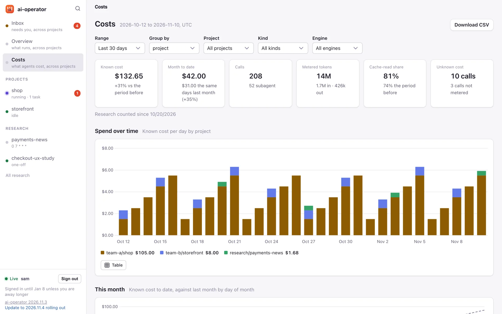

# Budgets and spend

Every agent call costs something, and the operator records each one. This
page shows where you see the spend in the Desk, what counts as spend, how
you give a milestone or an issue a [budget](../concepts/glossary.md#budget),
and what happens when one is used up. It also shows the lines of code the
agents wrote and merged next to the cost. Spend, budgets and the Metrics
page need the research database (see
[Install](../getting-started/install.md#add-the-database)).

## See the spend in the Desk



- **Cost chips** on each project, milestone and task show the cost and the
  tokens, for example `$12.34 · 1.2M tok`.
- **The *Metrics* tab** of a project or a milestone breaks that cost down,
  to the single call, next to its lines. See [The Metrics tab](#the-metrics-tab).
- **The Metrics page** (*Metrics* in the rail, or the dashboard's *today*
  and *last 7 days* chips) compares projects, kinds, models and engines over
  time, with the code, the flow and the pauses. See
  [The Metrics page](#the-metrics-page).
- **Lines** in a milestone's *Issues* table, the milestone rows and a
  task's runs. See [Lines of code](#lines-of-code).
- **The Inbox** shows a budget prompt and an issue at 80 % of its budget.

Unknown is never $0: a cost the Desk does not know shows *n/a*, and calls
without a cost are counted next to the figure (*+3 calls without cost*).

## What counts as spend

One record per agent call: planning, implementer steps, reviews, fix, CI and
conflict rounds, the describer, the pilot, the retrospective and Desk chat
turns. The Metrics tab, the Metrics page, the budgets and the
[retrospective](pilot.md#the-retrospective) all read the same records.

- **A call counts only itself.** Its tokens are everything it ran: the main
  model, its subagents and compaction. A call that resumes a session (an
  implementer step, a fix round, a chat turn) counts only its own part, not
  the earlier calls of the session.
- **Tokens add up.** A call's tokens split across its models, the main one
  and the subagents'. So the totals, the drill-down and every breakdown add
  up to the same tokens.
- **Claude's cost** is what the CLI reports. On a subscription that is the
  API price of the same work, not your invoice.
- **Cursor's cost** is reported when cursor sends one (the cursor CLI in the
  agent image sends none yet). Otherwise the operator estimates it from the
  tokens and the chart's [`pricing` table](../../charts/ai-operator/README.md#pricing),
  shown as `~$0.42`. Without tokens or a price the cost is *n/a*. Calls are
  not priced again when you change the table later.
- **Cursor's model `auto` is not metered.** Cursor picks the model and
  reports neither which one nor any usage. These calls show as *cursor auto
  (unmetered)*, count as *N calls not metered* next to the totals, and add
  nothing to tokens, costs or budgets. That holds for every role and
  profile on cursor with model `auto` (see
  [Agents and models](../reference/agents-and-models.md#roles)).
- **Old token basis.** Calls recorded by older releases counted tokens
  differently (subagents and chat turns). A total that includes them says
  *N of M calls on the old token basis*, or *old token basis* when all are
  old. They are not recomputed.

## Give a milestone a budget

Put a line into the milestone description, next to `/agent autopilot`:

```text
/agent spec
/agent autopilot
/agent owners @alice
/agent owner-subjects alice
/agent budget 40
```

The budget is in US dollars, decimals allowed. It covers every call of the
milestone, the pilot's included. A value that is not a number above 0 is
ignored, and the milestone has no budget. Like the owners, the line is not
part of the spec: changing it plans nothing again.

## Give issues a budget

Set a budget for every open issue of an autopilot milestone, and a heads-up
before it, in the [`AgentProject`](../reference/agentproject.md#specbudget):

```yaml
spec:
  budget:
    perIssueUSD: "20"
    perIssueAlertUSD: "15"
```

For one issue, comment on the issue or its merge request:

```text
/agent budget 40
/agent budget default
```

The first gives the issue its own budget, the second goes back to the
project's. The comment starts no run and is answered on the issue. In the
Desk, the task chat's `budget 40` does the same. Merged and skipped issues
have no budget any more. Neither field has a default: without them, issues
have no budget of their own.

## When a budget is reached

The operator checks the spend on every poll.

**At 80 % of the milestone's budget** the owners get a budget
[prompt](../concepts/glossary.md#prompt) in the Desk, also posted on the
[tracking issue](../concepts/glossary.md#tracking-issue). For $32.40 of $40
spent it offers:

- raise the budget to **$41** or **$49**;
- **keep going** (recommended: nothing changes);
- **pause now** (only while autopilot runs).

The two raises are 1.25 and 1.5 times the spend, in whole dollars. The
prompt comes once per budget value.

**At 100 %** autopilot [pauses](pauses.md#budget). The pause card in the
Desk shows a second prompt:

- raise the budget to either amount (the first is recommended);
- **end the milestone here**: the pending issues are skipped, and so are the
  active ones, since they cannot go on without spend. Autopilot is done.
- **stay paused**.

A raise rewrites the `/agent budget` line for you. If someone changed the
line by hand meanwhile to a higher amount, or removed it, their change is
kept, and the answer says so.

**What stops.** A running agent call is never killed: it finishes. After it,
nothing new starts or merges, as in every pause, and a run in progress stops
before its next call. The steps it pushed stay on the branch, and its
workspace and session are kept. Once the pause ends, the run goes on where it
stopped. Desk chat turns still run.

**How the pause ends.** Raise the budget above the spend, in the prompt or
in the description, or remove the line: autopilot goes on at the next poll.
`/agent resume` alone pauses again at once while the budget is spent.

**An issue's budget.** When an issue's calls reach its budget, autopilot
pauses for that issue ("#12 used its budget of $20.00 ($20.31 spent)").
A pending issue that spent its budget earlier pauses it before it starts.
The milestone's budget is checked first, then the issues in queue order.
Raise the issue's budget above its spend, go back to a higher default, or
skip the issue, and the pause ends at the next poll. Issue budgets get no
prompt.

## Heads-ups per issue

A heads-up pauses nothing. Once an issue's calls cost `perIssueAlertUSD`,
autopilot posts one comment on the tracking issue and wakes the
[pilot](../concepts/glossary.md#pilot), and goes on:

```text
💸 Heads-up: #12 spent $15.50, past the spend alert of $15.00 per issue (`budget.perIssueAlertUSD`). Autopilot keeps going.

- Top kinds: implement $7.75 (4 calls), conflict $4.65 (2 calls), review $2.32 (3 calls)
- Top models: claude-opus-5-5 $13.95, claude-sonnet-5-5 $1.55
```

An issue with a budget gets the same heads-up at 80 % of it: with
`perIssueUSD: "20"`, the heads-up comes at $16 and the pause at $20. Each
threshold an issue passes gets one heads-up (two passed in the same poll
get one, for the higher); a new value arms it again. An
issue that jumps past its budget in one poll gets only the pause.

The 80 % heads-up is also an Inbox item ("80 % of the issue's budget of
$20.00 spent") with a browser notification. It opens the issue's task, where
the chat's `budget <usd>` raises it. It leaves the Inbox when the issue
merges or is skipped, its budget is raised, or the budget pause takes over.

## Without the database

Budgets need the research database. Without it, or while the spend cannot
be read, budgets are not enforced, and the operator logs it on every poll:
autopilot never pauses for lack of data. Calls without a known cost add
nothing to a budget, so a budget on cursor without prices never runs out.

## The Metrics tab

The *Metrics* tab of a project or a milestone loads when you open it, and
does not follow live changes. It was called *Spend*: links with `?tab=spend`
still open it, new links use `?tab=metrics`. *Metrics across projects* opens
the Metrics page for the project.

- **Totals:** the cost, input, output, cache read and cache write tokens,
  calls (and subagent calls), checkpoints, duration and the cache-read share.
- **Lines** next to the totals: the written lines, and for a project,
  milestone or issue the merged production lines and the cost per 100
  merged production lines (see [Lines of code](#lines-of-code)). An issue's
  runs and calls have written lines only.
- **Drill-down:** a project's milestones, a milestone's issues (and its own
  planning, pilot and retrospective calls), an issue's runs, a run's calls.
  Click a row to go one level down; the crumbs lead back. The position is
  in the address, so you can send a link to it. An issue with a
  [companion](cross-repo-changes.md) has a *companion* marker: its calls
  edit both trees and count to the home issue.
- **A run's calls:** time, kind, role, engine, model and effort, whether
  the session was resumed, the engine it fell back from, tokens, and the
  cost with its source: reported, estimated (`~`) or *n/a*.
- **Model bars:** every row has a bar split by model, the main model first.
  *tokens | USD* above the table switches the unit. Hover a segment for the
  model, its tokens and its cost.
- **Breakdowns** by kind, role and model, highest cost first, and *By kind
  and model*, with the cost per 1M tokens, so "Opus with large outputs" can
  be read off. *By kind* also shows the written lines of the implementer
  kinds. A milestone and an issue also list the conflict calls per run;
  more than one marks a repeat.
- **Tuning tables**, with the average cost per call, to set the levers in
  [Agents and models](../reference/agents-and-models.md#roles):
  - *Review rounds:* the review calls by round. A high round-1 cost on big
    changes points at the reviewers' `maxInlineDiff`, many rounds at the
    fixes.
  - *Implementer steps: resumed vs fresh*, with the step commits' lines
    below (median, p90 and max), to see whether `implement.maxStepLines`
    keeps the steps small.
  - *With vs without subagents* per role, with the subagents' share of the
    tokens and the read gate's blocks per call. Many blocks mean the role
    keeps trying to read whole files.

Shares are of the known cost; when no row has one, of the tokens. Only
milestones without an *old basis* or *mixed basis* mark compare on tokens.

## The Metrics page

The Metrics page (`/metrics`) shows cost, tokens, code, flow and pauses
across every project you may see, and research cost when you may read it.
It replaced the Costs page: an old `/costs` link opens `/metrics` with the
same filters. The filters are in the address, so a link shows the same
page, for example `/metrics?range=90d&group=model&kind=implement`:

- **Range:** the last 30 days by default, 7 or 90 days, this month, last
  month, 12 months, or your own dates. Days are your browser's.
- **Group by:** project (the default), kind, model or engine.
- **Filters:** project, kind and engine.

Without a project filter, the page is the general view of all your
projects. With one, `/metrics?project=namespace/name`, it is that
project's metrics: the *Metrics* button on the project's stream opens it.

At the top: the known cost of the range against the period before, month
to date against the same days of last month, calls, metered tokens, the
cache-read share, and the calls of unknown cost. Below them:

- **Cost:**
  - *Spend over time:* the known cost per day, week or month, one colour
    per group key (the top six, then *Other*).
  - *This month:* this month's running cost as a line, last month's dashed
    next to it.
  - *Where it goes:* the known cost by project, kind, model or engine. A
    click on a project, kind or engine row filters the page.
- **Tokens:** the tokens per bucket by type, with the cache-read share.
- **Most expensive:** the top ten milestones, issues and runs of the range.
  Each opens its place in the Metrics tab.
- **Cost per 100 written lines:** the issues of the range by experiment arm
  (per project, only when issues ran in an experiment), by model, by
  effort and by step session. Each row shows the merged issues, the
  written lines of their implement calls, the cost and tokens of all its
  issues, and the cost per 100 of those lines. A row with fewer than 5
  merged issues is greyed out: too few to compare. How to run an
  experiment and read these tables is in [Cost levers](cost-levers.md).
- **Context:** per project, the median base context per role (what a
  fresh session holds before the agent starts) and the five tools whose
  results put the most tokens into the context.
- **Plan usage:** each engine's 5-hour and 7-day usage windows, live.
- **Budgets:** the budgets of milestones still on autopilot and of their
  issues, by share used, in the warning colour from 80 %. The page only
  shows them; you set budgets as above.
- **Code:** the written lines and the merged production lines per bucket
  side by side, tiles for the written lines, the merged lines of each
  category and the cost per 100 merged production lines, and without a
  project filter the same per project. See [Lines of code](#lines-of-code).
- **Flow:** the issues merged in the range per bucket, the median wall
  time (first run to merge), the median agent time (the sum of the issue's
  call times), and the review and fix calls per merged issue.
- **Pauses:** see [Pauses on the Metrics page](#pauses-on-the-metrics-page).

Code, Flow and Pauses follow the range and the project filter only. While
Kind or Engine is set, they say "Kind and engine filter cost and tokens
only".

*Download CSV* saves the series or the breakdowns of the current filters as
a spreadsheet file. An unknown cost is an empty cell, never 0.

**Limits of the figures.**

- The cost is what the calls report or what the prices estimate, not an
  invoice.
- Calls without a cost are not in any cost figure or bar; they are counted
  next to it. Unmetered calls are never drawn as zero-token bars.
- A range that mixes old and new token bases says so once.
- Research counts from its first stored call; older research cost is on the
  research page only.
- Calls expire with `research.historyRetention` (the default is in the
  [chart values](../../charts/ai-operator/README.md#research)), so a range
  starts no earlier than that.

### Pauses on the Metrics page

The *Pauses* section counts the [pauses](../concepts/glossary.md#pause) of
your autopilot milestones that started in the range:

- the pauses per bucket, stacked by kind, and the paused hours per bucket;
- tiles: the number of pauses, the paused time, the mean time to resume,
  and the pauses open now;
- tables by kind (count and time), by who resolved them and by how they
  ended;
- without a project filter, the same per project;
- the 10 longest pauses (project, milestone, kind, reason, length). Each
  opens the milestone's *Pilot* tab.

A pause counts in the bucket where it started, with its full length; an
open one counts up to now. A pause that started before the range is left
out, even if it ended in it. Only milestone pauses count: an issue's
[hold](../concepts/glossary.md#hold) is not recorded as a pause yet. The
section reads at most the newest 20000 pause events; above that it says
"Counts only the newest 20000 pause events."

## Lines of code

The Desk counts two kinds of lines next to the cost. Both show as
`+added/−deleted`, for example `+40/−5`, and neither replaces the other.

- **[Written lines](../concepts/glossary.md#written-lines)** measure effort:
  the lines of every step commit the implementer calls left, rewrites and
  fix rounds included. Every file counts, tests and docs too.
- **[Merged lines](../concepts/glossary.md#merged-lines)** measure the
  outcome: the final diff of the issue's merge requests, counted once from
  GitLab when each one merges on an autopilot milestone. They are split
  into four categories.

A file's category comes from its new path, or the old path of a deleted
file. The first match wins:

| Category | Paths |
|---|---|
| generated | `zz_generated*`, the web UI's generated types, the CRD and RBAC manifests, `charts/*/files/**`, protobuf Go code, `go.sum`, `package-lock.json`, `pnpm-lock.yaml`, `yarn.lock` |
| tests | Go test files, `**/test/**`, `**/tests/**`, `**/testdata/**`, `*.test.*`, TypeScript spec files |
| docs | `docs/**`, `*.md` |
| production | everything else |

So a Go test file under `docs/` is tests, and a Markdown file among the
generated web types is generated. The same list applies to every
repository, companions included, and you cannot change it. The exact
patterns are in [Merged lines](../contributing/design.md#merged-lines).

**Companions count to the home issue.** The merged lines of an issue's
[companion](../concepts/glossary.md#companion-repository) merge requests add
to the issue's merged lines, and per project they count under the home
project. A companion that merges later does not move the issue's merge
time. In a milestone's *Issues* table, *Merged* shows the production lines;
its tooltip lists the four categories and each companion's share, for
example `group/infra +12/−3`.

**Cost per 100 merged production lines.** The cost of all calls of the
issues merged in the scope or range, calls before the range included,
divided by their merged production lines (added plus deleted, companions
included), times 100. Only measured issues count, on both sides: an issue
without merged lines adds neither cost nor lines, and the figure says
which share was measured, for example "2 of 3 measured". It carries the
same notes as the cost (unmetered calls, old token basis).

**What the signs mean.**

- `—`: not measured. The issue merged before the Desk counted merged
  lines, or GitLab's diff could not be read at merge. For the cost per 100
  lines: the cost is unknown or there are no production lines.
- `≥ +A/−D`: a partial count. GitLab sent some file's diff without its
  content (collapsed or too large); those lines are not guessed, so the
  real count is higher.
- `≤ $1.20`: a cost per 100 lines over a partial count, so the real figure
  is lower.

There is no backfill: merged lines start with the first merge after the
release that added them, and older issues show `—`. Written lines exist
for every call the research database still keeps.

## Ask the database

For a question the Desk does not answer at once, such as "why did #179
cost $53.88" or "what do conflict rounds cost on Opus", a read-only report
script runs against the research database. It lists per issue the kinds,
models, runs, review rounds, tokens and cost, the conflict calls by model,
every call of one issue in order, and every cursor and `auto` call with the
call that followed it. How to run it is in
[Spend report script](../contributing/design.md#spend-report-script).

## Next

- [When autopilot pauses](pauses.md#budget): the `budget` pause and its
  ways out.
- [`spec.budget`](../reference/agentproject.md#specbudget): the per-issue
  fields.
- [Agents and models](../reference/agents-and-models.md): the levers the
  tuning tables point at.
- [Cost levers](cost-levers.md): try those levers side by side and compare
  the cost per merged line.
