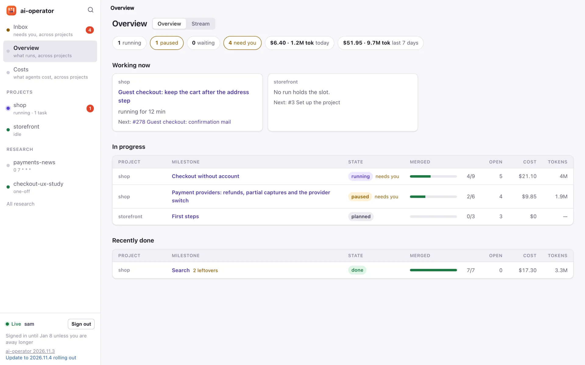
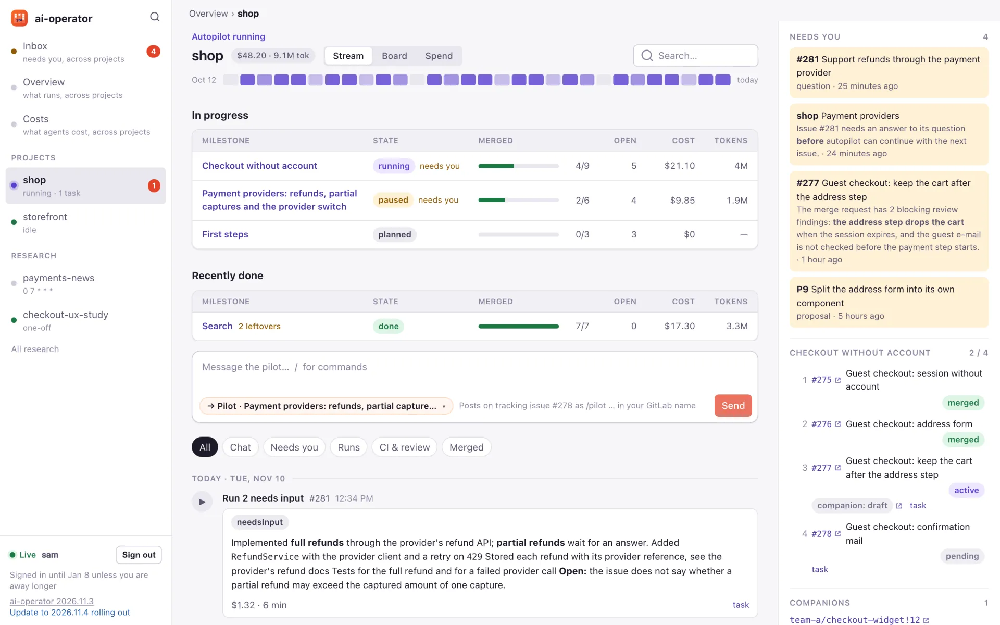
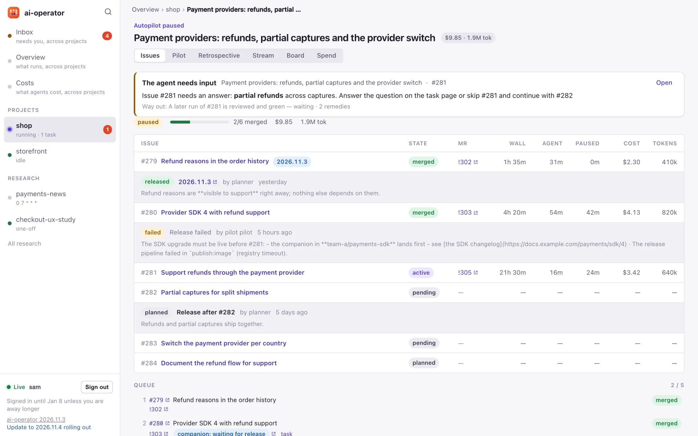
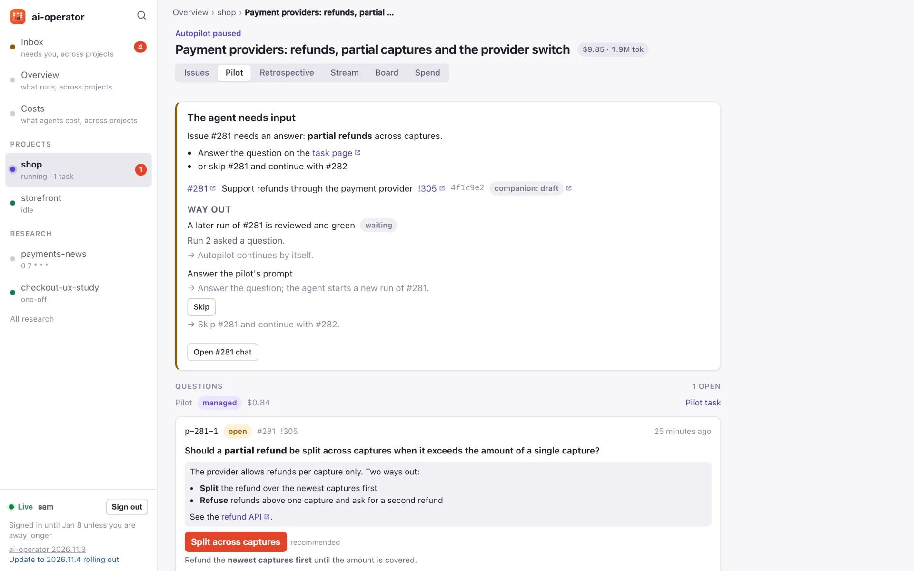
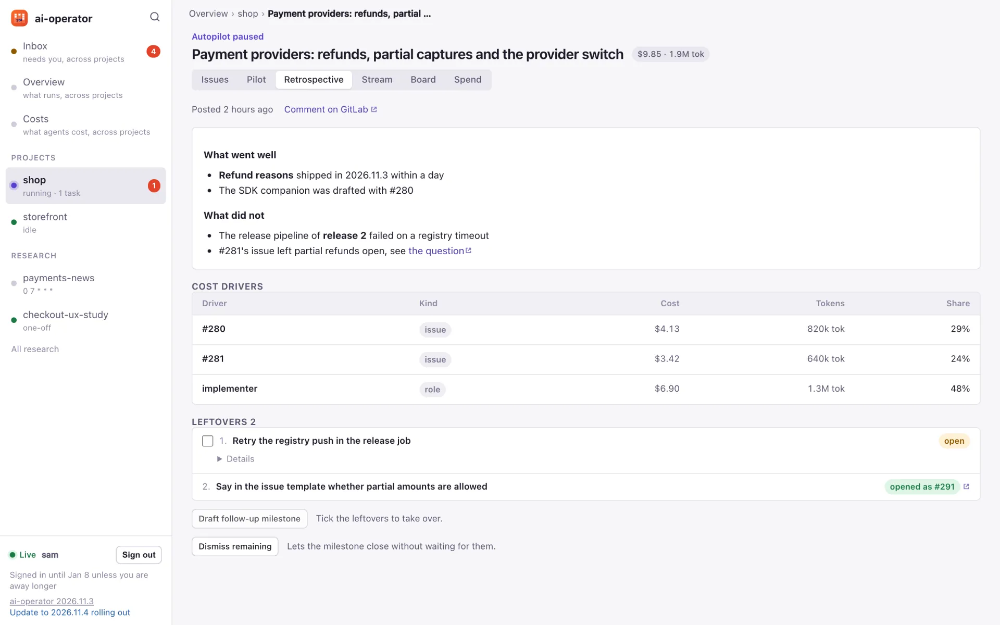
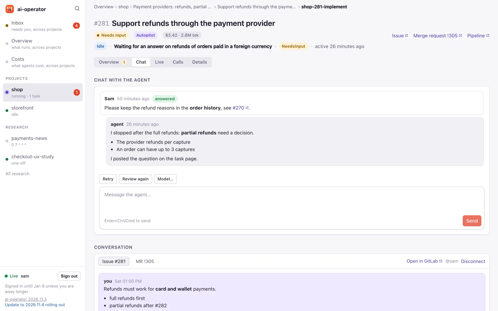

# The Desk

The [Desk](../concepts/glossary.md#desk) is the web UI where you steer ai-operator. You see
what needs you, follow every [milestone](../concepts/glossary.md#milestone) and
[task](../concepts/glossary.md#task), and act on them: answer prompts, talk to the
[pilot](../concepts/glossary.md#pilot), chat with an agent, resume a pause. This page shows
how you get in, who sees what, and what each view shows. What you do in them is in
[Steer from the Desk](steer-from-the-desk.md). To turn the Desk on, follow
[Turn on the Desk](../getting-started/turn-on-the-desk.md).

## Log in

Open the Desk's address and sign in at your identity provider. The Desk
opens on *Overview*. Your user name is at the bottom of the rail on the
left; hover over it to see the roles the Desk got from your provider.

Your login renews itself while you use it, and your roles are read again
each time. A role you lose at the provider is gone in the Desk within
minutes. If the login ends while a page is open, the Desk signs you in again
by itself and puts back text you had not sent yet.

## Who sees what

Nobody sees anything unless an access rule grants it. You write the rules
in the chart values, under `ui.authorization.rules`. A rule matches a user
who has **any** of its `roles`; `"*"` matches every logged-in user. A user
sees what all matching rules grant together.

```yaml
ui:
  authorization:
    rules:
      - roles: [ai-operator-admin]      # every project, every grant
        transcript: true
        steer: true
        conversation: true
        chat: true
      - roles: [shop-devs]
        projects: ["agents/shop"]       # streams, boards and tasks only
```

- **`projects`** are `namespace/name` patterns with `*` and `?`; `*` does not
  cross the `/`. Without `projects` the rule grants every project. Seeing a
  project means seeing all its tasks. A project you may not see does not
  exist for you in the Desk.
- **`chat: true`** lets you send Desk chat messages to agents, answer
  [prompts](../concepts/glossary.md#prompt), and use the buttons on pause
  cards and in the queue. It needs the chat writer login (`ui.chat.writerSecret`)
  and `agents.chat: true` in the project. Who may chat is decided by this
  grant, not by GitLab membership.
- **`steer: true`** lets you write GitLab comments from the Desk, in your
  own name (see [GitLab comments](steer-from-the-desk.md#gitlab-comments-from-the-desk)).
  GitLab's own permissions apply on top. It also lets
  [owners](../concepts/glossary.md#owner) plan milestones, read a task's
  logs and turn leftovers into a follow-up milestone.
- **`conversation: true`** shows the text of GitLab comments in the streams
  and of Desk chat messages. These are readable without access to the
  GitLab project, so they are a grant of their own. Without it a comment
  shows as who commented where, with a link.
- **`transcript: true`** shows the live transcripts of runs. They can quote
  code, issue text and CI logs.

Answering a milestone's prompts and the owner-only buttons (such as
*Move to top*, *Merge anyway*, *Revisit* and *Restart run*) also need your Desk user name on the milestone's
`/agent owner-subjects` line (see [Owners and pings](owners-and-pings.md)).

A user whose roles match no rule sees *No projects* in the rail. The roles
under your user name help you fix the role mapping.

### Map your provider's claims

Two chart values read your user name and roles from the login token:
`ui.oidc.claims.username` and `ui.oidc.claims.roles`. Each is a
[CEL](https://cel.dev) expression over `claims`, the token's claims plus
those only the provider's userinfo endpoint returns. `username` must give a
string. `roles` may give a list of strings, one string, or a map whose keys
are the roles. If the roles claim is missing, the user has no roles. If the
user name cannot be read, the login fails, and the Desk's log says why. The
expressions for common providers are in
[Turn on the Desk](../getting-started/turn-on-the-desk.md#other-providers).

### Research rules

With the research database the Desk also has a *Research* section. A rule
with `research` set is a research rule: `research: read` shows researches
and their results, `research: write` also lets you start one-off researches
and delete your own (with `ui.research.allowCreate`). `researches` are
`namespace/name` patterns like `projects`.

Project rules and research rules are kept apart: a research rule grants no
project and must not set `projects`, `transcript`, `steer`, `conversation`
or `chat`, and a project rule grants no research. So add a rule for each:

```yaml
ui:
  research:
    allowCreate: true
    namespace: agents                   # where one-off researches are created
  authorization:
    rules:
      - roles: [ai-operator-admin]      # every project
        transcript: true
      - roles: [ai-operator-admin]      # every research, and one-offs
        research: write
      - roles: [news-readers]           # only the news flashes
        research: read
        researches: ["agents/news-*"]
```

One-off researches are created in `ui.research.namespace` only, so the write rule must
match names there (for example `agents/*`). A user may start 10 per hour and delete only
their own. Scheduled researches are managed with `kubectl`.

## Find your way



- **The rail** on the left has *Inbox*, *Overview*, *Metrics* (cost, code,
  flow and pauses across projects, see [The Metrics page](budgets-and-spend.md#the-metrics-page);
  old `/costs` links open it), *Plans* (with Desk chat), your projects with a status dot
  (running, needs you, idle), a count of what needs you, the counts of active and
  [settling](../concepts/glossary.md#settling) milestones, the researches, and how much
  of each [engine's](../concepts/glossary.md#engine) usage window is used. Its footer has
  the [theme switch](#light-dark-or-auto) and the operator's version, with a note when an update is rolling out or out.
- **Breadcrumbs** lead back up from pages below the top level: *Overview* ›
  project › milestone › issue, or *Overview* › project › *Plans* › plan.
- **Search**: ⌘K (macOS) or Ctrl+K opens the search from anywhere. It finds
  projects, milestones, issues and merge requests, and pages such as the
  Inbox, *Plans* or *Plan milestone*, which opens the project's *Plans* tab.
- **Live**: every page updates by itself.

### Light, dark or auto

The switch in the rail's footer picks the Desk's colours: *Light*, *Dark*
or *Auto*. On a phone, tap *Projects* in the bottom bar to open the rail;
the switch is at its bottom. *Auto* follows your system and changes with
it. *Light* and *Dark* stay as you set them. This browser remembers your
choice; another browser or device starts on *Auto*.

## Inbox

The *Inbox* lists what needs you across your projects, newest first. The
count also shows in the browser tab's title, as `(3) Desk`:

- prompts and questions from an agent or the pilot;
- tasks that failed or are blocked;
- paused autopilots, as a short pause card. A strip on top says how many
  autopilots are paused and for how long, longest first;
- [companion](../concepts/glossary.md#companion-repository) merge requests
  ready for the owners to merge;
- issues that spent 80 % of their own [budget](../concepts/glossary.md#budget);
- a status write of the pilot that the cluster refused, for a day.

A row opens where you act: a milestone's *Needs you* tab, or the task page.

The *Open | Handled* switch on top changes the list. *Handled* shows up to
50 rows that closed in the last 7 days, newest first: the prompts, with who
closed them and why, and the actions the pilot ran on its own or after an
owner accepted them. A row opens the issue's problem on the milestone's
*Needs you* tab; `/inbox?view=handled` opens *Handled* directly.

### Browser notifications

Click *Notify me* in the Inbox header and allow notifications in your
browser. While they are on, each new pause, prompt, pilot proposal,
question from an agent, ready companion and budget warning raises one
notification; failed and blocked tasks only count in the Inbox. A click
opens the Inbox row's place. They only come while a Desk tab is open (no
e-mail or push). Click *Notifications on* to turn them off.

## Overview

*Overview* (`/`) shows, from top to bottom:

- **the summary**: milestones running, paused and waiting, what needs you,
  and the spend of today and the last 7 days;
- **Working now**: one card per project with the issue that runs now and
  for how long, what is next, usage limits, and *N finishing* when done
  milestones still wait to be closed;
- **In progress**: every milestone in work, those that need you first;
- **Recently done**: the newest done milestones, *Show all* for more;
- **Timeline**: which issue of which project ran when, in the last 6 h,
  24 h or 7 d ([the Overview timeline](milestone-order-and-timeline.md#the-overview-timeline)).

A milestone row shows its progress (merged of all issues), open issues, cost
and tokens, and the retrospective's open leftovers; an unknown cost is a dash,
never $0. The *Stream* tab shows every event of all your projects.

## A project



A project page has the tabs *Stream | Decisions | Board | Metrics*, and *Plans*
with Desk chat:

- **Stream**: the project's [run-order queue](milestone-order-and-timeline.md#the-queue),
  which owners drag into order, the [milestones that are finishing](steer-from-the-desk.md#the-queue-and-finishing),
  its milestones in progress and done, then the stream: what happened,
  newest first. A message box sits above the stream; a paused milestone
  pins its short pause card over it.
- **Decisions**: the decisions of all its milestones, or of the one you pick.
- **Board**: one board per milestone, plus the issues without one.
- **Metrics**: what the project's agent calls cost, with its lines of code.
- **Plans**: the project's [plans](write-a-milestone.md#draft-it-in-the-desk)
  and, for an owner, *Plan milestone*; a [plan's decisions](write-a-milestone.md#answer-the-agents-decisions) have a wizard.

A switch narrows the stream: *All*, *Chat*, *Needs you*, *Runs*, *CI & review* and *Merged*.
Comments on the same issue or merge request are one card. A strip shows the
last 30 days; click a day to jump there. *Load older* goes further back.

On a wide screen a panel beside the stream shows what needs you in the
project, the active milestone's queue and the last 30 days. On a phone or
tablet the *Context* button opens it.

## A milestone

A milestone page has the tabs *Issues*, *Needs you*, *Decisions*, *Pilot*,
*Retrospective* (once written), *Stream*, *Board* and *Metrics*. The tab
is part of the address, so you can send a link to it.

### Issues



The milestone's state, progress and cost, then one row per issue: its
title, state, merge request, wall time (first run to merge), agent time,
time paused, cost, tokens, and written and merged lines (see [Lines of
code](budgets-and-spend.md#lines-of-code)). An issue that shipped shows its version.
Between the issues sit the releases, at the point they were decided:
*Release after #N*, *Releasing…* with its pipeline, or the version with a
link to the GitLab release.

Below, *Timeline* shows when each issue ran, waited and was held (see
[The issue timeline](milestone-order-and-timeline.md#the-issue-timeline)).
*Lanes* groups the issues: *Running*, *Landing*, *Ready to land*, *Waiting*, *Held* and *Done*, with the
[waves](../concepts/glossary.md#wave) of the plan. Each item shows its merge
request, task and [decisions](../concepts/glossary.md#decision). Owners set
how many issues run at a time here. A milestone with companion merge
requests lists them under *Companions*.

Click a row to open the **issue page**: the same figures, the task while one
works on the issue, and the issue's own stream.

### Needs you



What waits for the milestone's owners; the tab reads *Needs you · n* while
n problems and proposals are open. On the left are the
[problems](../concepts/glossary.md#problem-thread), one per stuck issue and
one for the milestone (a budget pause), open first, each with its status
(*Waiting for you*, *Operator acting*, *Pilot looking*, *Resolved*), time and
cause. Under them are the pilot's proposals with *Accept* and *Reject*, and
the pause totals. Click a problem to open its **thread** beside the list
(below on a phone): what happened, oldest first, and one place to act at the
bottom ([The problem thread](pilot.md#the-problem-thread)). Each problem has
its own address; old `#prompt-Q3` or `#problem-280` links open it.

### Decisions

Every [decision](../concepts/glossary.md#decision) of the milestone's
issues, grouped by issue. A card shows the question, the option chosen
(*Chosen*), the alternatives, why, the run and a link to the comment on
GitLab. The tab needs the history database. A replaced decision is muted and links
to the one that replaced it. Search the ID or text, or pick *Active* or
*Superseded*. A link ending in `#D42-3` opens that card.

A revisited decision shows its chain: who asked, what for, the comment or
follow-up issue, and the decision that replaced it. A line says what a
revisit does. Owners get *Revisit* (opens the prompt in *Needs you*),
*Comment* (on an open issue, in your GitLab name) or a command to copy.
See [Read and revisit decisions](decisions.md).

### Pilot

The pilot's autonomy and cost, *Message the pilot*, and the pilot's events
(questions as one line each, answers, pauses, releases, comments and chat):
[Steer from the Desk](steer-from-the-desk.md#ask-the-pilot).

### Retrospective



Once the milestone is done: the pilot's [retrospective](../concepts/glossary.md#retrospective),
the cost drivers (the issues and roles that cost most), and the leftovers
with their state. Owners turn leftovers into a follow-up milestone here, see
[The retrospective](pilot.md#the-retrospective).

### Stream, Board and Metrics

*Stream* is the runtime: runs, pushes, CI, reviews and merges, with the
switch *All*, *Runs*, *CI & review* and *Merged*. The pilot's events are on
*Pilot*, so the two tabs share nothing. *Board* is the milestone's board,
*Metrics* its cost and [lines](budgets-and-spend.md#lines-of-code); `?tab=spend` still opens it.

### Done milestones

With the research database, a done milestone stays on the Desk after its
tasks are deleted, read from history: the *Issues* tab says *From history*,
and there is no board and no message box. Without the database the Desk
shows only milestones with live tasks, and no spend or per-issue figures.

## A task



A task page states the task's status once, above the title (its phase, such
as *Running*). The line below has the step and how long it runs, the last
result and activity, restarts if any, *Stalled* when the
[watchdog](../concepts/glossary.md#watchdog) sees no progress, and the cost.
On the right are the merge request and *Restart run* (owners with the `chat`
grant); other links are in the ⋯ menu. Banners show a block, a usage limit or
an out-of-memory restart.

Its tabs, each shown when there is something in it:

- **Overview**: the last run's summary, the agent's questions, review
  findings, and the pipeline with its fix rounds and failed jobs. A Spec
  task adds the plan and the autopilot's state.
- **Chat**: *Chat with the agent* and the GitLab conversation, see
  [Steer from the Desk](steer-from-the-desk.md#chat-with-an-agent).
- **Live**: the [live transcript](#live-transcript), with the `transcript`
  grant.
- **Logs**: for owners with the `steer` grant, the last 500 lines of the
  runner's or the agent's container, *Download*, and *Follow* for new
  lines.
- **Calls**: every agent call, with the database: per run its written lines
  and its calls with model, tokens, duration and cost; for the implementer
  the lines each call changed; a 💾 badge where a call saved a checkpoint;
  and a chart of how the session's context grew.
- **Details**: runs, spend, branch and last push, the pod and how to follow
  its logs, and the conditions.

A task's stage follows its status the same way the operator sets the GitLab
labels; hover a badge to see why. After a push the task stays in *CI* until
the operator has seen that commit's pipeline.

### Live transcript

The *Live* tab follows the task's pod while it runs:

- the runner's steps, with their results;
- which agent runs: role, engine, model, read-only or not;
- what the agent says and thinks (thinking: claude only), and the tools it
  calls with their main argument;
- a subagent's work as one folded row with its name, model and tokens, which
  opens to its own lines;
- with `spec.agents.logPrompts: true` in the project, every prompt the
  agent gets (see [Agents and models](../reference/agents-and-models.md)).

The lines are what the containers logged, shown as text. A pod stops about
a minute after its run; then the tab is empty, and the run log is on the
merge request. A project in a namespace the chart does not list in
`agent.namespaces` has no transcripts.

## Research

With the research database and a research rule, the rail lists the
researches under *Research*, and on a phone the bottom bar has
*Research*. The research list has one card per research: its view (news
flash or report), schedule or *one-off*, the last and next run, and the
agent. A research's page shows its prompt, feeds and the latest result: a news flash groups items by topic, important and new
ones first; a report shows its blocks in order. *Run history* lists the
stored runs with their cost. With `research: write`, *New research* starts a
one-off research. More in [Research](research.md).

## Watch progress in GitLab

GitLab shows the same work in its own views. The operator assigns its bot
user to an issue it picks up, so GitLab lists it as **Ongoing** (turn it off
with [`workflow.assignBot`](../reference/agentproject.md#specworkflow)), and
the agent's merge requests carry the issue's milestone.

## Run without login

On a test cluster you can run the Desk
[without login](../getting-started/turn-on-the-desk.md#without-login).
Everyone who can port-forward to it then sees every project.

## What the login protects

- The Desk runs apart from the operator, with its own account. It can read
  projects and tasks and the logs of agent pods. It never holds the
  operator's GitLab token, the agent credentials or any Secret.
- It changes no task itself: it steers by comments and chat messages the
  operator reads and checks.
- It writes to GitLab only in your name, with your token and the `steer` grant.
- Agent text (summaries, comments, research results) is shown as text with
  a safe subset of markdown: no HTML, no images, links only to `http(s)`.
- The Desk only runs over https; your session lives in encrypted cookies.

More in [Security](../concepts/security.md#what-the-desk-login-protects).

## Next

- [Steer from the Desk](steer-from-the-desk.md): chat, prompts, Revisit,
  pause cards, the queue and the planner.
- [Order milestones and read the timeline](milestone-order-and-timeline.md).
- [Turn on the Desk](../getting-started/turn-on-the-desk.md): set it up.
- [Desk API](../reference/desk-api.md): the same data for scripts.
