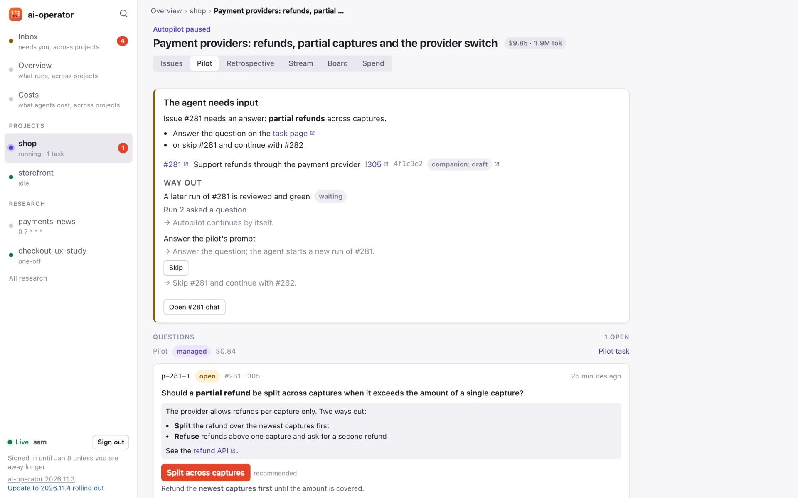

# When autopilot pauses

[Autopilot](../concepts/glossary.md#autopilot) pauses instead of guessing.
This page shows what a pause and a hold are, how you see one in the Desk,
how it ends, and then each kind of pause: what it means, what the
[pilot](../concepts/glossary.md#pilot) tries, and what you do.

## Pause or hold

A [pause](../concepts/glossary.md#pause) stops the whole milestone: nothing
new starts and nothing is merged. A [hold](../concepts/glossary.md#hold)
stops one issue only.

- Problems of one issue hold that issue when the milestone runs more than
  one issue at a time (its `/agent parallel` line, else
  [`autopilot.maxParallel`](../reference/agentproject.md#specautopilot)).
  These kinds are `needsInput`, `runFailed`, `findings`, `reviewErrors`,
  `notReviewed`, `ciRed`, `ciCanceled`, `mergeRequest`, `companion` and
  `stalled`. The held issue gives up its slot and the
  [landing lane](../concepts/glossary.md#landing-lane), and the other issues
  run, land and merge.
- At a limit of 1, the same problems pause the milestone. A problem of the
  fix of a red default branch always pauses the milestone, with the kind of
  the problem.
- The milestone kinds always pause: `owner`, `budget`, `mainRed`, `config`,
  `cycle`, `emptyPlan`, `release` and `stuck`. When every running issue is
  held and nothing else can start, the milestone pauses as `stuck`.

The [tracking issue](../concepts/glossary.md#tracking-issue) says what
happened and mentions the milestone's [owners](owners-and-pings.md):

```text
⏸️ #12 is held: CI is red after the fix rounds. The other issues go on.
```

The comment names the reason and the ways out of its kind: first what ends
it by itself, then the commands, labels or GitLab actions that end it, with
what each does. Text quoted from GitLab, such as job names, is made inert,
so mentions and quick actions in it do nothing. The tracking issue's
description lists every hold under its status line.

## In the Desk



The milestone's [*Needs you* tab](desk.md#needs-you) shows a pause that names one issue in that issue's
[problem thread](pilot.md#the-problem-thread). Other pauses, such as a spent
budget, are the milestone's own problem. At the bottom of the thread are the
cause, the paused issue and its merge request, what ends the pause by itself,
and buttons for the ways out: *Retry*, *Review again*, *Resume*, *Skip*,
links to the issue's chat, the pipeline, the merge request or the plan, and
for an owner *Merge anyway*. A hold shows the same way in its issue's
thread, with *Resume*. The *Issues* and
*Activity* tabs, the Board and the Inbox show a short card that links there.

The buttons send the same commands as the comments below, and the card shows
the operator's answer. A `mainRed` or `budget` pause shows its
[prompt](../concepts/glossary.md#prompt) instead of a bare *Resume*. The
pilot's prompts about the pause are on the same tab. Once a pause has
ended, it stays under *Handled* on that tab, with who ended it and how,
next to the issue's questions and the pilot's actions.

## While it is paused

Runs that were already asked for still finish, and your `/agent` comments
still reach the agent. Nothing new starts and nothing is merged. A run of the
paused issue gets the reason in its prompt, so `/agent investigate the root
and fix it` on that issue knows what "it" is.

Autopilot checks a pause over an issue on every poll. When the reason is
gone but the issue fails the [merge gate](autopilot.md#the-merge-gate) for
another reason, you get a new comment with the new reason.

The pilot looks at every pause but your own `/agent pause`. When it
[manages](pilot.md#when-it-acts-on-its-own) the milestone, it may retry,
re-review, rebase or restart a run on its own, a few times per issue. Else it
asks you in a prompt. See [The pilot](pilot.md).

## How it ends

Most pauses over an issue end by themselves:

- the merge request was merged by hand, or the issue was closed. Autopilot
  counts it as merged (merged by hand, or closed with `agent::done`) or as
  skipped, and goes on;
- a later run fixed the problem, for example after your `/agent fix the
  findings`: it ran, was reviewed and CI is green, so autopilot merges;
- the default branch is green again after a merge freeze;
- the budget was raised, a companion can go on, or an issue can start again.

The tracking issue then says `▶️ Autopilot continues: …` and who ended it:
"(ended by @alice)", "(ended by Ada via the Desk)", "(ended by the pilot)",
"(ended by a later run of #12)", "(ended by hand: the merge request was
merged)" or "(ended by the operator: the cause went away)". A hold that ends
says `▶️ #12 goes on: <why>`. The retrospective reads these comments.

You end a pause with `/agent resume` on the tracking issue, or *Resume* in
the Desk. It lifts the pause and every hold. `/agent resume #12` lifts the
hold of #12 only. Neither checks the cause: an issue whose problem is still
there is held or paused again on the next poll.

When a pause ends, a block of the issue for `infra` is lifted and the issue
gets its label back. A block after a run that failed for an outside reason
waits for a new run instead. Autopilot asks for one re-review per head: if
the reviewers fail on a head they checked again already, it pauses at once.

**A pause that nothing moves.** If nothing in the pause changes for
[`pilot.stuckAfter`](../reference/agentproject.md#specpilot), the pilot
assesses it once more and gives you a prompt with the ways out as options.
That prompt always waits for you, also when the pilot manages: nothing
resumes on its own.

**A status write the cluster refused.** When the cluster refuses to save
the pilot's or the operator's state, the tracking issue gets one line
("⚠️ The API server rejected a status write of the pilot …") and the Desk
Inbox shows *Pilot write rejected* for a day.

## The kinds

### When it pauses

Commands go on the tracking issue unless they say "on the issue". Every
pause over an issue also ends when its merge request is merged by hand or
the issue is closed. For a kind that holds an issue, `/agent resume #N` lifts
that hold.

#### `owner`

An owner paused the milestone with `/agent pause` or *Pause* in the Desk.
Nothing ends it by itself, and the pilot does not assess it.

- `/agent resume`, or *Resume* in the Desk: autopilot continues.

#### `cycle`

The plan has a dependency cycle: issues depend on each other in a ring. The
pilot assesses it and asks you in a prompt.

- Change the milestone description so the issues no longer depend on each
  other in a cycle, then `/agent resume`: the milestone is planned again and
  autopilot continues with the new plan.
- `/agent skip #N`: the issue is skipped, which breaks the cycle for the
  issues after it.
- `/agent resume`: autopilot checks the plan again.

#### `stuck`

Nothing can start and no issue runs. The remaining issues wait for skipped
issues, for issues outside the queue ("blocked by" links), or for each
other. Above a limit of 1 it is also `stuck` when every running issue is
held. Issues that wait for a running issue are no reason to pause.

It ends by itself once an issue can start: a skipped dependency closed as
done, a link removed, an unskip, a start anyway, or a hold that ends. The
pilot gives you a prompt with options such as "Mark #83 done" (another
milestone replaced it) or "Start #88 anyway". It never runs them without
your answer. You can also:

- set `agent::done` on the skipped issue and close it, or merge it by hand:
  it counts as merged, so the issues that wait for it can start;
- remove the "blocked by" link of the waiting issue;
- `/agent unskip #N`: the skipped issue goes back to pending, and autopilot
  picks it once it can start;
- `/agent startAnyway #N`: the waiting issue may start although an issue it
  depends on was skipped. Its other dependencies still hold;
- `/agent skip #N`: the waiting issue is skipped, and autopilot goes on with
  the others;
- `/agent resume`: autopilot looks for an issue that can start again.

#### `needsInput`

An issue is in `agent::needs-input`. The reason names the cause:

- "#12 needs input: CI is red after the fix rounds: failing jobs `lint`,
  `test` (pipeline link)";
- "#12 needs input: the run failed: <error> (link)". A usage limit names
  the engine and its reset time in UTC;
- "#12 needs input: the agent asks: <question> (link to the report)".

It ends by itself once a later run passes the merge gate. The pilot
classifies the cause and proposes a retry or an instruction, or runs it when
it manages. In the Desk, answer the agent's questions on the issue's task
page.

- Answer its questions and set `agent::ready` on the issue: a new run
  starts with the answers.
- `/agent retry` on the issue, or *Retry*: the agent runs again. A run that
  passes the gate ends the pause.
- `/agent skip #N`, or *Skip*: the issue is skipped and autopilot goes on.
  Issues that depend on it wait until it is done by hand.

#### `runFailed`

An issue's run failed. It ends by itself like `needsInput`. The pilot reads
the run's report and log, and may retry on its own when it manages.

- `/agent retry` on the issue, or *Retry*: the agent runs again.
- `/agent skip #N`, or *Skip*: the issue is skipped.

#### `findings`

The review left blocker or major findings. It ends by itself like
`needsInput`, for example after `/agent fix the findings` on the issue. The
pilot may retry with the findings.

- `/agent retry` on the issue, or `/agent skip #N`.
- `/agent merge #N <sha>`, or *Merge anyway* (owners only): autopilot merges
  this head without a full review. CI, the merge request's state and
  approvals still apply.

#### `reviewErrors`

Reviewers failed. The reason names each one and why, such as "bugbot failed
(usageLimit, resets 16:00 UTC), coderabbit failed (timeout)". When every
reviewer failed for a passing reason, an outage say, autopilot first waits
[`agents.review.retryAfter`](../reference/agents-and-models.md#roles) and
asks for one review again. It pauses only if that fails too. It ends by
itself like `needsInput`. The pilot may ask for another review on its own.

- `/agent review` on the issue, or *Review again*: the reviewers check the
  pushed head again.
- `/agent retry` on the issue, or `/agent skip #N`.
- `/agent merge #N <sha>` (owners only), as for `findings`.

#### `notReviewed`

The review did not see the pushed head, or the pushed head of the
[companion](../concepts/glossary.md#companion-repository). It ends by
itself like `needsInput`.

- `/agent review` on the issue, or *Review again*: the reviewers check the
  pushed head again.
- `/agent retry` on the issue, or `/agent skip #N`.
- `/agent merge #N <sha>` (owners only), as for `findings`.

#### `ciRed`

The merge request's pipeline is red, or the companion's is, and the CI fix
rounds did not make it green. The reason names the failing jobs, and says so
when they also fail on the default branch. It ends by itself like
`needsInput`. If the failing jobs also fail on the default branch, and that
branch is green again at a commit the merge request is not based on,
autopilot rebases the merge request once and says so ("`main` is green at
…: rebasing !34"). The new pipeline decides. The pilot may rebase or retry
on its own.

- `/agent rebase #N`: GitLab rebases the merge request onto the default
  branch and the pause ends. The review holds if the change is the same; the
  new pipeline decides.
- `/agent mergeBase #N`: the agent merges the default branch into the merge
  request and the pause ends. The new head is reviewed and checked by CI.
- `/agent retry` on the issue, or `/agent skip #N`.

#### `ciCanceled`

The merge request's pipeline was canceled. It ends by itself like
`needsInput`.

- `/agent retry` on the issue, or *Retry*.
- `/agent skip #N`, or *Skip*.

#### `mergeRequest`

The merge request cannot be merged: someone pushed to the branch, it was
closed or retargeted, it needs an approval, has unresolved discussions or
conflicts, is a draft again, GitLab refused the merge, or a rebase changed
more than a mechanical rebase may. The reason says which. For a rebase, the
difference to the reviewed version is in a 🔁 note on the merge request.

- Fix the merge request in GitLab (approve it, resolve its discussions or
  conflicts, mark it ready, let the bot merge), then `/agent resume`: the
  merge gate checks it again.
- `/agent rebase #N` or `/agent mergeBase #N`, as for `ciRed`.
- `/agent skip #N`: the issue is skipped.

#### `mainRed`

The default branch is red, so autopilot freezes merges
([main health](while-the-agent-works.md#main-health)): the issue that was
about to merge is blocked (`agent-blocked::main-red`). The fix issue
`ci::main-red`, once handed to the agent, is run and merged by the frozen
milestone. The pilot of that milestone gives you a main health prompt: hand
the fix to the agent, retry the failed jobs, ignore it, or pause.

If the fix itself cannot be merged, the pause is not `mainRed`: it has the
kind of the problem, such as `ciRed` or `mergeRequest`, and the reason
starts with "the fix of the red default branch (#N) cannot be merged". Use
the ways out of that kind.

It ends by itself when:

- the default branch turns green;
- the merge freeze is switched off (`mainHealth.freezeAutopilot`);
- the default branch's health is no longer watched or checked;
- the issue's merge request is merged by hand, or the issue is closed.

`/agent resume` does not end a freeze. To ship during one, merge by hand.

#### `config`

The setup does not allow a merge: an issue lost its workflow label, no
reviewers are configured, or there is no pushed merge request.

- Fix the setup (the issue's workflow label,
  [`agents.review.reviewers`](../reference/agents-and-models.md#roles), a
  pushed merge request), then `/agent resume`: the merge gate checks the
  issue again.
- `/agent skip #N`: the issue is skipped.

#### `budget`

The milestone, or one of its open issues, spent its
[budget](../concepts/glossary.md#budget). The Desk shows a budget prompt
with the choices. It ends by itself once the budget is raised above the
spend or removed: the `/agent budget <usd>` line in the milestone
description, or the comment on the issue for its own budget. `/agent resume`
alone pauses again. See [Budgets and spend](budgets-and-spend.md#when-a-budget-is-reached).

#### `companion`

The companion's merge request cannot follow the home merge: it was closed,
still has conflicts or needs a rebase, needs an approval, has unresolved
discussions, someone pushed to it, or GitLab reports another blocking
status. A red companion pipeline pauses as `ciRed`, an unreviewed one as
`notReviewed`. After the home merge, the same kind pauses the milestone
while a companion is stuck in its [landing](cross-repo-changes.md#how-a-companion-lands).

It ends by itself when the companion's merge request can be merged again,
was rebased or merged by hand (or closed by hand once the home change is
merged), or its default-branch pipeline turned green on a retry.

- Fix the companion's merge request in GitLab (resolve its conflicts or
  discussions, approve it), then `/agent resume`: the merge gate, or the
  companion's landing, checks it again.
- `/agent resume`: the companion is checked again, with one more rebase and
  merge. A companion autopilot merged onto a red default branch is recorded
  as merged; fix its default branch yourself.
- `/agent skip #N`: the issue is skipped. Its companion merge request is
  left to the owners.

#### `emptyPlan`

The planning run succeeded but planned no issues. A planning run that is
pending or failed does not pause. It ends by itself once the milestone is
planned again with issues. If that plan is empty too, it pauses again.

- Change the milestone description so the planner plans issues: the
  milestone is planned again. `/agent resume` alone pauses again.

#### `release`

The milestone's [final release](releases.md#the-final-release) failed twice.
It ends by itself once a tag contains the milestone's last merge, for
example a release you made by hand: autopilot is then done.

- `/agent resume`: the operator runs the final release once more.
- `/agent endMilestone` (owners only): the final release is dropped
  ("ended without a release by @you") and autopilot is done.

#### `stalled`

An issue's run hangs: the [watchdog](../concepts/glossary.md#watchdog) saw
no log line for too long, and the pilot cannot help any more. Its restarts
on this head are used up
([`pilot.maxInterventionsPerIssue`](../reference/agentproject.md#specpilot)),
the run was interrupted 3 times, or the milestone has no pilot. The reason
holds the evidence: "#12's run is stalled again after 2 of 2 pilot
interventions: no log line for 42m in step 18 push". The logs are on the
task page in the Desk.

With interventions left, the pilot restarts the run itself and the
milestone does not pause. It ends by itself once the run logs again or ends;
a run that ended is then judged by the merge gate.

- Restart the run in the Desk (owners only): *Restart run* on the issue's
  task page, or `{"cmd":"restart"}` in its chat. The pod is deleted and the
  run starts again. `/agent restart` is no GitLab command, and the pause
  card offers *Skip* only. See
  [Restart a stuck run](../reference/commands.md#restart-a-stuck-run).
- `/agent skip #N`, or *Skip*: the issue is skipped and autopilot goes on.
  Issues that depend on it wait until it is done by hand.

## Next

- [Autopilot](autopilot.md): the merge gate and the tracking issue.
- [The pilot](pilot.md): its assessments, prompts and what it may do on its
  own.
- [When runs go wrong](when-runs-go-wrong.md): cut-off runs and usage
  limits, which block an issue without a pause.
- [Commands](../reference/commands.md#on-the-tracking-issue): every command
  on the tracking issue.
