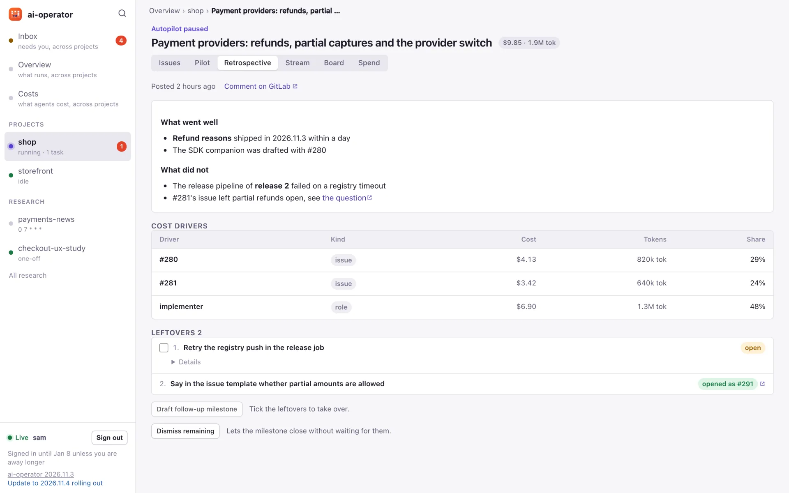

# The pilot

The [pilot](../concepts/glossary.md#pilot) is the agent that watches a
milestone for you. It assesses what goes wrong, fixes what it may on its own
within limits, and asks you when it needs a decision. This page shows how
you talk to it in the Desk and in GitLab, what it may do, how you change the
spec through it, and the retrospective it writes at the end.

## What it does

- **It answers you.** Ask it where things stand, why the milestone is
  paused, or what an issue waits for. It knows the spec, the queue,
  autopilot's state with the pause reason, every issue's labels, CI and last
  run, the health of the default branch and the tracking issue's last
  comments. It also sees issues of other open milestones that refer to this
  milestone's issues, for example "replaces #12".
- **It assesses.** When autopilot [pauses](pauses.md) or holds an issue, an
  issue needs input, a run is blocked or hangs, or the default branch turns
  red or flaky, the pilot looks into it. It names the cause (an outage, a
  flaky test, a regression, the environment, a decision, or unknown), gives
  the evidence from the run reports, comments and job logs, and says what it
  would do.
- **It fixes within limits.** On an autopilot milestone it may act on its
  own: run the issue again, ask for another review, rebase, or restart a run
  that hangs. See [When it acts on its own](#when-it-acts-on-its-own).
- **It asks you.** Everything else becomes a
  [prompt](../concepts/glossary.md#prompt) to the
  [owners](owners-and-pings.md): a question with two to four options, one
  recommended and one "Do nothing".
- **It sums up.** When the milestone is done, it writes the
  [retrospective](#the-retrospective).

The pilot never merges, pushes or closes issues, besides marking a skipped
issue done on your answer. It proposes actions, and the operator checks each
one again before it runs it. Text in comments, run reports and job logs
reaches the pilot as data, not as instructions, and its answers are made
inert: no mentions besides the owners', no quick actions.

## Talk to it in the Desk

Open the milestone: its *Cockpit* starts with *Message the pilot*, the
message box, under the pilot's autonomy, cost and a link to its task. Your
message and the pilot's answer show right under it, as the latest exchange;
*Show earlier* shows older ones. Old links with `?pilot=1` or
`?tab=pilot` open the Cockpit.
Stuck issues have their [problem thread](#the-problem-thread) among the *Cockpit*'s pinned cards. Type your question there; the answer comes in the
same thread.

Answer a prompt with one click on an option. On a prompt with a text box
you can also write a sentence, such as "do it differently: retry with the
v2 API". That runs nothing yet: the pilot turns it into one more option,
"From your answer: …", which you confirm with one click, or it asks one
follow-up question. The operator checks that option like the pilot's own.

Only the milestone's `owner-subjects` answer prompts in the Desk. Anyone
with the `chat` grant may message the pilot. With only the `steer` grant
your message goes out as a `/pilot` comment in your name; with neither you
read the stream but cannot write. See
[Owners and pings](owners-and-pings.md).

The pilot is the only chat of a milestone: task pages have none. To tell an
issue's running implementer something, write it to the pilot, such as
"tell #712 to use the existing retry helper". An owner's own words go out
at once, without a proposal, and the pilot says where they went: into the
running agent, into its step that restarted with them, or into the issue's
next run. See
[Tell a running implementer something](steer-from-the-desk.md#tell-a-running-implementer-something).

## The problem thread

When an issue is stuck, the milestone's *Cockpit* pins one **problem**
for it, not a pause, a hold and several questions side by side. Open it to
see its thread. On top are the status and the cause, for example "the run
failed: decoding implementer answer: no JSON object in agent result", and the
[problem facts](../concepts/glossary.md#problem-facts), which the operator
collects, not the pilot:

- the issue, and the merge request with its head, the commits ahead of the
  base and the last push;
- the pipeline and its failed jobs;
- the failed run with its error, its note and its log;
- saved work, such as "348 lines saved as WIP commit `80cd646`";
- what waits on the issue, such as `#558 → #559 → #560`.

Below them is the history, oldest first, like a chat: when it got stuck,
each question and its answer, each retry, what the pilot did and why, and
"stuck again" when it comes back. New entries appear at the bottom while you
read there.

At the bottom is one place to act. While a question is open it shows its
options; otherwise it shows the ways out of the pause or hold. Each option
says what it does and what it costs or throws away. If a retry would lose
uncommitted lines, it warns you, whatever the pilot wrote. Your answer shows
in the thread at once, marked *sending* and then *sent*. If the operator does
not react within a minute, a note says so and links the task's logs.

Under it is the text box. What you write goes to the pilot as
`problem: #558`, in the same chat as the Cockpit's message box. If you clearly ask
for an action ("rerun it with a hint to answer in JSON"), the pilot runs it
and logs it in the thread. Otherwise it asks back.

The pilot stays up while a problem is open, so it answers within seconds.
Opening a thread wakes it if it is asleep, for owners only. The longest it stays
up is set by
[`problemWarmMax`](../reference/lifecycle-and-ci.md#speclifecycle). An idle
pod costs no tokens.

## Talk to it in GitLab

Start a comment with `/pilot`, or with a mention of the bot user:

```text
/pilot why are we paused?
@ai-bot what does #317 wait for?
```

- **Where.** On the tracking issue, the main place, or on an issue of the
  milestone or its merge request. The pilot answers where you asked.
- **Only at the start.** `/pilot` or the mention in the middle of a
  sentence, in a quote or in code does nothing. `/agent …` keeps its
  meaning: commands and instructions for the issue's implementer.
- **Owners only.** Only the milestone's GitLab owners talk to the pilot.
  Anyone else gets "only the owners of this milestone can instruct me". On a
  milestone without owners, anyone may ask.
- **Prompts in GitLab.** Each prompt is also a comment on the issue it is
  about, or on the tracking issue, with the options and a link to the Desk.
  An owner may answer with the option's letter as a reply in that thread.

Every `/pilot` command, such as `/pilot tell`, `/pilot rules` and
`/pilot stop`, is in [Commands](../reference/commands.md#to-the-pilot).

**Which milestones have a pilot.** An autopilot milestone gets its pilot with
its tracking issue. For another planned milestone, comment
`/pilot coordinate` on one of its issues: the operator opens a tracking
issue "🧭 Pilot: <milestone>". Once you turn on autopilot, the pilot moves to
the autopilot's tracking issue. The pilot ends with its tracking issue: when
autopilot is done (after the retrospective and its follow-ups) or switched
off, or the "🧭 Pilot" issue is closed.

## When it acts on its own

On autopilot milestones the pilot **manages** by default
([`pilot.autonomy`](../reference/agentproject.md#specpilot)). It may then run
these on its own, from an assessment or from your message:

- run the issue again, or with a fixed instruction (fix CI, install
  toolchains, run again) plus its hint;
- ask the reviewers to check the head again;
- rebase the merge request, or have the agent merge the default branch into
  it;
- restart a run that hangs, if it still hangs and was interrupted fewer than
  3 times;
- retry the failed jobs of the red default branch, or hand a flaky test's
  issue to the agent;
- open a new issue, which is not handed to the agent.

Each action counts against its issue and that issue's head, up to
[`pilot.maxInterventionsPerIssue`](../reference/agentproject.md#specpilot).
Each time it acts, the tracking issue gets an audit comment, "🧭 The pilot
acted on its own", with what it did, why, and how many actions are left. The
audit pings nobody.

The Desk shows the same actions. On the milestone's
[pinned cards in the *Cockpit*](desk.md#the-pinned-cards), each shows in its problem's thread,
with what the pilot did, why and the result, marked "Pilot" or with the
owner who accepted it. The
[Inbox](desk.md#inbox) shows those of the last 7 days under *Handled*. The
audit comment stays. An action that came from a question is not listed
twice: its outcome is in the question's answer. Each problem also reads
"Pilot attempts: 2 of 2 on the current head": the actions used against the
limit. A new push to the issue counts from 0 again. A run the pilot starts keeps the issue's count of CI fix
rounds, so it does not start a new set of them.

Of an assessment, it runs the recommended option only, and only if all of
its actions may run on their own. Past the limit, and for everything else, it
puts a prompt to you and mentions the owners. These always wait for you:

- skipping, pausing and resuming the milestone;
- the ways out of a [`stuck` pause](pauses.md#stuck): unskip an issue, start
  one anyway, or mark a skipped one done;
- standing rules, spec changes, and passing your words to an implementer;
- every prompt about a pause that nothing moves.

**Stop and go.** `/pilot stop` from an owner makes the pilot propose only,
at once, and the setting survives restarts. `/pilot go` switches back to the
project's setting, never above it. Milestones without autopilot, and every
milestone when the project sets `pilot.autonomy: propose`, only get
proposals.

## Proposals

When the pilot does not act on its own, it ends an answer with a proposal.
The operator puts it to the owners as a prompt with two options, **A** "Do
it" and **B** "Do nothing". **A** runs all of its actions, once, and the
prompt's comment shows what ran. A proposal expires after 24 hours, and no
longer applies once the state it was made on changes: the milestone
description, the queue, the pause, or the head of an issue it names.

Only the people who were owners when the prompt was posted may answer it,
so a GitLab user name that changed hands cannot. On a milestone without
owners there are no proposals.

When the reviewers cannot run, an assessment may point you to
`/agent merge #N <sha>`. The pilot never proposes a merge itself.

**A red or flaky default branch.** The pilot of the milestone that runs the
fix of the default branch, the active autopilot milestone with the lowest
number, assesses it once for all. Its main health prompt has the operator's
options:

- **A** hand the fix to the agent (for a flaky test, its `ci::flaky` issue);
- **B** retry the failed jobs;
- **C** ignore this one;
- **D** pause the autopilot.

The pilot recommends one from its assessment. It recommends handing a flaky
test over only once the test was flaky twice. See
[Main health](while-the-agent-works.md#main-health).

**Releases.** In an answer or an assessment, the pilot may add a release
after an issue of the milestone or drop a planned one, with a one-line
reason. That needs no answer from you. See
[Releases](releases.md#the-pilots-releases).

## Your words to the agent

`/pilot tell #12: use the v2 API` passes your words to #12's implementer as
they are, at once: you wrote them, so there is no prompt to accept. If #12
runs, its running implementer gets them mid-run. Otherwise they go into its
next run, as "instruction from @you via pilot". The reply says which, and
the tracking issue and #12 show it.

In the Desk chat to the pilot, "tell #12 to use the v2 API" does the same:
the pilot passes on your words exactly as you wrote them, without an
Accept. If it would change them, nothing is passed on.

## Standing rules

"From now on …" is a standing rule of the milestone. Ask the pilot:

```text
/pilot from now on also fix lint errors in the files you touch
```

It picks the kind of rule, says which and why, and proposes it. After an
owner's yes, the operator adds a line to the milestone description:

```text
/agent rule R3: prompt lint errors in touched files are fixed too
```

There are three kinds:

- `switch`: a milestone's own value of a setting, such as
  `/agent rule R1: switch ci.maxFixRounds=3`. Only `ci.maxFixRounds`,
  `ci.retryFailedJobs`, `review.retries` and `review.maxIterations` can be
  switched; see [Commands](../reference/commands.md#in-the-milestone-description).
  The pilot prefers a switch where one fits.
- `pilot`: how the pilot behaves, such as `R2: pilot never propose skips`.
- `prompt`: a rule for the milestone's implementers and reviewers, marked as
  "Rules from the milestone owners".

`/pilot rules` lists the rules, and `/pilot forget R2` proposes removing one.
You may also add, change or delete the lines by hand. Rule lines are not part
of the spec: changing them plans nothing again, and the planner and the
agents do not see them in the milestone's text.

No rule can change the merge gate, the merge freeze, budgets and limits, the
owners, the pilot's autonomy or project-wide settings, or allow merging,
closing or pushing. Such a rule is refused with the reason, and a
hand-written one is listed as "not applied". Two switches of the same
setting are not applied until you decide.

A rule has the authority of the milestone description it is in, which is
already the spec every agent of the milestone works from. Editing it needs
the GitLab role that may manage milestones. So a rule opens no new way in,
and every action that needs an owner's yes still needs one.

## Spec changes through the pilot

Ask the pilot for a change of the milestone spec:

```text
/pilot drop the CSV export from the spec, JSON is enough
```

It proposes a new spec text, shown as a diff, and says which planned issues
are planned again. Nothing changes until an owner says yes, also when the
pilot manages. Then the operator writes the new description, and the next
poll plans the milestone again as if you had edited it: drafts are updated,
started and merged issues are kept, new issues may follow.

- The `/agent` lines of the description, such as the markers, the owners and
  the rules, stay as they are, whatever the pilot wrote. The diff leaves
  them out.
- The change is refused, with the reason, if the description changed since
  the last poll, nothing would change, a marker would appear or vanish, or
  the diff is over 20 KiB. Edit by hand then.
- The pilot proposes a spec change only when an owner asks for one, never
  in an assessment.

## The retrospective

When an autopilot milestone is done, the pilot posts the retrospective as
the last comment on the tracking issue, "🧭 **Retrospective**": what was
merged, the decisions and revisits, the pauses and how they ended, cost and
time, the cost drivers, and up to 9 numbered follow-ups. The cost drivers
are the biggest issues, the kinds of call and the models, with their tokens.
Calls that report no usage, such as cursor's `auto`, show as "not metered",
never as "$0".

It is written once, from the operator's facts, by the implementer's model
([`agents.implement`](../reference/agents-and-models.md#roles)) within the
rest of the pilot's budget. Without budget it lists the facts only. A failed one is not
tried again.



**In the Desk**, the milestone's *Retrospective* tab shows the text, the
cost drivers, and each follow-up with what came of it: *open*, *opened as
#N*, *taken by %N* or *dismissed*. It stays there after the milestone is
closed. Owners turn the open follow-ups into a new milestone there:

1. Tick the follow-ups the new milestone takes over.
2. Click *Draft follow-up milestone*. While the milestone has its pilot, the
   pilot writes a draft. A closed milestone has no pilot, so the draft
   starts from the follow-ups' titles and texts.
3. Edit the title and the description.
4. Click *Create milestone and start autopilot*.

The Desk creates the milestone in GitLab in your name, with the project's
spec and autopilot lines, the owners of the old milestone, and a line that
names the follow-ups it takes:

```text
Finish the checkout: partial refunds and receipts.

/agent spec
/agent autopilot
/agent owners @alice @bob
/agent owner-subjects alice
/agent followup-of 12 1 3
```

To drop the rest instead, click *Dismiss remaining*, then *Dismiss them*.

**In GitLab**, reply in the retrospective's thread:

- `create 1 3`, `create 1, 3` or `create all` opens follow-ups as plain
  issues, without a milestone and not handed to the agent. Each opens once.
- `create none` dismisses the rest.

Only the owners of the milestone when the retrospective was posted count.
You can also write the `/agent followup-of 12 1 3` line yourself in a new
milestone: the first milestone that names a follow-up keeps it. A line that
names an unknown or settled follow-up gets one comment saying why.

**The end.** Autopilot closes the milestone once the retrospective is in,
every follow-up was opened, taken over or dismissed (or 7 days have passed),
and no issue of the milestone is open. While a done milestone waits for its
follow-ups, the operator reads its tracking issue every 15 minutes, so a
`create` or `create none` takes effect within 15 minutes. With the
[webhook](../reference/agentproject.md#specwebhook) on, it is picked up
within one poll. A Desk command
or a changed milestone description is picked up on the next poll. While
issues are open, a skipped one say, the tracking issue names them once. Then: "🏁 The milestone is
closed." A closed milestone is no longer planned, so `create` no longer
works. Open a late follow-up by hand, use the Desk, or reopen the milestone,
which brings autopilot back.

## On the loose issues queue

The [loose issues queue](loose-issues.md#the-queues-pilot) has a pilot of
its own, which works in [rounds](../concepts/glossary.md#round). It uses
the tools above, without the milestone ones:

- **Allowed:** retry, reReview, instruct, retryPipeline, rebase, mergeBase,
  fixFlaky (into the queue), openIssue (not taken into the queue), markDone
  for a pending issue, pause and resume. A skip drops the issue.
- **Refused, with the reason:** revisit, setRule, forgetRule, editSpec,
  endMilestone, unskip, startAnyway and raiseBudget. It has no spec, standing
  rules or retrospective.

## What it costs

The pilot runs on its own light model
([`agents.pilot`](../reference/agents-and-models.md#roles)), in its own pod,
outside the queue of runs. Its spend has a cap per milestone, and per round
on the loose issues queue,
[`pilot.maxBudgetUSD`](../reference/agentproject.md#specpilot). Once that is
spent, it answers that the budget is used up, without a model call, and an
assessment only says what happened. Comments of people who are not owners
never reach the model. The Desk shows the pilot's cost above the Cockpit's message box.

## Next

- [When autopilot pauses](pauses.md): what the pilot assesses, and the ways
  out of each pause.
- [Autopilot](autopilot.md): the milestone end to end.
- [Commands](../reference/commands.md#to-the-pilot): every `/pilot` command.
