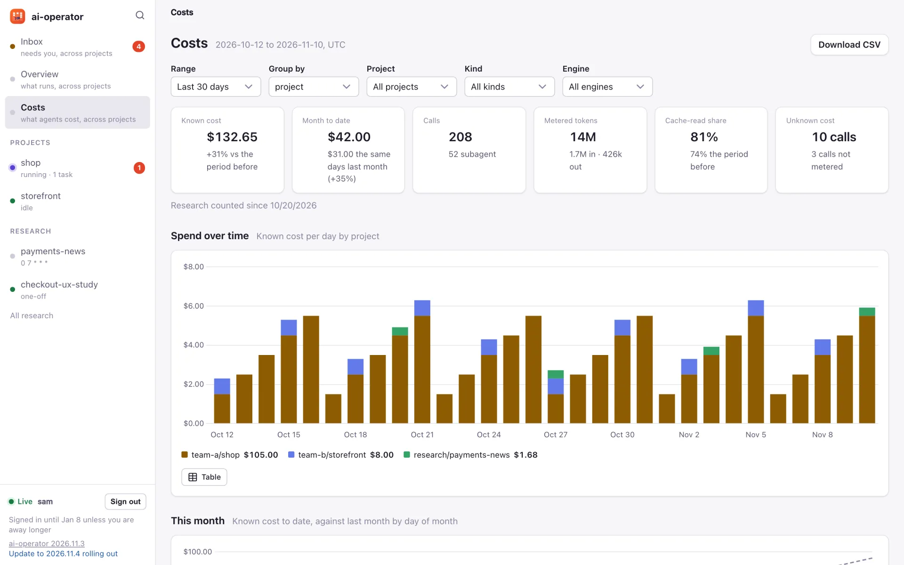

# Steer from the Desk

The [Desk](../concepts/glossary.md#desk) is where you steer a milestone. You
read its [Cockpit](../concepts/glossary.md#cockpit), talk to the
[pilot](../concepts/glossary.md#pilot), tell a running agent something,
answer [prompts](../concepts/glossary.md#prompt), change a decision, end a
pause, order the queue and plan the next milestone. This page shows each of
these. What the views show is in [The Desk](desk.md).

Most actions need the `chat` grant. Some also need your Desk user name
among the milestone's [owners](../concepts/glossary.md#owner), on its
`/agent owner-subjects` line: answering prompts, telling an implementer
something, *Revisit*, *Move to top*, *Merge anyway*, *Restart run*, and
planning or follow-up milestones. See
[Who sees what](desk.md#who-sees-what).
Everything you do here, you can also do with a comment in GitLab; the
[commands](../reference/commands.md) list both.

## The Cockpit

A milestone page opens on its *Cockpit*: everything about the milestone,
read from the top like a pull request.

- **The composer** comes first: the message box to the pilot, see
  [Talk to the pilot](#talk-to-the-pilot). It scrolls with the page.
- **The latest exchange** with the pilot sits under it: your last message
  and the pilot's answer. *Show earlier* shows older exchanges, 5 at a time.
- **Pinned cards** follow: open problems, the pilot's proposals and
  open questions. You answer each one in place: pick an option, click
  *Accept* or *Reject*, or write in its thread. A link with `#problem-…` or
  `#prompt-…`, and every Inbox entry, opens the Cockpit with that card open
  and in view.
- **Threads** come below the toolbar: one per issue, and a *Milestone*
  thread for events without an issue. The thread with the newest activity
  is on top. Its header shows the issue, its state and, while an agent
  works on it, the step with its time, such as *Implementing · 4 min*. With
  the `transcript` grant a running issue's thread has a closed *Live
  transcript* ([more](desk.md#live-transcript)). It lists its newest 3
  events first; *Show N more* shows the rest. **Shown events** are what the
  pilot did and why, merges and the milestone's state changes. A pilot
  action about an issue shows there too.
- **Decisions** are events in their issue's thread: ID, title, choice and *Revisit* ([Decisions tab](decisions.md)). The ID opens the card there. A replaced one says *Superseded by …*.
- **Folded groups** hold the rest. The runs, CI rounds, reviews and
  checkpoints of a thread between two shown events become one closed line,
  such as *#712 · 3 runs, 2 CI rounds, review clean*. Click it, or press
  Enter on it, to open its event cards. *Expand all* in the toolbar opens
  every group; *Search the Cockpit* on the right finds an event.

*Load older* at the bottom pages back in time.

### The panel

Beside the stream, the **Now & next** sidebar shows what goes on:

- **Running**: the issues an agent works on, with the step and its time,
  such as "#712 implementing · 4 min". A row opens the issue's thread in
  the Cockpit. If you may watch the transcript, the thread opens with its
  live transcript.
- **Waiting**: issues waiting for CI, and held issues with the reason.
- **Up next**: the next 5 issues, such as "#717 after #712". *+N more*
  opens the *Issues* tab.
- **Milestones**: this milestone with "3 of 9 merged", then the next ones.

From 1180 px the sidebar is a column. *Collapse Now & next* shrinks it
to a narrow rail with the counts of running, waiting and next issues;
*Expand Now & next* brings it back. Your browser remembers the choice on
every page. On a narrower screen, and on a phone, a one-line strip under
the page header sums it up, such as "1 running · 2 waiting · next #717",
or "Nothing running". The strip opens the sidebar as a sheet from the
right. Escape closes it and puts the focus back on the strip.

### The project and the Overview

A project page and the *Overview* open on a Cockpit of their own, with the
same pinned cards and threads, but no composer:

- **A project's Cockpit** spans its milestones. Each pinned card shows its
  milestone's name, and *Talk to the pilot* opens that milestone's Cockpit.
  Its threads show their milestone's name. *Now & next* groups *Running*
  and *Waiting* by milestone; a row opens the issue's thread in its
  milestone's Cockpit. *Up next* is of the milestone that runs first, and
  *Milestones* is the project's queue. *History* (closed at first) has the
  companions and the last 30 days: a day pages the Cockpit back to it.
- **The Overview's Cockpit** spans all your projects. It pins the open
  Inbox items as short cards that open their card in the milestone's
  Cockpit. It shows merges and milestone state changes, and folds the rest
  per project. Its Now & next sidebar has a card per project.

## Talk to the pilot

The pilot is the only chat of a milestone. Task pages have no chat of
their own: talk to the pilot, and it passes your words on.

1. Open the milestone's *Cockpit*. Its top is *Message the pilot*, with
   the pilot's autonomy, its cost and a link to the pilot's task above it.
2. Write your message and press Ctrl+Enter (Cmd+Enter on a Mac) or *Send*.
3. Your message and the pilot's answer show right under the box, as the
   latest exchange.

Ask where things stand, why the milestone is paused, or what an issue waits
for. Ask it to act: retry an issue, review it again, skip it, or pause the
autopilot. What it may do on its own, and what it proposes for an owner to
accept, is in [The pilot](pilot.md).

- Anyone with the `chat` grant can message the pilot, owner or not.
- Without `chat` but with `steer`, the box posts your message as a `/pilot`
  comment on the tracking issue, in your name.
- With neither grant, or without being an owner where one is needed, you
  read the stream but cannot write.
- A milestone without a pilot says *No pilot for this milestone.* A done
  milestone read from history has no composer.

The box scrolls with the page, on a phone too.

## Tell a running implementer something

When an issue's [implementer](../concepts/glossary.md#implementer) is on
the wrong track, tell it through the pilot. You do not have to wait for its
[run](../concepts/glossary.md#run) to end, and it does not start over.

For example, while *#712 implementing · 4 min* shows, write into the
composer:

```text
tell #712 to use the existing retry helper
```

Or comment on the tracking issue in GitLab:

```text
/pilot tell #712: use the existing retry helper
```

Your words go out at once, as your instruction, with no *Accept* card. The
pilot answers with where they went, and the Cockpit and the tracking issue
say it too:

| What you read | What happened |
|---------------|---------------|
| *delivered to #712's running implementer at 14:05* | The agent took your words in while it worked, without stopping. They show in its transcript as your turn. |
| *delivered to #712's implementer, the step restarted with it, at 14:05* | The agent stopped at its current step and went on in the same session with your words. Its work so far stays. |
| *Queued for #712's next run.*, later *delivered with #712's next run at 14:20* | #712 was not running. Your words went into its next run. |

- It happens within a minute.
- Each message is delivered once, also when a pod restarts.
- A message that arrives while #712 waits for CI or a review goes into its
  next implementer call, a CI fix for example, or else into its next run.
- At most 5 messages reach one run while it works; later ones wait for the
  next run.
- A run that took a message is not interrupted or failed, and keeps its
  work. Its calls list shows a stopped call and its resumed call, and their
  costs add up.
- Your words never widen what the agent may do: they are an instruction
  from you, inside the run's own rules.

Only the milestone's owners can tell an implementer something. The fields
are in [Owner messages](../reference/status-and-history.md#owner-messages).

**A run that hangs.** In the task page's header, owners get *Restart run*
while a run is in progress. It asks first, then stops the run and starts it
again. This is a Desk action only, there is no GitLab command for it. See
[Restart a stuck run](../reference/commands.md#restart-a-stuck-run).

## GitLab comments from the Desk

When the Desk is connected to your projects' GitLab, a task's *Overview*
tab has the *Conversation*: the comments of the issue, its merge request and
the milestone's [tracking issue](../concepts/glossary.md#tracking-issue).
With the `steer` grant it has a box to write a comment in your own name. The operator reads it like
any GitLab comment: `/agent …` starts a run, a plain comment reaches a
running agent at its next step. The buttons above the box start a comment
with the common commands.

Click *Connect GitLab* in the *Conversation* once. The Desk reads with your
token, so GitLab decides what you see. *Disconnect* forgets the token;
revoke the application in GitLab to end it there too. A connection lasts 30
days.

### Set it up

1. Create an OAuth application in the GitLab your projects live on (on
   gitlab.com: *Group → Settings → Applications*, or *User settings →
   Applications*): **confidential**, scope **`api`** (GitLab has no
   narrower scope that may post comments), redirect URI
   `https://<host>/oauth2/gitlab/callback`.
2. Put its secret into the Desk's Secret under `gitlab-client-secret` (or
   into another Secret named by `ui.gitlab.existingSecret`).
3. Set the chart values:

   ```yaml
   ui:
     gitlab:
       url: https://gitlab.com
       clientID: "<application id>"
     authorization:
       rules:
         - roles: [ai-operator-admin]
           steer: true
   ```

### One user, a fixed token

For a single user, the Desk can use a fixed token of that user instead of an
OAuth application: a **fine-grained personal access token** (GitLab 19.2 and
later) limited to the group with your projects:

| Boundary | Permissions |
|----------|-------------|
| group (selected membership) | `read_project`, `read_work_item`, `create_work_item` (comments on issues and merge requests are work item actions; it also allows creating issues), `read_merge_request` |
| user | `read_user` |

To create follow-up milestones and plans with it, the user also needs the
project's Planner or Reporter role. Put the token into the Secret under
`gitlab-token`, and name its owner's Desk user name:

```yaml
ui:
  gitlab:
    url: https://gitlab.com
    tokenUser: ada@example.com
```

That user is connected without OAuth; nobody else may use the token. Other
users can still connect their own accounts if `clientID` is set too. The
token expires after a year at most; a rejected token shows as an error.

### Limits

A comment is at most 10 000 characters, and you may post 10 per minute. A
comment goes only to the task's issue, its merge request or its milestone's
tracking issue. The Desk logs who posted where, never the text.

## Answer prompts

Every question to the owners is a prompt: from the pilot, from an agent,
about the budget or about a red default branch. It has a number such as
`Q5`, two to four options with one recommended, and, where you may write
your own answer, a text box. A prompt with actions always has a "do
nothing" option.

You find prompts:

- in the Inbox, with a [browser notification](notifications.md) if you turned them on;
- pinned on top of the milestone's *Cockpit*, at the bottom of their issue's
  [problem thread](pilot.md#the-problem-thread); closed ones stay in the
  thread's history;
- in a project's *Cockpit*, under the milestone's name, answered there;
- on a task page's *Overview*, for an agent's questions;
- on the pause card of a red default branch or a spent budget.

Click an option to answer. Or write a sentence into the text box. On a
prompt with actions, your text runs nothing: the pilot turns it into one
more option, *From your answer: …*, which you confirm with a click, or it
asks one follow-up question. On an agent's question your text is the
answer. See [Answer and hand over](answer-and-hand-over.md).

A prompt takes one answer. A second one is refused and names the first.
Afterwards the card shows who answered, which option, when and where (Desk
or GitLab). A prompt also closes when its cause goes away, such as the
default branch turning green again, the issue being merged or a newer
prompt; a proposal expires after 24 hours.

**In GitLab.** The operator posts each prompt as a comment, with a link
that opens it in the Desk, and updates the comment once it is answered or
closed. Where the project takes answers from GitLab, an owner may reply
with the option's letter in the comment's thread (see
[Answers in a prompt's thread](../reference/commands.md#answers-in-a-prompts-thread)).

## Revisit a decision

Each [decision](../concepts/glossary.md#decision) in a milestone's queue
has a *Revisit* button on the *Issues* tab. The decision's card on the *Decisions* tab has it too, with a
line that says what will happen. It is there for owners with the `chat`
grant, while the milestone has its pilot. The decision's ID opens its card
on the *Decisions* tab, or the comment on GitLab without the history
database.

1. Click *Revisit* on the decision.
2. A prompt opens with the agent's choice and the alternatives it recorded
   as options, and a text box.
3. Pick an alternative or write what you want instead.

This works once the decision's issue is merged: the operator then opens a
follow-up issue that makes the change. For an issue that is still open, the
card has a text box and *Comment*, or write
`/agent revisit <id> <what you want instead>` in the *Conversation* box. See
[Read and revisit decisions](decisions.md) and
[Decisions and Revisit](iterate-and-finish.md#decisions-and-revisit).

## Pause and hold cards

When autopilot [pauses](../concepts/glossary.md#pause), the milestone's
*Cockpit* pins the pause card on top: why it paused, the paused issue with its
merge request and pushed head, and *Way out*: first what ends the pause by
itself, with its state, then what you can do. Each
[hold](../concepts/glossary.md#hold) of a single issue has a card of its own
with *Resume*. The Inbox and the *Issues* tab show a short card
with *Open*, which leads to the *Cockpit*; a project's *Cockpit* pins the full card.

The buttons depend on the kind of pause:

- *Retry* and *Review again* run the paused issue again or ask for a new
  review;
- *Resume* ends the pause and every hold; *Resume* on a hold card lifts
  that hold only;
- *Skip* leaves an issue out;
- *Merge anyway* merges without a full review. It is for owners and asks
  first: CI, the merge request's state and approvals still apply, and it
  is refused if someone pushed since;
- links open the issue's task, the pipeline, the merge request, the
  companion merge request or the plan.

A way out the Desk has no button for shows as the command to post in
GitLab. After a click the card shows *sent…*, then the operator's answer.
Each kind and its ways out are in [When autopilot pauses](pauses.md).

## The queue and finishing

A project's *Milestones* tab lists its open autopilot milestones in the order
they run: *Running*, *Holding for %N* (planned, waits for the first),
*Waiting to plan*, *Paused* or *Budget*, each with its issues done and its
spend. With the `chat` grant each row has:

- a drag handle and a menu with *Move to top*, *Move up* and *Move down*.
  Only the milestone's owners can move it, like `/agent move`. See
  [Order milestones and read the timeline](milestone-order-and-timeline.md#move-a-milestone).
- *Pause* and *Resume*, as on the pause card.

Below, *Finishing* lists done milestones still open in GitLab, oldest first,
with what holds each: a re-plan, the retrospective being written, follow-ups
to settle, open issues, or companions not landed. *Close issue* closes an
open issue in your name with a note, for owners with the `steer` grant and
GitLab connected. The operator then closes the milestone on its next poll.
With nothing left, the row says *Closes on the next poll*. There is no
"close anyway": close the holding issue or the milestone in GitLab instead.

## Plan a milestone

Owners with the `steer` grant draft a new milestone with an agent: *Plan
milestone* on the project's *Plans* tab, or on *Plans* in the rail after
picking the project. The steps
are in [Write a milestone](write-a-milestone.md#draft-it-in-the-desk).

- **The plan page** has the chat on the left and the draft on the right; on
  a phone they are two tabs, *Chat* and *Draft*. Edit the draft and *Save*:
  the agent sees your edit with its next turn. If the agent writes a newer
  draft while you edit, the Desk shows the difference and lets you pick
  *Use agent's draft* or *Keep mine*.
- **The plan lists** (*Plans* in the rail, and each project's *Plans* tab)
  show each plan's title, phase, spend and the
  milestone it created, with its state and progress. *Delete* on a plan
  page leads back to the project's *Plans* tab.
- **Its budget** starts at the default cap. At the cap the plan stops until an
  owner raises it, up to the highest cap.
- **Create milestone** shows the title, the draft, the switches *Spec* and
  *Autopilot*, the `/agent` lines it adds, and an estimate of the cost from
  your finished milestones. It creates the milestone in GitLab with your
  token. A plan creates one milestone only.
- **Idle plans.** After a while without a message the plan's pod stops;
  the next message picks up where it left. A plan is deleted some time
  after its last message.

The caps, the idle time and how long plans are kept, with their defaults,
are in the [chart README](../../charts/ai-operator/README.md#plan).

## Costs at a glance



- A cost chip on each project, milestone and task shows its cost and
  tokens, for example `$12.34 · 1.2M tok`. Hover it to split the tokens.
  An unknown cost shows *n/a* or a dash, never $0.
- The *Metrics* tab of a project or milestone breaks the cost down, and
  *Metrics* in the rail compares projects over time.
- An issue at 80 % of its budget shows in the Inbox.

Spend and budgets are explained in [Budgets and spend](budgets-and-spend.md).

## On a phone

The Desk works on a phone. Below 760 px a bar at the bottom holds *Inbox*
(with its count), *Overview*, *Projects* (the rail as a sheet: projects,
researches, engine usage, sign out), and *Metrics* and *Research* where you
have them. The bar hides while you type.

- Tables become cards, and every button is big enough to tap.
- On a project or milestone page, the Now strip under the header
  ("2 running · 1 waiting · next #717") opens the *Now & next* sidebar.
- Text that is cut off opens with a tap.
- Prompts, pause cards, chat and *Restart run* work as on a desktop.

Turn on [notifications](notifications.md) to hear of a problem or a prompt
while a Desk tab is open, and
[install the Desk](notifications.md#install-the-desk) for its own icon.

## Next

- [The pilot](pilot.md): what it does on its own, and the retrospective.
- [When autopilot pauses](pauses.md): each kind of pause and its ways out.
- [Commands](../reference/commands.md): the same actions as GitLab comments.
