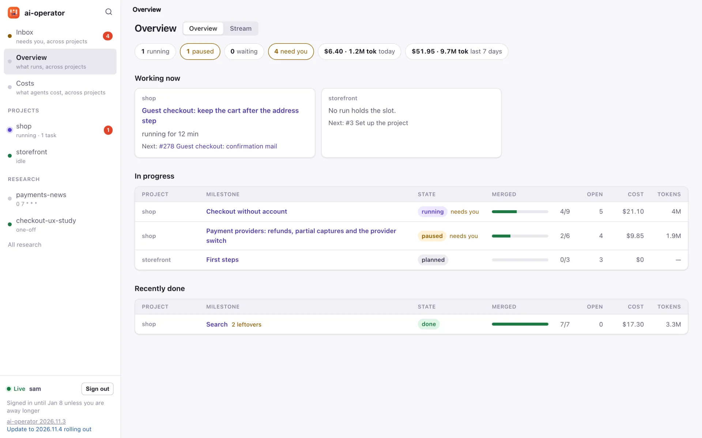
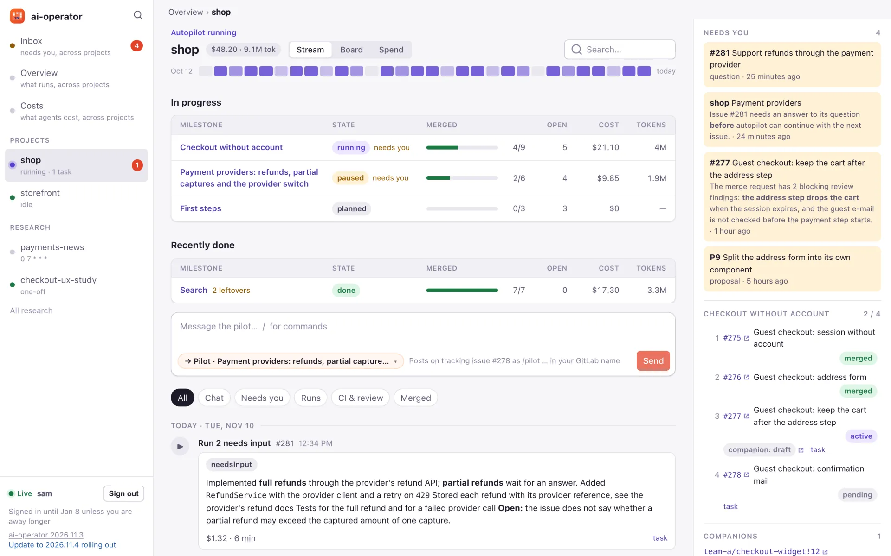
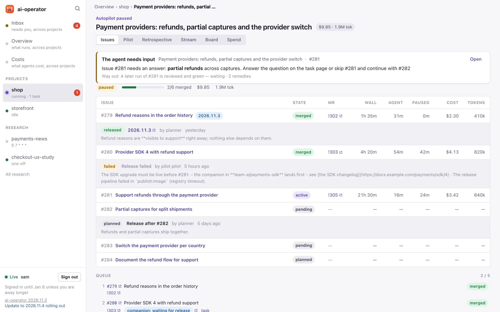
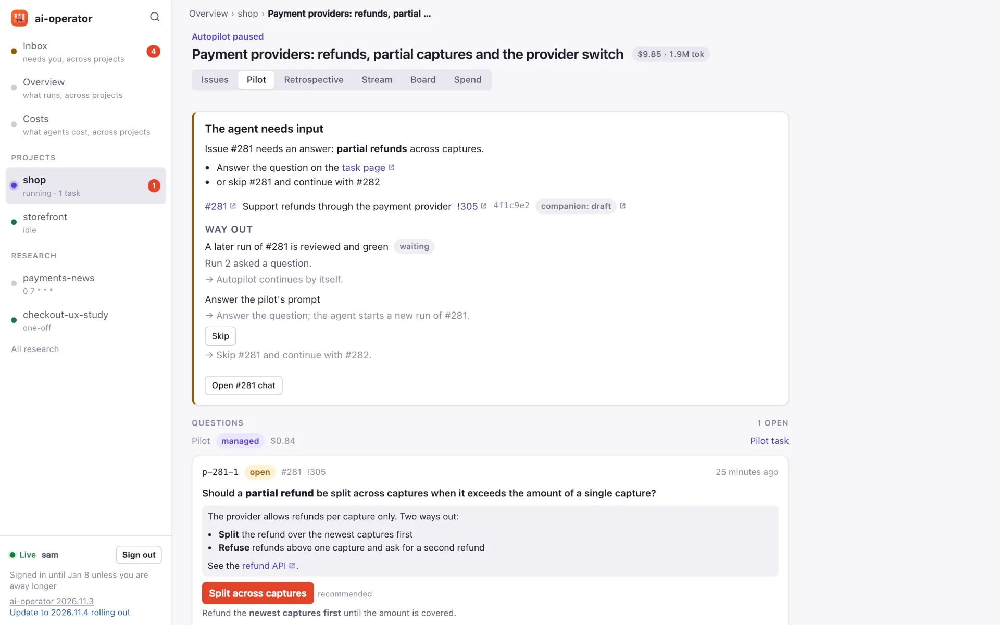
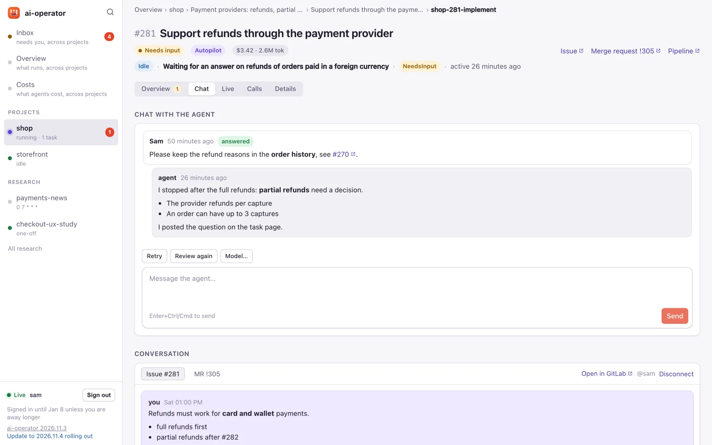
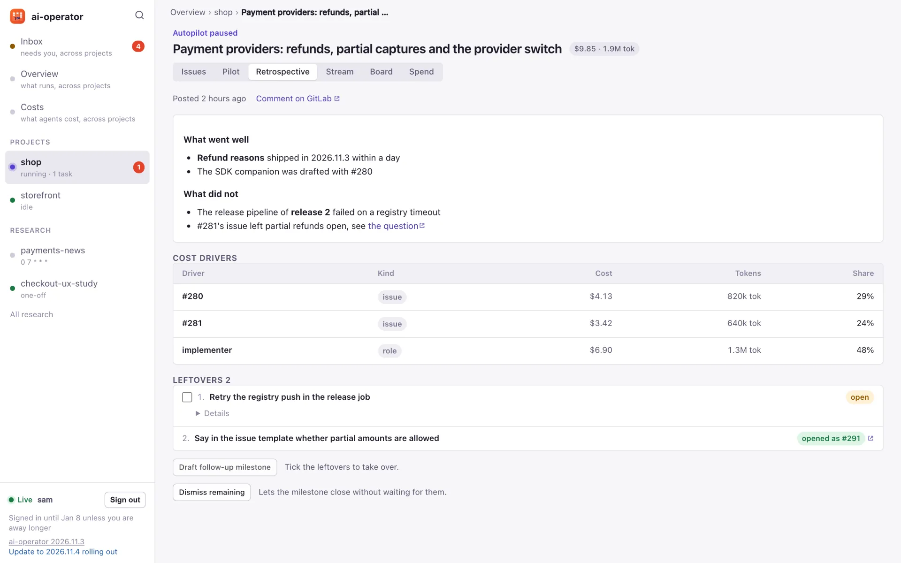
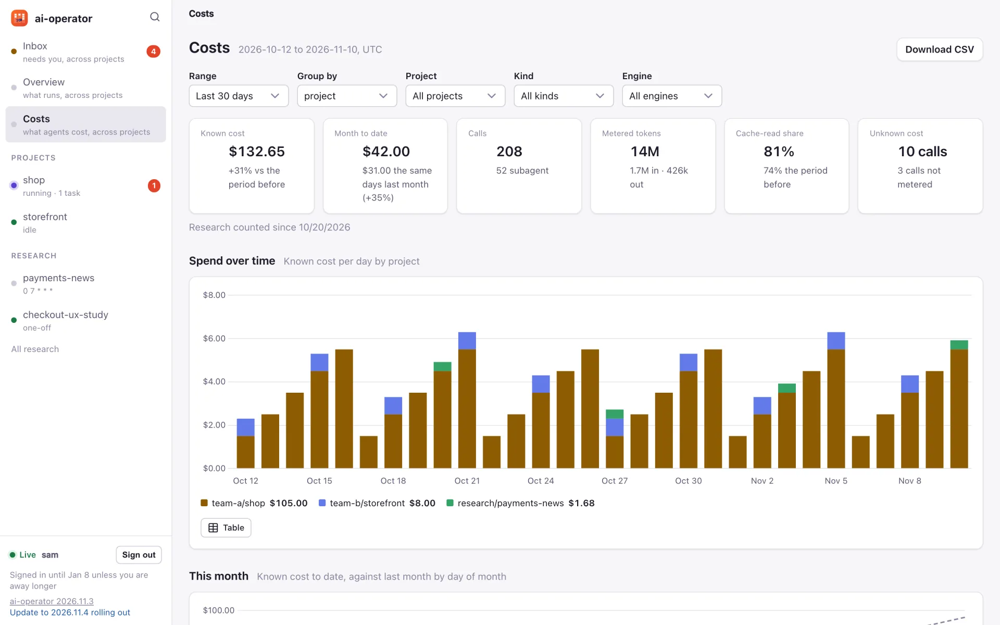

# Web UI

A web UI shows what the agents are doing as a **Desk**: a dashboard of
the milestones in work and done across your projects, and one stream per
project, newest at the top, that mixes the conversation (comments, the
pilot's replies and proposals) with what the agents did (runs, pushes, CI,
reviews, merges, autopilot changes), with the message box pinned above it.
With a research database the streams reach back through the
[history](#desk-and-history); the boards, task pages and autopilot queues stay
one click away. With a [research database](research.md) it also
shows researches: news flashes, reports and their run history, and starts
one-off researches. Pages update live. Users log in with OpenID Connect
(Zitadel, Keycloak, Dex, Entra ID, …), and their roles decide which projects
and researches they see.

The UI is off by default. It is a separate Deployment (`<release>-ui`, binary
`/ui` in the operator image) with its own service account that can only read
`AgentProjects` and `AgentTasks` (and `AgentResearches`, see
[Security](#security)). It never sees the GitLab tokens or the agent
credentials. Everything it shows comes from the resources' status, and links
lead to GitLab; only with your GitLab account connected (see
[Steering](#steering)) does it read comments and post them, the milestone
chat included, with your own GitLab token.

## Screenshots

Invented data (a shop on `gitlab.example.com`), rendered from the browser
checks' fixtures, see [Docs screenshots](contributing/web-ui.md#docs-screenshots).

**Overview** (`/`): what runs now, the milestones in work and the newest
done ones across your projects.



**Project page**: the project's milestones, the message box to the pilot and
the stream of what happened, newest first, with what needs you and the
autopilot queue beside it.



**Milestone Issues**: one row per issue with its state, merge request, time,
cost and tokens, the releases between them and the queue by lane (running,
landing, ready to land, waiting, held with Resume, done), the waves of the
plan and, for owners, a stepper for how many issues run at a time.



**Milestone Pilot**: the pause card with its ways out and the pilot's open
questions with their options.



**Task chat**: the Desk thread with the agent and the composer.



**Milestone Retrospective**: the cost drivers and the follow-ups left.



**[Costs](#costs-page)** (`/costs`): spend across projects and research.



## Desk and history

The app is a **Desk**: a left rail, the stream, and, on project pages, a context panel.

* **Rail:** *Inbox* (what needs you now across your projects: tasks with
  questions, failed or blocked, the open prompts (and proposals from before prompts), rejected pilot status writes (*Pilot write rejected*, with the API error, for 24 hours), companion merge requests ready for the owners to merge (*Companion ready · #N* with the companion `project!iid` linking the merge request in GitLab and the release in the reason; the row opens the home issue's task page), issues of an autopilot milestone that spent 80 % of their own budget (*#N title* with "80 % of the issue's budget of $X spent"; the row opens the issue's Implement task, where `budget <usd>` raises it; it leaves once the issue merges or is skipped, its budget is raised or the budget pause takes over, see [usage.md](usage.md#spend-heads-up-per-issue)), and paused
  autopilots as the compact pause card, see below, which opens the
  milestone's *Pilot* tab, as the strip's links, a pause, a proposal and a
  milestone's prompt do; the count also shows in the tab title as `(n) Desk`; see
  [Notifications](#notifications)). While any autopilot you may see is
  paused, the Inbox opens with a strip *N autopilots paused, longest
  &lt;duration&gt;* across projects, with a link to each milestone and how long
  it has been paused (longest first; from `status.autopilot.pausedAt`, a
  pause without a start counts but shows no time). *Overview*
  (the dashboard, see below), your projects with a status dot
  (running, needs you, idle), a one-line state and a needs-you count, the
  researches (with the research section) and the engine usage. On phones
  (under 760 px) the rail is a [sheet](contributing/web-ui.md#sheets) behind the bottom bar's
  *Projects* (see [Navigation](#navigation)).
* **Dashboard** (`/`): the tabs *Overview* (the default) and *Stream*
  (`/?tab=stream`, the stream of all your projects).
  *Overview* shows, top to bottom, the **summary strip**: the milestones
  running, paused and waiting, the needs-you count (linking to the Inbox)
  and, with the research database, the spend of today (the UTC day) and of
  the last 7 days; **Working now**: one card per project with work, the
  issue that holds its run slot (linking to its task page) and for how long,
  what is next, active usage limits and the engine usage; a project with an
  autopilot, queued work or done milestones still open on GitLab (*N
  finishing*, linking to the project page's [Finishing](#queue-and-finishing)
  section) and no run says so; **In progress**: one flat list of the
  milestones in work across projects, those that need you first, then
  running, then waiting, then paused and planned; **Recently done**: the
  newest 10 done milestones, *Show all* loads up to 200. A milestone row
  shows the project, the title (linking to the milestone), the state, a
  progress bar with merged (or skipped) of total, the open issues, the cost
  (a dash when unknown, never $0), the tokens and, while the retrospective's
  leftovers are open, *N leftovers*; on narrow screens a row stacks. Without
  the research database a note says that done milestones and spend need it,
  and *Recently done* stays empty. It updates live; on narrow screens the
  strip wraps and the cards stack. Counts cover only the projects you may
  see. A user with research alone starts at `/research`.
* **Stream** (the dashboard's *Stream* tab for everything, `/projects/<namespace>/<name>` for a
  project, `…/milestones/<iid>` for a milestone: its issues, its tracking
  issue and what was recorded for it): a header with the view tabs: *Stream*,
  *Board* and *Spend* on a project, *Issues*, *Pilot*, *Retrospective*, *Stream*,
  *Board* and *Spend* on a milestone (the tab is kept in `?tab=`, e.g. `…/milestones/3?tab=board`,
  so it can be linked to and reloaded; the default, *Stream* on a project and
  *Issues* on a milestone, is left out, and old `…/milestones/3?tab=stream`
  links still open the stream; a milestone link with a `#prompt-Q<n>` hash
  and no `?tab=` opens *Pilot*). The view tabs are a [RouteTabs](contributing/web-ui.md#routetabs)
  strip: where they do not fit beside the title they take a line of their
  own, and on a phone they scroll sideways inside it. A milestone's **Issues** tab shows its state,
  progress (merged of total) and cost, then one row per issue: title (linking
  to its issue page), state, merge request, wall time (first run
  to merge, or now), agent time (its calls' durations), paused time (the
  autopilot's pauses over it), cost and tokens; a dash where a figure is
  unknown (no history database, no calls recorded), never $0. An issue that
  shipped shows its version as a chip next to its title. Each release
  decision of the milestone is a row between the issues, after the issue it
  was decided after (one without, from an owner, the final release or the
  sweep, after the last issue it contains; one with no contents yet at the
  end): a planned or waiting one reads *Release after #N*, a running one
  *Releasing…* with a link to its pipeline, a released one (or one a tag
  already contained) its version, linked to the GitLab release; each with
  who decided it and when, and the why and the operator's reason as a
  muted line. Not needed, not applicable and dropped releases are muted
  rows, a failed one is a warning. A closed milestone shows them from its
  snapshot. Below desktop width issue rows stack ([Milestone Issues](contributing/web-ui.md#milestone-issues)), and release rows wrap
  with their state and version first. Below the view tabs come the scope tabs (the
  project, its milestones; they keep a chosen view tab where the target has
  it and open its default otherwise), a search box, and a strip of the last 30 days' activity, where
  a day jumps the stream to that day. The *Board* tab shows the project's
  boards (one per milestone and the issues without a milestone)
  or the milestone's board; the *Spend* tab what the project or milestone
  cost (see [Spend](#spend)). A project's *Stream* tab starts with the
  [Queue](#queue-and-finishing) of open autopilot milestones in run order,
  then [Finishing](#queue-and-finishing) for done milestones still open on
  GitLab, then the project's milestones in the dashboard's lists (*In
  progress* and *Recently done*, without the project column), above the
  stream. Below them, pinned, the **message box** (on a milestone it is on
  the *Pilot* tab instead): it sends to a milestone's pilot (on its
  tracking issue, as `/pilot …`) or comments on an issue, in your GitLab
  name, with `/` suggesting commands; it needs your GitLab account
  connected and the `steer` grant (see [Steering](#steering)), and the
  operator handles what you write like any GitLab comment. While the
  stream's milestone (the scoped one, or on a project stream the one the
  context panel shows; a milestone page pins it on its Stream tab and shows a compact line on Issues) is paused, the compact pause card is pinned above
  the message box, and *Open* leads to the milestone's *Pilot* tab; it goes
  when the autopilot runs again. The *Everything* stream pins nothing.
  Filter chips (*Chat*, *Needs you*, *Runs*, *CI & review*, *Merged*; on a
  milestone only *Runs*, *CI & review* and *Merged*), day dividers,
  and one card per event. Comments on the same issue or merge request
  among the loaded events are one card at the newest comment, read top
  down inside. *Load older* pages back; new events come in live.
* **Issue page** (`…/milestones/<iid>/issues/<issue>`, from a row of the
  *Issues* tab): the issue's number, title, state, links to the GitLab
  issue and its merge request, and its figures as on its row (wall, agent
  and paused time, cost, tokens; a dash where unknown). While a task works
  on the issue, a *Task* section holds what its task page holds (stage,
  links, the status line and banners, then the tabs *Overview*, *Chat*, *Live*, *Calls* and
  *Details* by `?tab=`, see [What it shows](#what-it-shows)) and *Task page* links to the task's
  URL, which keeps working. Without one a note says why there is no live
  transcript: no task yet, or the task is gone with its pod. Below comes
  the issue's **Stream**, the events recorded for it (`GET /api/v1/stream`
  with `issue=`), as cards with day dividers, *Load older* paging back and
  new events live. It reads the snapshot and history, so a closed
  milestone's issue still opens with its figures and stream after its
  tasks are gone.
* **Which events show where:** every event kind belongs to one of a
  milestone's two event tabs, never both (`pilotKinds` and `runtimeKinds`
  in `internal/ui/stream.go`, mirrored in `web/src/stream.ts`). *Pilot*:
  questions and their answers (`prompt.posted`, `prompt.answered`,
  `prompt.closed`, `needs`), the autopilot and its pauses (`autopilot`,
  `autopilot.paused`, `autopilot.resumed`), what the pilot did
  (`proposal`, `pilot.writeFailed`), comments (`note`), the Desk chat
  (`chat.user`, `chat.agent`), releases (`release.decided`: *Release
  decided by planner after #N* with the why; `release.started`: *Release
  after #N started* with the commit, the issues it contains and a link to
  the pipeline; `release.ended` by state: *Released 2026.11.3* with a link
  to the GitLab release, *Release failed*, *No release needed*, dropped or
  not applicable, each with the operator's reason; why and reason are
  shown as text; the final release and the sweep are decided by *the
  operator*) and the `retrospective` (*Retrospective
  posted*, once per milestone, with its number of follow-ups and a link to
  the milestone's *Retrospective* tab). *Stream*:
  runs (`run.started`, `run.finished`), pushes (`push`), checkpoints
  saved without a call (`checkpoint`: a budget stop, a lost pod or an OOM
  kill; under the *Runs* chip), CI (`ci`),
  reviews (`review`) and merges (`merged`, `closed`). A project's *Stream*
  tab and the dashboard's still show all of them, and every kind can be
  asked for with `kinds=`.
* **Pilot tab** (`…/milestones/<iid>?tab=pilot`): what matters to the
  milestone's owners, apart from the runtime stream. Top to bottom: the
  full pause card while the autopilot is paused, then one hold card per held
  issue (also while it runs, see *Hold cards*); the milestone's prompts
  (the pilot's autonomy, cost and task, the open prompt cards, the closed
  ones folded under *Earlier questions*); the message box to the pilot (the
  Desk chat, *Ask the pilot*, with the `chat` grant; else, with `steer`,
  the message box posting `/pilot …` on the tracking issue; else read-only:
  *Only the milestone's owners can message the pilot*, with the chat thread
  shown when the `chat` feature is on); the milestone's events of the
  *Pilot* kinds above, newest first, without filter chips; and the pause
  history (*Pauses*). The milestone's *Stream* tab asks only for the
  *Stream* kinds, so the two tabs share no event. A milestone page has no
  context panel (project pages only). A stored milestone's *Pilot* tab shows its history
  only: the events and the pauses, no cards and no message box.
* **Retrospective tab** (`…/milestones/<iid>?tab=retrospective`):
  when the retrospective was posted and a link to its comment on the
  tracking issue; its text, rendered like GitLab renders it but without
  HTML (HTML in it shows as text); the cost drivers (the top issues and
  roles with cost, tokens and their share of the listed ones, by cost, else
  by tokens; issues and roles overlap; only with the research database);
  and the leftovers: number, title, the body folded under *Details*, and a
  state badge (*open*, *opened as #N*, *taken by %N*, *dismissed*) linking
  to the issue or milestone it became. When the pilot could not write one,
  it says why. Without a retrospective: *The retrospective is written when
  the autopilot is done.* A stored milestone shows its stored text and
  leftovers; one posted before the text was stored shows *The text of this
  retrospective is not stored.*
  An owner (`permissions.followUp`) turns leftovers into a **follow-up
  milestone** here: a checkbox on each open leftover, then *Draft follow-up
  milestone*. While the milestone has a pilot (`permissions.draft`) it
  sends the `draft` command to it and shows *The pilot is drafting…* until
  `retrospective.draft` arrives with the live reload (a refusal in the
  pilot's answer or the draft's `error` shows instead); without one (a
  closed milestone) the draft starts from the ticked leftovers' titles and
  bodies (*Follow-ups of <title>*, a section per leftover). A draft the
  pilot wrote earlier is offered as *Edit the pilot's draft*. The editor
  has the title (one line, at most 255 characters) and the description as
  plain text, with a preview by the same markdown renderer: the draft is
  untrusted and never rendered as HTML. *Create milestone and start
  autopilot* (`POST …/followup`) says that autopilot starts at once; on
  success the tab links to the new milestone in the Desk and on GitLab,
  and the leftovers show as *taken by %N* after the operator's next poll
  (until then they cannot be ticked again). A 409 names the leftovers
  already opened, taken or dismissed. On an open milestone under autopilot
  an owner (`permissions.dismiss`) can also **dismiss the remaining
  leftovers**: *Dismiss remaining*, then *Dismiss them* in the
  confirmation dialog, replies `create none` in the retrospective's thread in the owner's
  GitLab name (`POST …/followups/dismiss`); the tab shows *Dismissing… the
  operator settles them on its next poll* until the live reload shows them
  *dismissed*, and the milestone can close without waiting 7 days.
  Everyone else sees the tab read-only.
* **Cost chips** on the stream header (the project or milestone), on each
  milestone scope tab and on the Task page header: `$12.34 · 1.2M tok`, the
  tooltip breaking it down into input, output and cache tokens, calls,
  calls without a known cost and the part from runs recorded before agent
  calls. With the research database they sum the recorded agent calls
  and older runs, so deleted tasks still count; a cost no call reports
  (cursor without pricing) shows *n/a*, never $0. Without the database,
  or until the UI is connected to it, they sum the cost of the current
  tasks, without tokens, as before.
* **Context panel** (from 1180 px, beside the stream): what needs you in this project, the
  active milestone's queue (per issue its state, merge request, task page
  and decisions; a milestone that waits for its turn to be planned says
  *⏳ Waiting for its turn: %7, %9 go first* with the hint `/agent start`,
  from `autopilot.queuedBehind`. It is running, not paused, so it has no
  pause card and no Inbox item: nothing is asked of anyone), and the last
  30 days: runs per day with the spend,
  merges, spend and events against the 30 days before. Beside the stream the
  panel is on project pages only: a milestone page has none and uses the full width for
  its tabs. What the panel once showed there lives in the tabs: the queue
  (with the *⏳ Waiting for its turn* hint) and the **Companions** in
  *Issues* (with a compact pause line linking to *Pilot* while paused), the
  full **pause card**, the pilot's autonomy and cost, the **questions**
  (prompt cards), **Ask the pilot** and the **pause history** in *Pilot*.
  Below 1180 px (phones and tablets) the panel is not beside the stream:
  the header's **Context** button, with the Needs-you count, opens it as a
  [sheet](contributing/web-ui.md#sheets) from the right, on project pages and on milestone pages
  (there with the page's milestone). The count is the panel's own (the
  page's Inbox items for the project), so neither the button nor the sheet
  loads anything more.
  The milestone API also carries the autopilot's **pause
  history** (`pauses`, from the `autopilot.paused`/`autopilot.resumed`
  events within the history retention: the newest 20 pauses with kind,
  reason, start, end, who resolved each and how (`via`, see
  [Autopilot](guides/autopilot.md#a-milestone-end-to-end)), an open one counting up to now, plus
  totals of all: time paused, per kind, mean time to resume, per resolver
  and per way it ended); it is absent without the history database. Below the
  questions, the **Pauses** card shows it: the totals line (*paused 3h 10m
  in 4 pauses · mean 47m to resume*; the mean once a pause has ended), a
  chip per kind with its count and time, longest first, who resolved them
  (operator, later run, pilot, owner, self-healed) and how they ended
  (*ended via* re-review, takeover, push, merged by hand, closed by hand,
  command, cause gone, self-healed), and the newest pauses (five, the
  rest of the 20 behind *Earlier pauses*) with kind, issue, duration, who
  resolved it or *open* and how (*later run · takeover*), and the reason as text. An open pause keeps
  counting on the Desk between reloads. Without pause history (no history
  database, no pauses yet) there is no card. A milestone whose issues have
  companion merge requests (cross-repo changes) lists them under
  **Companions**: per companion its `project!iid` linking the merge
  request, its chip, the home issue (its task page, else the GitLab issue),
  the release that made the home change live and the operator's reason.
* **Companion chip**: an issue with a companion merge request shows
  *companion: \<chip\>* on its board card, in the milestone queue, on the
  Task page header and on the pause card of its issue: `draft` (the home MR
  is not merged), `waiting for release` (waiting for the release, a rebase
  or CI), `ready`, `merging` (autopilot merges it) or `merged`; a blocked or
  closed companion keeps its chip with *· blocked* (red) or *· closed*. The
  tooltip names the merge request and the reason. The chip links the
  companion merge request everywhere but on the board card, which is a link
  to the task page itself.
* **Prompt card**: one question to the milestone's owners (`Q<n>`): the
  question, its context (markdown without HTML: untrusted), the options
  with the recommended one first, a detail line and what each one does, a
  text box when the prompt takes free text, and once closed who answered
  with which option, when and where (Desk or GitLab), or that it was
  superseded or expired. One click on an option sends
  `{"cmd":"answer","prompt":"Q<n>","option":"A"}` to the prompt's target
  task; the text box sends `{"cmd":"answer","prompt":"Q<n>","text":"…"}`
  (at most 4000 bytes). On an action prompt the pilot turns the text into a
  new option marked *from your answer*, which you confirm with a click;
  nothing runs from the text itself. The operator's reply shows under the
  card. Others see the card read-only: "Only the milestone's owners can
  answer." The card's anchor is `#prompt-Q<n>`, so the Desk link in the
  prompt's GitLab comment scrolls to it (a milestone's prompt on its
  *Pilot* tab, which such a link opens). The compact card shows the
  question and the recommended option.
* **Where prompts appear:** the Inbox (kind `prompt`, counted like the rest,
  with the tab title and the browser notification), the milestone's *Pilot*
  tab (full cards, replacing the old proposals list), the
  stream (compact cards), the Task page (an agent's questions above the chat) and the
  pause cards of `mainRed` and `budget` pauses.
* **Revisit:** each decision row in the queue has a **Revisit** button. It
  opens a `revisit` prompt on the decision's issue: the agent's choice and
  the alternatives it recorded, as options, and a text box. See
  [Revisiting after the merge](guides/iterate-and-finish.md#change-a-decision-after-the-merge).
* **Prompts in the stream and on the Task page**: a `prompt.posted` event
  is the prompt's compact card (question, the recommended option as a
  button, "more…") while the milestone view still has the prompt; if status
  dropped it, only the summary line shows. `prompt.answered` and
  `prompt.closed` are one-line events. The bot's mirror comments
  (`ai-operator:prompt`, and its answer reply) are hidden from the note
  threads, so a prompt shows once. On a task page the agent's open
  `needsInput` prompts (and the newest closed one) are full cards above the
  chat.

The Desk has no projects list or separate board and milestone pages; the
old board and milestone-detail paths no longer redirect and show Not found.
Task and research pages keep their URLs.
With the research database, a closed milestone whose tasks are gone still
opens from history: the milestone API answers from the snapshot (`stored`),
with its issues and their figures, and the *Issues* tab says *From history:
the tasks of this milestone are gone*. Such a milestone has no *Board* tab and
no message box. Milestones closed before the snapshot existed are filled in
once by the operator's backfill (see
[research.md](research.md#database)): their issues with
states and merge requests and the retrospective's text, but no leftovers
and only the spend `agent_calls` still holds, so the oldest show a dash,
never $0. Without the research database the dashboard, the lists and the
milestone pages show only what the live tasks give: no done milestones once
their tasks are gone, no spend in the strip and no per-issue figures.

### Navigation

Every view has breadcrumbs at the top, built from its URL: *Overview* ›
project › milestone › issue, *Overview* › project › *Plans* › plan, and
*Research* › research › *Runs* › run. A task page sits under its issue page
(milestone and issue from the task) and ends in the task's name, a task
without an issue under the project. The Inbox, Costs, the research list and
*Not found* show one crumb. Every crumb but the last is a link to that
level's default tab (the `?tab=` stays out); the last one names the
current view. Crumbs show titles once the view has loaded them, before
that the milestone's `%<iid>`, the issue's `#<iid>` or the task's name;
they cost no extra request. On narrow screens the middle crumbs fold
behind `…`, the first and last stay. The Spend tab keeps its own
drill-down crumbs below the header.

On phones (under 760 px) the top bar shows only the brand, a link to
*Overview*, and a bottom bar (`App.vue`) holds the navigation. Its items,
each an icon over a label, the bar's full height (56 px) to tap:

* **Inbox** (`/inbox`), with the Inbox count on its icon. This is the only
  count on a phone; the top bar has none.
* **Overview** (`/`).
* **Projects** opens the rail as a [sheet](contributing/web-ui.md#sheets): *Costs*, projects,
  researches, engine usage and sign-out.
* **Costs** (`/costs`), only with the history feature.
* **Research** (`/research`), only with the research feature.

The item of the section shown has `aria-current="page"` and the accent
colour: *Costs* on the costs page, *Research* for every research page, none on project, milestone,
issue and task pages. The bar keeps clear of the bottom safe-area inset,
and the content pane has as much bottom padding, so a page's end is never
under it. While a text field has the focus (an input of a text kind, a
textarea or an editable element, `src/textEntry.ts`) the keyboard is up:
the bar and the pane's padding go until the focus leaves. Tablet and
desktop have no bottom bar; the rail is the aside.

There is no strip of milestones under the header of a project or milestone
page. A milestone page's breadcrumbs (project › milestone) lead back to the
project, whose page shows the [Queue and Finishing](#queue-and-finishing)
sections above *MilestoneSections*; the tab row (*Issues*, *Pilot*, …)
stays. Switching milestones does not keep the open tab.

**Search.** A search button sits in the rail header on tablet and desktop
(title *Search (⌘K)* or *Search (Ctrl+K)*) and in the top bar on phones;
⌘K (macOS) or Ctrl+K opens the [palette](contributing/web-ui.md#search-palette) from anywhere,
also inside a text field, and closes it again.

**About line.** The rail footer, also in the phone's Projects sheet, shows
`ai-operator <version>`, linked to that version's GitLab release (the
project's releases page for a `dev` build, no link without `--self-project`).
When the self project's newest release is newer than the running version and
is *Waiting* or *Running*, a note *Update to X rolling out* follows; when it
is *Released* (the pod has not restarted yet), *X is out — reload*. The line
comes from `GET /api/v1/about`, loaded with the features and refreshed every
5 minutes while the tab is visible; an error keeps the last answer. A `dev`
build never shows a note.

### Queue and Finishing

On a project's *Stream* tab, above *MilestoneSections*, the project detail
(`GET /api/v1/projects/{namespace}/{name}`) carries two lists from the same
ranking and close-out fields the operator uses (`internal/milestoneorder`,
autopilot status), so the Desk and `pick` cannot disagree.

**Queue** (`project.queue`): the open autopilot milestones in run order
(marked first, earliest mark first, then by age). Each row: position, `%iid`
and title (to the milestone), a state badge, `done`/`total` issues, spend,
and when marked *marked by …*. States:

| State | Badge |
|-------|--------|
| `running` | *Running* (first in rank, not paused) |
| `holding` | *Holding for %N* (planned; waits for the first in rank) |
| `waiting` | *Waiting to plan* |
| `paused` | *Paused* or *Paused: \<reason\>* |
| `budget` | *Budget* |

With Desk chat on and the `chat` grant (`project.queueCommands`), each row
has buttons that post `kind: "command"` to that milestone's Spec task:

| Button | Command | Who |
|--------|---------|-----|
| *Run next* | `{"cmd":"start"}` | shown without a mark; only the milestone's owner subjects succeed (like `/agent start`) |
| *Clear mark* | `{"cmd":"unstart"}` | shown with a mark; owners only (like `/agent start off`) |
| *Pause* / *Resume* | `{"cmd":"pause"}` / `{"cmd":"resume"}` | same as the pause card |

Without the chat grant the list is read-only. The operator's answer shows
under the list. Empty when the project has no open autopilot milestone.

**Finishing** (`project.finishing`): done autopilot milestones whose Spec
task still exists (still open on GitLab), oldest first. Each row lists what
holds the close (`closeMilestone`): *Re-planning*, *Retrospective being
written*, *Follow-ups to settle* (to the milestone's *Retrospective* tab),
each open issue of `CloseWaitsFor` (*Open: #N …*, GitLab link) with *Close
issue*, and *Companions not landed* (links). With nothing left it says
*Closes on the next poll*. There is no "close anyway": the owner closes the
holding issue or the milestone in GitLab.

*Close issue* needs the `steer` grant, an owner subject of the milestone, and
your GitLab account connected. It confirms, then
`POST …/milestones/{iid}/issues/{issue}/close` with your token: a note
"Closed from the Desk by @\<you\> to finish %\<iid\>." then the close; the
operator closes the milestone on its next poll. Empty when nothing is
finishing.

The Overview *Working now* card shows *N finishing* when this list is not
empty (see [Overview](#desk-and-history)).

### Planner

With Desk chat on (`ui.chat.writerSecret` and the `plans` feature from
`GET /api/v1/features`), an owner drafts a new milestone with an agent that
reads the project's default branch, its milestones and its issues, then
creates it on GitLab. Plans are `AgentPlan` resources; see
[chart README](../charts/ai-operator/README.md#plan).

**Who may plan.** Creating, chatting, editing the draft, raising the budget,
creating the milestone and deleting need the `steer` grant and the caller
among the owner subjects of the project's live Spec tasks (the grant alone
when none has any), plus Desk chat enabled. Anyone who may see the project
may list plans and read a plan and its chat (bodies still need the
`conversation` grant).

**Entry points** (feature `plans`):

* *Plan milestone* on the project's *Stream* tab creates a plan and opens
  it; *Plans* next to it opens the list.
* A *Plan* button in the rail when a project is open (and *Plan milestone*
  in the ⌘K palette's Pages group) opens `/projects/{ns}/{name}/plans`.

**Plans list** (`/projects/{ns}/{name}/plans`): title (or *Untitled plan ·
\<date\>*), phase, spend of cap, and the created milestone once there.
Newest first. `GET …/plans`.

**Plan page** (`/projects/{ns}/{name}/plans/{plan}`): chat on the left, the
draft on the right; on phones, tabs *Chat* / *Draft* (`?tab=`). The header
shows the phase, spend of the cap, a raise field (owners) and *Delete*. The
page polls every 5 s while visible.

* **Chat** reuses the Desk chat parts (`PlanChat.vue`): messages and
  interrupt, no commands. `GET`/`POST …/plans/{plan}/chat`. Closing the tab
  and returning later continues the same conversation and draft: messages
  live in Postgres (`chat_messages.plan`).
* **Draft** (`PlanDraft.vue`): Edit / Preview, explicit *Save*, and *Create
  milestone*. An owner edit is `PUT …/draft` (a new revision, `draftBy:
  owner`); the next chat turn tells the agent "the owner edited the draft;
  it is now: …". The agent's draft replaces the editor only when there is no
  unsaved edit; otherwise *The agent has a newer draft* shows a line diff
  with *Use agent's draft* / *Keep mine*.

**Budget.** Each plan starts at `plan.maxBudgetUSD` (default $5). Calls are
kind `plan` and count under the project's Spend and Costs. At the cap the
plan answers no more turns until an owner raises it (`POST …/budget`) up to
`plan.maxBudgetUSDLimit` (default $20).

**Create milestone** opens a confirm with title, the final draft, toggles
*Spec* and *Autopilot* (both on by default), the `/agent` lines that will
be appended (including the project's owners and owner-subjects), and an
estimate from `GET …/estimate?plan=` (low–high USD and typical tokens, or
*not enough history* with fewer than three finished milestones). It uses
the owner's GitLab token like a follow-up create; the plan records the IID,
its phase becomes *Created*, the pod stops, and creating again from the
same plan is refused (`POST …/milestone`).

**Idle and retention.** After `plan.idleTimeout` (default 30m) without a
message the pod ends (phase *Idle*); the workspace stays, so the next
message starts a new pod that resumes the engine session. Plans are deleted
`plan.retention` (default 30d / `720h`) after their last message or
creation. Chart values: [chart README](../charts/ai-operator/README.md#plan).

Unstarted Queue milestones (`waiting` / `holding` with no spend) are the
ones `needsEstimate` selects for `GET …/estimate?milestone=`; the *Create
milestone* dialog already shows the same estimate for a plan's draft.

### Spend

The *Spend* tab of a project or milestone stream shows what its agent
calls cost, from the research database (`GET /api/v1/spend`; without it
the tab says it needs the database):

* **Totals:** the cost in USD (*n/a* when no call reports or estimates
  one, never $0; *+N calls without cost* when some calls have none, they
  are not in the sum; *N calls not metered* for the calls that report
  neither a cost nor tokens, such as cursor with model `auto`, whose ACP
  session reports no usage; *N of M calls on the old token basis*, or
  *old token basis*, for calls recorded before the token basis was stored,
  see below), input, output, cache read and cache write tokens,
  calls (and subagent calls), checkpoints, duration and the cache-read
  share (cache reads of all input tokens). *Checkpoints* counts the
  checkpoint commits of the scope: those of calls that were cut off and
  those saved without a call (budget stop, lost pod, OOM kill), which add
  no call; the tooltip lists them by reason. Runs recorded before agent calls add their
  cost without tokens: *includes $X from runs before token tracking*.
  A call's tokens include its subagents (the sum of its models), so the
  totals, the drill-down and the breakdowns add up to the same tokens.
  Calls recorded before that count the main thread only. A Desk chat turn
  counts only that turn's tokens, models and cost; turns recorded before
  that counted all earlier turns of their chat session again. A resumed
  call (implementer step, fix round) counts only itself too; a call
  recorded before whose models do not add up to its tokens counts whole
  on its main model, unsplit
  ([What the spend counts](usage.md#what-the-spend-counts)).
* **Token basis:** calls recorded before the token basis was stored count
  tokens differently (subagents and Desk chats). A scope that mixes them
  says *N of M calls on the old token basis* next to its totals (*old
  token basis* when all are old). At project scope each milestone row
  carries a *mixed basis* or *old basis* mark. Only milestones without a
  mark compare on tokens; old rows are not backfilled.
* **Drill-down:** a table one level down, with calls, tokens, cost and a
  share bar per row: a project's milestones, a milestone's issues (and
  its own spec, pilot and retro calls), an issue's runs, a run's calls.
  Clicking a row goes one level down; a project's milestone opens the
  milestone stream's Spend tab. The position is kept in the query
  (`?tab=spend&spendIssue=77&spendTask=…&spendRun=2`), so it can be
  linked to and back goes up again; breadcrumbs lead back to the project.
  Calls of no milestone and a milestone's own calls are not split further.
  An issue with a companion repository has a *companion* marker on its row
  (the tooltip names the project): its calls edit both trees and count to
  the home issue.
* **Calls** (a run's): seq, time, kind, role, engine and model (with the
  effort), whether the session was resumed, the engine it fell back from,
  tokens, cost and its source: *reported* by the engine, *estimated*
  from tokens and the `pricing:` table (shown as `~$0.42`), or *n/a*
  (cursor without pricing). A cursor call is *reported* when its ACP
  `usage_update` carries a cost in USD, *estimated* when it has tokens and
  a price, *n/a* otherwise, never $0; the cursor-agent in the agent image
  sends no usage yet. Calls recorded earlier are not re-priced. A call
  with neither a cost nor tokens shows *not metered* as its cost and *—*
  as its tokens.
* **Model bars:** every row of the drill-down (milestones, issues, runs
  and calls) has a stacked bar split by model: the main model first (in
  the progress color), the subagent models after it, each in its own color
  (named in the legend above the table, a model keeps its color in every
  row). Hovering a segment shows the model, its tokens and its cost. The
  bars of a table share one scale, the largest row full width, so rows can
  be compared (e.g. rising step costs). *tokens | USD* above the table
  switches the unit, kept in the query (`?spendUnit=usd`, tokens by
  default) while drilling down. In USD, a row without a known cost draws
  a faint token bar labelled *n/a* (never a $0 bar, on the scale of the
  other token bars), a model without a known cost is left out of the bar
  (named in its tooltip), and an estimated cost is marked `~`. Rows from
  before token tracking have no bar.
* **Breakdowns** by kind, role and model (subagent models as their own),
  highest cost first, each row with its share bar. A row whose calls all
  report neither a cost nor tokens stays a row and shows *not metered*
  instead of *n/a* and 0 tokens; in the drill-down's model list such a
  model is marked *(not metered)*. Cursor's model `auto` reads *cursor
  auto (unmetered)* in both: cursor reports neither the model it picked
  nor the usage.
* **By kind and model:** the calls crossed by kind and model (subagent
  models as their own rows), highest cost first: kind, model, calls,
  output tokens, cache write tokens, cost and cost per 1M tokens, so
  "Opus with large outputs" can be read off. At milestone and issue scope
  *Conflict calls per run* lists the conflict calls of each run (the 20
  most expensive, `conflictRuns` of the API, key `<issue>/<task>/<run>`);
  more than one call marks a repeat. The same questions per issue can be
  asked of the database with [`hack/spend-report.sql`](usage.md#spend-report-script).
* **Tuning tables**, each with the average cost per call (of the calls
  with a known cost; *n/a* when none has one), to set the levers in
  [Agents and models](reference/agents-and-models.md#roles) by:
  * *Review rounds:* the review calls by round. Within a run, round 1 is
    the reviews before the first fix call, round 2 those before the next,
    and so on; the rounds are summed across the scope's runs. A high
    round-1 cost on big changes points at the reviewers'
    `maxInlineDiff`; many rounds at the fixes, not the cap.
  * *Implementer steps: resumed vs fresh:* implement calls by whether
    their session was resumed, with tokens and cost per call
    (`implement.stepSession`).
    * *Step commits* (below the table): the scope's implement calls that
      left lines (their count) and their lines, added plus deleted:
      median, p90 and max, so you can see whether `implement.maxStepLines`
      keeps the steps small, and the step-size gate's nudges in the
      scope (`stepLines` of the API). Hidden without step data (no
      implement call left lines and the gate never nudged).
  * *With vs without subagents:* per role where a subagent ran, the calls
    that ran one (`subagentCalls` above 0) against those that did not,
    with tokens and cost per call and the subagent models' share of the
    tokens (`subagents`). Roles where no subagent ran are left out.
    * *Gate blocks per call* (same table): the read gate's denials
      (`readGateBlocks`) divided by the role's calls, one decimal; empty
      without a block, so projects without a `readGate` see an empty
      column. Many blocks mean the role keeps trying to read whole
      files: tighten the scout's prompt or raise `minLines` if the gate
      blocks reads that are fine.

Shares are of the rows' known cost; a row without a known cost shows
*n/a* there. When no row has a known cost they are shares of the tokens.
The Spend tab loads when it opens or the drill-down moves; it does not
follow live changes. *Costs across projects* above its drill-down opens
the [Costs page](#costs-page) filtered to the project.

### Costs page

*Costs* (`/costs`, `web/src/views/Costs.vue`, its own chunk) shows what
agents cost across every project you may see, and research when you may
read it, from `GET /api/v1/costs`. It is in the rail after *Overview*, and
so in the phone's Projects sheet and the bottom bar. The
entry shows with the research database (the `history` feature). The
dashboard's *today* and *last 7 days* chips open it for the last 7 days.

The filters live in the URL, so a shared link shows the same page:
`?range=` (`30d`, the default, `7d`, `90d`, `month`, `lastMonth`, `12m`) or
`?from=&to=` (a custom range, `YYYY-MM-DD`, both), `?group=` (`project`,
the default, `kind`, `model`, `engine`), `?project=<namespace>/<name>`,
`?kind=` and `?engine=`. An unknown value counts as its default or no
filter (`web/src/costs.ts`). Changing a filter replaces the query and
reloads the figures, not the page. Days are the browser's time zone, which
is not in the URL: a shared link shows the same range in your own days.

The KPI row (two columns on phones, three on tablets, six on desktop):

- *Known cost* of the range, with the change against the period of equal
  length before it; no change when that period has no known cost or this
  one only calls of unknown cost. Unknown is never $0: such a total shows
  *n/a* (or *not metered*).
- *Month to date* against the same days of last month (the 1st to today's
  day), independent of the range.
- *Calls*, with the subagent calls.
- *Metered tokens* (input, output and cache), in k/M.
- *Cache-read share* and the previous period's.
- *Unknown cost*: the calls without a reported or estimated cost, and the
  calls not metered at all (cursor's model auto).

Below it, once, the token basis note when the range mixes old and new
token bases, and *Research counted since <date>* when research calls are
counted (research cost before that date is only on the research page).
The page says when the history database is not configured (404) or not
connected yet (503), and when a range has no calls. The charts below follow
the [chart rules](contributing/web-ui.md#charts).
(`docs/specs/costs-page.spec.md`).

*Spend over time*: stacked bars of the known cost per bucket (day up to 90
days, week up to 180, month above), a segment per key of the *Group by*
filter: the six keys with the highest known cost in the range, the rest as
*Other*. Calls of unknown cost are not in the bars; a bucket with some says
*+ N unknown calls* in its tooltip and its table row, and a bucket with only
those says *No known cost*. The legend sums each series over the range;
the table view lists every bucket with each series, the total and the
unknown calls. Switching the group refetches and redraws, the page does not
reload.

*This month*: the cumulative known cost of this calendar month up to today
(a solid line, no point after today) against last month's (a dashed, muted
line over all its days), aligned by day of month, so the x axis runs to the
longer month's length and February's line ends at day 28. It does not
follow the range, only the project, kind and engine filters. The legend
gives month to date and the same days of last month, days 1 to today (to
last month's length when today is later), with the change, and names the
dashed line as last month; so does the table view, a row per day with both
cumulative sums (*–* where a line has no point) and the day's calls of
unknown cost in either month. Calls of unknown cost are not in the lines;
the legend counts them per month, up to today and over the same days.

*Where it goes*: horizontal bars of the known cost by project, kind, model
or engine, chosen with a segmented switch (it starts on project and is not
the `group` filter). The top six rows by known cost, then *Other*, which sums
the rest, so the bars equal the breakdown's totals. A row whose calls all
have an unknown cost shows *n/a*, never $0, and every row names its calls of
unknown cost. Each project, kind and engine row, in the legend and the table
view, is a link to the page with that filter set (`breakdownLink` in
`costs.ts`: the other filters stay), and a click on its bar does the same.
Model rows have no filter, and neither do *Other* and the legacy "before
calls" row: they are not links.

*Tokens*: metered tokens per bucket stacked by type (input, output, cache
read, cache write) in k/M, with the cache-read share as a line on a second
axis (0 to 100 %, right; the tooltip shows it as a percentage). The share is
cache read of input, cache read and cache write, the Spend tab's formula, and
has no point for a bucket without tokens; with one bucket it equals the KPI's
share. The legend has the range's totals and the share, the table view a row
per bucket with the calls not metered. Calls that report neither cost nor
tokens are named (*N calls not metered*), never drawn as 0-token bars. A range
that mixes token bases shows the basis note once, in this section.

*Most expensive*: three lists (milestones, issues, runs), up to ten rows each,
ranked by known cost in the range with the page's filters (`getCostsTop`,
fetched in parallel with `getCosts`; if it fails the page stays). A row shows
its label, project, the kind for runs, and the known cost with *+N calls
without cost* when some calls are unknown. A row with only unknown calls shows
*n/a* or *not metered*, never $0.00. The label links into the Spend drill-down
(`topRowLocation` in `costs.ts`, through `spendLocation`): a milestone row to
the milestone tab, an issue row to its issue, a run row to its task and run;
a run without a milestone (research `research/<name>`, chat) opens the project
tab with the scope query.

*Plan usage*: one card per engine with `EngineUsage.vue` (5 h and 7 day
windows), the project the reading came from and its age (`RelTime`). It is
live state (`status.engineUsage`, the freshest reading per engine among the
viewer's projects), not bound to the range or the filters. No chart; an empty
state when no engine has reported.

*Budgets*: the budgets of milestones whose autopilot is not done, the
milestone's own and its issues' (`CostsView.budgets`), sorted by share used.
A row has the title (linking to the milestone or issue page), the project,
spent / limit and a share bar; at 80 % or more the bar uses the warning tone.
Unknown spend reads "unknown" with no bar, never $0. The first 10 show, *Show
all* the rest; an empty state without budgets. Shown only: the page sets and
enforces none. Live state, not bound to the range or the filters.

*Download CSV* (a menu next to the title, shown when the range has calls):
*Series* saves `costs-series-<from>-<to>.csv`, one row per bucket and key
of the current series (columns bucket, group, key, other, known cost USD,
unknown calls, unmetered calls, input, output, cache read and cache write
tokens, calls, duration ms; the *Other* point has an empty key and `other`
true), *Breakdowns* saves `costs-breakdowns-<from>-<to>.csv` (dimension
project, kind, model or engine, key and the same totals). The files are
built in the browser from the figures on the page, for the current filters
(`web/src/costs.ts`): a `Blob` and an `<a download>` through an object
URL that is revoked after the click, so there is no request and the CSP is
unchanged. RFC 4180 quoting; a cell starting with `=`, `+`, `-`, `@`, a tab or
a carriage return gets a leading `'` (project and model names are
user-controlled, a spreadsheet would run them as formulas). An unknown cost
is an empty cell, never 0; the runs from before agent calls are the key
*before calls*. A byte order mark makes spreadsheets read UTF-8.

**Limits of the figures.** They are what the recorded agent calls say, and
nothing else (`agent_calls`; only *Plan usage* and *Budgets* read live state):

- *API-equivalent cost.* Claude's cost is what the CLI reports, cursor's is
  estimated from tokens and the `pricing:` table. It is not an invoice and
  not the subscription's real spend.
- *Unknown is never $0.* Calls without a cost are not in any cost figure or
  bar; they are counted next to it (*+N unknown calls*), and a figure made
  only of them reads *n/a*. Calls that report neither cost nor tokens
  (cursor's model auto) are *unmetered*, counted separately and never drawn
  as 0-token bars.
- *Mixed token bases.* Calls recorded before the token basis was stored do
  not compare with newer ones; a range that mixes them says so once, under
  the KPI row (and in *Tokens*).
- *Research* is counted since its first stored call (*Research counted since
  <date>*; no backfill, older research cost is only on the research page),
  and only for viewers who may read research: for others the calls of kind
  `research` are not in any figure, and the date is not shown.
- *Buckets* follow the span: day up to 90 days, week (from Monday) up to
  180, month above, in the viewer's time zone (`tz`, sent by the browser, so
  a day edge is local midnight, also across a DST change).
- *Retention.* Calls expire with `research.historyRetention` (a year by
  default); a range starts no earlier than today minus the retention (a named
  range is cut there, a custom `from` before it is refused).
- *Chunk budget.* The `/costs` route chunk, Chart.js included, stays within
  120 kB gzipped, checked by `npm run budget` ([Bundle budget](contributing/web-ui.md#bundle-budget)).
  Final figure 117.1 kB; the initial bundle is 129.1 kB.

The e2e route cases `costs`, `costs-dark` and `costs-filtered` (`?range=90d&group=model&kind=implement`) at 375, 768 and 1280 px
(`costs@<width>.png`, `costs-dark@<width>.png`) wait for both charts'
canvases and check overflow and the CSP, `costs` is among the hit-area routes,
`costs filters live in the URL, no reload@1280` checks that a filter change
updates the URL and refetches without a reload, and `costs Spend over time
legend, table and colours@375` and `@1280` check the canvas's summary, the
legend's totals, the table view's figures and that the bars are drawn in the
token colours of light and then dark. `costs This month legend and
table@375` and `@1280` check the summary, the legend's month to date and
same days with the change, the dashed swatch, the table's named columns
and its last-month-only days, and that both lines are drawn.

### Agent calls on the Task page

A Task page lists every recorded call of its task in an *Agent calls*
section on its *Calls* tab, from the same endpoint (`task=`): the task's totals on top, then
its runs newest first (calls, tokens, cost). Expanding a run loads its
calls (`run=`): time, kind, role, engine and model, resumed, input,
output, cache read and cache write tokens, duration and cost (`~` for an
estimate, *n/a* when unknown). A call the read gate blocked shows
`· N gate blocks` after its model. *Lines* shows `+A/−D` for implementer
calls (kinds implement, fix, ci and conflict): the uncommitted diff the
call left in the work tree when it ended (`git diff --numstat HEAD` plus
untracked text files, binary files not counted), which is what the step
commit after it holds. Other calls show `—`. A call the step-size gate
nudged (`implement.maxStepLines`) shows `· N step-gate nudges` after its
lines. A call whose end saved a
checkpoint commit (it was cut off by a usage limit, an engine error or
timeout, or an agent container restart) gets a 💾 badge with the reason,
e.g. *💾 usage-limit*; hovering it shows the commit. The totals on top
count the task's checkpoints with their reasons (*💾 3 checkpoints:
usage-limit ×2, pod-lost*). They include the checkpoints saved without a
call: after a budget stop, or by the next pod after a lost pod or an OOM
kill (`budget-stop`, `pod-lost`, `oom-kill`). Those have no 💾 badge, as
no call ended in them, and add nothing to the call count. The calls come from the database, so
runs whose CRD state was trimmed are listed too. Without the research
database (404 or 503) the section is left out.

Both the runs and a run's calls are [DataList](contributing/web-ui.md#datalist) tables: on a phone
each run and each call is a card of label and value pairs, and a run opens
by tapping its row (the *Run N* button covers it, 44 px high on a phone).
From the tablet width up they are tables; an opened run's calls table
scrolls inside its row when wider than the page.


Above an expanded run's calls a **context-growth chart** shows how the
session's context grew: the turn on x, the context tokens (input + cache)
of each main-thread turn on y, one line per implementer step (calls of
kind implement, ci, conflict and fix; reviewers, describe and pilot calls
are left out). All steps share one scale, so a resumed session's later
steps start and end higher. The lines share one color, fainter for the
first step and full for the latest, and the legend names each by seq and
kind (*#3 implement*). An orange dot marks each turn after which a
subagent ran. Hovering a dot or a line's end shows the turn, the tokens
and the step. A series is at most 500 points; a thinned one is spread
over the call's real turn count, so long sessions keep their length on
the axis. A cursor call's points are its ACP `usage_update` context
sizes, one per update; cursor calls without them (the cursor-agent in the
agent image sends none yet) and runs recorded before context series were
tracked show no chart.

### Notifications

The Inbox header has a **Notify me** button. It asks the browser for
permission and, once you allow it, shows *Notifications on* (click it to turn
them off). The choice is remembered per browser; they are off until you turn
them on. While they are on, a new Inbox item raises one browser notification:
a paused autopilot (*Autopilot paused · milestone*, with the cause and the
reason), a prompt (*Q5 · project*; a proposal "P3" from before prompts shows as before), or a task with a
question (*#12 needs input*), or a companion merge request ready for the
owners to merge (*Companion ready to merge · project*, with the merge
request, the home issue and the release), or an issue at 80 % of its budget
(*Budget at 80 % · #12 · project*). Failed and blocked tasks only count in the
Inbox. Items already there when the tab opens or when you turn notifications
on don't notify; each item notifies once, also across reloads and live
updates, and an autopilot that pauses again for another cause or issue is a
new item, as is an issue's raised budget crossed at 80 % again. Clicking a
notification leads where the Inbox row does (one mapping): the milestone's *Pilot* tab (pause,
proposal, a milestone's prompt) or the task page (a ready companion: its home issue's task; a budget warning: the issue's task). Notifications work only while a Desk tab is open: there is
no service worker, no Web Push and no e-mail. When the browser blocks them,
the header says *Notifications are blocked in this browser* (allow them in
the site settings); a browser without the Notification API shows no button.

**History.** The operator appends the factory's events to the research
database (configured with `research.database`, see
[Add the database](getting-started/install.md#add-the-database)): changes of the tasks'
status (a run started or finished with its result, spend and duration, a
push, a final CI result or a fix round, a review with its blocking findings,
a question, failure or block, a merge, autopilot phase changes, the pilot's
proposals posted, accepted or closed, a task closed) and every comment the
operator reads on issues and merge requests, its own included. Each event
is written once; events are kept for `research.historyRetention` (a year by
default). Without a research database the Desk shows the live state only
and says that the history needs the database. What happened while the
operator was down is not recorded (comments are caught up when it reads
them again), and an edited comment keeps its first version.

The bodies of comments are mirrored from GitLab, so they are a grant of
their own: a rule with `conversation: true` shows them (and searches them);
without it a comment shows as who commented on which issue, with its link.

## Platform

The UI is a platform with sections, which the app takes from
`GET /api/v1/features`: **Factory** (projects, milestones and tasks, at `/`
and `/projects/…`) and, with a [research database](getting-started/install.md#add-the-database)
and a [research rule](#research-rules), **Research** (at `/research`). With
more than one section the top bar shows them as tabs, the active one
following the page; with the factory alone the bar has no tabs and the UI
looks as it always did. `/research` and the pages below it are *Not found*
for users without the research section. A user with research alone starts
on `/research`.

The **Research** page lists the researches you may read, one card each:
name and namespace, view (news flash or report), depth and phase; the
schedule with its time zone (or *one-off* and who started it); the last and
next run; the run line of the current or last run (`claude/claude-sonnet-5-5
· 3 min · 07:00`, the outcome when it was not a success, the choice reason on
hover); and, when no agent was free, *waiting for `claude` until 14:00* with
the skip reason. The page updates live on research events.

A research's page (`/research/<namespace>/<name>`) has a header with the
prompt (the first lines, *Show the whole prompt* for the rest), the schedule
or *one-off*, the agent (`auto` or the fixed `engine/model`), the last and
next run, a *Feeds* line of the configured source links when `spec.sources`
is set, the waiting line and the error of a failed last run. Below it is
the latest result, with its title, run line (linked to the run's page) and
summary:

* **News flash** (`view: newsflash`): the items of all items blocks grouped
  by topic, the research's `topics` in their order first, then the other
  topics alphabetically, then *Other* for items without one. Within a topic
  the important items come first, then the newest. An item first seen in
  this run (its URL in no earlier run that is still kept) gets a *new*
  badge. The other blocks follow in their order.
* **Report** (`view: report`): all blocks in order.

A run's page (`/research/<namespace>/<name>/runs/<id>`) shows its status
(*degraded* when the answer failed validation and is kept as plain text),
error, warnings, agent, start, duration, spend, retention and choice reason,
and its result in the research's view. Both pages update live.

The **run history** (`/research/<namespace>/<name>/runs`, *Run history* in a
research's header) lists the stored runs, newest first, 20 at a time with
*Load older*: start (linked to the run's page), duration, status, agent,
choice reason, cost and error. Runs that expired are gone from it.

Full-text search over the stored results is in the API
(`GET /api/v1/research/search`, see [API](reference/desk-api.md)); the app has no search page
yet.

**One-off research.** With the research write grant (`write` in
`/api/v1/features`) the Research page has a *New research* button, which
opens the form at `/research/new`; without it there is no button and
`/research/new` is *Not found*. The form takes the question (with a
character counter up to 16384), the depth (*quick*, up to 20 minutes, or
*deep*, up to 2 hours), the view (*Report* by default), topics separated by
commas, the project when there is more than one (projects without a writer
login are disabled, with a hint) and the agent: *auto* or one of the
project's allowed models, with an effort for claude. The server checks
everything again; its errors show next to their field. A started research
opens its page, which follows the run live on research events: *Starting*
until the operator takes it, *Waiting* (*waiting for `claude` until 14:00*
and the reason) while no agent is free, *Running* with the agent, the choice
reason and the elapsed time, and then the report, without a reload. A
one-off you started has a *Delete* button (with a confirmation), which
removes the research and goes back to the list; its stored results stay
until they expire. See [One-off researches](#one-off-researches) for the
rules.

**Blocks.** Each block type has its own component: headings; markdown;
items (title linked to the source, source, publication time, *important*
for importance 3 and *minor* for 1, *new*); tables; stats (a delta starting
with `+` is green, with `-` red); and links. Types the UI does not know are
skipped. Agent output is text: markdown is rendered by the UI's own subset
renderer (`web/src/markdown.ts`) straight into page elements, with no HTML
in between. It knows paragraphs, headings, lists and task lists,
blockquotes, tables, rules, `<details>`/`<summary>`, emphasis,
strikethrough, code, entities, the attribute-free inline tags `code`, `kbd`,
`sub`, `sup`, `b`, `strong`, `i`, `em`, `s`, `del` and `br`, and links; HTML
comments are dropped. Everything else, other raw HTML and any tag with
attributes included, shows as typed. Links
only go to `http(s)` URLs, open in a new tab with `rel="noopener noreferrer
nofollow"`, and other links show as their text. Images are never loaded.
One component renders it everywhere, `Markdown` (`web/src/components/Markdown.vue`).
`mode="block"` (the default) renders the above, with the `note` spacing for chat,
events and prompts or the `doc` spacing and headings for research results and
retrospectives. `mode="inline"` renders one line for rows that are links already:
strong, emphasis, strikethrough and code stay, a link shows as its label (never an
`<a>`), headings, list and quote markers, fences, rules and `<details>` keep only
their text, and newlines fold into spaces.

Where it applies (decision 7): text an agent or a person wrote and the page shows as
a block renders through `<Markdown mode="block">`: a run summary, a conversation note,
a research result summary, a news item summary, a prompt question and option detail,
the autopilot's pause reason and release reason, the assistant's lines of the live
transcript, and a research run's prompt. Machine strings stay plain text: condition
messages, exit reasons, API errors and thinking lines.

## What it shows

| Page | Content |
|------|---------|
| **Task** | above the tabs: stage, autopilot and suspended badges, spend and links (issue, merge request, companion, pipeline), then one status line, *phase · current step · last result · last activity*, which wraps on a phone and never scrolls (a long step is clamped and opens on tap), and the banners (blocked, usage-limit deferrals, out-of-memory restarts). When the task has a pod or a current step, a **health line** under that: pod phase · restarts (summed) · step and how long it has run (`currentStepSince`) · a *Stalled* badge with its reason when condition `Stalled=True`; owners with the `chat` grant get a *Restart run* button at its end (confirm dialog; enabled while a run is in progress; sends `{"cmd":"restart"}`, see [commands](reference/commands.md#restart-a-stuck-run)). Then tabs by `?tab=`, each shown when the task has content for it: *Overview* (the default: the last run's summary first, the agent's questions, review findings, pipeline with fix rounds and failed jobs; Spec tasks add the plan with dependencies and the autopilot's phase, pause reason and a link to the milestone stream, whose *Issues* tab shows the queue), *Chat* (chat and conversation), *Live* (with the `transcript` permission), *Logs* (owners with the `steer` grant and a log source, `permissions.logs`: switch `runner` / `agent`, the last 500 lines, Reload, Download as `<task>-<container>.log`, and Follow, which streams new lines, keeps the last 2000, stays at the end unless scrolled up, stops on a container or tab switch and turns off with a note when the stream ends: the container stopped, or the session is due for renewal, after which Follow goes on), *Calls* (with the history database) and *Details* (runs, spend, branch and last push; the pod and how to follow its logs; conditions). Review and CI, and Pod and Conditions, sit side by side from 1180 px and stack below; their label and value pairs stack on a phone, the plan and the conditions are [DataList](contributing/web-ui.md#datalist) tables and the `kubectl logs` command scrolls inside its own box. Questions waiting for an answer put their count on *Overview*; an old `#live-transcript` link without `?tab=` opens *Live*. Only the open tab is loaded, so the live transcript and the chat follow the task only while shown. The issue page shows the same under its *Task* heading |

**Engine usage.** claude reports how much of its usage windows is used with
every agent call; the project keeps the freshest reading per engine
(`status.engineUsage`). The Board tab shows it as one line
per engine, e.g. `claude: 5 h 29 % (resets 19:20), 7 days 18 % (resets Tue
07:00) as of 15:27`, with times in your time zone (the weekday when not
today, the date beyond a week). A window at 80 % or more is highlighted. A
window whose reset time has passed was reset since the reading: it is
greyed out as `stale, reset 14:00` until the next agent call brings a new
one. cursor reports no usage, so it shows only an active limit, as a badge
with its reset (`cursor limited until 13 Nov`).

**Chat with the agent.** When Desk chat is configured (`ui.chat.writerSecret`)
and your roles have the `chat` grant (`permissions.chat` on the task, or the
`chat` feature), a task page's *Chat* tab has a **Chat with the agent** section: the
task's Desk thread (oldest at top), a composer that posts without a GitLab
token, and an Interrupt while a delivered turn has no reply and the agent
pod is answering. Sends are retry-safe (`clientKey` in session storage until
a 2xx). Bodies need the `conversation` grant; without it they show as
*message hidden*. While a message waits, the status line is honest about
the task: the task's own message when it is Queued, Pending or Blocked
(e.g. waiting for capacity), *starting the agent…* while the pod comes up,
and *the agent is answering…* only once the task is Running or Idle with a
pod (with a link to the *Live* tab when you may see it; on a milestone's
*Pilot* tab it opens the pilot task's *Live* tab). With the
`chat` grant the composer also shows command buttons by task type:
Implement has Retry, Review again and a Model… form (`use` / `effort`);
a Spec task with autopilot has Pause or Resume and Skip…; a Coordinate
task has Accept/Reject per open proposal. Owners also get *Restart run* on
the health line (Implement, Spec and Coordinate) while a run is in
progress. The project [Queue](#queue-and-finishing) also sends `start`,
`unstart`, `pause` and `resume` to the Spec task. Commands post as
`kind: "command"` with a JSON body and render as a short label in the
thread (operator answers nest under them as system replies). Each command
goes to the task that owns it: `retry` / `review` / `use` / `effort` on an
Implement task, `pause` / `resume` / `skip` / `merge` / `start` /
`unstart` / `endmilestone` on an autopilot Spec task (`start`, `unstart`
and `endmilestone` need the milestone's `owner-subjects`, like
`/agent start`, `/agent start off` and `/agent endMilestone` on the
tracking issue; see [commands](reference/commands.md#on-the-tracking-issue)),
`restart` on Implement, Spec or Coordinate (owners only; see
[commands](reference/commands.md#restart-a-stuck-run)), and `accept` /
`reject`, `answer`, `revisit` and `draft` on the milestone's Coordinate
(pilot) task (author must be in the milestone's `owner-subjects`);
`answer` to the agent's questions (`needsInput` prompts) goes on its
Implement task, same owners. The prompt commands:

| Command | Effect |
|---------|--------|
| `{"cmd":"answer","prompt":"Q5","option":"B"}` | Choose option B of prompt Q5: its actions run (checked again by the operator). |
| `{"cmd":"answer","prompt":"Q5","text":"…"}` | Your own words (at most 4000 bytes). On an action prompt the pilot adds the option "From your answer: …" to confirm; on an agent's question the text is the answer. |
| `{"cmd":"revisit","decision":"D42-3","text":"…"}` | Revisit a decision with that instruction. Without `text`: opens the `revisit` prompt. |
| `{"cmd":"draft","followUps":[1,3]}` | Ask the pilot of a done milestone for a draft of a follow-up milestone from those leftovers (1 to 9); it lands in `retrospective.draft`, untrusted until an owner confirms it. Refused while a draft is being written, for numbers that are unknown, opened or taken, and once the leftovers are settled (the pilot is gone then). See [commands](reference/commands.md#on-the-tracking-issue). |

An explicit prompt id is always required, and a prompt takes one answer.
Chat events
appear in the Desk stream when the `chat` feature is on (keyed apart from
history events).

With GitLab connected (see [Steering](#steering)), a task page's *Chat* tab
has a **Conversation** panel: the comments of its issue, merge request and
tracking issue, and, with the `steer` permission, a box to write comments in
your own GitLab name.

A milestone's *Pilot* tab has the same panel as its **Chat**: the comments of the
milestone's tracking issue and, with `steer`, a box whose messages go to the
pilot as `/pilot …` (the UI adds the prefix). Only the milestone owners'
instructions count, as in GitLab; answer a proposal "P<n>" from before
prompts with `yes P<n>`.

With the `transcript` permission, a task page also has a **Live** tab: the
running pod's steps and the agent's session as they happen (see
[Live transcript](#live-transcript)).

On the Board tab, an autopilot that paused over an
issue's run, review or CI and is **waiting** for a run that is working on
that issue now shows as *Autopilot waiting for #N*: it continues by itself
once the issue is reviewed and green. A pause that needs a human shows as
*Autopilot paused*. On the Board tab, each paused milestone's section starts
with the **compact pause card**: the heading for the `pauseKind`, the pause
reason as inline markdown on up to two lines that open on a tap (the free
text for a pause without a kind), the paused
issue, *A run is working on #N now* while one is, what ends the pause by
itself, and *Open* to the milestone's *Pilot* tab. It has no buttons; the
actions are on the full card there. The Inbox, the stream and a milestone's
*Issues* tab show the same compact card. In the stream and on the *Issues*
tab, where the card has the pause's exits, the line on
what ends the pause becomes the short **Way out**: the first automatic exit
with its status and the number of remedies, e.g. *Way out: A later run makes
the issue pass the merge gate (reviewed and green) — waiting · 5 remedies*.
While a run works on a task, its card marks the CI result as the last
push's.

On the milestone's *Pilot* tab (and as a compact line on its *Issues* tab,
which links to Pilot), a paused autopilot (waiting or not) shows as the **pause card**: a heading for
the `pauseKind`, the pause reason as text, the
paused issue with its title, MR and pushed head, what ends the pause by
itself, for failed reviewers which engine is usage-limited until when
(*Cursor is limited until 13 Nov*), *A run is working on #N now* while one
is, and a merge anyway an owner already gave for this head.

**Hold cards**: an issue the autopilot holds (`autopilot.holds`, a problem
of that issue only, while the other issues go on) gets a card of its own on
the *Pilot* tab, after the milestone's pause card and also while the
milestone runs: the same card (`PauseCard.vue` with a `hold`), headed
*#N is held — CI is red*, with the hold's reason, pushed head, review errors
and ways out. Its *Resume* sends `{"cmd":"resume","issue":N}`
(`/agent resume #N`), which lifts only that hold; the milestone pause's
*Resume* lifts the pause and every hold. A hold card always offers *Resume*,
even for kinds whose pause card has none (`ciRed`). The Inbox's hold items
and the milestone stream show the compact card with the same heading (one
per hold, *Open* leads to *Pilot*), and the project board shows *N held*
beside the autopilot badge, linking to *Pilot*.

A **release pause** (`pauseKind: release`, the final release failed after
its retry) is headed *The final release failed twice*, says that it can be
retried or the milestone ended without a release, and shows the final
release record: the commit, the issues it contains, the operator's reason
as text and *Open pipeline* to the failed release pipeline. Its Way out
comes from the exits: a tag that contains the milestone's last merge
(`releasedByHand`) ends it by itself; *Retry release* (`retryRelease`, the
Desk's `resume`, or `/agent resume` without the chat grant) runs the final
release once more; `/agent endMilestone` on the tracking issue
(`endWithoutRelease`, owners only) drops it and autopilot is done.

Its **Way out** section lists every exit of the pause (`exits` of the
milestone API, from the operator's `PauseExits` table). The automatic exits
come first, each with its condition, what follows, a status chip and the
operator's detail (*main is red at abc1234*): *lifts on the next poll* (the
condition holds), *in progress* (a run pending, a rebase in flight),
*waiting* or *not known*. Then the owner's remedies with what each does: a
remedy the API marks `allowed` for you (`resume`, `skip`, `retry`, `review`
with the chat grant, `merge` with `permissions.merge`) is a button that sends
the same Desk chat command as the buttons below; other commands (`rebase`,
`mergeBase`, `unskip`, `startAnyway`, `endMilestone`, `restart`, or any
without the grant) show as the command to send on the tracking issue or the
issue, e.g. `/agent endMilestone` — for `restart` that text is not acted on
as a GitLab comment; use the task's *Restart run* button or Desk chat
instead (see [`stalled`](#what-it-shows)); labels, GitLab actions and
answers to the pilot's prompt show as text, with a link to the merge
request, the companion merge request, the issue or the milestone where it
applies. With the section the
card drops its *Continues by itself* line, and its action row keeps only the
links (Open chat, Open pipeline, Open MR, Open companion MR, Open plan): the commands come from
the remedies, so none shows twice.

Against an operator that sends no exits, the actions depend on the kind:

| Kind | Actions |
|------|---------|
| `reviewErrors`, `notReviewed` | Review again, Merge anyway, Skip |
| `findings`, `runFailed`, `needsInput` | Retry, Open #N chat, Skip |
| `ciRed`, `ciCanceled` | Retry, Open pipeline (when there is one), Skip |
| `mergeRequest` | Open MR, Resume, Skip |
| `companion` | Open companion MR, Resume, Skip; it continues by itself once the companion merge request can be merged again or is merged by hand |
| `cycle`, `stuck` | Open plan, Skip (pick a pending or active issue) |
| `owner`, `mainRed`, `config`, and a pause without a kind | Resume |
| `budget` | none: raise the budget above the spend (the milestone's `/agent budget` line, or for a `pausedFor` issue an `/agent budget <usd>` comment on it), and it continues by itself |
| `emptyPlan` | none: change the milestone description, which plans it again; it continues by itself once the plan has issues |
| `release` | Open pipeline (the failed release pipeline), Resume (runs the final release once more); it continues by itself once a tag contains the milestone's last merge |
| `stalled` | Skip (Desk chat button); restart is not a pause-card button — open the paused issue's task and use *Restart run* on the health line, or send `{"cmd":"restart"}` in that task's Desk chat (owners, chat grant). The Way out may still list `/agent restart` as text; that GitLab form is unimplemented. It continues by itself once the run logs again or ends. The pause reason holds the step and stall evidence without the container logs (those stay in the Desk *Logs* tab). See [When autopilot pauses](guides/pauses.md#stalled) |

Retry and Review again go to the paused issue's Implement task; Resume,
Skip and Merge anyway to the milestone's Spec task, as Desk chat commands
(see [Chat with the agent](#what-it-shows)). Merge anyway shows only with
`permissions.merge` (an owner subject of the milestone with the chat grant)
and asks first: *Merge \<sha\> without a full review? CI, MR state and
approvals still apply.* It names the head the card shows, so the operator
refuses it after a newer push. The card shows *sent…* after a click, then the
operator's answer (a refusal in its words; *answered* when you may not read
bodies) or why the command failed. Without the chat grant the card keeps the
links and says that commands need Desk chat, or `/agent …` on the tracking
issue.

A task's **stage** is derived from its status the same way the operator moves
the GitLab labels; the hint on each badge explains it. After a push the task
stays in *CI* until the operator has followed that commit's pipeline, for at
most `spec.ci.noPipelineTimeout` plus one poll interval (unless the project
has `spec.ci.disabled`).

How to turn the Desk on and log in is in
[Turn on the Desk](getting-started/turn-on-the-desk.md).

## Access rules

Nobody sees anything unless a rule grants it. A rule matches a user who has
**any** of its `roles`; `"*"` matches every logged-in user. `projects` are
`namespace/name` patterns with `*` and `?` (path globs, `*` does not cross the
`/`); without `projects` the rule grants every project. A user sees the union
of all matching rules. Seeing a project means seeing all its tasks.

Projects a user may not see do not exist for them: the API answers 404, and
no change events are sent for them.

`steer: true` lets its roles write comments from the UI (see
[Steering](#steering)); GitLab's own permissions apply on top.

`conversation: true` shows its roles the bodies of the comments in the
projects' streams, mirrored from GitLab into the history (see
[Desk and history](#desk-and-history)), and the bodies of Desk chat
messages: readable without access to the GitLab project, so a grant of its
own.

`chat: true` lets its roles post Desk chat messages to the projects' agents
(no GitLab token). Default off; needs `ui.chat.writerSecret` and the
research database. Who may chat is decided by this grant, not by GitLab
membership. Delivery also needs `agents.chat: true` on the AgentProject;
without it the operator marks the row failed.

`transcript: true` on a rule also shows its roles the live transcripts of the
projects' runs. Transcripts can quote code, issue text and CI logs, so they
are a grant of their own:

```yaml
ui:
  authorization:
    rules:
      - roles: [ai-operator-admin]
        transcript: true
        steer: true
        conversation: true
        chat: true
      - roles: [shop-devs]
        projects: ["agents/shop"]       # streams, boards and tasks; no transcripts or comment bodies
```

### Research rules

With a [research database](getting-started/install.md#add-the-database) the UI also
has a Research section. A rule with `research` set is a **research rule**:
`research: read` lets its roles see the researches and their results,
`research: write` also start one-off researches and delete them (only with
`ui.research.allowCreate`). `researches` are `namespace/name` patterns of
AgentResearches like `projects`; without it the rule grants every research.

Factory and research rules are kept apart: a research rule grants no
projects (it must not set `projects`, `transcript`, `steer`, `conversation`
or `chat`), and a project rule grants no research, even without `projects`.
So the admin rule above does not show the Research section; add a research
rule for it:

```yaml
ui:
  research:
    allowCreate: true
    namespace: agents                   # where one-off researches are created
  authorization:
    rules:
      - roles: [ai-operator-admin]      # every project
        transcript: true
      - roles: [ai-operator-admin]      # every research, and one-offs
        research: write
      - roles: [news-readers]           # only the news flashes, no factory
        research: read
        researches: ["agents/news-*"]
```

`GET /api/v1/features` tells the app which sections to show: `factory` when
a project rule matches the user, `research` when a research rule matches and
a database is configured. Without login (`auth.mode: none`) everyone sees
both and may write with `ui.research.allowCreate`.

#### One-off researches

With `ui.research.allowCreate`, users with `research: write` start one-off
researches (no schedule) from the UI and delete their own:

- **Namespace.** The UI creates them in `ui.research.namespace`, never
  elsewhere: the request has no namespace field. The write rule must match
  the new research there (e.g. `researches: ["agents/*"]` or
  `["agents/q-*"]`); the chart grants the UI `create`, `delete` and `get` on
  AgentResearches in that namespace only.
- **Names** are chosen by the UI: `q-<yyyymmdd>-<6 random characters>`.
- **Creator.** The UI stamps `ai.wiemers.me/created-by: <user name>`. Only
  that user may delete it, and only one-offs in `ui.research.namespace`;
  scheduled researches are managed with `kubectl`. Deleting removes the
  AgentResearch and its pod; the stored results stay until their retention
  ends.
- **Projects.** A one-off runs with an AgentProject of `ui.research.namespace`
  that has `spec.research.writerSecret` (the runs' database login). The form
  lists the others as unavailable, and starting one with them is refused.
- **Agent.** Automatic (the [candidates](research.md#choosing-agents)) or one
  of the project's allowed models, checked like a research's `spec.agent`.
- **Limits.** The request is at most 32 KiB: a question of 1 to 16384
  characters and at most 20 topics of up to 100 characters. A user may start
  10 researches per hour; more answer 429 with `Retry-After`.
- **Audit.** Each create and delete logs a line
  `"msg"="audit" "action"="research.create"` (or `research.delete`) with the
  user, namespace, name, depth and agent, never the question.

Without `allowCreate` the UI has no client that writes, the chart renders no
write Role, and the endpoints answer 404.
Roles are read at login and again at each renewal of the session (every
`ui.auth.renewAfter`, default `15m`, with a refresh token), so a role change
takes effect within `renewAfter`; without a refresh token at the next login,
at the latest after `ui.auth.sessionTTL` (default
`12h`). A user without any matching role gets an empty project list that
names their roles, which helps to debug the claim mapping.

### Claim mapping

`ui.oidc.claims.username` and `ui.oidc.claims.roles` are
[CEL](https://cel.dev) expressions over the variable `claims`: the ID
token's claims, plus the claims only the userinfo endpoint returns (the ID
token wins where both have one). `username` must give a string. `roles` may
give a list of strings, a single string or a map whose keys are the roles. If
the roles expression fails because the claim is missing, the user has no
roles; a username that cannot be evaluated fails the login (the UI's log
says why).

## Live transcript

The **Live** tab of a task page follows the task's pod while it runs:

- the runner's steps (started, done, failed, with their results);
- which agent runs (role, engine, model, read-only);
- what the agent says and thinks (thinking: claude only), and the tools it
  calls with their main argument (command, file, pattern);
- a subagent's work (claude's Task/Agent tool) as one collapsed row
  *subagent · name · model · tokens* under the tool call that started it.
  It opens to the subagent's own thinks, says and tool lines. The tokens
  sum input, output and cache tokens over the subagent's messages seen so
  far and grow while it runs. Lines of a subagent started by a subagent
  show unfolded;
- with `spec.agents.logPrompts: true` on the AgentProject, every prompt:
  the role, the system prompt (with the project's instructions) and the
  prompt, each cut at 64 KiB. That includes what autopilot, CI fix runs,
  revisits and merge conflicts add to it.

The UI reads the pod's logs through the Kubernetes API, and passes on only
known kinds of lines of the current run, with a fixed set of fields, never a
raw log line. If a container restarts (out of memory), its log is followed
again. A pod stops a minute after its run (`lifecycle.idleTimeout`); after
that the panel is empty, and the run log of the last run is on the merge
request. Each new run opens a new stream.

The lines are what the containers logged, not signed: anything running in
the agent container could print lines that look like entries. They are shown
as text only, never as HTML.

The chart lets the UI's service account read `pods` and `pods/log` in each
namespace of `agent.namespaces` (Roles, nothing cluster-wide). An
AgentProject in a namespace that is not listed there has no transcripts:
its streams end with "pod not available".

## Steering

GitLab stays the place of record: comments written in the UI are GitLab
comments in **your** name, and the operator handles them like any other. A
plain comment reaches a running agent at its next step; `/agent …` starts a
run; `/agent use …` and `/agent effort …` change model and effort; on an
autopilot milestone's tracking issue, `/agent pause|resume|skip`, and for
owners `/agent start` / `start off` (run-next mark) and `/agent endMilestone`.
The Desk [Queue](#queue-and-finishing) sends the same as chat commands
`start`, `unstart`, `pause`, `resume` and `endmilestone`. All commands:
[commands.md](reference/commands.md).

### Set it up

1. Create an OAuth application on the GitLab your projects live on (for
   gitlab.com: *Group → Settings → Applications*, or *User settings →
   Applications*): **confidential**, scope **`api`** (GitLab has no narrower
   scope that may post comments), redirect URI
   `https://<host>/oauth2/gitlab/callback`.
2. Put its secret into the UI's Secret under `gitlab-client-secret` (or into
   another Secret named by `ui.gitlab.existingSecret`).
3. Set the chart values:

   ```yaml
   ui:
     gitlab:
       url: https://gitlab.com
       clientID: "<application id>"
     authorization:
       rules:
         - roles: [ai-operator-admin]
           steer: true
   ```

Each user then connects their account once with **Connect GitLab** on a
task page.

### One user, a fixed token

For a single user, the UI can use a fixed token of that user instead of an
OAuth application: a **fine-grained personal access token** (GitLab 19.2 and
later) limited to the group with your projects:

| Boundary | Permissions |
|----------|-------------|
| group (selected membership) | `read_project`, `read_work_item`, `create_work_item` (comments on issues and MRs are work item actions; it also allows creating issues), `read_merge_request` |
| user | `read_user` |

Put it into the Secret under `gitlab-token` and name its owner's UI user name
(what `oidc.claims.username` gives):

```yaml
ui:
  gitlab:
    url: https://gitlab.com
    tokenUser: ada@example.com
```

That user is connected without OAuth; nobody else may use the token (other
users can still connect their own accounts if `clientID` is set too). The
token expires (365 days at most) and must be renewed; a rejected token shows
as an error, not as a reconnect.

### How it works

- **Thread:** the task's issue, merge request and (on autopilot) tracking
  issue comments, read with your token, so GitLab decides what you see. The
  page looks again every 30 seconds and after every change of the task.
- **Comments:** posted with your token to the issue, MR or tracking issue
  you pick, at most 10 000 characters and 10 per minute. The buttons above
  the box start a comment with the common commands. The UI logs who posted
  where (user, GitLab user, project, target, note id), never the text.
- **Milestone chat:** a message to the milestone's pilot goes to its
  tracking issue with your token, under the same grant and limits. The UI
  puts the project's pilot prefix (`workflow.pilotPrefix`, `/pilot`) in
  front unless the message starts with it, so `yes P3` arrives as
  `/pilot yes P3` (and `/agent pause` as `/pilot /agent pause`: post
  commands in GitLab). Whether it counts as an owner's instruction is the
  operator's decision, as for any comment in GitLab.
- **Follow-up milestone:** an owner (one of the source milestone's
  `owner-subjects`) with the `steer` grant creates it with your token on the
  *Retrospective* tab (*Create milestone and start autopilot*) from
  the leftovers still open, an open or a closed milestone alike: your title
  (one line, at most 255 characters) and description (at most 64 KiB), a
  blank line, then the project's spec and autopilot markers and the
  source's `owners`, `owner-subjects` and `followup-of` lines (those three
  are dropped from your text). Creating it starts autopilot. The operator
  marks the leftovers taken on its next poll; the UI writes nothing to the
  database. Within the comment rate limit; the UI logs who created which
  milestone from which, never the text. The fixed token needs to be allowed
  to create milestones (the project's Planner or Reporter role).
- **Plan milestone:** an owner (steer grant and a project owner-subject)
  drafts a new milestone with an agent, then creates it with your token from
  the [Planner](#planner) (*Create milestone*): title and description, then
  the `/agent` lines for the Spec / Autopilot toggles and the project's
  owners and owner-subjects. Same GitLab token and rate limit as a follow-up
  create; audit line `plan.milestone`.
- **Tokens:** the access and refresh token live in an encrypted, `HttpOnly`
  cookie (like the login), bound to your UI user, refreshed when the access
  token runs out, never readable by the page's JavaScript. The connection
  ends 30 days after you made it, however often it was refreshed.
  **Disconnect** forgets them; revoke the application in GitLab to end it
  there too.
- **Targets are checked:** a comment goes to an MR only if its source branch
  is the task issue's work branch, and to a tracking issue only if it is the
  operator's tracking issue of the task's milestone (the task status, which
  holds their numbers, is written by the agent pods too).
- The rate limit counts per UI replica. The `gitlab-client-secret` key must
  exist in the Secret, or the UI pod does not start.
- Projects on another GitLab host than `ui.gitlab.url` get no thread and no
  box.

## Security

- **Separate, read-only identity.** The UI's service account may only `get`,
  `list` and `watch` AgentProjects and AgentTasks (with a research database
  also AgentResearches), and read pods and their logs in the agent
  namespaces (for transcripts). No Secrets, no GitLab token; the research
  database only with the read-only reader login, which the chart passes
  from its Secret as environment variables. The API returns views of the
  resources without the
  operator's bookkeeping and secret references. Its only write access, with
  `ui.research.allowCreate`, is `create`/`delete` on AgentResearches in
  `ui.research.namespace` (see [One-off researches](#one-off-researches)).
- **Login.** Authorization code flow with PKCE, `state` and `nonce`; the ID
  token's signature, issuer, audience and expiry are verified. The session
  cookie holds only the user name, the roles and the expiry; the provider's
  refresh token is kept only in the sealed refresh cookie, never logged or
  shown to the web app, and revoked at logout.
- **Sessions** are AES-GCM encrypted cookies (`__Host-` prefix, `HttpOnly`,
  `Secure`, `SameSite=Lax`), so the UI keeps no state and replicas share
  logins through the session key. With a refresh token the session lasts
  `ui.auth.renewAfter` and the next request renews it in place with the
  refresh cookie (the provider down keeps it for another `renewAfter`, at
  most until the idle deadline; a refusal ends the login). Logout clears
  both cookies and ends the session at the provider (RP-initiated logout)
  if it supports it. Since nothing is stored on the server, a copied cookie
  stays valid until it expires (`ui.auth.sessionTTL` without a refresh
  token); changing the session key ends all sessions.
- **Redirects.** After the login the browser only goes back to a path on the
  UI's own host; login errors reach the sign-in page as codes, never as
  text from the URL.
- **Signing in again.** When the API answers 401 (the login ended), the
  Desk goes to `/oauth2/login?return=<current route>` by itself, a
  top-level navigation; a provider that still knows the user brings it back
  to the same page without a click. It does so once: a `sessionStorage`
  marker stops another attempt for 60 seconds, a `login_error` in the URL
  or a browser without `sessionStorage` stops it too, and then the sign-in
  page shows as before. Unsent text in the task chat, the Desk chat, the
  note, comment and prompt-answer composers is kept in `sessionStorage`
  per route and composer (`desk-sign-in-draft:<route>:<composer>`) just
  before it leaves, put back into the empty composer when the login returns
  to that route, and then dropped.
- **Browser protections.** A strict Content Security Policy (only the UI's
  own scripts, styles and API, no framing), HSTS, `nosniff`, and Go's
  cross-origin protection for requests that change state (logout, comments,
  one-off researches). Links to
  GitLab must be `http(s)` URLs.
- **Research results are untrusted.** They come from agents that read web
  pages. The UI validates every stored result against the block schema again
  before it sends it (see [API](reference/desk-api.md)), renders blocks with its own
  components and its markdown subset renderer, never as HTML, loads no
  images and links only to `http(s)` URLs. The Content Security Policy is the
  same with research as without.
- **https only.** `externalURL` must use https (http only for `localhost`);
  TLS ends at the Gateway.
- **Deny by default** (see [Access rules](#access-rules)).
- **Writing only as the user.** Comments are posted with the user's own
  GitLab OAuth token (scope `api`) or their fixed fine-grained token, never
  with a shared or the bot's token,
  and only with the `steer` grant; they go through Go's cross-origin
  protection, a size and a rate limit, and leave an audit line. The tokens
  stay server-side in an encrypted cookie bound to the UI user. A stolen pair
  of cookies could post as that user until the GitLab connection expires or
  is revoked.
