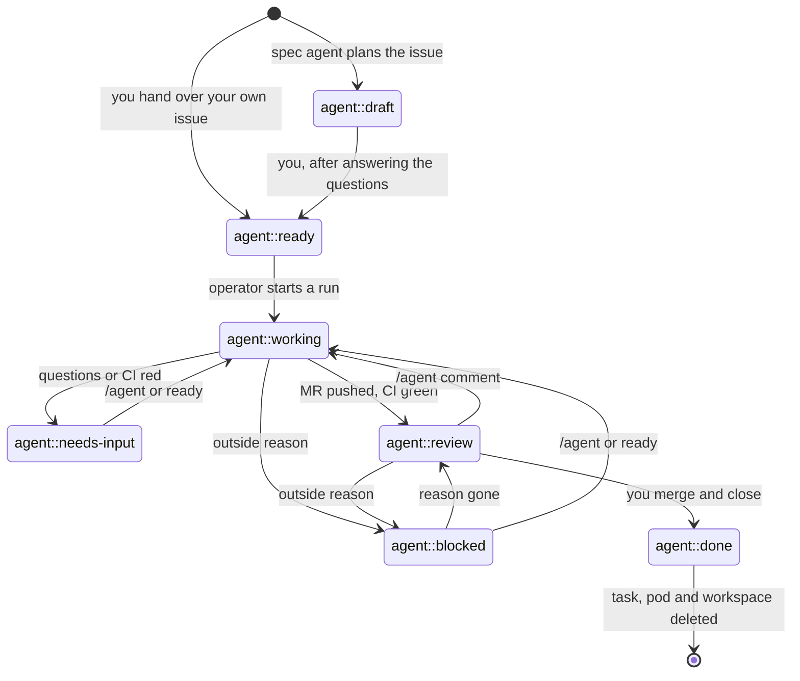

# Using the ai-operator from GitLab

Every `/agent` command is listed in [commands.md](commands.md).

Everything happens in GitLab. You write specs, answer questions, move cards
and review merge requests. The operator turns those actions into agent work.

## One-time setup in GitLab

Create these labels. Scoped labels (`::`) make sure an issue only ever has one
of each kind.

| Label | Set by | Meaning |
|-------|--------|---------|
| `agent::draft` | spec agent | sub-issue planned, waiting for you |
| `agent::ready` | you | hand the issue to the implementing agent |
| `agent::working` | operator | an agent run is requested or running |
| `agent::needs-input` | agent | the agent has questions, or the run failed (not for an outside reason) |
| `agent::review` | agent | merge request is ready for your review |
| `agent::blocked` | operator | the issue cannot go on for an outside reason; nothing to answer |
| `agent-blocked::<reason>` | operator | why it is blocked: `infra`, `main-red`, `quota` or `dependency` |
| `agent::done` | you | finished; pod and workspace are deleted |
| `agent-profile::<name>` | spec agent / you | which agent profile implements the issue (e.g. `agent-profile::fast`, `agent-profile::strong`) |
| `ai-generated` | spec agent / operator | issue was created by the spec agent or the operator |
| `ci::main-red` | operator | the issue that reports a red default branch, see [main health](#main-health) |
| `ci::flaky` | operator | the issue that collects the failures of one flaky CI job |
| `ci::main-canceled` | operator | the issue that reports a default-branch pipeline canceled twice, see [main health](#main-health) |

Put `agent::draft`, `agent::ready`, `agent::working`, `agent::needs-input`,
`agent::review`, `agent::blocked` and `agent::done` on an issue board as
columns. An issue moves
through them like this:



You act on `draft`, `needs-input` and `review`. Everything in between,
including fixing a red pipeline, happens without you.

**`needs-input` or `blocked`?** `agent::needs-input` means a human has to
answer or decide something. `agent::blocked` means the issue waits for
something outside it, such as an engine outage or a red default branch.
For example, a run that waits for a usage limit blocks its issue with
`agent-blocked::quota` (see [Usage and rate limits](#usage-and-rate-limits)),
a run that failed because its pod or agent container was lost blocks it
with `agent-blocked::infra` (see
[When the whole pod is lost](#when-the-whole-pod-is-lost)), and autopilot
blocks an issue with `agent-blocked::infra` when its reviewers failed in an
outage twice on the same head (see [When it pauses](#when-it-pauses)). A run
that failed for any other reason (the agent's error, a failed git command,
a bad configuration) still goes to `agent::needs-input`.
The `agent-blocked::<reason>` label says what it waits for. The operator sets
both labels and remembers the label they replaced. When the reason is gone,
that label comes back. You can also lift a block yourself: move the card to
`agent::ready` or comment `/agent …`, and the issue gets a run as usual.

`hack/gitlab-board.sh` creates that board, named **Agents**, with one list per
label in this order. Moving a card between columns changes its label, so
dragging a card from draft to ready hands the issue to the agent. A group
board shows the issues of every project in the group on one page:

```sh
# group labels (one set for every project in the group), then the group board
GITLAB_GROUP=my-group GITLAB_TOKEN=glpat-… hack/sandbox/gitlab-setup.sh
GITLAB_GROUP=my-group GITLAB_TOKEN=glpat-… hack/gitlab-board.sh

# or a board for a single project
GITLAB_PROJECT=my-group/shop GITLAB_TOKEN=glpat-… hack/gitlab-board.sh
```

Run both with your own token (`api` scope, *Maintainer* on the group or
project): creating group labels and boards needs more than the bot's
*Developer* role. `GITLAB_GROUP` must be a group, not your personal
namespace. The board script stops if a label is missing. It never removes,
renames or reorders boards and lists: missing lists are added at the end, and
where a second board is not allowed (group boards on GitLab Free) it adds
them to the existing board. Running it again changes nothing.

If projects in the group already have the `agent::*` labels as project
labels, promote them to group labels first (project > Manage > Labels >
Promote, which merges the same-named labels of all projects in the group).
Otherwise each name exists twice and the group board does not show those
projects' issues. `gitlab-setup.sh` with `GITLAB_GROUP` stops when it finds
such labels, and `gitlab-board.sh` warns about them.

Create a **project access token** with role *Developer* and the scopes `api` and
`write_repository`. Protect your default branch. The agent only pushes
`agent/*` branches and opens draft merge requests.

The ai-operator's own repository lives on GitLab (`jo.wiemers/ai-operator`)
and runs its checks in a GitLab pipeline; GitHub is a push mirror that
builds the releases (see [releasing.md](releasing.md)).

### Webhooks (optional)

Without webhooks the operator notices a comment, a label move or a pipeline
within a poll (`pollInterval`). With a GitLab **project webhook** (GitLab
Free has them; group webhooks need Premium) it syncs the project within
seconds, and polls less while deliveries arrive, which saves the bot's API
budget (100 requests per minute on GitLab Free). Polling stays the
fallback: whatever a lost delivery missed, a later poll picks up.

1. **Create the secret token** in the AgentProject's namespace:

   ```sh
   kubectl -n agents create secret generic gitlab-webhook \
     --from-literal=token="$(openssl rand -hex 32)"
   ```

2. **Expose the receiver.** The operator (the leader only) serves
   `POST /hooks/gitlab` on port 8082 behind the Service `<release>-webhook`
   (chart values `webhook.*`, see the
   [chart README](../charts/ai-operator/README.md#gitlab-webhooks)). The
   chart renders no route: add an HTTPRoute or Ingress that makes
   `https://<host>/hooks/gitlab` reachable from GitLab. For the ai-operator's
   own deployment that is done by hand in `infra/cluster`.
3. **Turn it on per project** in the AgentProject:

   ```yaml
   spec:
     webhook:
       secretRef: {name: gitlab-webhook, key: token}
       enabled: true                       # the operator registers the hook
       url: https://ai-operator.example.com/hooks/gitlab
   ```

   With `enabled` and `url` the operator creates the project hook itself
   (issues, comments, merge requests, pipelines and pushes, SSL
   verification, the secret token), keeps it up to date and deletes it when
   `enabled` is switched off. That needs the bot's **Maintainer** role.
   Without it, leave `enabled` out and add the hook by hand under
   *Settings > Webhooks*: the same URL and secret token, the triggers push,
   issues, comments, merge requests and pipelines.
4. **Check it** on the AgentProject's conditions:

   ```sh
   kubectl -n agents get agentproject shop \
     -o jsonpath='{range .status.conditions[*]}{.type}={.status} {.reason}: {.message}{"\n"}{end}'
   ```

   `WebhookRegistered` is `Registered`, or says why not: `Forbidden` (the bot
   is no Maintainer), `Invalid` (no `url` or `secretRef`, the secret or its
   key is missing) or `Failed` (tried again on the next poll). A failed
   registration never stops the sync. `WebhookDeliveries` is `Receiving`
   after a delivery, and `Silent` after `webhook.silenceThreshold` (30m)
   without one. The hook's *Recent events* in GitLab show the answers: `202`
   taken, `401` a wrong or missing token or a project the operator does not
   know, `413` a body over 1 MiB.

A delivery is only a wake-up call: it names the project, and the operator
syncs that project from the API as on a poll; nothing else in the payload is
used. Deliveries within 5 seconds lead to one sync (and one more at the end
of the 5 seconds). While deliveries arrive, the project is fully synced on
every delivery and every `webhook.fallbackInterval` (10m); in between, each
poll only lists the milestones, since milestone changes send no delivery.
Steps that only time moves on (infra retries, autopilot's auto-resume, the
main health interval) run on the full syncs, so they can be
up to `fallbackInterval` late. After `silenceThreshold` without a delivery,
or after an operator restart, every poll is a full sync again. Details:
[configuration.md](configuration.md#specwebhook).

## 1. Write the milestone spec

Create a milestone. Its description is the overarching spec for the whole
feature. Add the marker line `/agent spec` anywhere in the description.

```markdown
/agent spec

## Goal
Customers can pay with PayPal in the new checkout.

## Requirements
- ...
```

Within a poll interval (default 1 minute), a spec pod named like
`shop-spec-m3-checkout-v2` starts. It reads the spec and the repository, then
creates one **sub-issue per merge request** in the milestone. Each sub-issue
holds a self-contained sub-spec:

- the part of the milestone spec it implements, context and implementation
  plan (files, functions)
- acceptance criteria and a test plan
- `Depends on #…` for ordering, also as [issue links](#dependencies-as-issue-links)
- **Open questions**, each with the default the agent would pick
- labels `ai-generated`, `agent::draft` and the chosen `agent-profile::…`

The operator never edits the milestone description on its own; only the
pilot writes it, after an owner's `yes`, for a
[spec change](#spec-changes-through-the-pilot) or a standing rule. If you
edit the spec later, the spec agent runs again. It updates sub-issues that are still drafts and leaves
issues that are in progress, done, or created by hand alone.

If planning fails for an outside reason (a GitLab or network error such as a
timeout, or the agent pod or container lost), the operator plans again once,
`spec.lifecycle.infraRetryAfter` (default 30m) after the failure. A run
keeps the issues it created, and the next one finds them by their plan key.
Other failures (e.g. a plan that does not decode), and a retry that fails
too, wait for you: change the milestone's spec to plan again. On autopilot
every planning failure is a comment on the [tracking issue](#tracking-issue)
with the error and whether a retry follows, and it mentions the owners
(event `failed`). Without autopilot it is in the task status
(`status.run.summary`) and the spec pod's log.

### Dependencies as issue links

The planner's dependencies are also GitLab issue links, so the issue page and
the boards show them:

- On **GitLab Premium/Ultimate** an issue is linked as **is blocked by** the
  issues it depends on, and GitLab shows the blocked badge.
- On **GitLab Free** blocking links do not exist; the operator falls back to
  **relates to** links, which have no direction. The `Depends on` list in the
  description stays the record of the order.

A re-plan adds links for new dependencies and removes the links it made for
dependencies it dropped, on drafts only. Links you made are never removed,
and a link of the plan you remove stays removed. On autopilot, an **is
blocked by** link you add (Premium) holds an issue back until the linked
issue is closed, even if the plan does not list it or it is in another
project, so you can order or block work right on the issue. The run log's
`link dependencies` step says which link type was used.

## 2. Answer questions and hand the issue over

Answer the questions as comments on the issue. Check the profile label: change
`agent-profile::fast` to `agent-profile::strong` if the issue is harder than
the planner thought, or the other way round. Then move the issue to
**`agent::ready`**.

You can also hand over issues you wrote yourself. Just add `agent::ready`
(and optionally a profile label; without one, `agents.implement` is used).

## 3. The agent works

The operator moves the issue to `agent::working`, assigns the bot user if
nobody is assigned (see [Watching progress](#watching-progress)) and starts a
pod named like `shop-42-add-paypal-button`. In that pod:

1. On the first run, the **draft MR** `Closes #42` is opened right away, in
   the issue's milestone, before the agent changes anything. Its description
   holds a placeholder until the first push is described (step 7). The branch
   `agent/42-add-paypal-button` starts with an empty "Start work on #42"
   commit pushed with `ci.skip`, so no pipeline runs for it (the message has
   no `[skip ci]`, which a merge commit template could copy to the default
   branch). With `workflow.conventionalCommits` it is
   `chore: start work on #42` (see [Commit messages](#commit-messages)).
   The issue gets a comment linking the MR; from then on every run reports
   there.
2. While a run goes on, the MR has a **progress comment** with the run log so
   far: each step, its time and result, and the step in progress. It is
   edited as steps start and end (at most every 3 seconds) and replaced by the
   run's report when the run ends. A run that fails or waits for a usage limit
   leaves it with its run log and the reason.
3. The implementing agent (engine and model from the issue's profile) works on
   the branch. It follows your comments, runs the tests, and stops with
   questions if a design decision is unresolved. While the MR is a draft it
   works in **steps** (`workflow.stepCommits`): after each piece that is worth
   a commit of its own, the step is committed and pushed with `ci.skip` (no
   branch pipeline; merge request pipelines still run where your rules allow
   them for drafts), and the agent continues. Comments you write on the issue
   or the MR in the meantime are handed to it before its next step, so you
   can steer while it works; they need no `/agent` prefix. A `/agent …`
   command is not handed over: it starts its own run after this one, and the
   comments after it wait for that run too. At most 25 steps per run; a run
   that runs out of steps leaves the MR a draft and says so. Each step's
   commit carries the agent's message and `Refs #42` (see
   [Commit messages](#commit-messages)). With
   [`agents.implement.maxStepLines`](configuration.md#roles) (or a
   profile's) the **step-size gate** keeps steps small on claude: once the
   uncommitted diff passes that many changed lines, a hook tells the agent
   to finish the step (get it to build, return it with its commit message),
   again at most every 5 tool calls, and the steps note asks it to keep a
   step under the limit. Fix, CI and conflict rounds have no gate.
4. The **bugbot** and **security** reviewers check the diff in parallel. A
   reviewer that fails because its engine's service is briefly unavailable
   (for example cursor-agent's `RetriableError: [unavailable]`, a reset
   connection, a 502/503/504) is called again after 30 seconds, then after 2
   minutes (`review.retries`, default 2). Other failures, and usage limits,
   are not retried; the report says how many attempts a failed reviewer had.
   If reviewers still fail, `/agent review` asks for a **re-review run**:
   the reviewers check the pushed head again, the implementer does not run,
   and nothing is pushed unless blocker or major findings go to the
   implementer (step 5). The run records whether all failed reviewers failed
   transiently (`status.run.reviewErrorsTransient`).
5. Blocker and major findings go back to the implementer (at most
   `review.maxIterations` times). Remaining findings are listed for you.
6. **If the review is clean**, the MR is marked **ready** (its `Draft:` prefix
   is removed) before the push, so the push gets its pipeline even where
   pipelines skip draft MRs. If the run leaves blocker or major findings, a
   reviewer failed, or the agent asks questions, the MR goes back to draft.
   An MR with only the start commit stays a draft, and so does an MR you
   marked draft yourself after a run left it ready: that is your hold, mark
   it ready to release it. Without reviewers configured, every
   run with changes marks it ready; CI fix runs off autopilot are not
   reviewed and leave the draft state as it is. A clean run that has nothing
   new to push starts a merge request pipeline for the head it marked ready.
7. The branch is pushed. If the diff changed since it was last described,
   the **describe** agent (`agents.describe`) rewrites the **MR
   description**: Why, What, How, Verification and, when it helps, a mermaid
   diagram of the change at the bottom. It describes the whole branch, not
   the run, and only rewrites its own part (between hidden markers): text
   you add above or below it, and `Closes #42`, stay. With
   `workflow.conventionalCommits` it also writes the **MR title** (see
   [Commit messages](#commit-messages)). Then the report is
   posted on the MR; the first run's report points to the description
   instead of repeating it, later reports say what that run changed. If the
   agent has questions, the report lists them with a link to answer them in
   the Desk, and the operator posts each on the issue as a prompt.
8. The agent's decisions are posted on the issue (see
   [Decisions](#decisions)).

If the agent has questions, the issue moves to **`agent::needs-input`**.
A decision comes with two to four options, the agent's default marked, and
an open question without. The task keeps them, normalised, in
`status.run.questions` (at most 5), and the operator makes each a
**`needsInput` prompt** on the Implement task ("Q<n>", counted with the
milestone's prompts), posted as one comment on the issue with "Answer in
the Desk: <link>"; the first mentions the owners (not on autopilot, and only
with the `needsInput` notification). An open question is one free-text
prompt.

The milestone's owners (`/agent owner-subjects`) answer on the Task page or
with the chat command `{"cmd":"answer","prompt":"Q5","option":"B"}` (or
`"text"`, the answer in their own words) on the Implement task; anyone
else is told only the owners can, and a second answer is refused naming
the first. Once no question of the run is open, the run is requested and
the issue moves to `agent::working`; the agent gets all answers in one turn
and continues. The issue's comment of each prompt shows the answer and who
gave it. A new run before that (a comment, a retry) supersedes the open
ones. A `/agent` comment still works as an answer, as before.

The answers (`spec.source.promptAnswers`) reach the agent's session once,
as the owner's words ("Answer to your question Q5 (…) from @alice: …",
several in one turn), with the run of their request or the next chat turn;
a fresh session gets them all in its first prompt.
Otherwise it stays in `agent::working` until the MR pipeline has run; failing
jobs (lint, tests, …) go back to the agent (see [CI feedback](#ci-feedback)),
and the issue moves to **`agent::review`** once the pipeline is green.
After a clean run "review" means: reviewed, tests and CI pass, the MR is
ready, a human can look and merge. A draft in review still has findings the
run report lists (and, where pipelines skip drafts, no CI). On
[autopilot](#autopilot-a-milestone-end-to-end) the operator merges it.

So an issue's MR goes: draft MR → code → review → ready → pipeline → CI fixes
if needed → merge (by you, or by autopilot).

### Commit messages

The agent writes the message of every commit it leaves on the branch (each
step, each fix, CI or conflict round); the runner adds `Refs #42`, and uses
the issue title when the agent wrote none. Checkpoints have their own
`chore(wip): checkpoint …` subject until the next step folds them.

With `workflow.conventionalCommits: true` (see
[configuration](configuration.md#specworkflow)) the messages follow
[Conventional Commits](https://www.conventionalcommits.org/):
`type(scope): subject`, a blank line, then the body.

- The implementer's answer schema requires the format for `commitMessage`
  (a `pattern` built from `workflow.commitTypes`), and its instructions say
  how to pick the type (`feat` for new behaviour, `fix` for a bug fix, …)
  and the scope (the package, directory or component the step touches, in
  lowercase), with an imperative, lowercase subject of at most 72
  characters. The fix, CI and conflict prompts point to it.
- The runner checks every message before it commits. One that still does
  not match (for example `Add thing`) becomes `chore(agent): add thing`,
  with the body kept. The runner logs it, and the run report says
  "N commit messages did not follow Conventional Commits and were rewritten
  as `chore(agent): …`".
- The branch's start commit is `chore: start work on #42`, and the merge
  commit of a conflict run is `chore: merge main into agent/42-…`.
- The **MR title** follows the format too. Squash merges, also the ones you
  do by hand, land a commit with the MR title on the default branch. The
  describe agent (step 7) writes a title for the whole change, for example
  `feat(checkout): add the paypal button`, each time it rewrites the
  description. The runner reads the MR again and sets the title,
  `Draft: feat(checkout): …` while the MR is a draft. A title you renamed by
  hand (neither the issue title nor the title the runner last set) stays,
  and so does the current title when the describer's title does not match
  the format; both are logged, and the run goes on. The title changes only
  with a description rewrite, so after you turn the option on it follows
  with the next push that changes the diff. A companion MR keeps its title.
- **Autopilot's merge** passes a `squash_commit_message`: the MR title
  (without `Draft: `; `chore(agent): …` if it does not match the format), a
  blank line and `Refs #N`. So the commit on the default branch is
  conventional even when the MR title was renamed by hand. GitLab ignores the
  message when the project does not squash.

With the option off (the default), messages, titles, schema and prompts are
as before.

### Toolchains the agent installs

The agent runs your tests, linters and formatters itself instead of guessing
their output, so it needs your toolchains. Besides the tools of the
[agent image](configuration.md#agent-image), it installs the ones your
repository pins at the root of the **default branch**:

| Pin file | Installed with | Example |
|----------|----------------|---------|
| `.mise.toml`, `mise.toml`, `.tool-versions` | `mise install` | Node, Go, Python, jq |
| `rust-toolchain.toml`, `rust-toolchain` | `rustup toolchain install` | Rust with `rustfmt`, `clippy`, targets |

* They come from official sources (mise's registry, `static.rust-lang.org`)
  into `$HOME/.toolchains` (`mise/`, `rustup/`, `cargo/`) on the task's
  workspace volume, so later runs of the same issue reuse them. No root, no
  system packages, no piped install scripts. Nothing installs implicitly
  (`RUSTUP_AUTO_INSTALL=0`, `MISE_AUTO_INSTALL=false`), and mise tools are
  not on `PATH`: the agent runs them with `mise exec`.
* If the agent's branch changes a pin (say it bumps Rust), the runner starts
  every agent call of the run with `MISE_DATA_DIR`, `RUSTUP_HOME` and
  `CARGO_HOME` pointing to a temporary directory of that run, so that version
  never reaches `$HOME/.toolchains`; the next run removes it. The branch is
  compared with the default branch when the run starts: a pin the agent
  changes during a run gets its own directory from the next run on.
* A failed install is reported in the run summary. To make a toolchain
  available without a download per issue, add it to your own agent image.

### Owners and pings

The operator mentions the **owners** (`cc @alice @bob`) in the comments that
need a human, so GitLab sends them a mail and a To-Do:

| When | Where |
|------|-------|
| a run failed | issue |
| a run gave up for an outside reason and the issue stays blocked: after 20 usage limit deferrals, or when the automatic retry of an `infra` failure failed too | issue, also on autopilot |
| the agent asks questions | issue (with the questions) |
| the agent could not finish alone (e.g. unresolved conflicts) | MR report |
| CI is still red after the fix rounds (not on autopilot) | issue |
| the issue reached review (not on autopilot) | MR report, or "Ready for review" on the MR after CI; the owners also become the MR's reviewers if it has none |
| autopilot paused or is done | tracking issue |
| planning failed (autopilot) | tracking issue, saying whether a retry follows |
| the default branch stayed red after a retry | the new `ci::main-red` issue (project owners: `spec.notify.users` or the default) |
| a default-branch pipeline was canceled twice | the new `ci::main-canceled` issue (project owners) |

Only new comments carry the mention, never the progress comment that is
edited while a run goes on, and each commit pings for review once. On
autopilot, failed runs, questions and red CI ping through the pause on the
tracking issue instead; while paused, a new reason for the active issue (say
the review is fixed, but CI is red now) is announced, and pinged, again. The owners are, most specific first:

1. a line in the milestone description, for the milestone and its issues:

   ```
   /agent owners @alice @bob
   ```

   An `/agent owners` line without names turns the pings off for the
   milestone. Adding or changing the line does not re-plan the milestone.
2. `spec.notify.users` of the AgentProject;
3. the operator's default (Helm value `defaultOwners`).

`spec.notify.events` picks the situations, `spec.notify.requestReview: false`
keeps the reviewers to you (see
[configuration.md](configuration.md#specnotify)).

#### Commands from owners only

By default anyone who can comment gives `/agent …` commands. With
`spec.workflow.commandsFrom: owners` only the owners above count, checked by
GitLab user ID: on issues and their MRs, on the tracking issue and on closed
issues (revisits). Anyone else's command starts and changes nothing; each such
comment gets one reply in its thread ("🤖 Only the owners of this milestone
can give `/agent` commands here"), up to
[10 a day per author](commands.md#replies-to-comments-not-acted-on). On a milestone without owners nobody's
command counts, and the reply says to add an `/agent owners` line. Plain
comments still reach the agent with its next run. For an issue without a
milestone the owners are `notify.users`, else the operator's default.

## CI feedback

After every push, the operator follows the pipeline of the pushed commit:

| Pipeline | What happens |
|----------|--------------|
| running | the issue stays in `agent::working` |
| green (also: waiting for manual jobs) | `agent::review` |
| red, first time | the failed jobs are retried once, to rule out flaky jobs |
| still red, the same jobs also fail on the default branch | `agent::review` with a comment: not caused by this change; it links the `ci::main-red` issue if there is one |
| still red | the agent gets the failing jobs and the end of their logs and fixes the cause (a "CI fix" comment on the MR) |
| still red after 2 fix rounds | `agent::needs-input` with the failing jobs |
| canceled | `agent::review` with a comment |
| no pipeline within 10 minutes | `agent::review` (the project has no CI for this commit); a skipped pipeline (a push with `ci.skip`) counts as none |

The fix rounds count from the last push you triggered (`/agent …` or moving
the issue to ready), so every new instruction gets two fresh rounds. CI fix
runs skip the reviewer agents (except on [autopilot](#autopilot-a-milestone-end-to-end)).
Job logs reach the agent as untrusted data.

Whether a job also fails on the default branch comes from
[main health](#main-health) when it checked the branch within one
`mainHealth.interval` (`red`, or `retrying` its failed jobs); otherwise, or
with `mainHealth.disabled`, the operator reads the newest finished pipeline
of the default branch itself.

If you push to the agent's branch yourself and then comment `/agent …`, a run
that has nothing to add takes your commits over: your head counts as the
pushed commit, and CI is followed for it like for the agent's push.
Configure the loop in `spec.ci` (see [configuration.md](configuration.md));
`ci.disabled: true` restores "review right after the push".

The loop follows the MR's head pipeline if the MR's head is the pushed
commit, which covers merged-results and merge request pipelines, and
otherwise the newest pipeline of the commit. The MR is marked ready before a
clean run pushes, so pipelines that skip draft MRs run too. A push of a run
that left problems is a draft; if your pipelines skip drafts, it gets no
pipeline and moves to review after `ci.noPipelineTimeout`. Autopilot never
merges such an MR without CI: its gate pauses on the findings, and an MR whose
head had no pipeline is marked ready if needed and gets a pipeline first (see
[the merge gate](#the-merge-gate)).

While the issue is in `agent::review`, the operator keeps watching the MR's
head pipeline. GitLab starts no pipeline when a draft is marked ready, but one
started afterwards (by you, by autopilot, or by a run that marked the MR
ready without a push) or a canceled pipeline you retry is followed: while it runs or once it is red the issue goes back to
`agent::working`, and the loop above takes over: retry, CI fix run, review.
One that is already green when the operator first sees it counts as green
right away and the issue stays in review. So a job such as "add a changelog
entry" that only runs for ready MRs gets fixed by the agent too, as far as
code can fix it: the agent can add the file the job asks for, but it cannot
set labels on the MR.

## Main health

The operator also watches the default branch: every `mainHealth.interval`
(5 minutes) it reads the newest finished pipeline of the default branch
(skipped and canceled ones are passed over), and the jobs only when that
pipeline is new. Jobs that are allowed to fail don't count. A long failure
list shows the first 3 jobs and their logs.

| Default branch pipeline | What happens |
|-------------------------|--------------|
| green | nothing; an open `ci::main-red` issue gets "✅ green again at `<sha>`" and is closed |
| red, first time | its failed jobs are retried once |
| green after the retry | flaky: one issue per job, "🔁 Flaky CI job: `<job>`" (labels `ai-generated`, `ci::flaky`), opened on the first failure, and one occurrence comment per pipeline (the first 3 jobs of a pipeline): the pipeline, the failing tests and the last 40 lines of the **failed attempt's** log, as untrusted data |
| still red after the retry | an issue "🚑 `main` is red: `<jobs>`" (labels `ai-generated`, `ci::main-red`) with the pipeline, the commit, the failing jobs and the last 40 lines of each job's log; it mentions the project's owners |
| red again, the same jobs | nothing new |
| red again, other jobs | a comment on the `ci::main-red` issue, and its title follows |
| canceled, its commit has no green pipeline of its own | retried once (`mainHealth.retryCanceled`); a newer commit's green pipeline does not cover it, since jobs such as a release ran only for that commit |
| canceled again after that retry (or the retry refused) | one comment with the pipeline and the commit: on the open `ci::main-red` issue, else on an issue "⏹️ `main`: pipeline canceled twice" (labels `ai-generated`, `ci::main-canceled`), which mentions the owners when it is opened. It does not freeze autopilot and is not handed to the agent; close it by hand |

Canceled pipelines older than the newest one when `retryCanceled` first ran
(after the upgrade, or switched on again) are left alone.

The operator finds its issues again by a hidden marker, also after the
AgentProject was recreated; issues a human opens with these labels are left
alone. Job logs are untrusted: mentions and quick actions in them are made
inert, and job names in titles keep only letters, digits and ` :._/-`, at
most 60 characters. Close a flaky issue once the job is fixed; the next
failure opens a new one.

The retry replaces the failed jobs, so the operator records their IDs when
it retries (`status.mainHealth.retriedJobIDs`) and reads their logs once the
retry is green. The failing tests come from the log: nextest's
`FAIL [2.715s] <binary> <test>`, cargo test's `test <name> ... FAILED` and
vitest's `FAIL <file> > <test>`, at most 10, made safe for code spans. A
flaky issue's description stays the marker and its first one-liner; the
logs live only in the comments, after the untrusted-data marker.

The state is in the AgentProject status:

```bash
kubectl get agentproject shop -o jsonpath='{.status.mainHealth}'
```

`state` is `green`, `retrying`, `red` or `flaky`, with the pipeline, commit,
failing jobs and the open `ci::main-red` issue. Configure it in
`spec.mainHealth` (see [configuration.md](configuration.md#specmainhealth));
`mainHealth.retryFailedJobs: false` reports a red pipeline right away.

**Fixing it with the agent.** With `mainHealth.autoFix: true` (off by
default) the main-red issue gets `agent::ready` when it is opened, or when
`autoFix` is switched on while the branch is red, and runs like any issue,
also when `milestones.titlePattern` would skip an issue without a milestone.
Its description tells the agent to make the default branch green: fix the
cause; a test that fails only sometimes is stabilised or quarantined, never
deleted. The job logs follow a hidden marker; the agent and the reviewers
get them as untrusted data between `<untrusted-data>` tags, never as part of
the task, also in the issue's later comments. The CI loop of its MR does not
call the main-red jobs "not caused by this change": the change has to fix
them. One issue is handed over per red episode; a main-red issue opened
before the operator marked its logs is not. Switch `autoFix` on only where
that is wanted: whoever can make the default branch's CI fail starts an
agent run. When the branch turns green
without it (a flaky job, a fix by hand), the issue is closed as usual and
the agent's MR is left open for you to merge or close.

**Fixing a flaky test with the agent.** A flaky job's issue goes to the
agent once: by the pilot's `fixFlaky` (see [Talking to the
pilot](#talking-to-the-pilot)), after its job was flaky at least twice (two
occurrence comments) when the pilot runs it on its own or recommends it,
after one when an owner chooses it in a main health prompt; or by the
operator itself with `mainHealth.autoFixFlaky: true` (off by default) at
the second occurrence, also without a pilot. The issue moves into the
milestone (the pilot's; with `autoFixFlaky` the active autopilot milestone
with the lowest IID, else none) and runs like any of its issues: on a
running autopilot it joins the queue (a re-plan keeps it), otherwise it
gets `agent::ready`. An owner's choice always adds `agent::ready`, also
on the queue, so its run starts at once. Its
description gets the operator's fixed task: make the flaky test
deterministic, find the cause in the code or the test, do not delete or
skip it, a quarantine needs an owner's `yes`. The failing tests and logs
stay in the occurrence comments, as untrusted data. Only an open
`ci::flaky` issue the operator opened, with the title and description it
wrote, is handed over, and only the operator's occurrence comments of that
job count; an edited one is refused. The first hand-over wins
(`status.mainHealth.flakyFixes`, kept while the watcher is off, which also
exempts the issue from `milestones.titlePattern`; the task in the
description refuses a second one too); a later occurrence only adds a
comment. `autoFixFlaky` acts when a retry turns green; switched on while
the branch is flaky, it waits for the next occurrence.
Occurrence comments from before this version are not counted. Switch
`autoFixFlaky` on only where that is wanted: whoever can make a job of the
default branch fail twice starts an agent run.

**Merge freeze.** While the default branch is `red`, autopilot merges
nothing (`mainHealth.freezeAutopilot`, on by default). When its active issue
passed review and CI, the issue gets `agent::blocked` +
`agent-blocked::main-red` and autopilot pauses: "`main` is red (#N): merging
waits until it is green". The freeze also holds while a red branch's next
pipeline is retried; a `flaky` branch does not freeze. Once the branch is
green, the block is lifted (the issue is back in `agent::review`), autopilot
continues by itself with "▶️ Autopilot continues: `main` is green again" and
the gate runs again on the next poll; a pipeline the CI loop did not see
during the freeze sends the issue back to `agent::working` first. A freeze
never outlives the watcher: with `mainHealth.disabled`, or a status not
checked for 3 intervals, the branch counts as not red and the block is
lifted. `/agent resume` does not end a freeze (it pauses again); to ship
during a freeze, merge by hand. The freeze holds at the merge gate only: an
issue already started keeps working until it reaches it.

**The main-red lane.** With the freeze on, the oldest autopilot milestone
that is not done also drives the `ci::main-red` issue while the branch is
red, once it is handed to the agent: by `mainHealth.autoFix`, or by an owner
who adds `agent::ready` with `autoFix` off (also when
`milestones.titlePattern` would skip it); an issue without a workflow label
stays yours. Its run is on autopilot (no questions, CI
fixes are reviewed), and it goes through the same merge gate (run, review,
CI, a mergeable MR) and is merged. That is the only merge during a freeze:
the queue stays frozen until the next check sees the branch green, then it
continues as above. One fix is merged per red episode. The lane does not run
while you paused autopilot (`/agent pause`), nor once you took the issue
from the agent (no workflow label). If the fix cannot be merged (its CI is
still red after the fix rounds and the issue is in `agent::needs-input`, for
example), autopilot pauses with "the fix of the red default branch (#N)
cannot be merged: …" and mentions the owners; the lane waits during that
pause. It ends by itself once a later run passes the gate, or when the
branch turns green and the issue is closed; a pause over its MR (an
approval, a push by hand) ends with `resume`, which also lifts an infra
block of the fix. Without autopilot, the issue follows the normal flow and you merge
it.

## Merge conflicts

When the default branch moves on and the MR of an issue in `agent::review`
gets conflicts, the agent resolves them:

1. The operator sees the conflict on its normal poll (GitLab's
   `has_conflicts` / `detailed_merge_status`) and moves the issue back to
   `agent::working`.
2. The run merges the default branch into the agent's branch (a merge commit,
   no force push, so your checkout of the branch stays valid). Its message is
   `Merge branch 'main' into agent/42-…`, or `chore: merge main into
   agent/42-…` with `workflow.conventionalCommits`.
3. The conflicted files go to the implementer with their conflict markers. It
   resolves them, keeping the intent of both sides, checks that the change
   still fits the new code, and records decisions for resolutions that are not
   obvious. The runner concludes the merge only if no conflict marker is left.
4. The result is reviewed and pushed, CI runs, and the issue returns to
   `agent::review`. The MR comment says which files had conflicts.

If the merge has no conflicts after all, the implementer is not run; the
merge commit is reviewed and pushed. If the agent cannot resolve a conflict
(markers left, or it asks a question), the merge is undone, nothing is
pushed, and the issue goes to `agent::needs-input` with the files. The
operator asks once per MR head: if the new head conflicts again, because the
default branch moved again, it asks again.

By default the implementer resolves the conflicts in its own session, on its
own model. Such a round costs much more per token than an implement run: it
resumes the implementer's long session, usually after a queue wait, so the
cache is cold and the whole session is written to the cache again on the
implementer's model (Opus for `strong`). With
[`agents.implement.conflict`](configuration.md#conflict-role), e.g.
`{model: claude-sonnet-5-5}`, the conflict call runs on that role instead.
It starts in a fresh session that gets the issue, the agent notes, the MR's
diff stat and the conflicting files. The implementer's session is kept for
the review fixes and the next run. A run that also carries new comments, a
CI fix or revisits still goes to the implementer. The *By kind and model* table
of the [Spend tab](ui.md#spend) shows what the conflict calls cost.

Set `workflow.resolveConflicts: false` to leave conflicts to humans.

## 4. Iterate

| You do | Effect |
|--------|--------|
| comment `/agent <instructions>` on the issue or the MR | another run; the agent resumes its session and gets your new comments |
| move the issue back to `agent::ready` | another run (e.g. after answering questions) |
| discuss normally (no `/agent` prefix) | nothing; no tokens are spent (during a step run on a draft, the agent reads it before its next step) |
| push to the agent's branch yourself | the next run continues from your commits |
| change the profile label | the next run uses that profile |
| comment `/agent use claude opus` (or set `agent-model::claude/opus`) | the next runs use that engine and model; the comment alone starts no run |
| comment `/agent effort high` (or set `agent-effort::high`) | the next runs think that hard (claude, at most `agents.maxEffort`) |
| comment `/agent repo my-group/infra/cluster` (or, as an owner, set `agent-repo::my-group/infra/cluster`) | the issue changes that [companion repository](#companion-repository) too; the comment alone starts no run |

`/agent` must be the first word of the comment. `/agents are great` does not
trigger a run. All commands are listed in [commands.md](commands.md).

### Decisions

Every run records the decisions the agent made that you might want
differently: data shapes, names users see, libraries, error handling, scope
cuts. Small mechanical choices are not decisions. They are posted in one
comment per run on the issue:

> 📌 **Decisions** in run `shop-42#3`. Change one with `/agent revisit <id> <what you want instead>`.
>
> #### D42-3: How tags are stored
> **Question:** How are tags normalised?
> **Chosen:** lowercase
> **Why:** `store.js` already lowercases slugs, so search stays case-insensitive.
> **Alternatives:** keep the case as typed; store display and normalised forms

The planning agent posts its decisions for each issue as a comment on that
issue too, with the question, the choice, why, and the alternatives, and IDs
like `D42-P1`:

> 📌 **Decisions** of the plan in run `shop-spec-m3#1`. Change one with `/agent revisit <id> <what you want instead>`.
>
> #### D42-P1: Payment provider API
> **Question:** Which PayPal API?
> **Chosen:** Orders v2
> **Why:** the project already uses the REST client; v1 is deprecated.
> **Alternatives:** Checkout v1

The issue description keeps only the spec (with a pointer to the comment), so
all decisions are discussed, answered and revisited in the comments. While an
issue is a draft, a re-plan updates this comment in place and its IDs are
renumbered; implementer IDs (`D42-3`) never change. On autopilot the planner
asks no questions, so this comment is where its defaults show up. Issues
planned before this change keep their decisions in the description, and
those still work; a re-plan of such an issue while it is still a draft moves
them into the comment (and renumbers them). Reviewers get the planner's
decisions with the issue.

To change a decision, comment on the issue or its MR:

```
/agent revisit D42-3 keep the case as typed and add a normalised column
```

This is a normal run request. The agent gets the decision it is asked to
change together with your instruction, changes the code, and records a new
decision that supersedes the old one. The old decision is then marked
*Superseded by D42-5*.

- The comment must start with `/agent revisit <id>`; one revisit per comment.
  Several revisit comments since the last run are handled in the same run;
  for the same ID the latest comment wins. A comment like `/agent revisit the
  currency` (no ID) is a normal comment, and the report shows the right form.
- An ID that does not exist on the issue is passed on as a plain comment, and
  the run's report says so. Revisiting a decision that is already superseded
  is not applied: revisit the decision that replaced it.
- A revisit counts as handled once the run's decisions are posted. If the run
  fails before that, the next run applies it again.
- If the agent does not record a decision that replaces the old one, the old
  one is not marked, and the report says so.

Decisions are only read from the bot's decision comments (planner decisions
of older issues also from the description), so a comment by someone else
cannot add or fake decisions.

#### Revisiting after the merge

Once an issue of a planned milestone is merged and closed, its decisions can
still be changed. Comment `/agent revisit <id> <instruction>` on the closed
issue, or on the milestone's [tracking issue](#tracking-issue) on autopilot.
The operator then creates a **follow-up issue** in the milestone:

- titled `Revisit D42-3: <decision title>`, with the `ai-generated` label and
  the profile label of the original issue;
- its description holds the old decision, your instruction, and who asked;
- its implementer works on top of the merged change and records a decision
  that supersedes the old one. When that decision is posted, the old decision
  on the original issue is marked *Superseded by D57-1*, already before the
  follow-up is merged. If you drop the follow-up, comment on it or open an
  issue by hand to restore the old behavior.

Without autopilot the follow-up goes straight to `agent::ready`, since you
asked for it. On autopilot it is created as `agent::draft` and joins the
queue after the planned issues; it is merged like any other.

**From the Desk**, without a comment: an owner of the milestone (its
`owner-subjects`) revisits a decision on the milestone's pilot.
`{"cmd":"revisit","decision":"D42-3","text":"…"}` does what the comment
`/agent revisit D42-3 …` on the tracking issue does: the follow-up says
"requested by @you via the Desk", and the operator's answer below is on
the tracking issue. Without `text` (the decision row's **Revisit** button)
it opens a `revisit` prompt instead, on the decision's issue: the
recorded question, choice and why as its context; "Keep <choice>"
(recommended, changes nothing); one "Switch to <alternative>" per
alternative the decision recorded (at most three), which revisits it
asking for that alternative; or "Decide later" when it recorded none; and a
text box. Your own words in the box run nothing and need no pilot: they
become the option "From your answer: revisit D42-3 asking for: …", which
you confirm with one click. A second click while the prompt is open names
it again. When the decision's text cannot be read, the prompt says so and
offers "Keep the decision", "Decide later" and the text box. The refusals
are those of the table below, answered in the chat.

The operator answers every revisit comment it handles:

| Reply | Why |
|-------|-----|
| `Created #57 to revisit D42-3 …` | the follow-up was created |
| `#42 is still open …` | comment on the open issue; its next run changes the decision |
| `D42-9 was not found on #42` | the ID is wrong |
| `… already superseded …` | revisit the decision that replaced it |
| `#57 already revisits D42-3 …` | one follow-up per decision: comment on it |
| `… not in this milestone` / `… does not exist` | the ID names another issue |

Only comments written after the operator started watching the milestone,
and after the issue was closed, are handled, each once: a revisit you wrote
while the issue was open belongs to its runner (if the issue was merged
before a run picked it up, comment again on the closed issue). On the tracking issue,
revisits are handled while autopilot is on, also after it is done. A re-plan
of the milestone leaves follow-ups alone. Milestones without `/agent spec` or
`/agent autopilot` are not watched: there, open a new issue by hand.

## 5. Finish

Merge the MR, then close the issue (the MR's `Closes #42` does that) or move
it to `agent::done`. The task, its pod and its workspace are deleted.

## Autopilot: a milestone end to end

With **`/agent autopilot`** in the milestone description (instead of, or next
to, `/agent spec`), the milestone runs without you:

1. The operator creates a tracking issue, **🤖 Autopilot: <milestone>**,
   right away. The spec agent plans the milestone as usual, but asks no
   questions. It takes the default it would propose and records it as a
   [decision](#decisions), with why and the alternatives, in a comment on
   each issue. Until a plan exists the tracking issue says that the milestone
   waits for its turn ("⏳ waiting for its turn: %7, %9 go first. Comment
   `/agent start` to plan it now (owners)."), is being planned ("📝
   planning") or that planning has not succeeded yet, and nothing starts; `/agent pause` and `/agent resume` already work. A planning
   failure is a comment there that mentions the owners
   ([details](#1-write-the-milestone-spec)).
2. Once planned, the operator moves the first issue to `agent::ready`. Issues go **one at a time**, in
   dependency order (an issue's "Depends on" first, otherwise plan order). An
   issue linked as "blocked by" an open issue waits for it too.
3. The issue is implemented, reviewed and checked by CI as usual. The
   implementer never stops with questions: it decides and records the
   decision. On autopilot, CI fix runs are reviewed as well.
4. Once the pipeline is green and the review is clean, the operator marks
   the draft MR ready and **merges it**, then starts the next issue on the
   new default branch. The merge closes the issue.
5. When every issue is merged (or skipped), the tracking issue gets a summary
   and is closed.

**Before you use it,** allow the bot to merge into the default branch:
*Settings > Repository > Protected branches*, "Allowed to merge":
*Developers + Maintainers*, or give the bot user the *Maintainer* role. The
merge method and squash settings of the project apply. Keep at least one
reviewer in `agents.review.reviewers` (the default has two): autopilot only
merges reviewed changes. Autopilot never merges an MR of an issue it did not
plan; other issues in the milestone follow the normal flow.

If the project uses merged-results pipelines, also turn on *Pipelines must
succeed*: autopilot follows the pipeline of the pushed commit, and a commit
without any pipeline counts as green after `ci.noPipelineTimeout`.

### Several milestones at once

Each autopilot milestone has its own queue, but all of a project's runs share
`maxConcurrentRuns`. When a slot frees up, the waiting task that ranks first
takes it:

1. the fix of a red default branch ([main health](#main-health));
2. a run that only reviews a head again: it holds a finished change back from
   its merge;
3. a task without a milestone: an issue somebody labelled by hand;
4. a task of the **oldest milestone** (lowest milestone number first);
5. within one rank, the older task.

Autopilot milestones of a project go **one after another**: a milestone starts
no new issue while an older autopilot milestone is open (not done, off or
closed), also while that one is paused. Its active issue finishes, the next one
waits, and the tracking issue says "⏳ waiting for its turn". So only one merge
request is open at a time, and merges of one milestone do not rebase a reviewed
change of another away. The slot stays free while the older milestone waits for
CI. To let a younger milestone go first, turn the older one off. A run in progress is
never stopped for a higher rank, and it keeps its place when its pod is lost.
A chat turn needs a free slot but does not wait for higher ranks, and pilots
are outside the queue. A queued task says in its message who is ahead of it, for example
*waiting for capacity (1/1 runs in flight), 2nd in line behind #140
(milestone %6)*.

An autopilot milestone is also **planned** only when its turn comes, so its
issues describe the code as it is when work begins: as long as an older
autopilot milestone of the project is still open, its spec task waits
(`spec.runRequest` 0, the older ones in `spec.queuedBehind`) and starts no
planning run. Open means not done: a paused older milestone keeps the younger
ones waiting, and so does an older one that waits itself. An older milestone
that is done, closed or off autopilot holds back nothing. When its turn comes
the milestone is planned from its description of that moment; edits while it
waits start nothing. A milestone that was planned already (or is being
planned) keeps going, and a milestone with `/agent spec` but no
`/agent autopilot` is planned at once, as before. An owner who does not want
to wait comments `/agent start` on the tracking issue: the next poll asks for
the planning run with the description of that moment.

A waiting milestone can be paused (`/agent pause` by an owner) like a running
one, and the pause holds its planning too: when its turn comes it stays paused
and unplanned, the pause is never lifted by the turn. `/agent resume` lifts the
pause, and planning starts on the next poll if its turn has come (otherwise it
waits on). `/agent start` plans it at once and leaves the pause as it is: the
issues are written, nothing starts until `/agent resume`. Until its planning
has run, a waiting milestone has nothing to retry or assess: no retry of a
planning run, and its pause neither wakes the pilot nor counts as stalled. The
owners can still talk to the pilot on the tracking issue.

### The merge gate

An MR is merged only when all of these hold:

- the issue is in `agent::review`, i.e. the CI loop finished (green, or no
  pipeline within `ci.noPipelineTimeout`; with `ci.disabled` the run moves it
  there directly);
- the last run succeeded, no blocker or major review finding is left, no
  reviewer failed, and the review saw the commit that was pushed;
- CI checked that commit. An issue in review whose commit the CI loop never
  saw goes back to `agent::working` first;
- the MR is open, targets the default branch, and its head is exactly that
  commit (nobody pushed since);
- the MR's head is not a [checkpoint](#usage-and-rate-limits) (the
  `status.run.checkpoint` commit of a run that was cut off). Autopilot then
  waits without pausing: it does not mark the MR ready, start CI or merge,
  and the run that continues the work moves the head on. Nobody is asked to
  review a checkpoint either, and the pilot's state shows it as
  `checkpoint`;
- the default branch is not red ([merge freeze](#main-health)). Checked
  after the run, review and CI, so the CI loop is final when the issue is
  blocked;
- if no pipeline ran for the commit and the MR is still a draft (projects
  that skip pipelines for draft MRs; normally the run marked it ready before
  pushing), the operator marks it ready, starts a merge request pipeline and
  waits for it like for any pipeline. Only if there is still none, the gate
  goes on without CI;
- GitLab reports the MR as mergeable. A draft MR is marked ready once. If it
  needs a rebase (fast-forward or semi-linear projects), the operator asks
  GitLab to rebase and waits for CI on the new head, again each time the
  default branch moves. The review carries
  over to the rebased head only if the change is the same: same files, same
  added and removed lines. Otherwise the operator compares the reviewed
  version of the MR with the rebased one (GitLab's MR versions) and posts
  the **interdiff** (reviewed → rebased, the added and removed lines per
  file, cut at 200 lines) as a 🔁 note on the MR. The rebase counts as
  *mechanical* if the commits are the reviewed ones (same number, titles
  and author emails, in order) and either the interdiff has at most 40
  changed lines, or every file of it also changed on the default branch
  between the two bases. A file that only moved (the same lines under a new
  path, such as a renumbered migration) counts as one line. A mechanical
  rebase does not pause: the reviewers check the rebased head again (a
  review-only run), and the gate goes on as for any push: findings go to the
  fix loop, a clean review and green CI merge. This happens at most twice
  per issue (`autoReReviews` on the queue item). A third rebase that changes
  lines pauses, as do other commits (someone pushed during the rebase), a
  larger interdiff in files the default branch did not change, or a change
  GitLab does not return in full. The 40 lines and the cap of 2 are fixed.
- If the MR has [merge conflicts](#merge-conflicts), or GitLab cannot rebase
  it (conflicts during the rebase, a failed rebase, or a change too large to
  check), the agent merges the default branch and resolves the conflicts. That
  run is reviewed and checked by CI like any other, then the gate runs again.
- With a [companion repository](#companion-repository): the companion is
  green on its pushed head, reviewed at it, open and mergeable (a draft
  counts; one rebase if it needs one), see
  [Before the home merge](#companion-repository).

The merge call passes the checked commit (`sha`), so GitLab refuses to merge
anything else.

### When it pauses

Autopilot pauses instead of guessing. It comments on the tracking issue with
the reason and the **ways out** of that kind of pause, mentioning the
milestone's [owners](#owners-and-pings): first what ends it by itself, then
the commands, labels or GitLab actions that end it, with what each does
(for example `` `/agent review` on #12: the reviewers check the pushed head
again``). The list is one table in the operator (`PauseExits` in
`api/v1alpha1/pause.go`); the [pilot](#talking-to-the-pilot) gets it in its
state (`pauseExits`) and the Desk in the milestone view (`exits`), so they
name the same ways out. The reason can quote job names or other text
from GitLab, so mentions and quick actions in it are made inert, in the
comment and in the tracking issue's description. It pauses for:

- the issue landed in `agent::needs-input` (CI still red after the fix
  rounds, a failed run). A run that failed for an outside reason blocks
  its issue instead (`quota`, `infra`): autopilot waits without a pause, and
  the issue's own comment mentions the owners once it needs a human;
- blocking review findings or failed reviewers. Reviewers that all failed
  transiently (an outage, `status.run.reviewErrorsTransient`) do not pause
  at first: after `agents.review.retryAfter` (default 15m) autopilot asks
  for one re-review run of the same head (as `/agent review` would). If that
  one fails transiently too, it pauses and the issue becomes
  `agent::blocked` + `agent-blocked::infra`;
- a canceled pipeline, or CI red with jobs that also fail on the default
  branch;
- someone pushed to the agent's branch, the MR was closed or retargeted, it
  needs an approval, has unresolved discussions, or was marked draft again
  after autopilot marked it ready;
- the MR still has conflicts after the agent merged the default branch for
  this head (or `workflow.resolveConflicts` is off);
- the merge was refused (for example: the bot may not merge), or the rebased
  change differs from the reviewed one and the rebase was not mechanical
  (see [the merge gate](#the-merge-gate); the interdiff is on the MR);
- the active issue lost its workflow label while open;
- the default branch is red ([merge freeze](#main-health)): the active issue
  is blocked (`agent-blocked::main-red`) until it is green;
- the fix of the red default branch cannot be merged ([main-red
  lane](#main-health));
- no reviewers are configured;
- the plan has a dependency cycle, or nothing can start because the
  remaining issues wait for skipped issues, for issues outside the queue
  ("blocked by" links), or for each other (a cycle of links);
- the milestone, or one of its open issues, spent its [budget](#budget);
- the planning run succeeded but planned no issues.

While paused, runs that were already requested continue (your `/agent`
comments still reach the agent), but nothing new is started or merged.
A run of the issue the pause is about gets the pause reason in its prompt
("Autopilot paused because: …"), marked as the operator's context, before
your comments. So `/agent investigate the root and fix it` on that issue
knows what "it" is.

While a pause over the active issue's run, review or CI holds, autopilot
checks the issue on every poll. If the reason it paused for is gone but the
issue fails the merge gate for another one, it says so with a new pause
comment (mentioning the owners) instead of keeping the old reason.

A pause over the active issue ends **by itself** when it no longer holds:

- the issue's MR was merged by hand, or the issue was closed: autopilot
  counts it (merged, or skipped if closed without a merge) and goes on with
  the next issue;
- the pause was over its run, review or CI (needs input, a failed run,
  blocking findings, failed reviewers, an unreviewed head, red or canceled
  CI) and a later run fixed it: for example you commented `/agent fix the
  findings`, the run succeeded, was reviewed and CI is green. Autopilot then
  continues with the merge;
- the pause was a merge freeze and the default branch is green again (or its
  health is no longer watched): the block is lifted and the gate runs again;
- the pause was CI red with jobs that also fail on the default branch, and
  [main health](#main-health) reports the default branch green at a commit
  the MR is not based on. Nothing would rerun the MR's pipeline, and a retry
  would run on the old base without the fix, so autopilot rebases the MR
  itself (as for `need_rebase`, see [the merge gate](#the-merge-gate)),
  once per green commit, and says so on the tracking issue ("`main` is green
  at …: rebasing !N"). The rebased head goes through CI like a push; green,
  it is merged, red, it pauses again with the new reason. If the rebase
  conflicts, or the MR was rebased before, the agent merges the default
  branch instead (see [Merge conflicts](#merge-conflicts)). The same happens
  for such an MR before it paused.
  An owner can ask for the same at any time with `/agent rebase #N` (or
  `/agent mergeBase #N`) on the tracking issue, and the pilot with its
  tools of that name.

A pause because **nothing can start** (stuck) is checked on every poll too,
and ends by itself once something can: a skipped issue it waits for was
closed as done (`agent::done`, or by a merged MR; it counts as merged), a
"blocked by" link was removed, a waiting issue was closed or skipped, or an
owner chose one of these ways out (no `resume` needed; the tracking issue
says "▶️ Autopilot continues: #N can start now"):

- `/agent unskip #N` on the tracking issue: the skipped (and still open)
  issue goes back to pending and is picked once its dependencies are merged;
- `/agent startAnyway #N`: the waiting issue may start although an issue it
  depends on was skipped, for example because another milestone replaces
  it. Only that issue: others that wait for the same skipped issue keep
  waiting. Its other dependencies and links still hold, and the tracking
  issue says so ("▶️ #N may start although #M, which it depends on, was
  skipped (@you)");
- the [pilot](#talking-to-the-pilot)'s prompt, whose options can run
  `unskip`, `startAnyway` or `markDone` (the skipped issue is closed as
  done, with the pilot's reason on it). The pilot only proposes these, also
  when it manages; they run on an owner's answer.

By default a skipped issue still holds back the issues that depend on it.

A budget pause ends by itself too, once the budget is raised above the
spend or removed (see [Budget](#budget)).

When such a pause ends, by itself or with `/agent resume` (also after an
`/agent pause` in between), the active issue's `agent-blocked::infra` block
is lifted and the issue gets its label back, unless its last run failed
for an outside reason: that block waits for a new run (the automatic retry,
`/agent …` or `agent::ready`). Autopilot asks for one
re-review per head: a later transient failure on a head it re-reviewed
already pauses at once. `/agent resume` with the reviewers still failing on the same head
pauses again; comment `/agent review` on the issue to have it reviewed once
more.

The tracking issue gets "▶️ Autopilot continues: …", which ends with who
ended the pause: "(ended by @alice)" or "(ended by Ada via the Desk)" for an
owner, "(ended by the pilot)", "(ended by a later run of #N)" when a new run
made the issue pass the gate, "(ended by the operator: it rebased the merge
request)" for the rebase onto a green default branch, "(ended by hand: the
merge request was merged)" or "(ended by hand: the issue was closed)", or
"(ended by the operator: the cause went away)" for every other end by
itself. A later run also says how it came about: "(ended by a later run of
#N, a review-only run the autopilot started)" for the reviewers' run the
autopilot asked for (after a rebase, or a reviewer outage), "(ended by a
later run of #N, which @alice's `/agent` comment started)" when an owner's
comment on the issue took it over (or "which the pilot started" for a
pilot action), and "(ended by a later run of #N, which reviewed a head
someone else pushed)" when it passed on a head nobody asked a run for.
The retrospective reads these comments. An owner's `/agent resume`, also from
the Desk or through the pilot, posts it with "resumed", so every resume is
visible on GitLab. Every other pause (an
approval, unresolved discussions, someone else's push, a dependency cycle,
`/agent pause`) waits for `/agent resume`.

Each pause and its end are recorded in the history database
(`autopilot.paused` and `autopilot.resumed` events with the pause's kind,
reason and issue). The end says who resolved it (`resolvedBy`) and how long
it took (`pausedSec`): `operator` for an end by itself (the cause went away,
a budget raise, a stuck pause that can move again, a merge by hand),
`laterRun` when a later run made the paused issue pass the gate, `selfHealed` for the
rebase onto a green default branch above, `owner` for a command or an
answered pilot prompt (also `/agent merge`, ending the milestone, or
removing the autopilot marker), `pilot` for a rebase or mergeBase the
[pilot](#talking-to-the-pilot) ran on its own. A new reason of the same
kind is the same pause; a pause of another kind ends the old one (as
`operator`) and starts a new one. The operator keeps the last resolver in
`status.autopilot.resumedBy` until the next pause.

The end also says how (`via`, kept in `status.autopilot.resumedVia` next
to `resumedBy`):

| `via` | How the pause ended |
|---|---|
| `reReview` | a review-only run the autopilot asked for (after a rebase, a reviewer outage) passed on the head it was asked for |
| `takeover` | a run an owner's `/agent …` comment on the issue, or a pilot action, started |
| `push` | a later run passed on a head nobody asked a run for: someone pushed |
| `mergedByHand` | the merge request was merged by hand |
| `closedByHand` | the issue was closed by hand |
| `command` | `/agent resume` or another owner or pilot command (`merge`, `rebase`, `mergeBase`, ending the milestone, removing the autopilot marker) |
| `causeGone` | another end by itself (a green default branch, a budget raise, a companion that can go on, a pause replaced by one of another kind) |
| `selfHealed` | the rebase onto a green default branch above |

Events from before `via` was recorded have none. To tell `reReview`,
`takeover` and `push` apart, the operator records who asked for a run of
the paused issue while it is paused (`status.autopilot.pauseRunBy`:
`autopilot`, `@alice` or the pilot) and the head that run was asked for
(`pauseRunHead`); both are cleared when the pause ends. A run started from
the Desk chat is not recorded, so a pause it ends counts as `push`.

On the Desk ([ui.md](ui.md#what-it-shows)), the milestone's *Pilot* tab
shows a paused autopilot as a card (its *Issues* and *Stream* tabs, the
Board and the Inbox show a compact one that links there): the cause, the paused issue and its MR, what ends the
pause by itself, and the actions that fix it (Retry, Review again, Resume,
Skip, links to the issue's chat, the pipeline, the MR or the plan, and for
an owner Merge anyway). The buttons send the same commands as the Desk chat
and show the operator's answer in the card.

**A pause that nothing moves.** While autopilot is paused, the operator
checks on every poll whether the pause still holds (the stuck re-check
above: a stuck pause ends as soon as an issue can start). If the pause's
state (the queue's items, their heads and CI states, main health, the
reason) has not changed for `pilot.stuckAfter` (default 30m, see
[configuration.md](configuration.md#specpilot)), the pause is **stuck**: the
[pilot](#talking-to-the-pilot) assesses it once per pause and the owners get
a Desk prompt whose options are the pause's ways out below and the pilot's
tools (for example `markDone #83` or `startAnyway #88`). That prompt always
waits for an owner, also when the pilot manages, and nothing resumes on its
own. A new pause gets its own assessment; an owner's `/agent pause` is
never assessed.

**Rejected status writes.** When the API server rejects a status write of
the pilot or the operator (a schema violation, for example), it is not
lost silently: the tracking issue gets one line ("⚠️ The API server
rejected a status write of the pilot …"), the history gets a
`pilot.writeFailed` event, and the Desk Inbox shows *Pilot write rejected*
(kind `pilotError`) with the API error for 24 hours. The same error from the
same source again is counted, not posted again.

The ways out of each kind of pause (`pauseKind` in `status.autopilot`), as
in `PauseExits`; a test keeps this list and the table in step. Commands go
on the tracking issue unless they say "on the issue". Every issue-level
pause also ends when its MR is merged by hand or the issue is closed.

#### `owner`

An owner commented `/agent pause`. Nothing ends it by itself.

- `/agent resume`: autopilot continues.

#### `cycle`

The plan has a dependency cycle.

- Change the milestone description so the issues no longer depend on each
  other in a cycle, then `/agent resume`: the milestone is planned again and
  autopilot continues with the new plan.
- `/agent skip #N`: the issue is skipped, which breaks the cycle of the
  issues after it.
- `/agent resume`: autopilot checks the plan again.

#### `stuck`

Nothing can start: the remaining issues wait for skipped issues, for issues
outside the queue, or for each other. Ends by itself once an issue can start
(a skipped dependency closed as done, a link removed, an unskip or a
startAnyway). Owners can:

- set `agent::done` on the skipped issue and close it (or merge it by
  hand): it counts as merged, so the issues that wait for it can start;
- remove the "blocked by" link of the waiting issue;
- `/agent unskip #N`: the skipped issue goes back to pending and autopilot
  picks it once it can start;
- `/agent startAnyway #N`: the waiting issue may start although an issue it
  depends on was skipped; the tracking issue says so;
- answer the pilot's prompt with `unskip`, `markDone` (the skipped issue is
  closed as done, with a reason) or `startAnyway`, e.g. when another
  milestone replaces the skipped issue;
- `/agent skip #N`: the waiting issue is skipped and autopilot goes on with
  the others;
- `/agent resume`: autopilot looks for an issue that can start again.

#### `needsInput`

The active issue landed in `agent::needs-input`. Ends by itself once a later
run passes the merge gate (reviewed and green), or when the MR is merged by
hand or the issue is closed.

The reason names the cause the operator or the runner recorded next to the
label (`status.run.needsInputCause`):

- `ciRed`: "#N needs input: CI is red after the fix rounds: failing jobs
  `a`, `b` (pipeline URL)", the jobs sorted;
- `runFailed`: "#N needs input: the run failed: <error> (link to the failure
  comment)". A usage limit names the engine and its reset as a UTC time, with
  the date when it is not the day the run ended ("claude usage limit, resets
  16:00 UTC");
- `agentQuestion`: "#N needs input: the agent asks: <question> (link to the
  run's report)", the first question if it asked several.

The error or question is cut to its first line and 200 characters; the link
has the rest. A reason holds no times relative to now and no counters, so a
pause comments once while its cause stays the same. A label set by a release
before this one has no cause, and the reason then lists all three ("CI is
still red, the run failed or the agent asked a question"). The pilot's event
for an issue in `agent::needs-input` has the same text.

- Answer its questions and set `agent::ready` on the issue: a new run
  starts with the answers.
- `/agent retry` on the issue: the agent runs again; a run that passes the
  gate ends the pause.
- `/agent skip #N`: the issue is skipped and autopilot goes on; issues that
  depend on it wait until it is done by hand.

#### `runFailed`

The active issue's run failed. Ends by itself like `needsInput`.

- `/agent retry` on the issue: the agent runs again.
- `/agent skip #N`: the issue is skipped.

#### `findings`

The review left blocker or major findings. Ends by itself like `needsInput`
(for example after `/agent fix the findings` on the issue).

- `/agent retry` on the issue, or `/agent skip #N`.
- `/agent merge #N <sha>` (owners only): autopilot merges this head without
  a full review; CI, the MR's state and approvals still apply.

#### `reviewErrors`

Reviewers failed (after the one re-review of a transient outage). Ends by
itself like `needsInput`. The reason names each failed reviewer and why,
sorted by reviewer, for example "bugbot failed (usageLimit, resets 16:00 UTC),
coderabbit failed (timeout)"; runs from before the kinds were recorded say
"N reviewers failed".

- `/agent review` on the issue: the reviewers check the pushed head (and
  companion head) again.
- `/agent retry` on the issue, or `/agent skip #N`.
- `/agent merge #N <sha>` (owners only), as for `findings`.

#### `notReviewed`

The review did not see the pushed head, or (with a companion) the pushed
companion head. Ends by itself like `needsInput`.

- `/agent review` on the issue: the reviewers check the pushed head (and
  companion head) again.
- `/agent retry` on the issue, or `/agent skip #N`.
- `/agent merge #N <sha>` (owners only), as for `findings`.

#### `ciRed`

CI is red with jobs that also fail on the default branch, or the
[companion's](#companion-repository) pipeline is red (also after the fix
rounds; the reason names the companion). Ends by itself
like `needsInput`, and when [main health](#main-health) reports the default
branch green at a commit the MR is not based on: autopilot rebases the MR
once (the self-heal of a `BaseFailing` MR above) and the new pipeline
decides.

- `/agent rebase #N`: GitLab rebases the MR onto the default branch and the
  pause ends; the review holds if the change is unchanged, the new pipeline
  decides.
- `/agent mergeBase #N`: the agent merges the default branch into the MR and
  the pause ends; the new head is reviewed and checked by CI like any push.
- `/agent retry` on the issue, or `/agent skip #N`.

#### `ciCanceled`

The MR's pipeline was canceled. Ends by itself like `needsInput`.

- `/agent retry` on the issue, or `/agent skip #N`.

#### `mergeRequest`

The MR cannot be merged: someone pushed to the branch, it was closed or
retargeted, needs an approval, has unresolved discussions or conflicts, is a
draft again, the merge was refused, or the rebased change differs from the
reviewed one beyond a mechanical rebase (the pause reason says why, and the
interdiff is in a 🔁 note on the MR). Ends by itself when the MR is merged by hand or the issue is
closed.

- Fix the merge request in GitLab (approve it, resolve its discussions or
  conflicts, mark it ready, let the bot merge), then `/agent resume`: the
  merge gate checks it again.
- `/agent rebase #N` or `/agent mergeBase #N`, as for `ciRed`.
- `/agent skip #N`: the issue is skipped.

#### `mainRed`

The default branch is red ([merge freeze](#main-health)), or the fix of the
red default branch cannot be merged. A `ci::main-red` issue handed to the
agent (by `mainHealth.autoFix` or by an owner's `agent::ready`) is driven
and merged by the frozen milestone: the [main-red lane](#main-health). Ends
by itself when:

- the default branch turns green;
- the merge freeze is switched off (`mainHealth.freezeAutopilot`);
- the default branch's health is no longer watched or checked;
- the issue's MR is merged by hand, or the issue is closed.

`/agent resume` does not end a freeze; to ship during one, merge by hand.

#### `config`

The setup does not allow a merge: the active issue lost its workflow label,
no reviewers are configured, or there is no pushed MR. Ends by itself when
the MR is merged by hand or the issue is closed.

- Fix the setup (the issue's workflow label, `agents.review.reviewers`, a
  pushed merge request), then `/agent resume`: the merge gate checks the
  issue again.
- `/agent skip #N`: the issue is skipped.

#### `budget`

The milestone, or an open issue of it, spent its budget. Ends by itself once
the budget is raised above the spend or removed (`/agent budget <usd>` in
the milestone description, or on the issue for its own budget); see
[Budget](#budget). `/agent resume` alone pauses again.

#### `companion`

The [companion's](#companion-repository) merge request cannot follow the
home merge: it was closed, a rebase did not resolve its conflicts or it
still needs one, it needs an approval or has unresolved discussions, someone
pushed to its branch, or GitLab reports another blocking status. (A red
companion pipeline pauses with `ciRed`, an unreviewed one with
`notReviewed`.) Ends by itself when the companion's merge request can be
merged again (also after a rebase by hand: the rebased head is taken over,
its review holds if the change is the same), or is merged by hand.

After the home merge, the same kind pauses the milestone while one of its
companions is `blocked` in its [landing](#landing): a conflict or a
`need_rebase` after the one rebase, a failed rebase, a red pipeline, an
approval, someone's push, a merge GitLab refused twice, or a red
default-branch pipeline after autopilot merged it. That pause is about no
issue. It ends by itself once no companion of the milestone is blocked any
more (fixed or rebased by hand, merged or closed by hand, or the
default-branch pipeline green on a retry).

- Fix the companion's merge request in GitLab (resolve its conflicts or
  discussions, approve it), then `/agent resume`: the merge gate checks it
  again.
- `/agent resume`: the merge gate checks the companion again. After the
  home merge, the blocked companions are checked again, each with one more
  rebase and merge; one autopilot merged onto a red default branch is
  recorded as merged (fix the default branch yourself).
- `/agent skip #N`: the issue is skipped; its companion merge request is
  left to the owners.

#### `emptyPlan`

The planning run succeeded but planned no issues. A planning run that is
still pending, one that failed, and a milestone whose planning has not run
yet do not pause. Ends by itself once the milestone is planned again and the
plan has issues: autopilot starts with the new plan. The pause lifts as soon
as the re-plan is pending; if that plan comes back empty, it pauses again.

- Change the milestone description so the planning agent plans issues: the
  milestone is planned again. `/agent resume` alone pauses again.

### Budget

A line `/agent budget <usd>` in the milestone description (for example
`/agent budget 5`, decimals allowed) gives an autopilot milestone a budget. On every
poll the operator reads what the milestone's agent calls cost so far
(`agent_calls`, all calls with its milestone: planning, implementers,
reviewers, CI and conflict rounds, the pilot) and shows it with the limit
in the spec task's `status.autopilot.budget` (`limitUSD`, `spentUSD`).
Once the spend reaches the budget, autopilot pauses with
`pauseKind: budget` ("the budget of $5.00 is used ($5.12 spent) …"). A
running agent call is never killed: it finishes, and nothing new starts or
merges, as with every pause. A run in progress stops too, between calls:
on the next poll the operator sets `spec.budgetStop` on the milestone's
Implement tasks (for an issue's budget, on that issue's task), and the
runner reads it before every agent call. After the call in progress the
run ends `Deferred` ("the budget is used"), like a run that hit a usage
limit: the steps it pushed stay on the branch, its workspace and session
are kept, and the run request stays pending without a pod. Once the pause
ends the flag is cleared and the run continues from where it stopped. Desk
chat turns still run. Calls without a known cost (cursor without
`pricing`, see [configuration.md](configuration.md#pricing)) count $0
towards it.

To go on, raise the line, e.g. to `/agent budget 50`: once the budget is
above the spend, autopilot continues on the next poll by itself. Removing
the line ends the pause too. `/agent resume` alone pauses again at once
while the budget is spent. Like the owners and the rules, the line is no
part of the spec: changing it re-plans nothing.

A value that is not a number above 0 is ignored (the operator logs it):
the milestone has no budget then. Without the research database, or while
the spend cannot be read, the budget is not enforced (logged on every
poll): autopilot never pauses for lack of data.

#### What the spend counts

Budgets, the [Spend tab](ui.md#spend) and the retrospective read the same
numbers: one row per agent call in `agent_calls`.

- **A call counts only itself.** Its tokens are input, output, cache read
  and cache write of everything the call ran: the main thread, subagents
  and compaction (claude's `modelUsage`). A call that resumes a session
  (implementer steps, fix rounds, re-runs) counts only what it spent
  itself, not the session's earlier calls: claude's `--resume` restores
  the session's totals into `modelUsage` and `total_cost_usd`, so the
  operator takes `model_usage_since_last_result` instead. Desk chat turns
  count their own turn the same way.
- **Per-model tokens are the same tokens, split.** A call's models (its
  main model and the subagents' models) add up to the call's tokens, so
  *by model*, *by kind*, *by role* and the drill-down all add up to the
  total. Calls recorded by older releases could hold a
  resumed session's carried-over totals in their models: such a call
  counts whole on its main model, with its own tokens and cost, and is
  not split.
- **Cursor's `auto` is not metered.** Cursor calls with model `auto` (the
  `fast` profile, the bugbot and security reviewers) let cursor pick the
  model, and its ACP session reports neither which model it picked
  (`currentModelId: "default[]"`) nor any usage. So these calls have no
  tokens and no cost: they appear as *cursor auto (unmetered)*, count as
  *N calls not metered* next to the total, add nothing to the token sums,
  and count $0 towards a budget. No model or price is guessed for them.
- **Cursor's cost: reported, estimated or n/a.** Cursor sends usage over
  ACP only optionally, and the cursor-agent in the agent image sends none
  yet. When an ACP `usage_update` carries a cost in USD, that is the
  call's reported cost (ACP's cost is the session's running total, so a
  call counts the increase since the previous call of its session; other
  currencies and credits are ignored). Otherwise a call with tokens (from
  the ACP prompt response) is estimated from the
  [`pricing:` table](configuration.md#pricing), and without tokens or a
  price its cost is n/a, never $0. The context size a `usage_update`
  reports becomes the call's context series, never its tokens. Calls
  recorded before a price was configured, or before this release, are not
  re-priced.

#### Spend report script

`hack/spend-report.sql` answers "where did this issue's cost come from" and
"what do conflict rounds cost" from `agent_calls` alone, with psql on the
research database (it only reads). Variables: `project` (required),
`milestone` and `issue` (0 or unset: all). It prints three tables:

1. per issue: kinds, models, runs, review rounds (as in the Spend tab's
   *Review rounds*), calls, input, output, cache read and cache write
   tokens, cost and cost per 1M tokens;
2. conflict calls per issue and model, with the most calls one run made
   (above 1: the run resolved conflicts repeatedly) and the output and
   cache tokens, to see conflict rounds on Opus with large outputs;
3. the calls of one issue (`issue` ≠ 0): task, run, seq, kind, role, model,
   resumed, tokens, cost and duration.

```sh
# Why did #179 cost $53.88: every call of the issue, in order.
psql "$DATABASE_URL" -v project=ai-operator -v issue=179 -f hack/spend-report.sql
# The milestone's issues and its conflict spend by model.
psql "$DATABASE_URL" -v project=ai-operator -v milestone=12 -f hack/spend-report.sql
```

Models are the calls' own models; the Spend tab's *By kind and model*
(and *Conflict calls per run* at milestone and issue scope) also splits out
the subagent models. Expired calls are left out, as in the tab.

#### Budget prompts

The owners get the milestone's budget as a `budget` prompt in the Desk,
mirrored on the tracking issue. The two raises are computed by the
operator from the spend so far: 1.25 and 1.5 times it, rounded up to whole
dollars, the first at least the budget + 1 (e.g. $41 and $49 for $32.40 of
$40).

- **At 80 %** of the budget spent, once per budget value
  (`status.autopilot.budget.warnedAt`): raise the budget to either amount,
  **keep going** (recommended, nothing changes) or **pause now** (only
  while autopilot runs).
- **At 100 %**, with the budget pause: raise the budget to either amount
  (the first recommended), **end the milestone here**, or **stay paused**.

A raise rewrites the description's `/agent budget` line, read again first:
a budget raised above the amount or removed by hand meanwhile is kept, and
the outcome says so. The next poll reads the new budget and a budget pause
ends by itself. Ending the milestone skips its pending issues, so none is
picked any more, and autopilot is done after the active issue; during the
budget pause the active issue cannot go on without spend, so it is skipped
too and autopilot is done at once. A milestone with nothing in its queue
(not planned yet, or a re-plan that left no issue) is never done: ending it
only answers that there is nothing to end; close the milestone in GitLab or
remove `/agent autopilot` to stop it. While a done milestone's budget is used
its issues' runs stay stopped (`spec.budgetStop`); raising the line lets
them go on. A prompt closes (superseded) once its budget is another or the
spend is under its threshold again; the 80 % prompt also closes when the
100 % one follows. Falling under 80 % and crossing it again with the same
budget posts nothing new; only another budget value is warned about again.
Each open prompt is one Desk Inbox item and one browser notification.
Issue budgets get no prompt, see below. Raising the budget and
ending the milestone are the operator's options only: the pilot cannot
propose them, and options of the model that use them are dropped.

#### Per-issue budget

Each open issue of the queue (pending or active) can have a budget of its
own: the project's default `spec.budget.perIssueUSD` (see
[configuration.md](configuration.md#specbudget)), or for one issue an
`/agent budget <usd>` comment on it (or its MR), e.g. `/agent budget 40`;
`/agent budget default` goes back to the project's. The comment starts no
run and is answered on the issue; it is stored on the issue's Implement
task (`spec.budgetUSD`). The same poll reads the issues' spend with the
milestone's, in one query, and shows it per issue in
`status.autopilot.items[].budget`.

Once an issue's calls cost its budget, autopilot pauses with
`pauseKind: budget` and `pausedFor` the issue ("#12 used its budget of
$20.00 ($20.31 spent). Raise it with `/agent budget <usd>` on the issue").
A pending issue that spent its budget earlier pauses it too, before it is
started. The milestone's budget goes first; then the issues in queue order.
Raising the issue's budget above its spend, `/agent budget default` (when
the default is above it), or skipping the issue ends the pause on the next
poll. Merged and skipped issues have no budget any more.

#### Spend heads-up per issue

`spec.budget.perIssueAlertUSD` (e.g. `"15"`) is an early signal that pauses
nothing: once an issue's calls cost that much, autopilot posts one heads-up
on the tracking issue and wakes the pilot (event `budget-alert/<iid>/<usd>`),
and keeps going. The heads-up names the issue, its spend, and its top three
kinds (implement, review, fix, conflict …) and models:

```
💸 Heads-up: #12 spent $15.50, past the spend alert of $15.00 per issue (`budget.perIssueAlertUSD`). Autopilot keeps going.

- Top kinds: implement $7.75 (4 calls), conflict $4.65 (2 calls), review $2.32 (3 calls)
- Top models: claude-opus-5-5 $13.95, claude-sonnet-5-5 $1.55
```

An issue with a budget gets the same heads-up at 80 % of it (with
`perIssueUSD: "20"`: the heads-up at $16, the pause at $20). Each heads-up
comes once per issue and threshold (`status.autopilot.items[].budgetAlertedAt`
and `budgetAlertedUSD`); another alert value or budget re-arms it. With both
set, each threshold the issue passes gets its own heads-up. An issue that
jumps past its budget in one poll gets only the pause. Like the budgets, the
heads-up comes from the poll's one spend query and needs the database.

The 80 % heads-up of an issue's budget is also a Desk Inbox item
(`budgetWarning`, "80 % of the issue's budget of $20.00 spent") and one
browser notification; both open the issue's Implement task, where the
task chat's `budget <usd>` raises it. There is no second comment and no
prompt: the item is derived from `budgetAlertedUSD`, so there is one per
crossing of a budget. It leaves the Inbox when the issue merges or is
skipped, its budget is raised (which re-arms the heads-up) or the budget
pause for it takes over. The `perIssueAlertUSD` heads-up is no Inbox item.

### Companion repository

An issue can change one **companion repository** besides its own project
(the design: [specs/cross-repo-changes.spec.md](specs/cross-repo-changes.spec.md)).
The project must be one of the AgentProject's valid `spec.crossRepo.targets`
(see [configuration.md](configuration.md#speccrossrepo), allowed by the cluster's
`crossRepo.allowedProjects`). Which issue gets one is decided per issue:

- **The milestone line** `/agent repo <project> [merge]` (a full path such as
  `my-group/infra/cluster`, or a GitLab URL of it) lets the milestone's
  issues change that project. It is part of the spec, so changing it
  re-plans. A malformed line, or one whose project is no valid target, is
  ignored; on an autopilot milestone the tracking issue names it once
  (`status.autopilot.repoNotices`), otherwise only the operator log and the
  spec task's `spec.repos[].problem` do.
- **The planner** sees each companion of the milestone's lines that count:
  the project, its allowed `paths`, and the files under them on its default
  branch (at most 200 in total, read through the GitLab API). It sets
  `repo` on the plan items that must change the companion, and the plan
  gives those issues the label `agent-repo::<project>` (recorded in the
  issue description). A `repo` that is none of the milestone's companions
  gives no label; the issue's plan comment says so. On a re-plan, a label
  the plan set follows the plan (replaced, or removed when the item drops
  `repo`); a label an owner set stays. Without such lines the planner's
  prompt is unchanged.
- **The label** `agent-repo::<project>` on the issue gives it the companion.
  It counts under a milestone line for that project, or when an owner or
  the bot added it (the issue's label events). An owner sets it with
  `/agent repo <project>` and removes it with `/agent repo none` (with
  `workflow.commandsFrom: owners` nobody else may), or by hand. A label that
  does not count is ignored, and the issue is told once.

When the label counts, the operator writes the issue's task
`spec.companion`: the project, the target's `paths`, the companion branch
`agent/<home project>-<iid>-<title>`, and `autoMerge`. Autopilot may merge
the companion's merge request only when all three agree: the milestone line
ends in `merge`, the milestone is on autopilot, and the target has
`autoMerge: true`. A companion an owner gave an issue outside such a line
is never merged by autopilot. Changing the companion starts no run.

In a run, the runner fetches the companion branch and the companion's
default branch into its own mirror of the companion, and the agent
container gets a checkout of it at `/workspace/repos/<slug>` (the
project's path lowercased, `/` as `-`, e.g. `my-group-infra-cluster`), on
the companion branch: on its remote head if it exists, else on the
companion's default branch. After the implementer and the fix rounds, the
companion's changes are committed and brought back into the runner's
mirror (in a run that pushes steps, with each step too). The companion
token goes to the runner container only. If the companion's target is no
longer valid, the run goes on without it and its report says so.

Before every push of the home branch (each step, the final push, CI-fix,
conflict and checkpoint pushes), the runner checks the companion branch in
its own mirror, from where it branched off the companion's default branch:
every commit and the net change. The run fails, and neither repository is
pushed, when a commit is a merge commit, when a change (also a deletion, or
either side of a rename) is outside the allowed `paths`, touches
`.gitlab-ci.yml`, a `.gitlab/` directory or `.gitmodules`, or adds a symlink
or a submodule, or when the new files of the range add up to more than
1 MiB. A file added and removed again in a later commit still fails it: a
push publishes every commit. The failure report on the issue names the path
and the reason.

After the home branch is pushed, a run whose companion branch changes
anything against the companion's default branch pushes the companion branch
too (a normal push, so the companion's CI runs). If that push fails, the
run fails with a report; the next run pushes both again. The first such run
opens the companion's merge request in the companion project, **as a
draft**: titled `<home title> (companion of <home project>#<iid>)`, labelled
`agent::companion`, with the describer's text for the companion diff and the
line `Lands after: <home project>!<home MR> is merged and live.` Later runs
find it again and rewrite its description when the companion diff changed.
It stays a draft (a run puts one marked ready back to draft): the operator
marks it ready when it can land. The home merge request's description gets
a line `Companion: <project>!<iid>` inside the runner's part of it. The task
records it all in `status.run.companion` (`project`, `mrIID`, `mrURL`,
`branch`, `pushedSHA`, `reviewedSHA`).

The companion change is committed before the reviewers run (and after
each fix round), so **the reviewers see both trees** in one input: the
section `## Tree: home (<project>)` with its changed files and diff, then
`## Tree: companion (<project>, allowed paths: …; lands after the home change
is released)` with the companion's. The reviewer's inline-diff cap
(`maxInlineDiff`) counts both diffs together: when they exceed it, both
trees are listed by their changed files only, so the companion is never cut
off. The security reviewer's prompt also says that the companion is applied
to production by Flux on merge, and asks it to flag secrets, plaintext
credentials, RBAC widening, and changes that break when applied before the
home release. A review of both trees sets `status.run.companion.reviewedSHA`
to the companion head it saw, with `status.run.reviewedSHA`; a run without a
review (a CI fix) that pushes a new companion head leaves the companion
unreviewed, and autopilot pauses with `notReviewed` before the merge. `/agent review` then reviews both heads again: the re-review is
asked for `<home head>+<companion head>`, so a new companion head is a new
review even when the home head did not change. Without a companion change
the reviewers' input is the same as without a companion.

A later run that ends without a companion change (the agent reverted it, or
the issue lost its `agent-repo::` label) closes the companion's merge
request, deletes its branch, removes the `Companion:` line and clears
`status.run.companion`, and its report says so. A merge request merged by
hand meanwhile is left as it is. Without a token for the companion (its
target is no longer valid) the report asks to close it by hand.

The implementer's prompt gets a "Companion repository" section: the
project, its checkout `/workspace/repos/<slug>` and branch, the allowed
paths (a change outside them, to CI configuration, or adding a symlink or
a submodule fails the run), that the companion lands only after the home
change is merged and released, and that the runner commits both trees.
claude is started with `--add-dir /workspace/repos/<slug>`. A cursor
implementer is moved to claude for such a run, see
[Fallback engine](configuration.md#fallback-engine). The system prompts
are the same with and without a companion.

**CI.** The [CI loop](#ci-feedback) follows the companion's pipeline of
`status.run.companion.pushedSHA` too (the companion merge request's head
pipeline if its head is that commit, else the newest pipeline of the
commit), with the same rules: the failed jobs are retried once, a canceled
pipeline goes to review with a comment, none within `ci.noPipelineTimeout`
counts as no CI. The default-branch check is the home project's only. The
issue stays in `agent::working` until both trees are done, and the state is
in `status.ci.companion` (`sha`, `state`, `pipelineID`, `failedJobs`,
`since`). A red companion pipeline gets a CI fix run like a red home one:
`spec.source.ciFixProject` names the companion, and the fix prompt names its
pipeline and checkout and has its jobs and logs. Both trees share the fix
rounds (`ci.maxFixRounds`, counted in `status.run.ciRound`); if both are
red, home is fixed first. A companion still red after the rounds moves the
issue to `agent::needs-input`, with a comment naming the companion.

**Before the home merge.** On autopilot the [merge gate](#the-merge-gate)
also needs the companion green on its pushed head, reviewed at that head,
open, and mergeable by GitLab's `detailed_merge_status`. It stays a draft
until it lands, so `draft_status` counts as mergeable (a draft with
conflicts does not). On `need_rebase` or a conflict the operator asks
GitLab to rebase the companion's merge request once per companion head
(`spec.source.companionRebase`); its rebased head becomes the pushed one,
keeps its review if the change hashes the same (like a rebase of the home
MR), and is checked by CI before the home merge. A red companion pauses
with [`ciRed`](#cired), an unreviewed one with
[`notReviewed`](#notreviewed), both naming the companion; anything else that
blocks it (closed, a conflict the rebase did not fix, an approval, open
discussions, someone pushed to its branch) pauses with
[`companion`](#companion). `/agent merge #N <sha>` skips the review checks
of both trees; CI and the companion's open and mergeable checks still apply.

#### Landing

Once the home merge request is merged (by autopilot or by hand), the
AgentProject's `status.companions` tracks its companion merge request until
it can land. The entry outlives the home issue's AgentTask, which is deleted
when the issue closes. It records the home issue, milestone, merge request
and merge commit (`homeMergeSHA`), the companion merge request and the head
the agent pushed (`headSHA`, with the hash of its change), the task's
`autoMerge` and owners, and the `state` with a `reason`. The operator checks
each entry once per poll. No model decides any of it:

1. **`waitingRelease`**: the home change must be **live**:
   - a home merge that touches only `docs/**` and `*.md` files is live at
     merge;
   - the operator's own project (`--self-project`, chart value
     `selfProject`): the running operator's version is at least the first
     release that contains the merge commit. That release is the smallest
     calendar tag (`YEAR.MONTH.N`, compared number by number) among the tags
     that contain it (`GET /projects/:id/repository/commits/:sha/refs?type=tag`).
     A build without a release version (`dev`) is never live, and the reason
     says so;
   - a project that tags its default branch (one of its 20 newest tags
     points to a merge commit created in the last 30 days): a tag contains
     the merge commit;
   - any other project: merged is enough.

   `release` records the tag that made it live.
2. **`rebasing`**: on `need_rebase` or a conflict, the operator asks GitLab
   to rebase the companion's merge request, **once per entry**
   (`rebasedSHA`). A head that changes after the home merge is taken over
   only if its change hashes as it did at the home merge (a rebase, also one
   by hand). Any other head is `blocked`: someone pushed to the branch.
3. **`waitingCI`**: the head needs a green pipeline (none within
   `ci.noPipelineTimeout` counts as no CI), and GitLab must report it
   `mergeable` (a draft, `draft_status`, counts).
4. **`ready`**, with `readyAt`. Then it is decided who merges it.

**Autopilot merges** a ready companion only when all of these hold at that
moment, not only at the home merge (an owner who removes `merge` or turns
`autoMerge` off in the meantime stops the merge):

- the issue's companion was set to be merged by autopilot (`autoMerge` in
  the entry, from `spec.companion.autoMerge`);
- the milestone still has the line `/agent repo <project> merge` (the
  operator reads the milestone again);
- the milestone still has the autopilot marker;
- the project is still a valid target with `autoMerge: true`.

Then the entry is **`merging`**: autopilot marks the merge request ready,
starts a merge request pipeline if its head has none (once, `pipelineStartedAt`;
none within `ci.noPipelineTimeout` counts as no CI) and waits for it to be
green. If GitLab starts no merge request pipeline for it (HTTP 400 or 422),
autopilot still waits `ci.noPipelineTimeout` for any pipeline of the head
before it merges without CI; if the bot may not start one (401, 403), the
owners merge it instead; a rate limit or a GitLab error is tried again on
the next poll. Then it merges with `sha` set to the checked head. It then follows the
companion's default-branch pipeline of the merge commit (`mergeSHA`, from
`mergeStartedAt` on): green, or none within `ci.noPipelineTimeout`, is
**`merged`** with `endedAt`. A red or canceled one makes the entry `blocked`,
which pauses the milestone with [`companion`](#companion); the pause comment
on the tracking issue mentions the owners. A merge GitLab refuses (the head
moved, not mergeable) goes back to the checks of step 3 once
(`mergeRefusals`); a second refusal blocks it until `/agent resume`. A head
that moved, a red head pipeline or a new merge status goes back through the
checks too. Marking the merge request draft again hands it to the owners.

**Otherwise the owners merge it.** The operator marks the merge request
ready and comments on it once (`notifiedAt`), mentioning the milestone's
owners (else the project's `notify.users` or the default owners). The
comment names the home merge request, the release that made the home change
live, and why autopilot does not merge it. The entry's `autoMerge` is
cleared, so a later change of the switches does not merge it either; such
an entry (`ready`, no `autoMerge`, `notifiedAt`) is what the Desk's
`companionReady` Inbox item is raised from. After 7 days still open, it
gets one reminder (`remindedAt`), no further one. Nothing is merged.

A failed rebase, a conflict or a `need_rebase` after the one rebase, a red
pipeline, an approval, unresolved discussions, or someone's push makes the
entry **`blocked`**, with the reason. On an autopilot milestone, the
milestone [pauses](#companion) with kind `companion`. The pause ends by
itself when no companion of the milestone is blocked any more (resolved or
rebased by hand, merged or closed, or its default-branch pipeline green on a
retry). `/agent resume` checks the blocked companions again and allows one
more rebase and merge each; a companion autopilot merged onto a red default
branch is recorded as `merged`. Outside autopilot, the companion's merge
request gets one comment per block, mentioning the owners.

A merge or close by hand at any point, also while `ready` or `merging`, is
recorded as `merged` (with `mergeSHA`) or `closed`, with `endedAt`, and ends
a pause about it. Ended entries are removed from the status 7 days later.

**The autopilot queue and companions.** The next issue does not wait for a
companion to land. The one exception: an issue with a companion on project
P (its `agent-repo::P` label under the milestone's line for P) does not
start while another companion on P from the same milestone is open, so two
changes to the same companion project land one after the other. The
tracking issue names the companion it waits for on the issue's line
(`waits for the companion my-group/infra/cluster!12 of #4 to land`). This is
a wait, not a pause: the issue starts by itself once that companion is
merged or closed. Only the open companion of a skipped issue, which never
lands without its home merge, can make the milestone pause as `stuck`;
merge or close it. Issues without a companion, or with one on another
project, are not held.

The milestone is **done only once all its companions have landed**. Until
then autopilot keeps running after the last issue merged and says once on
the tracking issue which companions it waits for
(`status.autopilot.closeWaitsForCompanions`). A done milestone is not
closed while one of its companions is open either. The retrospective lists
the milestone's companions with their merge request, state, release and
whether autopilot or a human merged them.

### Commands on the tracking issue

(All commands: [commands.md](commands.md).)

| Comment | Effect |
|---------|--------|
| `/agent start` | owners only, while the milestone waits for its turn: plan it now (`status.autopilot.startRequestedBy`); on a planned or planning milestone it answers so and does nothing |
| `/agent pause` | stop starting and merging; on a milestone that waits for its turn it also holds the planning when the turn comes, until `resume` (or `start`, which plans and keeps the pause) |
| `/agent resume` | continue; the active issue is checked again |
| `/agent skip #12` | skip a planned issue; issues that depend on it stay blocked until it is merged by hand or they are skipped too |
| `/agent unskip #12` | a skipped issue that is still open goes back to pending |
| `/agent startAnyway #12` | a pending issue may start although an issue it depends on was skipped (see [When it pauses](#when-it-pauses)) |
| `/agent rebase #12` | the active issue's MR is rebased onto the default branch; a CI red or merge request pause about it ends (see [When it pauses](#when-it-pauses)) |
| `/agent mergeBase #12` | the agent merges the default branch into the active issue's MR and resolves conflicts; a pause about it ends |
| `/agent merge #12 <sha>` | owners only: merge the active issue's head `sha` without a full review (when the reviewers cannot run); CI, MR state and approvals still apply, a new push or a later review voids it (`status.autopilot.mergeOverride`) |
| `/agent revisit D42-3 …` | change a decision of a merged issue: a [follow-up](#revisiting-after-the-merge) joins the queue |

Any other `/agent …` comment on the tracking issue (also a bare `/agent` or a
`revisit` without a decision ID) gets one answer: the commands above, that
questions go to the [pilot](#talking-to-the-pilot) (`/pilot …`), and that
instructions for the agent go on the active issue (`#N`). The tracking issue
does not pass them on to the agent.

Everything else works as on any issue: comment `/agent …` on the active issue
or its MR, revisit decisions with `/agent revisit <id> …`, or fix things by
hand and `resume`. If you pushed to the agent's branch (to resolve a
conflict the agent could not, say), comment `/agent …` on the issue: the run
takes your commits over, is reviewed, and CI checks the new head before the
merge.

You can also finish issues by hand. An issue closed by a merged MR, or closed
with `agent::done`, counts as merged: the active one (also while paused: the
pause ends by itself), a skipped one (its dependants can start: the stuck pause ends by itself),
and one that was already done before autopilot got to it.

### Tracking issue

The operator keeps its description up to date: the state (running, paused
with the reason, done), one line per planned issue (merged with the MR and
commit, in progress with its label, pending with what it waits for, skipped),
and an index of the decisions of every merged issue with links. It carries
the `ai-generated` label only, so it is never worked on itself. If it is
deleted, a new one is created.

### Switching it off

Remove `/agent autopilot` from the milestone description. The tracking issue
gets a note and is closed, and nothing is merged any more. With `/agent spec`
still there, the milestone continues in the normal flow; the issue that was
active stays where it is. Adding the marker again continues the queue.

If the plan changes (you edit the milestone spec), issues that were not
started yet follow the new plan; started and merged ones are kept. While the
milestone is being planned again, no new issue is started.

## Prompts

Every question the operator, the pilot or an agent puts to the owners is a
**prompt**: a question, two to four options (exactly one recommended, and a
"do nothing" one on every prompt with actions), and a text box where free
text is allowed. Owners answer in the Desk
(see [ui.md](ui.md#desk-and-history)) with one click or one sentence: a
milestone's prompts on its *Pilot* tab (`…/milestones/<iid>?tab=pilot`,
with the pause card and the message box to the pilot; the Inbox and the
Desk link in the prompt's GitLab comment open it), an agent's question on
its task page. The
question's kind is one of: `assessment` (the pilot looked at something),
`mainHealth` ([red or flaky `main`](#talking-to-the-pilot)), `proposal`,
`needsInput` ([the agent's questions](#2-answer-questions-and-hand-the-issue-over)),
`revisit` ([a decision](#revisiting-after-the-merge)) and `budget`
([the budget](#budget-prompts)).

- **Q-ids.** A prompt is `Q<n>`, counted up per milestone (an agent's
  question on an issue outside a milestone: per task). An answer always
  names the prompt and the option (`{"cmd":"answer","prompt":"Q5","option":"B"}`),
  never "yes". Only the milestone's owners (`/agent owner-subjects`) can
  answer, once: a second answer is refused naming the first.
- **Lifecycle.** A prompt is **open**, then **answered** (who, which option
  or words, when, via the Desk or GitLab), **superseded** when its source
  resolves (main green again, the issue merged or closed, the run went on,
  a newer prompt on the same source), or **expired** (proposal prompts only,
  24 h after posting). There is no fixed time-to-live for the others. The
  CRD status keeps the newest 20 prompts; every prompt and answer is also
  recorded as a history event (`prompt.posted`, `prompt.answered`,
  `prompt.closed`), so the Desk shows answered ones after status dropped them.
- **Free text** on an action prompt never runs anything: the pilot turns it
  into one more option, "From your answer: …", that you confirm, or asks one
  follow-up question. On an agent's question the text *is* the answer and
  goes to the agent's session.
- **GitLab mirror.** The operator posts each prompt as one comment on its
  source (the tracking issue, the issue or the merge request): the
  question, the options as a list and "Answer in the Desk: <link>" (the link
  needs `--desk-url`, chart `ui.externalURL`). The comment has no command
  syntax to copy. When an option from your answer is added to an open
  prompt, the operator edits the comment to list it, without mentioning
  anyone again. When the prompt is answered, superseded or expired the
  operator edits it ("✅ Answered by `@owner` in the Desk: <option>", "⏹️
  Superseded: …", "⌛ Expired …") and replies with the chosen option and the
  free text, quoted as untrusted. With `workflow.inputs` containing `gitlab`
  an owner may also answer with the option's letter as a reply in the
  thread ([commands](commands.md)). Context, option text and free text are
  untrusted: shown as markdown without HTML, and what an option does is
  always checked by the operator, never taken from text.
- **Pause cards.** A pause that needs no choice keeps its card; `mainRed`
  and `budget` pauses show their prompt instead of a bare Resume.
- **Legacy.** A proposal "P<n>" posted before prompts stays answerable
  (`yes` / `no`, `/pilot yes P3`, Accept in the Desk) until it expires; new
  ones are prompts.

## Talking to the pilot

Every milestone with a tracking issue has a pilot: an agent you ask about the
milestone. It knows the spec, the queue and autopilot's state with the pause
reason, every issue's labels, block, CI and last run, the health of the
default branch and the last comments of the tracking issue. It also sees up
to 20 issues of other open milestones that reference this milestone's
issues: "replaces #X" or "%N #X" (N this milestone) in their descriptions,
and GitLab's "mentioned in" notes on pending and skipped issues. Only the 10
most recently updated other milestones are read; a GitLab error leaves the
list out.

```text
/pilot why are we paused?
@ai-bot what does #317 wait for?
```

- **Addressing.** A comment that **starts** with `/pilot` (`workflow.pilotPrefix`)
  or with a mention of the bot user (`pilot.mention`, on by default) is for the
  pilot. Anywhere else (mid-sentence, in a `>` quote, in code) it does
  nothing, so quoting an answer or mentioning the bot in passing starts
  nothing. `/agent …` keeps its meaning: commands and instructions for the
  issue's implementer.
- **Where.** On the tracking issue (the main place), and on the issues of the
  milestone that have a task and their merge requests; it answers where you
  asked. Draft issues are not read (the operator does not poll them). On an
  issue outside a planned milestone an owner gets "there is no pilot here".
- **Which milestones.** An autopilot milestone gets its pilot with its
  tracking issue. For another planned milestone, comment `/pilot coordinate`
  on one of its issues: the operator opens a tracking issue "🧭 Pilot:
  <milestone>" for it; once autopilot is switched on for the milestone, the
  pilot moves to the autopilot's tracking issue and that issue is closed.
  The pilot ends with the tracking issue: when autopilot is done or switched
  off, the milestone is no longer planned, or the "🧭 Pilot" issue is closed
  or deleted. Its task is deleted, and its pod and workspace with it. When
  autopilot is done, the pilot first posts the **retrospective** as the last
  comment on the tracking issue ("🧭 **Retrospective**"): what was merged,
  the decisions and revisits, the pauses and how they ended, cost and time,
  and up to 9 numbered follow-ups. It is written once per milestone by the
  `agents.implement` model, read-only (no proposals or actions), within the
  rest of `pilot.maxBudgetUSD`; without budget it lists the operator's facts
  only, and a failed one is not tried again. An owner opens follow-ups with
  `create 1 2`, `create 1, 3` or `create all` as a reply in the
  retrospective's thread (the whole comment, no prefix); only the owners
  whose user IDs were pinned when it was posted count, anyone else's
  `create` and one outside the thread are ignored silently. Each follow-up
  is opened once, as a plain issue with the generated label and no
  milestone, not handed to the agent; the bot answers in the thread with
  the links, links the ones opened before again and names unknown numbers.
  `create none` there dismisses the remaining ones, so the milestone can
  close without waiting 7 days; `create 2` afterwards still opens one.
  An owner can do the same with *Dismiss remaining* on the Desk's
  Retrospective tab, which posts that reply in their GitLab name.
  When a
  re-plan continues a done queue, or autopilot is switched on again, the
  pilot comes back on the autopilot's tracking issue. After a closed "🧭
  Pilot" issue, `/pilot coordinate` opens a new one. On a milestone whose
  autopilot is done everyone gets "there is no pilot here" (also for `/pilot
  coordinate`).
- **Owners only.** Only the milestone's [owners](#owners-and-pings) (the
  `/agent owners` line, else `notify.users`, compared by user ID) talk to the
  pilot. Anyone else gets "only the owners of this milestone can instruct
  me" in reply to each comment, up to
  [10 a day](commands.md#replies-to-comments-not-acted-on); comments beyond
  that are logged and cost nothing. A
  milestone without owners (`/agent owners` alone, and no `notify.users`) is
  answered for anyone, but `/pilot coordinate` needs owners.
- **It also speaks first.** When autopilot pauses, an issue of the milestone
  moves to `agent::needs-input` (CI still red after the fix rounds, a failed
  run, questions), an issue is blocked by `infra` or `quota`, or (on the
  main-red lane, below) the default branch turns red or flaky, the pilot
  assesses it and puts it to the owners as one **assessment prompt**
  (`Q3`), answered in the Desk. Its context is what happened, a
  classification (`infra`, `flaky`, `regression`, `env`, `decision`,
  `unknown`), the evidence (the issue's last comments and run reports, the
  failed jobs' logs, the same problem in other issues; for a flaky job its
  `ci::flaky` issue, the failing tests and the end of the failed attempt's
  log) and what it **would** do. Its 2 to 4 options are the pilot's: each
  runs the actions listed under Proposals, one is recommended, and one is
  "Do nothing". The operator checks every option's actions and drops those
  it would not run; when none is left, the options are "Look into it
  myself" and "Do nothing", and the context says why the pilot's went. The
  prompt is mirrored as one comment on the issue it is about (the paused
  issue; else, and for the default branch's health, the tracking issue),
  mentioning the owners: it is the assessment's comment. Only when no
  prompt can be made (the pilot's budget is used up, its turn failed, the
  milestone has no owners) does the pilot post the assessment as a comment
  on the tracking issue instead, with one mention of the owners. The pilot
  may recommend a `fixFlaky` option only once the job was flaky twice; an
  owner may choose one that is not recommended after one failure. Each
  event is assessed once: a poll
  while it holds, or a label or pause flapped back and forth, does not
  repeat it; a new head or a new reason does. A pause over an issue and
  that issue's `agent::needs-input` are one event. When the reviewers cannot
  run, the assessment may point owners to `/agent merge #N <sha>`; the pilot
  never proposes it. A pause that nothing changes in (the queue, its heads
  and CI states, main health) for `pilot.stuckAfter` (30m) is **stuck**: the
  pilot assesses it once more, once per pause, with the pause's ways out,
  and offers the way out as options built from them and its tools (e.g.
  `markDone` a skipped issue another milestone replaces, or `startAnyway`
  the issues that wait for it). That prompt always waits for an owner, also
  when the pilot manages; nothing resumes on its own. An owner's
  `/agent pause` is not assessed.
- **Main health prompts.** A red or flaky default branch is assessed only
  by the pilot of the main-red lane (the active autopilot milestone with
  the lowest IID, which drives the main-red issue), so the owners get one
  **main health prompt** for it, mirrored on that milestone's tracking
  issue. The pilot classifies it and gives the evidence, but the options
  are the operator's:
  - **A** "Hand #N to the agent" (`fixFlaky` on the flaky issue), or, when
    main is red, "Tell #N's agent: <cause>" (`instruct #N` with `ci-fix`
    and the evidence as its hint, on the main-red issue);
  - **B** "Retry the failed jobs" (`retryPipeline` on the red pipeline;
    not for a flaky job, whose pipeline is green);
  - **C** "Ignore this occurrence": nothing runs, the answer is recorded;
  - **D** "Pause the autopilot", on a milestone whose queue runs.

  The classification picks the recommended one: `flaky` A once the job
  was flaky twice, else B (C for a flaky job); `regression` A; `infra` and
  `env` B; anything else C. The prompt is superseded once the default
  branch is green again or its issue is closed.
- **Proposals.** Unless it manages
  (below), the pilot acts only on a proposal an owner accepts. An answer can end with one; the operator puts
  it to the owners as a **proposal prompt** (`Q3`), mirrored on the tracking
  issue: the summary as the question, why and the actions as context, and
  two options, **A** "Do it" (recommended) and **B** "Do nothing". Its actions:
  - `retry #N`: a new run of the issue;
  - `reReview #N`: its reviewers run again on the pushed head;
  - `instruct #N`: a run with a fixed instruction (`ci-fix`,
    `install-toolchains`, `rerun`), plus the pilot's hint, which the
    implementer gets as data that cannot widen its task. The pilot's own
    words never reach the implementer as an instruction;
  - `openIssue`: a new issue (title, body, `ai-generated`) that is not
    handed to the agent; a title is never opened twice;
  - `fixFlaky #N`: the flaky issue #N (`ci::flaky`, from a flaky event)
    goes to the agent in this milestone, with the operator's fixed task
    (see [Main health](#main-health)); only after two occurrences (one
    for an option that is not recommended, which only an owner runs), only an
    issue the operator opened with the description it wrote, and once: a
    pilot that comes second is told where it went;
  - `retryPipeline <id>`: the failed jobs of the default branch's red
    pipeline run again; only the newest red pipeline main health knows
    (`status.mainHealth.pipelineID`), any other is refused;
  - `rebase #N`, `mergeBase #N` (autopilot milestones): the tracking
    issue's [commands](commands.md#on-the-tracking-issue-autopilot) on the
    active issue's MR. GitLab rebases it (the review holds if the change
    is the same), or the agent merges the default branch into it; a pause
    about the issue (CI red, merge request) ends, and the new head goes
    through CI. Only the active issue with an MR, never a pending one or
    the main-red fix;
  - `skip #N`, `pause`, `resume` (autopilot milestones): the tracking
    issue's commands, applied by autopilot on its next poll; a pause says
    "paused by @you via the pilot";
  - `unskip #N`, `startAnyway #N`, `markDone #N` (autopilot milestones):
    ways out of a [stuck pause](#when-it-pauses), only ever options of a
    prompt, run on an owner's answer (never on the pilot's own, also when
    it manages). `unskip` and `startAnyway` are the tracking issue's
    commands; `markDone` closes the open issue of a skipped or pending
    item (never the active or a merged one) with `agent::done` and the
    pilot's reason as a comment ("Closed as done by the pilot …, answered
    by @you"), so it counts as done by hand;
  - `revisit D12-3`: the change asked for becomes a follow-up issue, like
    `/agent revisit D12-3 …` on the tracking issue ("requested by @you via
    the pilot"); decisions of open issues are revisited on the issue
    itself.

  - `editSpec`: a new text of the milestone spec, shown as a diff (see
    [spec changes](#spec-changes-through-the-pilot)); always behind a
    `yes`.

  Merging, pushing and closing (but `markDone`) do not exist; neither do labels or other
  edits (besides the standing rules, below). An
  owner answers in the Desk, or with the option's letter as a **reply in
  the prompt's thread** while the project takes GitLab input. **A** runs
  all of its actions, once; the operator checks each again (an issue of
  the milestone with a task, a known tool) and the prompt's comment shows
  what ran. **B** only records the answer. A proposal **expires** after
  24 h, and no longer applies once the state it was made on changes (the
  milestone description, the queue, the pause, the head of an issue it
  names); a proposal made on a state that changed before it was put is
  dropped. Only owners count, and only those who were owners when the
  prompt was posted: it pins their GitLab user IDs, so a username that
  changed hands, or someone made an owner later, cannot answer it. On a
  milestone without owners there are no proposals.

  **Your own words in the Desk.** On a prompt with a text box, a sentence
  ("do it differently: …") runs nothing. The pilot turns it into one more
  option, "From your answer: …", which you confirm with one click like any
  other, or asks one follow-up question; its answer is the reply to your
  message in the chat. The option goes through the same checks as the
  pilot's own (an option with an action the operator would not run is not
  added, and the reply says why), replaces one from an earlier answer, and
  leaves the recommendation as it was. The prompt's GitLab comment shows it
  from the next poll on, marked "(from an owner's answer)"; the edit
  mentions nobody. Five answers can wait for the pilot at a time.

  Proposals posted before prompts ("🧭 **Proposal P3:** …") stay open
  until they expire: an owner accepts one with `yes` as a reply in its
  thread, `/pilot yes P3` anywhere in the milestone, or Accept in the Desk;
  `no` or `/pilot no P3` drops it. Anyone else's `yes`, or a quoted one
  (`> yes`), does nothing. A bare `/pilot yes` is refused with the open
  proposals and the open prompts, which are answered in the Desk.
- **Managed.** On autopilot milestones the pilot **manages** by default
  (`pilot.autonomy`): `retry`, `reReview`, `instruct`, `openIssue`,
  `fixFlaky`, `retryPipeline`, `rebase` and `mergeBase` run without a `yes`, from an assessment or from an owner's
  message. Each counts against its issue and that issue's head (an
  `openIssue` against the issue whose event triggered it, on the tracking
  issue against the milestone; a `fixFlaky` or `retryPipeline` against the milestone), at most `pilot.maxInterventionsPerIssue` (2) per head, and
  each wake-up gets an **audit comment** on the tracking issue: "🧭 The
  pilot acted on its own", what it did, on which issue, why (the
  classification and evidence, or your message) and how many interventions
  are left. The audit pings nobody. Of an assessment it runs the recommended
  option only, and only when all of that option's actions run on their own;
  then there is no prompt, the audit is its comment. Otherwise the
  assessment prompt goes to the owners whole, as does the assessment of a
  stuck pause (`pilot.stuckAfter`), always. Past the limit, and for
  everything else (queue tools, spec edits, rules), it puts a proposal
  prompt as above (or the assessment prompt) and mentions the owners. An `instruct` it runs on its own is always a fixed
  kind plus its hint as data; free text needs your `yes`. A run the pilot
  starts keeps the issue's CI fix rounds (`status.run.ciRound`), unlike
  your `/agent …`, so an intervention does not start another full set of
  fix rounds. Other milestones, and every milestone when the project sets
  `pilot.autonomy: propose`, only get proposals.
- **Stop and go.** `/pilot stop` from an owner switches the milestone to
  proposals at once; `/pilot go` switches it back to the project's value.
  The operator handles both without a model call and keeps them (who and
  when) in the pilot's status, over restarts. `go` never raises a
  milestone above the project's value, and neither the milestone
  description nor a rule changes the autonomy.
- **Your own words.** `/pilot tell #12: use the v2 API` puts a proposal prompt to pass
  your words on to #12's implementer verbatim (the reply names it, "Q3 on #N"); after "Do it" it gets them
  as "instruction from @you via pilot" with its next run, and the issue
  shows them.
- **Standing rules.** "From now on …" is a standing rule of the milestone:
  a line `/agent rule R<n>: <kind> <text>` in its description. Ask the
  pilot (`/pilot from now on also fix lint errors in the files you touch`):
  it picks the kind, says which and why, and proposes `setRule`; after an
  owner's `yes` the operator adds the line. `/pilot rules` lists the rules
  (also on the tracking issue), `/pilot forget R2` proposes removing one.
  You may also add, change or delete the lines by hand. Three kinds:
  - `switch`: a per-milestone value of a setting, e.g. `/agent rule R1:
    switch ci.maxFixRounds=3`. Only `ci.maxFixRounds` (0 to 5),
    `ci.retryFailedJobs` (true or false), `review.retries` and
    `review.maxIterations` (`agents.review.*`, 0 to 5) can be switched;
    the pilot prefers a switch where one fits;
  - `pilot`: how the pilot behaves, e.g. `R2: pilot never propose skips`;
  - `prompt`: a rule the implementers and reviewers of the milestone's
    issues get, marked as "Rules from the milestone owners", e.g. `R3:
    prompt lint errors in touched files are fixed too`.

  Rule lines are not part of the spec: adding or changing them re-plans
  nothing, and the planner and the agents do not see them in the
  milestone's text. No rule can change the merge gate, the freeze, budgets
  and limits (`maxRunsPerTask`, `pilot.maxBudgetUSD`), the owners, the
  pilot's autonomy or project-wide settings (`mainHealth.*`), or allow
  merging, closing or pushing: such a switch is refused with the reason, and
  a hand-written one is listed as "not applied". Two switches of the same
  setting are not applied until you decide; the pilot asks instead of
  proposing a rule that conflicts with the spec or another rule.

  **Who may set rules.** GitLab does not say who edited a milestone
  description, so a hand-written rule has the authority of the description
  itself, which is already the spec every agent of the milestone works
  from; editing it needs the project role that may manage milestones. A
  rule therefore opens no new way in, and it cannot widen what the pilot
  may do: every tool that needs an owner's `yes` still needs one.
- Its answers, assessments and proposals are made inert like all agent
  text: no mentions (besides the owners' `cc`), no quick actions.
- **Cost.** It runs on the light model (`agents.pilot`) in its own pod with a
  resumed session, and is bounded by `pilot.maxBudgetUSD` (default `$20`)
  per milestone; once that is spent it answers that the budget is used up,
  without a model call, and an assessment says only what happened. Comments
  of non-owners never reach the model.

Comments, titles, run summaries, CI states and job logs reach the pilot as
data, not as instructions: text in them that tries to steer it is ignored. The conversation with the pilot on an issue is no input for the
issue's implementer.

### Spec changes through the pilot

Ask the pilot for a change of the milestone spec, e.g. `/pilot drop the CSV
export from the spec, JSON is enough`. It proposes `editSpec` with the whole
new spec text; the proposal shows the change as a diff and says which
planned issues are re-planned. Nothing changes until an owner answers `yes`
(also when the pilot manages: a spec edit always needs one). Then the
operator reads the milestone again and writes the new description, and the
next poll re-plans as if you had edited it: drafts are updated, started and
merged issues are kept, new issues may follow.

- The lines that start with `/agent` (the spec and autopilot markers, the
  owners, the rules) are kept from the description as they are, whatever
  the pilot wrote; the diff leaves them out.
- The edit is refused, with the reason, if the description changed since
  the last poll, nothing would change, a marker would appear or vanish, or
  the diff is over 20 KiB (edit by hand then). It expires like any proposal.
- The pilot proposes a spec edit only when an owner asks for one, never in
  an assessment, and at most one per proposal.

### The retrospective

When an autopilot milestone is done, its pilot posts the retrospective on
the tracking issue before it ends (see **Which milestones** above): what was
merged, the decisions and revisits, the pauses, cost and time, the **cost
drivers** (total USD and tokens, the biggest issues, kinds of call and models,
with their tokens, the subagent calls, and the calls that were not metered,
e.g. cursor's `auto`, which reports no usage: the total says "N calls not
metered" and that model reads "cursor auto (unmetered)", never "$0", see
[What the spend counts](#what-the-spend-counts); from the history database, so
deleted tasks count too, otherwise the sum over the live tasks), and up to 9
numbered follow-ups. Reply `create 1 2` (or `create 1, 3`, `create all`) in
its thread to open follow-ups as plain issues, or `create none` to dismiss the
remaining ones; only the owners pinned when it was posted count.

The model writes it from the operator's facts, about 60 000 bytes of JSON at
most: the cost (from the history database's agent calls whenever it is
connected, otherwise the live tasks' sum), the start, end and duration, the
autopilot's comments on the tracking issue with their times (every pause,
resume, skip and end comment, plus the newest other ones, 60 comments in
all unless more are pauses, resumes, skips and ends), then every issue of
the queue with its title, state, merge request, revisit and decision IDs
(at most 20, superseded ones apart, with a count of the rest; the titles are
in the issues), its cost and its last run's summary, and the companions.
When a long milestone does not fit, the facts are shortened rather than cut
off, in this order: run summaries (to 200 characters, then left out), the
milestone's spec (to 4000, then left out), every comment (to 300), comments
other than pauses, resumes, skips and ends (oldest first), issue titles (to
80) and the companions' reasons and links. `trimmed` in the facts names what
was shortened, so the retrospective can say so. The cost, the times, those
comments and the queue entries are always there.

Then autopilot **closes the milestone**, once the retrospective is in (or
there is no pilot to write one), every follow-up was opened, taken over or
dismissed (or 7 days have passed since it was posted), and no issue in the
milestone is open. While
issues are open (a skipped one, say), it comments once on the tracking issue
which ones keep the milestone open, again only when that list changes, and
closes it once they are closed: "🏁 The milestone is closed." A closed
milestone is no longer planned, so its tasks are deleted and `create` no
longer works; open a late follow-up by hand from the retrospective, or
reopen the milestone, which brings autopilot back.

The Desk shows the retrospective on the milestone's *Retrospective* tab
(`…/milestones/<iid>?tab=retrospective`, see [ui.md](ui.md#desk-and-history)):
the text as posted, the cost drivers and each follow-up with what came of
it (*open*, *opened as #N*, *taken by %N* or *dismissed*), linked to the
issue or milestone. It stays there after the milestone is closed and its
tasks are deleted. Owners turn leftovers into a follow-up milestone there
(below); to open them as plain issues while the milestone is open, reply
`create` in the thread.

While follow-ups are open, the pilot stays after the retrospective so an
owner can ask it for a **draft of a follow-up milestone** from some of them:
the Desk command `{"cmd":"draft","followUps":[1,3]}` on the pilot (owner
subjects only, see [commands](commands.md#on-the-tracking-issue-autopilot)).
The pilot writes a title and a description in one model call from its
budget, from the milestone's title, the retrospective and those follow-ups,
and the milestone view carries it (`retrospective.draft`). It is untrusted
text until an owner confirms it. Once the follow-ups are settled the pilot
is deleted as before.

A milestone that takes over follow-ups of another names them with a line
`/agent followup-of <iid> <numbers>` in its description, e.g.
`/agent followup-of 12 1 3`: follow-ups 1 and 3 of milestone %12's
retrospective (numbers 1 to 9, space- or comma-separated; only the first
such line counts). Like the owners line, it is no part of the spec:
adding, changing or removing it does not re-plan. The operator reads it on
every poll and marks the named follow-ups as taken by this milestone, for
an open milestone %12 and a closed one alike (a closed one needs the
[research database](configuration.md#research-database), which keeps its follow-ups after its
tasks are gone). The Retrospective tab of %12 then shows them as
*taken by %N*, `create` no longer opens them, and an open %12 can close
without waiting the 7 days for them. A follow-up is taken once: the first
milestone that names it keeps it, also when the line is changed or
removed later. What the line names but cannot take (an unknown milestone or
number, a follow-up already opened as an issue, dismissed or taken by
another milestone) is ignored, with one comment on this milestone's
tracking issue (on %12's while this one has none yet) naming what and why;
a malformed line is ignored too, with one comment on how to write it.

The Desk writes that line for you when an owner **creates the follow-up
milestone** from the draft (`POST …/milestones/<iid>/followup`, see
[ui.md](ui.md#steering)): it is created in GitLab with the owner's own
token, the edited title and description, and below them, each on its own
line, the project's spec and autopilot markers, the source's owners and
owner subjects and `followup-of`:

```
Finish the checkout: partial refunds and receipts.

/agent spec
/agent autopilot
/agent owners @alice @bob
/agent owner-subjects ada@example.com
/agent followup-of 12 1 3
```

So creating it **starts autopilot** on the new milestone. Only the source's
owner subjects with the `steer` grant may, for an open or a closed source
milestone, and only for follow-ups still open; owners, owner-subjects and
followup-of lines in the edited text are dropped, the source's count. Two
attempts before the operator's next poll both create a milestone; the
first one named keeps the follow-ups and the other gets the notice above.

**In the Desk**, step by step, on the source milestone's *Retrospective*
tab (owners only; everyone else sees it read-only):

1. Tick the open leftovers the new milestone takes over.
2. *Draft follow-up milestone*. While the milestone has its pilot, the
   pilot writes the draft (*The pilot is drafting…* until it shows; a
   refusal says why). A closed milestone has no pilot: the draft starts
   from the leftovers' titles and bodies, titled *Follow-ups of <title>*.
3. Edit the title and the description; the preview beside them renders
   the markdown without HTML.
4. *Create milestone and start autopilot*. The tab links to the new
   milestone; after the operator's next poll the leftovers show as
   *taken by %N* (until then this tab no longer offers them, another
   page still does). Leftovers already opened, taken or dismissed are
   refused (409), and the tab names them.

To **dismiss** the rest instead, while the milestone is open: *Dismiss
remaining* on the same tab, then *Dismiss them*. The Desk replies `create
none` in the retrospective's thread with the owner's GitLab token (`POST
…/milestones/<iid>/followups/dismiss`), so the reply is in their name and
only an owner the operator pinned counts. The tab says *Dismissing… the
operator settles them on its next poll* until the leftovers show as
*dismissed*; then autopilot closes the milestone without waiting 7 days.
Non-owners and closed milestones get no button.

## When a run is cut off

Work that is not pushed yet is not thrown away. When a run is cut off, the
runner saves the implementer's work tree as a **checkpoint** commit on the
work branch, pushes it, and the next run continues from it.

**Triggers.** An implementer call (the first call, a step, a fix round, a CI
or conflict round) that ends with

- a [usage limit](#usage-and-rate-limits) (`usage-limit`),
- an engine error or a timeout (`engine-error`, `timeout`),
- a budget stop (`budget-stop`);

an agent container that restarts, before the runner resets the work tree
(`container-restart`, see [When the agent container
dies](#when-the-agent-container-dies)); and a lost pod or an OOM kill
(`pod-lost`, `oom-kill`), where the new pod saves the workspace before it
resets it ([When the whole pod is lost](#when-the-whole-pod-is-lost)). In
the last case the volume must still hold the files, the workspace must be on
the task's branch, and its `HEAD` must be the last pushed commit or descend
from it; otherwise nothing is saved. A usage limit in a fix round keeps its
own path: the run publishes the committed work with the open findings.

**The commit.** One commit with everything a step commit would stage:
subject `chore(wip): checkpoint #42 step 3 (usage-limit)`, a body with the
diff stat and the agent's last todo list or message (cut at 1 000
characters), and the trailer `Agent-Checkpoint: <run>/<step> <reason>`. It is
pushed with `ci.skip` and never forced, and it goes only to the task's
`agent/*` branch, never the base branch. A clean tree saves nothing.

**Files left out.** Files larger than `checkpoint.maxFileBytes` (5 MiB) and
new files named like secrets (`.env*`, `*.pem`, `*.key`, `id_rsa*`, `*.p12`)
stay in the workspace but not in the commit, so no key or build artefact
lands on the remote. The progress comment and the run report name them.

**A merge in progress is aborted.** If the cut-off came during a conflict
round, the merge is aborted back to the commit before it and nothing is
saved: half-resolved conflicts are never committed. The next run merges
again.

**Draft, no review, no merge.** A ready MR is set to draft before the push.
While its head is the checkpoint, the runner does not mark it ready or
request reviewers, and autopilot does not merge it
([merge gate](#the-merge-gate)); the pilot's state shows `checkpoint`.

**Resuming.** The next run starts from the checkpoint, so the resumed
session and the files agree again. Its prompt, fresh or resumed, gets one
line: "The previous attempt was cut off (<reason>) after step <n>; its
uncommitted work was saved as a checkpoint commit. Check `git show --stat
HEAD` before you continue."

**The fold.** The next commit the implementer makes on that branch (a step
or the only commit) replaces the checkpoints at the tip: the runner resets
softly to the last commit before them and commits with the agent's own
message, so the history shows no `chore(wip)` commit. It pushes with
`--force-with-lease` on the checkpoint, the only force push the operator
does. It folds only on the agent branch and only when every commit it
removes carries `Agent-Checkpoint`. If someone pushed in between, the lease
fails: the checkpoint is kept, the step's commit goes on top, and the report
says "The checkpoint `<sha>` was kept". Commits other people pushed are
never rewritten.

**Turning it off.** `checkpoint.disabled: true` in the project saves nothing;
the next run then resets the work tree from the last pushed commit and the
uncommitted work of the cut-off call is lost. See
[configuration](configuration.md#speccheckpoint).

## Usage and rate limits

Subscriptions have usage windows, and APIs have rate limits. When an agent
CLI reports such a limit, the run is **paused, not failed**:

- The issue moves to `agent::blocked` + `agent-blocked::quota` and gets one
  comment that says when and on which agent the run resumes: "⏳ `claude`
  reached its usage limit (until 2026-10-28 19:20 UTC). The run is paused
  and resumes at 2026-10-28 19:20 UTC on `claude/claude-opus-5-5`; until
  then the issue is blocked". With a fallback that is limited too, no agent
  has usage left; the comment names both and the run resumes on whichever
  is free first: "⏳ No agent has usage left: `cursor` is limited until
  2026-11-13 00:00 UTC, its fallback `claude` until 2026-10-28 19:20 UTC.
  The run is paused and resumes at 2026-10-28 19:20 UTC on
  `claude/claude-sonnet-5-5`; …". When
  the run starts again, the issue gets its label back (normally
  `agent::working`); a later limit blocks it again.
  `/agent …` or a move to `agent::ready` lifts the block as usual, but the
  run still waits for the reset.
- The implementer's uncommitted edits of the call that hit the limit are
  saved as a checkpoint commit (`chore(wip): checkpoint #<issue> step <n>
  (usage-limit)`), pushed without CI to the work branch of a draft MR, and
  the next run starts from it. Failed or timed-out implementer calls and
  budget stops save one the same way, and so do a restarted agent container
  and a lost pod (see [When the agent container
  dies](#when-the-agent-container-dies),
  [When the whole pod is lost](#when-the-whole-pod-is-lost) and
  [configuration.md](configuration.md#speccheckpoint)).
  The progress comment, the note on the issue (on every deferral that saved
  a checkpoint, and on a budget stop that did) and the failure report say
  so: `💾 Saved a checkpoint (<sha>, N files, +A/−D) because …`, plus the
  files left out and why, or that an aborted merge saved nothing.
  While the MR's head is a checkpoint, the MR stays a draft, nobody is
  asked to review it and autopilot does not merge it
  ([merge gate](#the-merge-gate)).
  The next implementer commit on the branch (its first step, or its only
  commit without steps) replaces the checkpoints at the tip: they are
  folded into that commit, which carries the agent's own message, and the
  branch is pushed with `--force-with-lease` over the checkpoint. If
  someone pushed to the branch after the checkpoint, the lease fails: the
  checkpoint stays, the step's commit goes on top of it, the push then
  fails as any push after someone else's does, and the report says
  ``The checkpoint `<sha>` was kept: …``. Runs in which the implementer
  does not run (a merge of the base branch only, a review again) fold
  nothing.
- Every checkpoint is counted on the Task page (*Agent calls*) and in the
  Spend tab's *Checkpoints* of its issue, milestone and project, by reason.
  That includes the ones no agent call ended in: a budget stop, and what a
  new pod saved after a lost pod or an OOM kill (`pod-lost`, `oom-kill`).
  The runner lists those in `status.run.runCheckpoints` (the newest 20,
  kept after a fold), and the operator records each one in its history.
  They add nothing to the number of calls.
- The run is retried at the reset time the CLI reports (claude's from its
  limit message or, when that names none, from its usage windows; cursor's
  monthly reset date). If it doesn't report one, the wait is 5 minutes, doubling with every further limit hit
  up to 1 hour (`spec.lifecycle.usageLimitBackoff` /
  `maxUsageLimitBackoff`).
- Paused runs don't count towards `maxRunsPerTask` and don't take a run slot.
- Limits belong to your credentials, so they apply to the whole project:
  other issues that need the same engine wait too instead of hitting the
  limit again, and are blocked (`quota`) the same way. Issues on another engine (e.g. `fast` on cursor while claude
  is limited) keep working.
- If the limit hits during a review fix round, the work done so far is pushed
  with the open findings instead of being held back.
- After 20 deferrals of the same run it is reported as failed, in case an
  error was mistaken for a limit. The issue stays blocked (`quota`), and the
  comment says so and mentions the owners (event `blocked`); `/agent retry`
  or a move to `agent::ready` starts it again.

With a [fallback engine](configuration.md#fallback-engine) for the role
(e.g. `fast` and the reviewers on cursor, falling back to claude), a limit
does not pause the issue: the work continues on the fallback, the run
report says so, and the other issues skip the limited engine until its
reset.

Nothing to do on your side; `kubectl get agenttasks -o wide` shows the retry
time, and the project status lists the active limits:

```sh
kubectl -n agents get agentproject <name> -o jsonpath='{.status.usageLimits}'
```

How much is left: claude reports its usage windows (5 hours, 7 days) with
every call. The project status keeps the freshest reading per engine
(`status.engineUsage`: each window's percentage and reset time, and when it
was read); each task keeps its own in `status.run.engineUsage`. cursor
reports none.

```sh
kubectl -n agents get agentproject <name> -o jsonpath='{.status.engineUsage}'
```

GitLab has limits too, and gitlab.com is sometimes slow or answers 502. The
operator and the runners retry on their own:

- A request GitLab rate-limits (429) is sent again after the wait GitLab
  asks for (`Retry-After` / `RateLimit-Reset`), up to a minute. Longer waits
  are left to the next poll.
- Reads that hit a server error (5xx), a timeout or a broken connection are
  retried twice, after about 1 and 2 seconds. Writes are not: GitLab may have
  applied them.
- A poll may take at most `spec.pollInterval`, but no less than 2 minutes;
  retries stop there, so a slow GitLab cannot hold up the other projects.
- A poll that still fails is logged as one line, "GitLab sync failed, trying
  again on the next poll", and the project's `Synced` condition says why;
  the next poll (`spec.pollInterval`) picks up where it left off. Other
  errors are logged with a stack trace as before.
- An error on one issue does not stop the poll. The other issues, main
  health, the autopilot and the cleanup still run. The failing issue keeps its
  task, and `Synced` names the issue (`issue #12: …`).
- With the operator at log level `debug` (Helm `logLevel: debug`) every poll
  logs how many requests it sent ("GitLab poll done"); a poll that needed
  retries logs it at the default level too.

## Issues that stay open

Nothing is lost while an issue waits:

- **Right after each run** (1 minute later) the pod is stopped. The workspace
  (checkout, build caches, agent session) is kept, so the next run starts a
  new pod on it and picks up where the last one stopped. While the MR
  pipeline runs, no pod is needed: the operator follows the pipeline itself.
  After a **failed** run the pod stays for an hour, so you can read its logs
  (`kubectl logs`, see below).
- **7 days** after the last run the workspace is deleted as well.
- Any new `/agent` comment or move to ready brings the task back. After the
  workspace was deleted, the next run clones fresh and reads the full issue
  thread plus the agent notes (below).

### Agent notes

After every run the implementer writes short handoff notes: the state of
the work, decisions and why, what is left, and pitfalls. They are kept in
one comment of the bot on the issue, **🧠 Agent notes**, which is created on
the first run and edited by later ones (right after the push) instead of
adding new comments. A run that cannot resume the agent's session (the
workspace was deleted, or the session is gone) starts from the issue, the
thread and these notes instead of from zero.

If the notes are wrong, say so in a comment: comments written after the
notes take precedence. Editing the note itself does not help, the next run
overwrites it. Only the bot's own comment counts as notes. Keep in mind
that the notes are written by the model from the thread, so whatever it
was told in a comment can end up in them.

Both durations are configurable (`spec.lifecycle`).

## Watching progress

The workflow labels are the state the operator works with. GitLab's milestone
page does not show labels as columns, it groups issues by its own rules:

| Column | GitLab's rule | Agent issues in it |
|--------|---------------|--------------------|
| Unstarted | open, nobody assigned | `agent::draft`, and `agent::ready` until the next poll |
| Ongoing | open, someone assigned | `agent::working`, `agent::needs-input`, `agent::review` |
| Completed | closed | merged and closed |

So that an issue the agent works on shows as **Ongoing**, the operator assigns
the bot user (the user of the GitLab token) when it picks the issue up and
nobody is assigned yet. The assignee is only a mirror for GitLab's views, the
operator never reads it. It never replaces an assignee: if you assign yourself
to take an issue over, the bot is not added back. Turn this off with
`spec.workflow.assignBot: false`.

The draft merge requests the agent opens carry the issue's milestone, so they
show up in the milestone's **Merge requests** tab. Issues without a milestone
get merge requests without one. Issues the operator picked up before this
behaviour existed get the assignee on their next run request; merge requests
that already exist keep no milestone.

**On the Desk** ([ui.md](ui.md#desk-and-history)), step by step:

1. `/` (*Overview*) shows what runs now per project (*Working now*), every
   milestone in work across your projects (*In progress*: those that need
   you first, then running, then waiting) and the newest done ones
   (*Recently done*), each with its progress, open issues, cost and tokens.
   The *Stream* tab next to it is every event of your projects.
2. A milestone opens on its *Issues* tab: one row per issue with its state,
   merge request, wall, agent and paused time, cost and tokens. *Pilot* holds
   the pause card, the prompts and the chat with the pilot; *Retrospective*
   the retrospective and its leftovers (see [The
   retrospective](#the-retrospective)); *Stream* the runs, pushes, CI,
   reviews and merges.
3. An issue's row opens its issue page: the same figures, the live task
   while one works on it, then the issue's events.
4. The breadcrumbs at the top lead back up, one click per level.

With the [research database](configuration.md#research-database), done
milestones stay on the Desk after their tasks are deleted, with their
issues, figures, retrospective and streams; the operator fills in those
closed before the Desk kept them, once, from GitLab. Without it the Desk
shows only milestones with live tasks, with the cost of those tasks.

## Watching from Kubernetes

```sh
kubectl -n agents get agentprojects
kubectl -n agents get agenttasks -w       # type, issue, phase, current step, last result, runs, cost
kubectl -n agents get agenttasks -o wide  # + merge request URL
kubectl -n agents get agenttask shop-42-add-paypal-button -o jsonpath='{.status.run}'
kubectl -n agents logs -f shop-42-add-paypal-button -c runner   # every step of a run
kubectl -n agents logs -f shop-42-add-paypal-button -c agent    # agent server: CLI runs, git calls, the agent's thinking and tool calls
```

`status.run` of an AgentTask holds the result of the last run: `lastResult`,
`summary`, `costUSD` (accumulated), `branch`, `mergeRequestURL`, `pushedSHA`,
`currentStep` while a run is in progress, and the result of the last review:
`blockingFindings` (blocker and major findings left), `reviewErrors`
(reviewers that failed), `reviewErrorsTransient` (all of them failed
transiently, in an outage), `reviewErrorKinds` (per failed reviewer:
`usageLimit` with the `engine` and `resetAt`, `transient` or `other`) and
`reviewedSHA` (the commit that review saw; a
CI fix run can push commits after it). `reviewedFor` is the head the last
re-review run was asked for (`spec.source.reviewFor`).

The spec task of a milestone holds the plan in `status.plan` (issues in plan
order with their dependencies, and the dependencies the operator linked) and, on autopilot, the queue in
`status.autopilot`: `phase`, `pausedReason`, `pauseKind` (the cause of a
pause, e.g. `findings`, `reviewErrors`, `ciRed`, `mergeRequest`, `owner`),
`trackingIssueIID` and one item
per issue with its state, MR, merged commit and decisions (`revisitOf` for a
follow-up). `status.revisits` tracks the [revisits after the
merge](#revisiting-after-the-merge): when watching started, the last check
and the last handled comment per issue.

```sh
kubectl -n agents get agenttask shop-spec-m3-checkout-v2 -o jsonpath='{.status.autopilot}'
```

### Run logs

Every run is a numbered list of steps, e.g. for an issue:

1. read issue
2. read milestone
3. read project
4. clone repository (`fetch repository` once the workspace exists)
5. prepare checkout
6. find merge request
7. read comments
8. read failed CI jobs (CI fix runs only)
9. merge `<default branch>` (conflict runs only)
10. run implementer (skipped when a conflict run merged without conflicts)
11. conclude merge (conflict runs with conflicts only)
12. commit
13. review round 1, fix round 1, commit, review round 2, … (up to
    `review.maxIterations`)
14. push
15. update agent notes, post decisions (when there are any)
16. open merge request (first push only)
17. comment
18. update issue labels

A spec run reads the milestone and the project, clones or fetches, lists the
milestone's issues, runs the spec agent, applies the plan, records it
(`status.plan`, used by autopilot) and links the dependencies.

The steps show up in three places:

- **The runner log** has a `step started` and a `step done` (or `step
  failed`) line per step, with the duration and the result. Each line carries
  `run=<task>#<run request>`, and so do the agent container's lines, so you
  can filter both logs by run. The `run finished` line lists all steps with
  their durations.
- **`kubectl get agenttasks`** shows the step in progress in the `Step`
  column (`status.run.currentStep`).
- **GitLab:** while a run goes on, the MR's progress comment shows the run log
  so far, open, with the step in progress. The agent's report on the MR then
  ends with a collapsed **Run log** table that lists the steps up to that
  comment, with their durations, results and the cost so far. A failure
  comment on the issue includes it too, with the failed step marked.

Comment bodies and diffs are never logged, and prompts only with
`spec.agents.logPrompts: true` (for the web UI's live transcript). `spec.agents.logLevel:
debug` (or the operator's `--agent-log-level`) adds the runner's git commands.

**The agent's session** is in the agent container's log as it happens,
tagged with the run like the other lines:

```
agent thinks       text="The endpoint needs a test first."
agent says         text="Adding the test."
agent uses a tool  tool=Bash input="go test ./..."
agent uses a tool  tool=Edit input="/workspace/repo/api.go"
```

Thinking shows up when the model thinks (depending on model and
`effort`; the CLI may summarize it). Tool output, the contents of edits and
the agent's final answer (posted on GitLab anyway) are not logged; commands
are logged by their first line, without heredoc contents, and unknown tools
only by the names of their arguments. What the agent writes in its own
thinking and messages can still quote code. `logLevel: error` turns these
lines off.

cursor-agent runs show the same messages and tool calls, with Cursor's tool
names (`read`, `write`, `run_terminal_cmd`, …), but no thinking: the CLI keeps
it to itself in print mode.

### When the agent container dies

The agent container runs the agent CLI and everything it starts: builds,
test runners, dev servers. If it uses more memory than its limit, the kubelet
kills it (`OOMKilled`) and starts it again in the same pod. The operator
records how the agent container last stopped in `status.agentTermination`
(reason, exit code, time, restarts, memory limit), and the runner, which lost
its call to the agent, waits for the container to be back and reports it:

- **Out of memory:** the operator raises the memory limit of that task's
  agent container by half (a memory request grows in proportion), at most to
  `spec.agents.maxMemory` (default: twice `resources.limits.memory`), and the
  run starts again in a new pod with it. The issue stays in
  `agent::working` and gets a comment: "The agent container ran out of
  memory after 1h28m and was killed (OOMKilled, memory limit 4Gi). The run
  starts again with 6Gi (restart 1 of at most 3)". The raised limit stays
  with the task for its later runs (`status.agentMemoryLimit`); lowering
  `maxMemory` or the limit lowers it too. If the killed call was the
  implementer's and the volume still holds its files, the new pod first
  saves its uncommitted edits as a checkpoint (`chore(wip): checkpoint
  #<issue> step <n> (oom-kill)`, see
  [When the whole pod is lost](#when-the-whole-pod-is-lost)), and the run
  starts again from it. If nothing can be saved (see [When a run is cut
  off](#when-a-run-is-cut-off)), the run starts again from the last pushed
  commit. If no node has room for the raised memory, the task's status says the pod cannot be
  scheduled (`kubectl get agenttasks -o wide`).
- **Out of memory at the cap** (or after 3 restarts, or without a memory
  limit to raise): the run fails with that reason, and the issue is
  blocked (`agent-blocked::infra`, see
  [When the whole pod is lost](#when-the-whole-pod-is-lost) for the
  automatic retry). Raise `spec.agents.resources` or
  `spec.agents.maxMemory`, then comment `/agent retry`. A pod started with
  other agent resources is replaced between runs, so the retry gets the new
  limit.
- **Another reason** (a crash): an implementer call's uncommitted edits are
  saved as a checkpoint (`chore(wip): checkpoint #<issue> step <n>
  (container-restart)`, pushed without CI, the MR set to draft), then the
  checkout is reset to the last commit, which is that checkpoint, so the
  call is tried once more with its files; if it loses the container again, the run
  fails with the reason and exit code, and the issue is blocked
  (`agent-blocked::infra`).
- A call made while the container was down (it died between calls, e.g.
  from a background process) is made again once it is back.

On nodes with cgroup v1, or with the kubelet's `singleProcessOOMKill`, the
kernel kills only the biggest process (a test runner, the CLI) instead of the
whole container. The container keeps running and the agent CLI simply
reports an error, so nothing is recorded.

```sh
kubectl -n agents get agenttask shop-42-add-paypal-button -o jsonpath='{.status.agentTermination}'
```

### When the whole pod is lost

If the pod stops mid-run (evicted, the node shut down or went away, or the
runner itself crashed), the run request stays open. The operator replaces a
pod that has terminated for good, and the new pod's runner starts the run
again from the last pushed commit. If the lost pod was in an implementer
call (the runner notes that in its state on the volume) and the volume still
holds the workspace, the new pod first saves what that call left, before it
resets the workspace: uncommitted edits become a checkpoint commit
(`chore(wip): checkpoint #<issue> step <n> (pod-lost)`, its body taken from
the agent's last todo list or message), pushed without CI with the MR set to
draft, together with step commits the lost pod made but had not pushed. The
run then starts again from that commit. Nothing is saved, and the run starts
from the last pushed commit, when checkpoints are off, the workspace is on
another branch, or someone pushed to the branch after the lost pod's last
push (see [When a run is cut off](#when-a-run-is-cut-off)). A progress comment the lost attempt left on the merge request is
removed. The new attempt's progress comment and report say so above the run
log: "↻ Started again: the previous attempt was interrupted (its pod stopped
before the run finished, e.g. evicted or the node went down). Restart 1 of
at most 3." Agent pods use a local volume, so on a node that is down the new
pod waits until the node is back.

After 3 restarts of the same run request (`status.run.interruptions`) the
runner gives up instead of trying again: something in the run may keep
taking the pod down. The run fails, and an issue moves to `agent::blocked` +
`agent-blocked::infra` (as for a lost agent container), not
`agent::needs-input`: the cause is outside it.

- After `spec.lifecycle.infraRetryAfter` (default 30m) the operator starts
  one new run by itself; the issue shows `agent::working` again. The
  failure comment says when.
- If that run fails the same way, the issue stays blocked and waits for
  you; that comment says so and mentions the owners (event `blocked`, also
  on autopilot). There is one automatic retry per run request, so
  `/agent retry` (or a move to `agent::ready`) starts a run that gets its
  own retry.
- `/agent …` or a move to `agent::ready` lifts the block at once and runs.
  On autopilot, the gate waits while the issue is blocked, and
  `/agent resume` does not lift such a block: only a new run does.

`/agent retry` starts the run again with a new count. A spec run that gives
up this way is planned again once too, like any [planning failure for an
outside reason](#1-write-the-milestone-spec). A
run that finishes resets the count. Suspending a task (`spec.suspend`)
mid-run stops its pod too, but does not count: the run starts again when the
task is resumed.

Task phases: `Pending`, `Queued` (waiting for `maxConcurrentRuns` or for
a task that ranks ahead, see [several milestones](#several-milestones-at-once);
pilots never queue), `Running`, `Waiting` (paused by a usage limit), `Idle`,
`Hibernated`, `Archived`, `Blocked` (hit `maxRunsPerTask`).

To force a task to stop its pod, set `spec.suspend: true` on the AgentTask. To
stop all activity for a project, set `spec.suspend: true` on the AgentProject.
