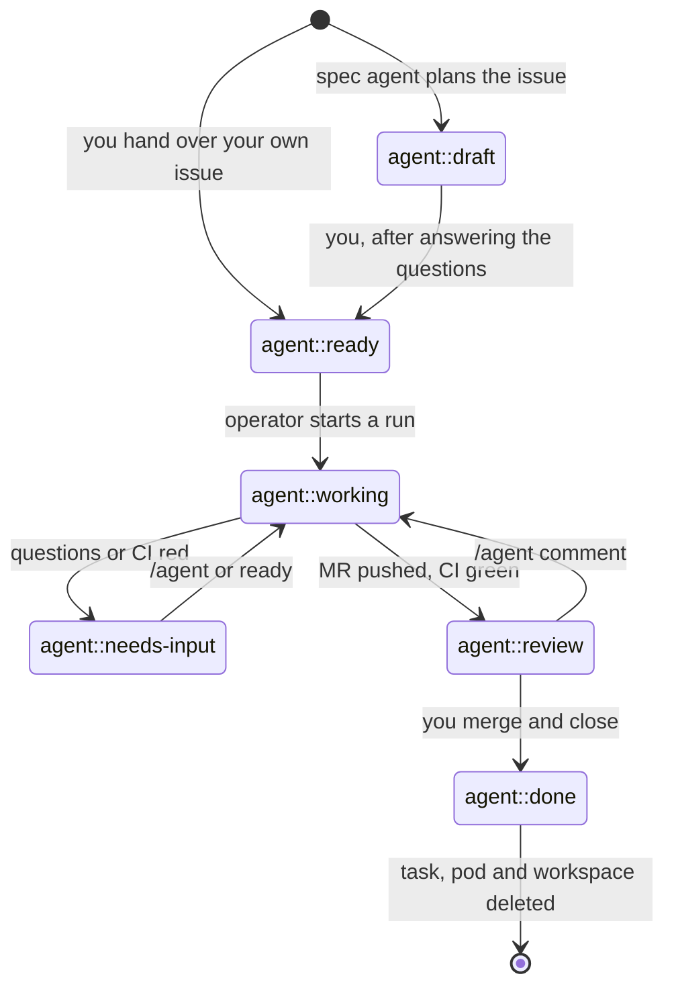

# Using the ai-operator from GitLab

Everything happens in GitLab. You write specs, answer questions, move cards
and review merge requests. The operator turns those actions into agent work.

## One-time setup in GitLab

Create these labels. Scoped labels (`::`) make sure an issue only ever has one
of each kind.

| Label | Set by | Meaning |
|-------|--------|---------|
| `agent::draft` | spec agent | sub-issue planned, waiting for you |
| `agent::ready` | you | hand the issue to the implementing agent |
| `agent::working` | operator | an agent run is requested or running |
| `agent::needs-input` | agent | the agent has questions, or the run failed |
| `agent::review` | agent | merge request is ready for your review |
| `agent::done` | you | finished; pod and workspace are deleted |
| `agent-profile::<name>` | spec agent / you | which agent profile implements the issue (e.g. `agent-profile::fast`, `agent-profile::strong`) |
| `ai-generated` | spec agent | issue was created by the spec agent |

Put `agent::draft`, `agent::ready`, `agent::working`, `agent::needs-input`,
`agent::review` and `agent::done` on an issue board as columns. An issue moves
through them like this:



You act on `draft`, `needs-input` and `review`. Everything in between,
including fixing a red pipeline, happens without you.

Create a **project access token** with role *Developer* and the scopes `api` and
`write_repository`. Protect your default branch. The agent only pushes
`agent/*` branches and opens draft merge requests.

## 1. Write the milestone spec

Create a milestone. Its description is the overarching spec for the whole
feature. Add the marker line `/agent spec` anywhere in the description.

```markdown
/agent spec

## Goal
Customers can pay with PayPal in the new checkout.

## Requirements
- ...
```

Within a poll interval (default 1 minute), a spec pod named like
`shop-spec-m3-checkout-v2` starts. It reads the spec and the repository, then
creates one **sub-issue per merge request** in the milestone. Each sub-issue
holds a self-contained sub-spec:

- the part of the milestone spec it implements, context and implementation
  plan (files, functions)
- acceptance criteria and a test plan
- `Depends on #…` for ordering
- **Open questions**, each with the default the agent would pick
- labels `ai-generated`, `agent::draft` and the chosen `agent-profile::…`

The milestone description is never modified. If you edit the spec later, the
spec agent runs again. It updates sub-issues that are still drafts and leaves
issues that are in progress, done, or created by hand alone.

## 2. Answer questions and hand the issue over

Answer the questions as comments on the issue. Check the profile label: change
`agent-profile::fast` to `agent-profile::strong` if the issue is harder than
the planner thought, or the other way round. Then move the issue to
**`agent::ready`**.

You can also hand over issues you wrote yourself. Just add `agent::ready`
(and optionally a profile label; without one, `agents.implement` is used).

## 3. The agent works

The operator moves the issue to `agent::working` and starts a pod named like
`shop-42-add-paypal-button`. In that pod:

1. The implementing agent (engine and model from the issue's profile) works on
   the branch `agent/42-add-paypal-button`. It follows your comments, runs the
   tests, and stops with questions if a design decision is unresolved.
2. The **bugbot** and **security** reviewers check the diff in parallel.
3. Blocker and major findings go back to the implementer (at most
   `review.maxIterations` times). Remaining findings are listed for you.
4. The branch is pushed and a **draft MR** `Closes #42` is opened, or a
   comment is added to the existing MR.

If the agent has questions, the issue moves to **`agent::needs-input`**.
Otherwise it stays in `agent::working` until the MR pipeline has run (see
[CI feedback](#ci-feedback)) and moves to **`agent::review`** once it is
green. "Review" therefore always means: tests and CI pass, a human can look.

## CI feedback

After every push, the operator follows the pipeline of the pushed commit:

| Pipeline | What happens |
|----------|--------------|
| running | the issue stays in `agent::working` |
| green (also: skipped, or waiting for manual jobs) | `agent::review` |
| red, first time | the failed jobs are retried once, to rule out flaky jobs |
| still red, the same jobs also fail on the default branch | `agent::review` with a comment: not caused by this change |
| still red | the agent gets the failing jobs and the end of their logs and fixes the cause (a "CI fix" comment on the MR) |
| still red after 2 fix rounds | `agent::needs-input` with the failing jobs |
| canceled | `agent::review` with a comment |
| no pipeline within 10 minutes | `agent::review` (the project has no CI for this commit) |

The fix rounds count from the last push you triggered (`/agent …` or moving
the issue to ready), so every new instruction gets two fresh rounds. CI fix
runs skip the reviewer agents. Job logs reach the agent as untrusted data.
Configure the loop in `spec.ci` (see [configuration.md](configuration.md));
`ci.disabled: true` restores "review right after the push".

## 4. Iterate

| You do | Effect |
|--------|--------|
| comment `/agent <instructions>` on the issue or the MR | another run; the agent resumes its session and gets your new comments |
| move the issue back to `agent::ready` | another run (e.g. after answering questions) |
| discuss normally (no `/agent` prefix) | nothing; no tokens are spent |
| push to the agent's branch yourself | the next run continues from your commits |
| change the profile label | the next run uses that profile |

`/agent` must be the first word of the comment. `/agents are great` does not
trigger a run.

## 5. Finish

Merge the MR, then close the issue (the MR's `Closes #42` does that) or move
it to `agent::done`. The task, its pod and its workspace are deleted.

## Usage and rate limits

Subscriptions have usage windows, and APIs have rate limits. When an agent
CLI reports such a limit, the run is **paused, not failed**:

- The issue stays in `agent::working` and gets one comment: "⏳ The `claude`
  engine reached a usage limit. The run is paused and retried automatically
  at …".
- The run is retried at the reset time the CLI reports. If it doesn't
  report one, the wait is 5 minutes, doubling with every further limit hit
  up to 1 hour (`spec.lifecycle.usageLimitBackoff` /
  `maxUsageLimitBackoff`).
- Paused runs don't count towards `maxRunsPerTask` and don't take a run slot.
- Limits belong to your credentials, so they apply to the whole project:
  other issues that need the same engine wait too instead of hitting the
  limit again. Issues on another engine (e.g. `fast` on cursor while claude
  is limited) keep working.
- If the limit hits during a review fix round, the work done so far is pushed
  with the open findings instead of being held back.
- After 20 deferrals of the same run it is reported as failed, in case an
  error was mistaken for a limit.

Nothing to do on your side; `kubectl get agenttasks -o wide` shows the retry
time, and the project status lists the active limits:

```sh
kubectl -n agents get agentproject <name> -o jsonpath='{.status.usageLimits}'
```

## Issues that stay open

Nothing is lost while an issue waits:

- **Right after each run** (1 minute later) the pod is stopped. The workspace
  (checkout, build caches, agent session) is kept, so the next run starts a
  new pod on it and picks up where the last one stopped. While the MR
  pipeline runs, no pod is needed: the operator follows the pipeline itself.
  After a **failed** run the pod stays for an hour, so you can read its logs
  (`kubectl logs`, see below).
- **14 days** after the last run the workspace is deleted as well.
- Any new `/agent` comment or move to ready brings the task back. After the
  workspace was deleted, the next run clones fresh and reads the full issue
  thread.

Both durations are configurable (`spec.lifecycle`).

## Watching from Kubernetes

```sh
kubectl -n agents get agentprojects
kubectl -n agents get agenttasks          # type, issue, phase, last result, runs, cost
kubectl -n agents get agenttasks -o wide  # + merge request URL
kubectl -n agents logs -f shop-42-add-paypal-button -c runner   # what the runner does
kubectl -n agents logs -f shop-42-add-paypal-button -c agent    # agent server
```

Task phases: `Pending`, `Queued` (waiting for `maxConcurrentRuns`), `Running`,
`Waiting` (paused by a usage limit), `Idle`, `Hibernated`, `Archived`,
`Blocked` (hit `maxRunsPerTask`).

To force a task to stop its pod, set `spec.suspend: true` on the AgentTask. To
stop all activity for a project, set `spec.suspend: true` on the AgentProject.
